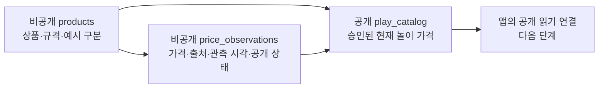

# 상품 DB 준비와 Supabase 프로젝트 확인

현재 앱은 내장 예시 상품 6개를 사용한다. 이번 단계에서는 Supabase에 적용할 DB 구조·예시 데이터와 로컬 PostgreSQL 검사를 준비했다. 앱의 원격 DB 읽기와 기존 Supabase 프로젝트 적용은 연결 확인 후 진행한다.

## 파일과 실행

| 파일 | 역할 |
| --- | --- |
| supabase/migrations/20261112090000_catalog.sql | 상품·가격 이력·공개 카탈로그·권한 |
| supabase/seed.sql | 직접 만든 예시 6개. 실제 이마트 가격이 아님 |
| scripts/database/database.test.mjs | 실제 SQL 제약·권한·공개 조건 검사 |
| scripts/database/package-lock.json | DB 검사 엔진 버전 재현 |

저장소 루트의 Git Bash에서:

```bash
npm --prefix scripts/database ci
npm --prefix scripts/database test
```

PGlite 0.5.16을 별도 개발 의존성으로 사용한다. 이 PC에서 PostgreSQL 18.6 엔진·Node 26·Windows 실행을 확인했다. 메모리 DB를 생성하고 검사 후 닫으므로 Supabase 계정·DB 비밀번호·Docker 없이 실행할 수 있다. 모바일 앱 번들에는 이 검사 엔진을 넣지 않는다.

전체 코드·DB·갤럭시 검사와 자동 커밋은 기존 실행기를 사용한다.

```bash
cd apps/mobile
npm run verify:device -- --message "feat: 상품 DB 구조와 공개 권한 검증 추가"
```

DB 검사만 통과한 것으로 자동 커밋하지 않는다. 실행기는 DB 검사 이후 앱 검사와 갤럭시 전체 검사를 완료하고 파일 지문이 유지되는 경우에만 결과 기록과 커밋을 만든다.

## 데이터 구조



상품의 이름·규격과 가격 관측을 분리한다. 같은 상품의 가격이 바뀌면 관측 행을 새로 추가한다. 관측 사실과, 이미 관측이 있는 상품의 이름·규격은 덮어쓰지 못하게 했다. 다른 규격은 새 상품 ID로 관리한다.

가격은 원래 금액과 놀이 금액을 별도로 보관한다. 이번 단계는 exact 규칙만 지원하므로 두 금액이 같아야 한다. numeric 값에 정수·양수·범위 제약을 걸고 공개 뷰에서 integer로 반환한다. integer 열에 소수를 넣었을 때 SQL이 먼저 반올림하는 일을 피하기 위한 선택이다.

예시 가격의 observed_at은 NULL이다. 실제 자료는 출처 URL·출처 상품 ID·실제 관측 시각과 유한한 공개 기한이 필요하다. created_at은 DB에 기록을 만든 시각이며 관측 시각을 대신하지 않는다.

## 공개되는 가격

상품이 활성 상태이고, 명시적으로 published로 선택한 가격 중 아래 조건을 모두 만족해야 공개한다.

- app_approved 권리 상태, 판매 가능, 조건 없는 가격
- 예시 또는 SSG.COM 이마트 온라인 채널
- 현재 한 개를 살 수 있는 10,000원 이하의 놀이 가격
- 미래 관측이 아니며 행사 시작 전·행사 종료 후·공개 기한 경과가 아님

한 상품에 published 관측은 하나만 허용한다. 현재 가격을 철회하거나 기한이 지나면 예전 가격으로 자동 복귀하지 않는다. 관리자가 기존 공개 행을 withdrawn으로 바꾸고 새 관측을 공개하는 작업은 한 트랜잭션에서 처리한다.

app_approved는 앱 표시 범위의 관리 상태다. 실제 사용권을 자동으로 확보하거나 책·GitHub 재배포 권한을 뜻하지 않는다. seed에는 자체 예시만 넣었다. 놀이돈 예산이나 반올림 규칙을 바꿀 때에는 카탈로그 공개 조건과 앱 규칙을 함께 검토한다.

## 읽기와 쓰기 권한

catalog_private 스키마는 앱의 원본 직접 읽기 대상이 아니다. anon·authenticated는 비공개 스키마 USAGE가 없고, 공개 뷰가 필요한 원본 열만 SELECT 권한을 받는다. security_invoker 뷰가 실제 호출자의 열 권한과 RLS를 적용한다. approval_notes·내부 출처 ID·생성 시각은 공개 뷰에 포함하지 않는다.

일반 역할의 INSERT·UPDATE·DELETE·TRUNCATE 권한은 회수한다. 서버 관리자 service_role만 원본 자료를 관리한다. 이 역할은 RLS를 우회하므로 관리자 비밀 키를 앱이나 저장소에 넣지 않는다. 아동 사용자 계정은 만들지 않는다.

## 기존 Supabase 프로젝트를 사용할 수 있는지 확인

사용자에게 Supabase 계정과 기존 프로젝트가 있음을 확인했다. 아직 해당 프로젝트의 연결·테이블 조회·적용은 완료하지 않았다. 연결 후 다음 정보를 먼저 읽어서 판단한다.

1. 프로젝트 이름·상태와 다른 운영 서비스에서 사용하는지
2. PostgreSQL 15 이상인지, anon·authenticated·service_role이 있는지
3. catalog_private 스키마와 public.play_catalog 이름이 이미 사용 중인지
4. Data API 노출 스키마에 비공개 원본 스키마가 포함되지 않는지
5. 기존 테이블·권한에 영향을 주지 않고 새 구조를 적용할 수 있는지

마이그레이션은 새 객체를 만드는 SQL이며 기존 객체를 삭제하거나 덮어쓰는 SQL이 아니다. 이름 충돌이 있으면 먼저 기존 구조를 확인한다. 무조건 삭제하거나 같은 이름의 테이블을 재사용하지 않는다. 운영 중인 다른 서비스와 공유할 경우에는 역할·공개 스키마·관리 범위를 함께 검토한다.

호환성과 대상 프로젝트를 확인한 후 마이그레이션, seed 순서로 적용한다. seed의 ON CONFLICT DO NOTHING은 기존 관리 상태를 덮어쓰지 않는다. seed를 다시 실행해도 철회한 가격이 자동 공개되지 않는다.

그다음 실제 Supabase의 공개 키로 카탈로그 읽기와 노출 범위를 확인하고 앱 연결을 구현한다. 로컬 PGlite 검사는 Supabase 키의 역할 매핑·PostgREST·HTTP 통신·실제 프로젝트 설정을 대신하지 않는다.

[Supabase RLS](https://supabase.com/docs/guides/database/postgres/row-level-security) · [PostgreSQL 뷰 권한](https://www.postgresql.org/docs/current/sql-createview.html) · [Supabase 키 종류](https://supabase.com/docs/guides/getting-started/api-keys) · [PGlite](https://pglite.dev/docs/)
