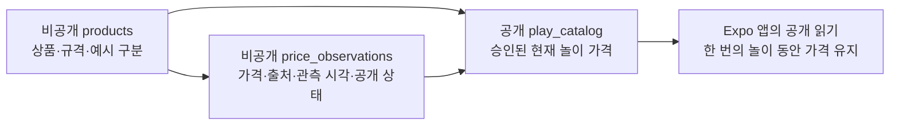

# 상품 DB와 Supabase 앱 연결

상품 DB 기반은 `06cb47c`, 앱의 원격 읽기·실패 처리와 갤럭시 검증은 `1f994f3`에 포함했다. 실제 페이지에서 확인한 가격 3개의 비공개 저장·재조회·검사는 `0184ef9`에 포함했고 사용자가 GitHub 업로드를 확인했다. 공개 카탈로그는 자체 예시 6개다. 다음 단계는 본인 갤럭시에서 비공개 자료를 확인하는 개발용 미리보기다.

## 파일과 실행

| 파일 | 역할 |
| --- | --- |
| supabase/migrations/20261112090000_catalog.sql | 상품·가격 이력·공개 카탈로그·권한 |
| supabase/migrations/20261112102641_manual_price_observations.sql | 직접 확인한 실제 가격의 비공개 보관 제약 |
| supabase/seed.sql | 직접 만든 예시 6개. 실제 이마트 가격이 아님 |
| scripts/database/database.test.mjs | 실제 SQL 제약·권한·공개 조건 검사 |
| scripts/database/manual-observations.mjs | 관측 입력 검증과 원자적인 적재 SQL 생성 |
| scripts/database/manual-observations.test.mjs | 잘못된 입력·조건·중복 처리 검사 |
| scripts/database/package-lock.json | DB 검사 엔진 버전 재현 |

저장소 루트의 Git Bash에서:

```bash
npm --prefix scripts/database ci
npm --prefix scripts/database test
```

PGlite 0.5.16을 별도 개발 의존성으로 사용한다. 이 PC에서 PostgreSQL 18.6 엔진·Node 26·Windows 실행을 확인했다. 메모리 DB를 생성하고 검사 후 닫으므로 Supabase 계정·DB 비밀번호·Docker 없이 실행할 수 있다. 모바일 앱 번들에는 이 검사 엔진을 넣지 않는다.

전체 코드·DB·갤럭시 검사와 자동 커밋은 기존 실행기를 사용한다.

```bash
cd apps/mobile
npm run verify:device -- --message "feat: SSG 실제 가격 비공개 관측 저장 추가"
```

DB 검사만 통과한 것으로 자동 커밋하지 않는다. 실행기는 DB 검사 이후 앱 검사와 갤럭시 전체 검사를 완료하고 파일 지문이 유지되는 경우에만 결과 기록과 커밋을 만든다.

## 데이터 구조



상품의 이름·규격과 가격 관측을 분리한다. 같은 상품의 가격이 바뀌면 관측 행을 새로 추가한다. 관측 사실과, 이미 관측이 있는 상품의 이름·규격은 덮어쓰지 못하게 했다. 다른 규격은 새 상품 ID로 관리한다.

가격은 원래 금액과 놀이 금액을 별도로 보관한다. 이번 단계는 exact 규칙만 지원하므로 두 금액이 같아야 한다. numeric 값에 정수·양수·범위 제약을 걸고 공개 뷰에서 integer로 반환한다. integer 열에 소수를 넣었을 때 SQL이 먼저 반올림하는 일을 피하기 위한 선택이다.

예시 가격의 observed_at은 NULL이다. 실제 자료는 출처 URL·출처 상품 ID·실제 관측 시각과 유한한 공개 기한이 필요하다. created_at은 DB에 기록을 만든 시각이며 관측 시각을 대신하지 않는다.

## 실제 페이지에서 확인한 가격 보관

`manual_observation`은 공식 이마트몰 상세 페이지를 직접 열어 확인한 기록이다. `approved_api`·`approved_file`과 구분하고, 승인된 데이터 공급을 사용했다고 표시하지 않는다. 상품은 비활성, 관측은 `is_sample=false`, `rights_status=unknown`, `publication_state=draft`로 저장한다. 이 출처를 승인·공개 상태로 바꾸는 입력은 DB 제약으로 거절한다. 향후 승인된 자료를 받으면 기존 관측을 덮어쓰지 않고 새로운 관측을 기록한다.

입력 검증기는 한 번에 최대 20개를 다루며 상품 ID·공식 출처 URL의 일치, 원 단위 정수 가격, 규격, 확인 시각, 재고 표시를 확인한다. 금액은 표시된 상품 단위 가격이며 카드혜택가·적립금을 대신 넣지 않는다. 확인하지 않은 점포는 NULL, 배송지별 재고를 알 수 없으면 unknown으로 둔다. 관측 후 24시간 기한은 내부 기준이며 판매자의 가격 보장 기간이 아니다.

실제 입력과 생성한 SQL은 Git에서 제외된 `.artifacts/catalog/`에 보관한다. 원본 입력의 오류나 기존 상품·관측과의 충돌이 있으면 부분 적재하지 않고 전체 작업을 실패시킨다. 같은 관측을 다시 적용하는 경우에는 중복 이력을 만들거나 기존 사실을 바꾸지 않는다. 이 모듈 자체는 웹사이트에 접속하거나 DB 인증 정보를 읽지 않는다.

공개 뷰와 일반 앱 목록은 이 비공개 관측을 반환하지 않는다. 실제 자료 적재 확인은 관리자 조회로, 공개 목록에 나오지 않는지는 공개 역할·HTTP·갤럭시 검사로 나누어 확인한다. [실제 가격 관측의 개발 기록](book/chapters/04b-real-price-intake.md)

2026-11-12 19:29:28 KST에 실제 Supabase 재조회로 입력과 저장된 상품·관측의 모든 필드를 비교했다. 비공개 실제 상품 3개·관측 3개, 기존 예시를 포함한 전체 상품 9개·관측 9개를 확인했다. 같은 적재 SQL을 다시 실행해도 이 수가 늘지 않았고, 공개 뷰는 예시 6개·실제 자료 0개였다. 로컬 검사는 DB 통합 48개·입력 15개, 합계 63개가 통과했다. 이후 전체 앱·갤럭시 결과는 같은 커밋의 검증 기록과 구분해서 확인한다.

## 개발용 미리보기로 비공개 자료 확인

사용자가 본인 갤럭시의 개발용 미리보기를 선택했다. Supabase 연결 도구에서 비공개 관측을 새로 조회하고, 필요한 필드만 `.artifacts/catalog/private-preview.json`에 저장한다. 이 조회는 원래 상품 페이지의 가격을 다시 확인하는 작업이 아니다. 관측 시각과 DB 조회 시각을 구분해 남긴다.

컴퓨터의 미리보기 서버는 `127.0.0.1:8092`에만 연결을 받으며, 실행마다 만든 임시 토큰과 USB 연결을 통해 휴대전화에 필요한 자료만 전달한다. 관리자 키·승인 메모를 앱으로 전달하지 않는다. JSON 자료는 모바일 소스에 import하지 않으며 Git에서도 제외한다.

앱의 개발 설정이 켜진 경우에만 별도 읽기 전용 미리보기를 표시한다. 원 가격·규격·출처·확인 시각·재고 상태를 보여 주지만 장바구니 상품을 교체하지 않는다. 오래된 관측을 현재 가격이라고 부르지 않으며, 미리보기 실행이 `unknown`·`draft`를 바꾸거나 앱 공개 승인을 뜻하지 않는다.

일반 공개 HTTP 검사는 계속 자체 예시 6개를 확인한다. 개발용 미리보기 검사는 별도의 응답·자료 지문·기기 화면으로 확인하고, 배포 번들에 실제 상품 자료나 임시 토큰이 포함되지 않았는지도 확인한다. 실행 방법과 실제 결과는 [개발용 실제 가격 미리보기 기록](book/chapters/04c-real-price-preview.md)에 남긴다.

## 공개되는 가격

상품이 활성 상태이고, 명시적으로 published로 선택한 가격 중 아래 조건을 모두 만족해야 공개한다.

- app_approved 권리 상태, 판매 가능, 조건 없는 가격
- 예시 또는 SSG.COM 이마트 온라인 채널
- 현재 한 개를 살 수 있는 10,000원 이하의 놀이 가격
- 미래 관측이 아니며 행사 시작 전·행사 종료 후·공개 기한 경과가 아님

한 상품에 published 관측은 하나만 허용한다. 현재 가격을 철회하거나 기한이 지나면 예전 가격으로 자동 복귀하지 않는다. 관리자가 기존 공개 행을 withdrawn으로 바꾸고 새 관측을 공개하는 작업은 한 트랜잭션에서 처리한다.

app_approved는 앱 표시 범위의 관리 상태다. 실제 사용권을 자동으로 확보하거나 책·GitHub 재배포 권한을 뜻하지 않는다. seed에는 자체 예시만 넣었다. 놀이돈 예산이나 반올림 규칙을 바꿀 때에는 카탈로그 공개 조건과 앱 규칙을 함께 검토한다.

## 읽기와 쓰기 권한

catalog_private 스키마는 앱의 원본 직접 읽기 대상이 아니다. anon·authenticated는 비공개 스키마 USAGE가 없고, 공개 뷰가 필요한 원본 열만 SELECT 권한을 받는다. security_invoker 뷰가 실제 호출자의 열 권한과 RLS를 적용한다. approval_notes·내부 출처 ID·생성 시각은 공개 뷰에 포함하지 않는다.

일반 역할의 INSERT·UPDATE·DELETE·TRUNCATE 권한은 회수한다. 서버 관리자 service_role만 원본 자료를 관리한다. 이 역할은 RLS를 우회하므로 관리자 비밀 키를 앱이나 저장소에 넣지 않는다. 아동 사용자 계정은 만들지 않는다.

## 적용한 Supabase 프로젝트 확인

사용자가 새 store-price 프로젝트를 만들었다. 적용 전 브라우저에서 Healthy 상태, FREE 요금제, Singapore(ap-southeast-1), PostgreSQL 17.11을 확인했다. catalog_private와 public.play_catalog가 없고 public 객체 수가 0인 것도 확인했다. anon·authenticated는 RLS 우회 권한이 없고 service_role은 우회할 수 있었다.

사용자가 SQL Editor에서 마이그레이션과 seed를 차례로 실행해 성공했다고 보고했다. 이후 SQL Editor의 공개 뷰 6행을 직접 읽었고, Node fetch의 공개 키 요청에서 HTTP 200·Content-Range 0-5/6과 이름·단위·가격·is_sample=true를 확인했다. 이 결과는 앱·실기기 검사와 구분한다.

다른 프로젝트에 적용할 때도 이름·용도·PostgreSQL 15 이상 여부, 기본 역할, 객체 이름 충돌, Data API 노출 범위를 먼저 확인한다. catalog_private는 노출 스키마에 추가하지 않는다. 마이그레이션은 새 객체를 만드는 SQL이며, 기존 객체를 무조건 삭제하거나 덮어쓰지 않는다.

마이그레이션 다음에 seed를 적용한다. seed의 ON CONFLICT DO NOTHING은 기존 관리 상태를 덮어쓰지 않는다. 반복 실행해도 철회한 가격이 자동 공개되지 않는다.

## 앱의 공개 연결 설정

처음 설정하는 작업 폴더의 Git Bash에서 다음 명령을 사용한다. -n은 이미 있는 .env.local을 보존한다.

```bash
cd apps/mobile
cp -n .env.example .env.local
```

.env.local에서 다음 두 변수의 가짜 값을 본인 프로젝트의 값으로 바꾼다.

| 변수 | 값 |
| --- | --- |
| EXPO_PUBLIC_SUPABASE_URL | 본인 프로젝트 Connect 화면에서 복사한 HTTPS URL |
| EXPO_PUBLIC_SUPABASE_PUBLISHABLE_KEY | 본인 프로젝트의 publishable 키 |

실제 키 값은 문서·검사 로그에 출력하지 않는다. .env.local은 Git에서 제외하고 변수 이름과 가짜 값만 있는 .env.example을 공유한다. 이 제외 규칙이 앱 번들 안의 값을 숨겨 주는 것은 아니다. EXPO_PUBLIC_ 값은 앱에 공개되므로 secret·service_role 키는 넣지 않는다.

Expo SDK 58은 표준 .env 파일을 읽고 process.env.EXPO_PUBLIC_이름의 직접 점 표기를 번들에 반영한다. .env.test·.env.staging을 별도 환경 선택 방법으로 사용하지 않는다. 변경한 값을 보려면 앱을 완전히 새로고침한다. [Expo 환경 변수](https://docs.expo.dev/guides/environment-variables/)

publishable 키는 공개 클라이언트용이며 그 자체로 읽기 전용 키는 아니다. 이 프로젝트의 GRANT·RLS가 읽기를 허용하고 원본 쓰기를 막는다. 현재 앱은 별도 아동 계정이나 사용자 로그인 없이 GET /rest/v1/play_catalog를 요청하며, 키는 apikey 헤더에만 전달한다. [Supabase API 키](https://supabase.com/docs/guides/getting-started/api-keys) · [REST API](https://supabase.com/docs/guides/api)

## 목록을 읽고 새 놀이를 시작하는 흐름

처음에는 “가게 물건을 가져오고 있어요”를 표시한다. 앱은 필요한 열을 선택하고 sort_order·id 순으로 요청한다. 본문을 읽는 시간까지 포함한 제한 시간은 12초이며, HTTP 응답·자료 형식·가격·중복 ID·전체 행 수를 검증한다. 원 단위 정수 1~10,000원과 원 가격·놀이 가격 일치가 필요하다. 목록이 1,000개를 넘거나 일부가 누락된 응답은 부분 목록으로 시작하지 않는다.

| 상태 | 화면과 선택 |
| --- | --- |
| 조회 중 | 기다림 안내 |
| 조회 성공 | 원격 출처를 표시하고 받은 목록으로 놀이 시작 |
| 빈 목록 | “아직 준비된 물건이 없어요”, 다시 불러오기 또는 예시 선택 |
| 설정 없음 | “가게를 준비하고 있어요”, 다시 불러오기 또는 예시 선택 |
| 통신·자료 오류 | “물건을 불러오지 못했어요”, 다시 불러오기 또는 예시 선택 |

연결 오류를 숨기고 내장 예시로 자동 전환하지 않는다. 사용자가 **예시 상품으로 놀이하기**를 누르면 원격 요청을 중단하고 내장 예시 6개로 시작한다. 늦게 끝난 이전 요청이 선택한 목록을 덮어쓰지 않게 했다. 원격 예시와 내장 예시는 모두 예시임을 표시하며 가져온 경로도 구분한다.

받은 목록과 가격은 한 번의 놀이 동안 유지한다. 원격 영수증에서 **다시 장보기**를 누르면 목록을 다시 조회하고 빈 장바구니·놀이돈 10,000원으로 시작한다. 내장 예시에서는 같은 예시로 새 놀이를 시작한다. 장바구니·돈 선택·채점·영수증은 메모리에만 남고 재시작하면 초기화된다. 원격 자료를 저장하는 영구 오프라인 캐시는 이번 범위에 없다.

## 원격 조회와 전체 검사 구분

사전 확인에서는 Node fetch로 실제 공개 목록을 읽었다. 로컬 PGlite 검사는 Supabase 키의 역할 매핑·PostgREST·HTTP 통신·실제 프로젝트 설정을 대신하지 않는다.

원격 검사 파일은 scripts/device/catalog-http-check.mjs다. 별도 npm 명령을 만들지 않고 기존 자동 실행기의 catalog-http-before·catalog-http-after 단계에서 검사한다. 공개 목록을 앱과 같은 검증 함수로 읽어 예시 6개와 비교하고, 비공개 원본 스키마와 공개 뷰의 approval_notes 접근이 거부되는지 읽기 요청으로 확인한다. 이 HTTP 검사는 서버 자료를 추가·수정·삭제하지 않는다.

실행기는 환경 설정을 검사하고 앱 검사·번들·새 개발 서버에 같은 설정을 전달한다. 환경 파일이나 실제 적용 값이 검사 중 달라졌는지 지문으로 확인한다. 출력에는 키 대신 상품 수와 검증 결과를 남긴다.

`1f994f3`에서는 앱 단위 검사 93개, DB 검사 34개, 원격 검증기 단위 검사 10개와 타입·ESLint·세 플랫폼 번들·갤럭시 전체 검사가 통과했다. 실제 공개 키로 예시 6개 일치와 비공개 스키마·승인 메모 접근 차단도 확인했다. 별도 브라우저 검사에서는 잘못된 클라이언트 키로 오류를 만들고 내장 예시 선택 후 사과 1개의 1,500원·잔액 8,500원을 확인했다. [연결 단계의 개발 과정](book/chapters/04a-supabase-catalog.md)

위 결과는 앞 단계의 근거다. 현재 변경의 최종 결과는 같은 커밋의 [검증 기록](book/verification/latest-android.md)에서 실행 기준 HEAD와 각 단계 결과를 확인한다. 이전 실행 기록을 현재 코드의 검증으로 대신하지 않는다.

[Supabase RLS](https://supabase.com/docs/guides/database/postgres/row-level-security) · [PostgreSQL 뷰 권한](https://www.postgresql.org/docs/current/sql-createview.html) · [PGlite](https://pglite.dev/docs/)
