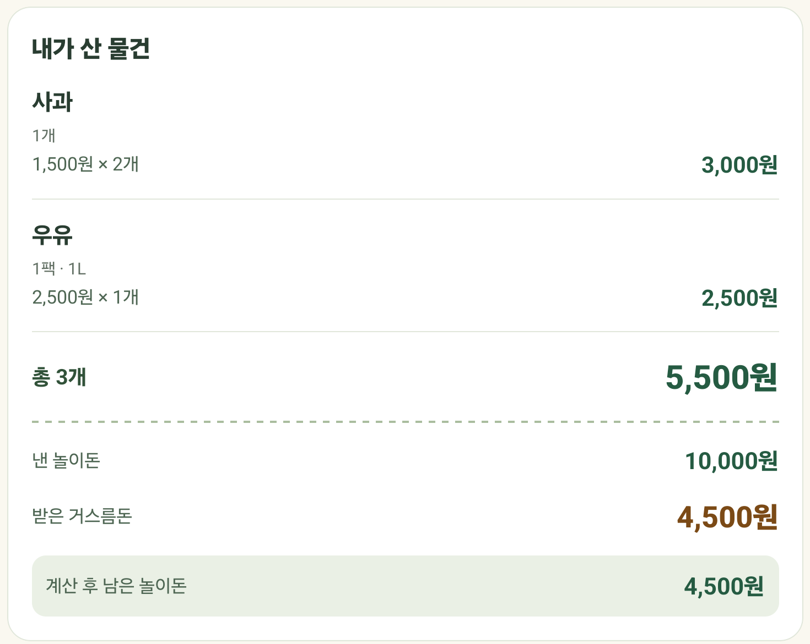
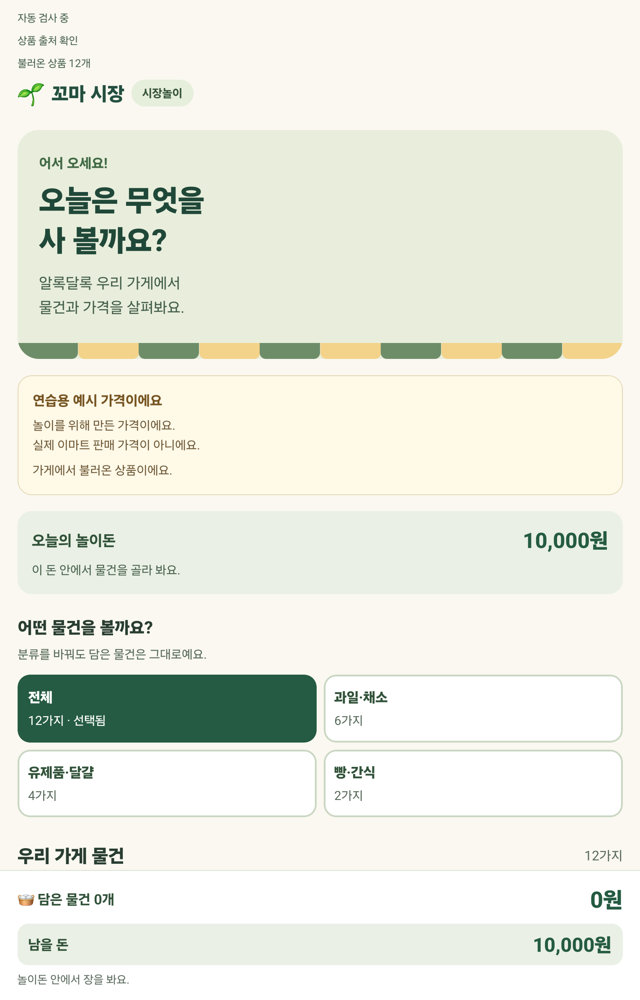
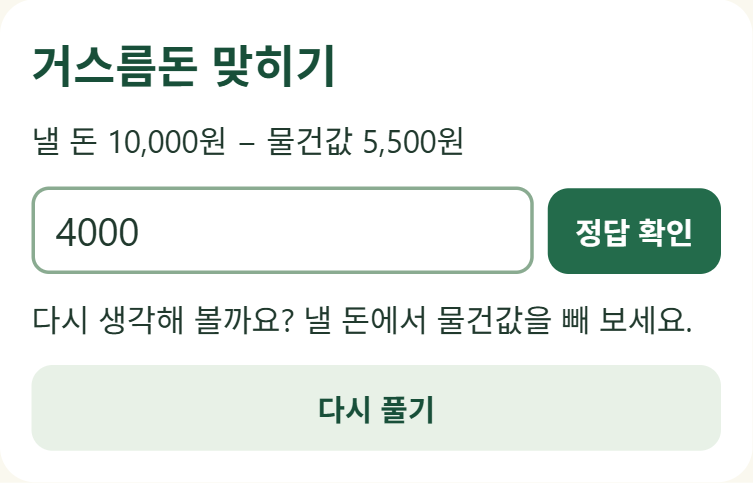

# 1장 우리가 만들 앱부터 살펴보기

책을 펴자마자 코드를 입력하기 전에 마지막 화면을 한 번 보자. **사과 2개, 우유 1팩, 합계 5,500원.** 마지막에 이런 영수증을 받는다면 첫 버전은 제 일을 한 것이다. 목표를 이렇게 구체적으로 적어 두면 다음에 무엇을 만들지 판단하기 쉽다.

그림 1-1. 완성 앱의 Android 태블릿 영수증에서 품목과 합계를 발췌했다. 10장에서는 이 영수증을 코드로 만든다.

## 1.1 꼬마 시장의 사용자와 학습 목표

꼬마 시장을 만드는 사람은 이 책을 읽는 독자다. 완성된 앱을 쓸 사람은 상품 가격을 읽고 덧셈·뺄셈을 연습하는 초등학교 저학년 아이다. 두 사람에게 필요한 정보가 다르다. 개발자는 “왜 값이 0인가?”를 알고 싶다. 아이는 “아무것도 담지 않았어. 먼저 상품을 골라 볼까?”라는 안내가 필요하다.

종이에 사과와 우유를 그려 놓고 시작해 보자. 사과 밑에는 ‘1개 1,500원’, 우유 밑에는 ‘1팩 2,500원’이라고 쓴다. “우유 두 개”라고만 쓰면 우유 한 팩의 부피를 말하는지, 장바구니 수량을 말하는지 모호하다. 앱에서는 상품에 적힌 단위와 **몇 번 담았는지**를 따로 표현한다.

이제 아이에게 맡길 일을 동사로 적는다. 가격을 **읽고**, 상품을 **담고**, 돈을 **고르고**, 거스름돈을 **입력하고**, 영수증을 **확인한다**. ‘가격 교육 기능’ 같은 추상적인 이름보다 실제 화면과 버튼을 정하기 좋다.

| 아이가 하는 말 | 화면이 보여 줄 정보 | 개발자가 확인할 것 |
| --- | --- | --- |
| 사과를 하나 더 담을래 | 사과 수량과 새 합계 | 한 번 누르면 정확히 1개 늘어나는가 |
| 이 돈으로 살 수 있어? | 남을 돈 또는 부족한 돈 | 예산과 지불액을 구분하는가 |
| 거스름돈이 얼마지? | 숫자 입력칸과 짧은 안내 | 빈칸과 0원을 따로 처리하는가 |
| 한 번 더 할래 | 새 장바구니 | 앞 놀이의 답과 선택이 사라졌는가 |

아이에게 이름이나 학교를 물을 이유가 없다. 계산 연습을 위해 필요한 것은 현재 담은 상품과 금액이다. 이처럼 학습 목표에서 시작하면 화면과 저장할 정보가 함께 줄어든다.

## 1.2 상품 선택부터 영수증까지 전체 흐름 살펴보기

다음 순서를 손가락으로 짚으며 종이 위에서 먼저 장을 보자. 중간에 계산이 달라지는 위치에 표시한다.

1. 상품 목록에서 사과를 한 번 담는다. 장바구니는 1개, 1,500원이다.
2. 사과를 하나 더 담는다. 장바구니는 2개, 3,000원이다.
3. 우유 한 팩을 담는다. 사과와 우유 두 **종류**를 샀지만 수량 합계는 **3개**다.
4. 10,000원을 낼 돈으로 고른다. 퀴즈에는 아직 정답을 표시하지 않는다.
5. 4,500원을 입력해 답을 확인하고 계산을 완료한다.
6. 영수증의 사과 줄에는 3,000원, 우유 줄에는 2,500원이 보인다. 다시 장보기를 누르면 0개로 돌아간다.

목록에 보이는 상품과 장바구니에 담은 상품도 구별하자. ‘유제품·달걀’ 분류를 누르면 사과 카드는 화면에서 사라진다. 그래도 아까 담은 사과 두 개는 장바구니에 남아야 한다. 이 한 문장이 5장의 분류 기능과 6장의 장바구니 기능을 나누는 기준이 된다.

**예측해 보기.** 세 개를 담은 상태에서 사과 한 개를 뺀다면 화면에 무엇이 남을까? 사과 한 개, 우유 한 팩, 두 종류, 총 2개, 합계 4,000원이다. “2개”만 확인하면 금액 계산의 오류를 놓칠 수 있으므로 수량과 합계를 한 쌍으로 본다.

### 화면을 읽고 아이가 할 일을 적어 보기

그림 1-2. 설치한 검사 앱의 Android 시작 화면이다. 한 번도 담지 않은 상태에서 놀이돈과 장바구니에 각각 어떤 숫자가 보이는지 살펴본다.

화면을 가리고 종이에 두 칸을 그린다. 한 칸에는 ‘오늘 받은 돈’, 다른 칸에는 ‘지금까지 담은 물건값’이라고 쓴다. 사과를 하나 담았다고 가정하고 각각 어느 숫자가 바뀌는지 적는다. 아이가 받은 돈은 10,000원이고 물건값은 1,500원이다. 사과를 하나 담았다고 받은 돈까지 줄이지 않는다. 앱에서는 받은 돈, 물건값, 장을 본 뒤 남을 돈을 구별해 보여 준다.

그림 1-3. 9장에서 직접 만들 퀴즈의 PC 웹 미리보기. 아이가 다시 풀 때 필요한 두 숫자를 화면에서 찾아본다.

이번에는 사과 두 개와 우유 한 팩을 담았다. 아이가 거스름돈을 4,000원이라고 썼을 때, 다음 버튼에 무엇이라고 적으면 좋을까? 정답과 오답을 구분해도 아이가 답을 고칠 방법이 없으면 놀이는 멈춘다. ‘낼 돈에서 물건값을 빼 보세요’라는 문장, 여전히 입력할 수 있는 칸, 같은 장바구니가 필요하다. 아이가 정답을 고치면 그림 1-1의 영수증으로 이어진다.

종이에 다음 두 문장을 완성해 두자. ‘처음 시작하면 아이는 ___을 누를 수 있다.’ ‘거스름돈이 틀리면 아이는 ___을 바꾸고 다시 확인한다.’ 5장과 9장에서 만든 버튼과 입력칸이 그 문장에서 말하는 일을 실제로 하는지 확인하게 된다.

## 1.3 첫 버전에 넣을 기능과 다음에 추가할 기능 정하기

실습 노트에 세 칸을 그린다. 첫 칸에는 **한 번 장보기**, 둘째 칸에는 **여러 상황에서 사용하기**, 마지막 칸에는 **내 기기에 설치하기**라고 쓴다. 새 아이디어가 떠오르면 어느 칸의 목표에 필요한지 먼저 살핀다.

| 완성 시점 | 직접 만들 기능 | 통과 장면 |
| --- | --- | --- |
| 10장을 마친 뒤 | 예시 상품, 장바구니, 돈 선택, 퀴즈, 영수증 | 사과·우유를 사고 처음으로 돌아간다 |
| 16장을 마친 뒤 | DB 읽기, 내장 예시, 큰 글자, 화면 읽기 | 연결이 늦거나 글자가 커도 놀이를 끝낸다 |
| 20장을 마친 뒤 | 이름·아이콘, 설치 파일, 기기 확인 | 개발 서버를 끈 뒤 아이콘으로 앱을 연다 |

“어제 산 상품을 다시 보여 주자”라는 생각이 들 수 있다. 이 기능을 넣으려면 놀이를 끝낸 뒤에도 데이터를 보관할 장소, 지울 방법, 다시 불러올 화면이 필요하다. 이 책의 영수증은 현재 놀이가 끝난 순간의 내용을 보여 준다. 과거 영수증 목록을 만드는 일은 새 요구사항으로 적어 두면 된다.

## 1.4 놀이돈으로 계산하는 앱 설계하기

이 예에서는 기본 예산 10,000원으로 시작한다. 완성 앱의 50,000원 예산과 지폐는 [20.7절](#ch20-s7)에서 직접 고른다. 장바구니에 무엇이 들었는지와 얼마를 지불할지는 서로 다른 값이다. 물건값이 1,000원인 당근을 산다고 생각해 보자.

| 질문 | 계산 | 답 |
| --- | --- | ---: |
| 오늘 예산 중 장을 보고 나면 얼마가 남을까? | 10,000 − 1,000 | 9,000원 |
| 5,000원을 냈을 때 얼마를 돌려받을까? | 5,000 − 1,000 | 4,000원 |
| 1,000원을 냈을 때 얼마를 돌려받을까? | 1,000 − 1,000 | 0원 |

‘남은 돈’과 ‘거스름돈’은 어떤 경우에는 우연히 같다. 사과와 우유를 사고 만 원을 내는 대표 사례만 시험하면 둘을 뒤바꾼 코드를 발견하기 어렵다. 그래서 이 책은 **낸 돈이 예산과 다른 사례**도 반복해 사용한다.

아직 코드를 모르더라도 계산 규칙은 자기 말로 적을 수 있다. “담은 물건이 하나도 없으면 계산을 시작하지 않는다.” “낼 돈이 부족하면 부족한 금액을 안내한다.” “답을 맞힌 뒤 상품 수량을 바꾸면 새 문제를 풀어야 한다.” 이런 문장은 나중에 오류를 발견하는 시험 문제가 된다.

## 1.5 개발 단계와 완료 기준 적기

VS Code를 아직 설치하지 않았다면 메모장이나 종이 한 장이면 충분하다. 아래 표에서 ‘관찰’ 열을 비워 둔 뒤, 실제로 실행할 때 채운다.

| 조작 | 예상 | 실제 관찰 예시 |
| --- | --- | --- |
| 빈 장바구니에서 사과 하나 담기 | 총 1개, 1,500원 | 수량과 금액이 함께 변했다 |
| 사과를 하나 더 담고 한 개 빼기 | 사과 1개 | 줄이기 뒤에도 사과 카드가 남았다 |
| 마지막 한 개 빼기 | 0개, 0원 | 빈 장바구니 안내가 나타났다 |
| 우유 한 팩에 1,000원 내기 | 1,500원 부족 | 돈 선택 화면에서 부족액을 확인했다 |

예상과 관찰이 다르면 곧바로 여러 파일을 고치지 않는다. 무엇을 담았는지, 몇 번 눌렀는지, 어느 줄의 값이 달랐는지 적는다. 예를 들어 ‘합계 오류’보다 ‘사과 수량은 2인데 하단 합계가 1,500원으로 남음’이 다음 실험을 정하기 쉽다. 사과 수량 갱신과 합계 다시 계산 중, 후자를 먼저 살펴볼 수 있기 때문이다.

기록은 다음 장에서 이어서 쓸 작은 지도이기도 하다. 앱을 종료하거나 컴퓨터를 재시작하더라도 마지막으로 본 상태와 다음에 확인할 한 가지가 남는다.

## 1.6 AI에 작업을 요청하고 결과 직접 확인하기

AI를 사용해도 앱의 동작을 결정하는 사람은 독자다. 처음에는 작은 함수나 오류 문장 하나에 범위를 좁히는 것이 제일 쉽다. 아래 요청을 자신이 만든 앱에 맞게 바꿔 보자.

> 원 단위 정수로 계산하는 TypeScript 장바구니를 만들고 있어. 사과 단가는 1500, 우유 단가는 2500이야. 사과 두 개와 우유 한 개를 담았을 때 총수량과 총금액을 구하는 함수 한 개를 써 줘. 빈 장바구니도 예로 들어 줘.

답을 받으면 함수 이름보다 먼저 결과를 본다. 3개·5,500원인가? 빈 장바구니는 0개·0원인가? 우유 가격을 바꾸면 새 가격이 계산에 반영되는가? 마지막 질문은 결과에 5,500을 직접 적어 넣은 코드와 실제 계산하는 코드를 구별해 준다.

오류를 질문할 때는 실행한 **폴더, 명령, 첫 오류, 예상 결과**를 함께 적는다. 예를 들어 “apps/mobile 폴더에서 npm start를 입력했는데 package.json을 찾지 못했다. pwd에는 market-book만 나온다”라고 쓸 수 있다. 이미 답의 실마리가 보인다. 실행한 폴더를 잘못 짚었다. 실제 로그에 계정 키나 기기 식별값이 섞여 있으면 그 값은 가리고 오류 줄만 옮긴다.

**장 마무리 실습.** 빈 종이에서 ‘당근 한 개, 낼 돈 5,000원’ 시나리오를 시작해 영수증까지 써 보자. 물건값 1,000원, 예산에서 남을 돈 9,000원, 거스름돈 4,000원이 구분되면 준비가 끝났다. 다음 장에서는 그 종이 대신 코드를 쓸 자리와 실행할 터미널을 만든다.
