# 2장 필요한 프로그램과 계정 준비하기

오늘의 목표는 내 PC에서 **파일 하나를 만들고, 저장하고, 터미널에서 찾는 것**이다. 이 세 가지를 할 수 있으면 나중에 빨간 오류가 나도 어디에서 무슨 일을 했는지 돌아볼 수 있다. 프로그램은 사용할 때 설치한다. 4장까지 필요한 것은 VS Code, Node.js와 npm, Git과 Git Bash, Android의 Expo Go다.

| 도구 | 어디에서 여는가 | 이번 장의 완료 기준 |
| --- | --- | --- |
| VS Code | Windows 시작 메뉴 | 폴더 이름과 파일 내용이 함께 보인다 |
| Node.js / npm | 터미널 | 두 버전 명령이 각각 숫자를 돌려준다 |
| Git Bash / Git | 시작 메뉴 또는 VS Code 터미널 | 현재 위치와 변경한 파일을 볼 수 있다 |
| Expo Go | Android 기기 | 앱을 열 수 있고 지원하는 SDK를 확인했다 |

## 2.1 VS Code를 설치하고 Windows 실습 폴더 열기

먼저 두 창의 이름을 구별해 보자. **Windows 파일 탐색기**는 컴퓨터에 저장된 폴더와 파일을 찾는 프로그램이다. **Visual Studio Code(VS Code)**는 그 파일을 열고 코드를 쓰는 편집기다. 그림 2-1~2-5에서는 편집기를 설치하고, 그림 2-6에서는 파일 탐색기로 실습 폴더를 만든다.

### 공식 다운로드 페이지에서 설치 파일 고르기

1. Windows PC에서 브라우저를 열고 [VS Code 공식 다운로드 페이지](https://code.visualstudio.com/download)에 접속한다. 가운데 제목이 **Download Visual Studio Code**인지 본다.
2. 그림의 **Windows** 카드 안을 본다. 파란 **Download** 버튼 아래 작은 글자가 **x64 · User Installer**다. Windows 설정의 **시스템 → 정보 → 시스템 종류**에 ‘x64 기반 프로세서’라고 표시된 일반 Windows PC라면 이 버튼을 누른다. ‘ARM 기반 프로세서’라고 표시된 PC에서는 **Other builds → Arm64**의 Windows 사용자용 설치 파일을 선택한다.
3. 브라우저에서 다운로드가 끝나면 내려받은 `.exe` 파일을 연다. 파일 이름에는 보통 `VSCodeUserSetup`, 아키텍처, 버전 번호가 들어 있다. 브라우저에서 창을 닫았다면 `Ctrl+J`로 다운로드 목록을 다시 열 수 있다.

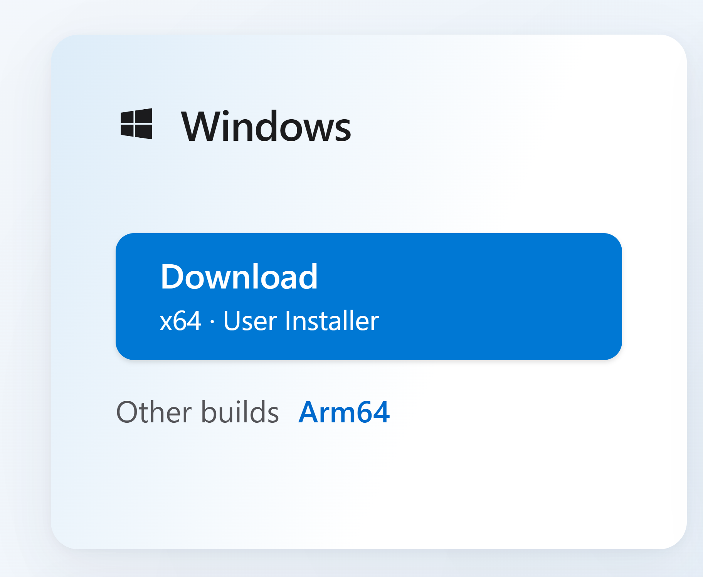

그림 2-1. Windows용 다운로드 카드. Windows 글자 아래 파란 버튼에서 x64와 User Installer를 함께 확인한다.

**어느 설치 파일을 고를까?** User Installer는 현재 Windows 사용자용이다. 책의 실습은 이 방식으로 진행한다. 설치 파일의 버전 번호는 책과 달라질 수 있다. 이름이 비슷한 Visual Studio라는 프로그램도 있으므로, 브라우저 주소의 `code.visualstudio.com`과 프로그램 이름 **Visual Studio Code**를 함께 확인한다. [Microsoft의 Windows 설치 안내](https://code.visualstudio.com/docs/setup/windows)

### 설치 마법사에서 선택하고 결과 확인하기

그림 2-2~2-5는 한국어 Windows에서 촬영한 VS Code 1.147.0 설치 창을 바탕으로 다시 그렸다. 창 안의 글자를 확대해서 읽을 수 있다. 실제 촬영본은 HTML의 그림 아래 링크와 PDF의 첨부 파일에서 열 수 있다. 이미 설치한 버전이 있거나 다른 버전을 내려받으면 일부 단계를 건너뛸 수 있다. 화면 위쪽 **단계 제목**을 기준으로 따라가자.

**사용권 계약.** 아래에 있는 **동의합니다**와 **동의하지 않습니다**는 둘 중 하나를 고르는 동그란 단추다. 내용을 읽고 동의한다면 **동의합니다 → 다음**을 누른다. 계속 진행할 수 있게 되면 오른쪽 아래의 ‘다음’ 글자가 진하게 보인다.

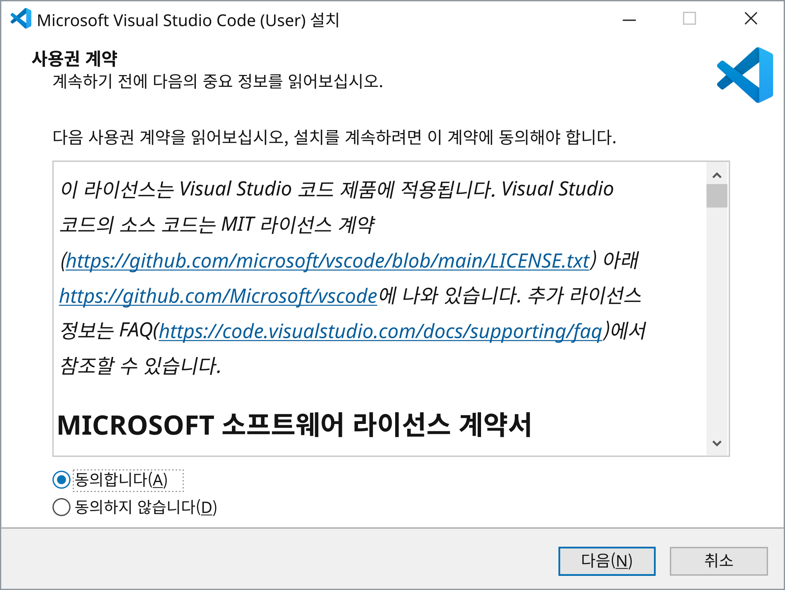

그림 2-2. 위쪽 상자에서 약관을 읽고, 상자 아래의 ‘동의합니다’와 창 오른쪽 아래의 ‘다음’을 차례로 찾는다.

**설치 위치·시작 메뉴 폴더.** 처음 설치할 때 설치 위치나 시작 메뉴 폴더를 묻는 창이 나타날 수 있다. 일반 사용자 설치라면 제안된 경로와 시작 메뉴 이름을 그대로 두고 각 화면에서 **다음**을 누른다. 나중에 만드는 `market-book`은 내가 작성하는 코드의 폴더다. 편집기 프로그램의 설치 위치와 구별해 두자.

**추가 작업 선택.** **PATH에 추가(다시 시작한 후 사용 가능)** 항목에 체크 표시가 있는지 확인한다. 이 선택을 하면 나중에 새 Git Bash에서 `code .`를 입력해 현재 폴더를 VS Code로 열 수 있다. 바탕 화면 바로가기와 탐색기 오른쪽 클릭 메뉴는 취향에 따라 고른다. 책의 기본 경로는 Windows 시작 메뉴에서 VS Code를 여는 방법이다.

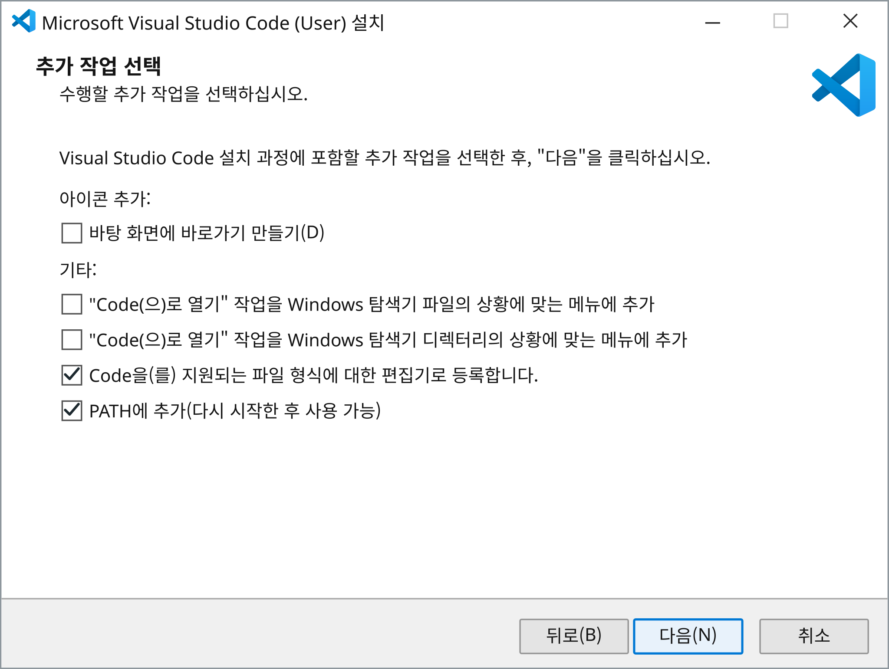

그림 2-3. ‘추가 작업 선택’에서 아래쪽 ‘PATH에 추가’를 확인하고 ‘다음’을 누른다.

**GitHub Copilot CLI.** 일부 버전은 별도의 명령줄 도구를 함께 구성할지 묻는다. 이 책에서 코드를 입력하고 앱을 실행하는 데에는 VS Code와 Git Bash를 사용한다. 그림처럼 **Don't add the copilot command**를 고르고 **다음**을 누르면 그 선택으로 진행할 수 있다. 이 화면이 없는 버전은 다음 단계로 간다.

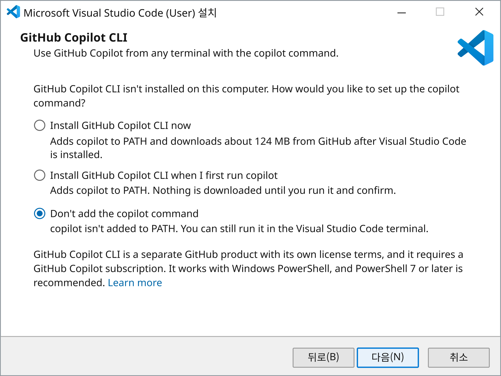

그림 2-4. 이 실습에서 쓰는 선택은 세 번째 줄이다. 편집기 설치는 다음 단계로 이어진다.

**설치 준비 완료.** 목록에서 PATH 등 방금 선택한 항목을 읽는다. 바꿀 항목이 있으면 **뒤로**, 그대로 설치하려면 **설치**를 누른다. 진행 표시가 끝나면 마지막 화면에서 **완료**를 누른다. **Visual Studio Code 실행**을 고를 수 있으면 체크한 채 마쳐도 된다.

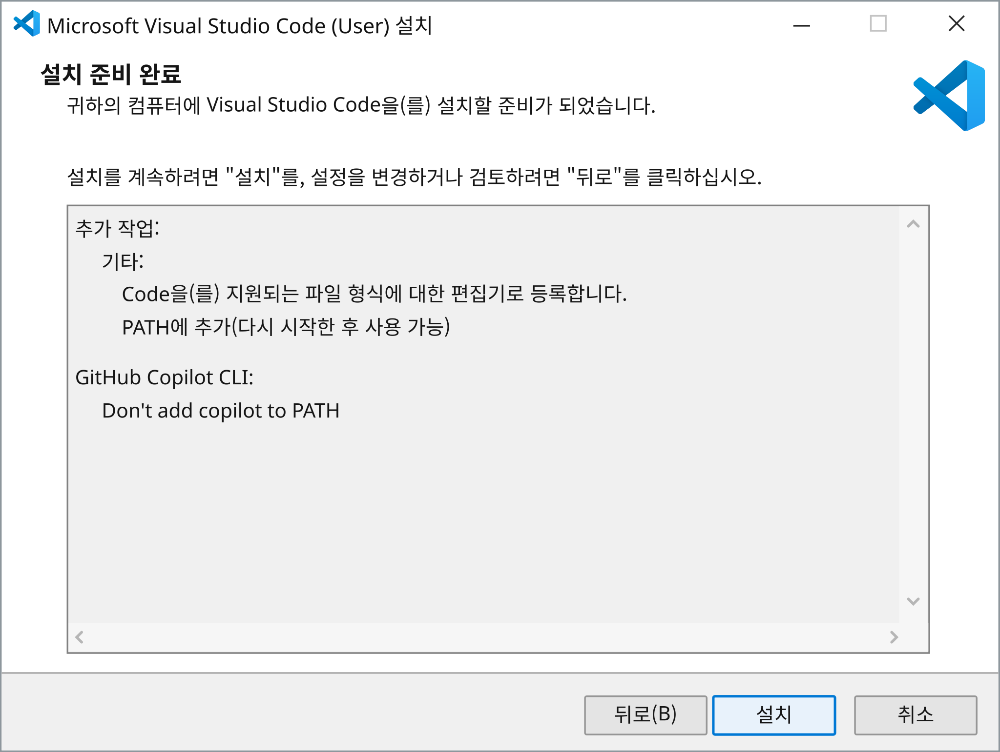

그림 2-5. ‘설치 준비 완료’ 화면. 오른쪽 아래 ‘설치’를 누르는 시점에 실제 설치가 시작된다.

**완료 확인.** Windows 키를 누르고 `Visual Studio Code`를 입력한다. 검색 결과에서 파란 아이콘의 앱을 한 번 연다. 시작 안내나 빈 편집기 창이 보이면 성공이다. 시작 안내가 영어라면 그대로 진행해도 된다. 책에서는 주요 메뉴의 영어 이름을 함께 표시한다. 실행 경로나 터미널에서 `code`를 찾는 과정은 기존에 열어 둔 터미널을 닫고 새 터미널에서 확인한다.

### 파일 탐색기에서 내 실습 폴더 만들기

1. **Windows 키 + E**를 누른다. Windows 파일 탐색기가 열린다. 창 위쪽의 **주소 표시줄**을 누르거나 `Alt+D`를 누른다. 바로 오른쪽에 있는 ‘검색’ 칸과 위치가 다르다.
2. 주소 표시줄에 `%USERPROFILE%`을 입력하고 Enter를 누른다. 내 Windows 사용자 폴더가 열린다. 여기에 `market-book` 폴더를 만든다. 상단의 **새로 만들기 → 폴더** 또는 그림에 보이는 리본의 **새 폴더**를 누른다. `Ctrl+Shift+N`으로도 만들 수 있다.
3. 새 폴더 이름 칸에 `market-book`을 쓰고 Enter를 누른다. 만들어진 `market-book`을 두 번 눌러 들어간다. 이미 만들었다면 있는 폴더를 연다.
4. 같은 방법으로 그 안에 `market-notes`를 만들어 이름을 확정한다. 아래 그림처럼 이름 목록에 보이면 `market-notes`를 두 번 누른다. 주소 표시줄 끝이 `market-book > market-notes`인지 확인한다.

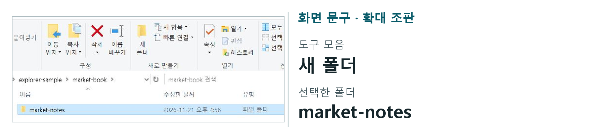

그림 2-6. Windows 파일 탐색기에서 market-book 안에 만든 market-notes가 선택된 모습이다. 위쪽 ‘새 폴더’와 아래쪽의 실제 폴더 이름은 서로 다른 위치에 있다.

| 내가 보고 있는 위치 | 해야 할 동작 | 성공하면 보이는 것 |
| --- | --- | --- |
| 주소 표시줄 | `%USERPROFILE%`을 입력하고 Enter | 사용자 폴더 내용 |
| `market-book`의 파일 목록 | 새 폴더 이름 `market-notes`를 입력하고 Enter | `market-notes`라는 폴더 한 개 |
| `market-notes` 안 | 주소 표시줄의 맨 끝 확인 | `market-book > market-notes` |

### VS Code에서 방금 만든 폴더 열기

시작 메뉴에서 VS Code를 연다. 화면 맨 위 **파일(File) → 폴더 열기(Open Folder)** 메뉴를 누른다. 폴더 선택 창의 주소 표시줄에 `%USERPROFILE%\market-book\market-notes`를 입력하고 Enter를 누른 뒤 **폴더 선택**을 누른다. 이미 `market-book`을 보고 있다면 `market-notes`를 한 번 선택하고 **폴더 선택**을 눌러도 된다. 폴더가 비어 있어 보이는 것은 아직 파일을 만들지 않았기 때문이다.

작업 공간 신뢰를 묻는 창에서는 지금 고른 폴더가 직접 만든 `market-notes`인지 확인하고 진행한다. VS Code 왼쪽 **탐색기(Explorer)**의 첫 폴더 이름 **MARKET-NOTES**를 찾는다. 패널이 보이지 않으면 `Ctrl+Shift+E`를 누른다. 상위 `market-book`이나 다른 프로젝트가 열렸다면 **파일 → 폴더 열기**로 다시 고른다.

이제 Windows 파일 탐색기와 VS Code가 같은 폴더를 보고 있다. Windows 창은 그대로 두고 다음 절에서 VS Code로 파일을 만든다.

## 2.2 파일을 만들고 확장자와 저장 상태 확인하기

### 파일 이름과 코드는 서로 다른 칸에 쓴다

1. VS Code 왼쪽 탐색기의 **MARKET-NOTES** 위에 마우스를 올린다. 이름 오른쪽에 나타난 종이 모양의 **새 파일(New File)**을 누른다. 또는 폴더 이름을 오른쪽 클릭해 **새 파일**을 고른다.
2. 폴더 이름 바로 아래에 생긴 작은 칸에 `prices.ts`를 입력하고 Enter를 누른다. 이는 **파일 이름**이다. 오른쪽에 `prices.ts`라는 탭과 빈 편집 영역이 열린다.
3. 오른쪽의 빈 편집 영역 첫 줄을 누른다. 여기에 아래 네 줄을 입력한다. 왼쪽에 보이는 줄 번호나 코드 상자의 ‘TypeScript’ 표시는 따라 쓰지 않는다.

~~~typescript
type Product = { name: string; price: number };

const apple: Product = { name: "사과", price: 1500 };
console.log(apple.name, apple.price);
~~~

4. `Ctrl+S`를 눌러 저장한다. 탭의 파일명 옆에 보이던 변경 표시가 사라진다. 왼쪽 폴더 트리와 오른쪽 탭에 모두 `prices.ts`가 보여야 한다. ‘다른 이름으로 저장’ 창이 열리면 새 파일의 이름이 확정되기 전에 빈 탭에서 작성한 것이다. 저장 위치를 `market-notes`로 고르고 파일 이름을 `prices.ts`로 적는다.

### Windows에서도 저장된 파일 찾기

`Alt+Tab`으로 열어 둔 Windows 파일 탐색기로 돌아간다. 주소 끝이 `market-notes`인지 확인한다. 파일 목록에 `prices` 또는 `prices.ts`가 보이면 VS Code에서 저장한 파일이 디스크에 생긴 것이다. 창이 갱신되지 않았다면 `F5`를 한 번 누른다.

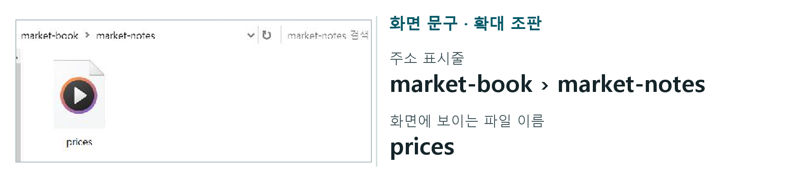

그림 2-7. 이 Windows 파일 탐색기는 알려진 확장자를 숨겨 파일명을 prices로 보여 준다. 파일 아이콘은 PC의 연결 프로그램에 따라 달라진다.

파일 이름 끝을 확실히 보려면 Windows 11의 **보기 → 표시 → 파일 확장명**, 리본형 탐색기에서는 **보기 탭 → 파일 확장명**을 켠다. `prices.ts`는 TypeScript 파일이고 `prices.ts.txt`는 마지막 확장자가 `.txt`인 파일이다. 두 번째 이름이라면 VS Code 왼쪽 파일을 선택하고 `F2`를 눌러 이름을 정확히 `prices.ts`로 고친다. [Windows 파일 탐색기 안내](https://support.microsoft.com/windows/find-and-open-file-explorer-ef370130-1cca-9dc5-e0df-2f7416fe1cb1)

### 한 화면에서 파일·코드·명령을 구별하기

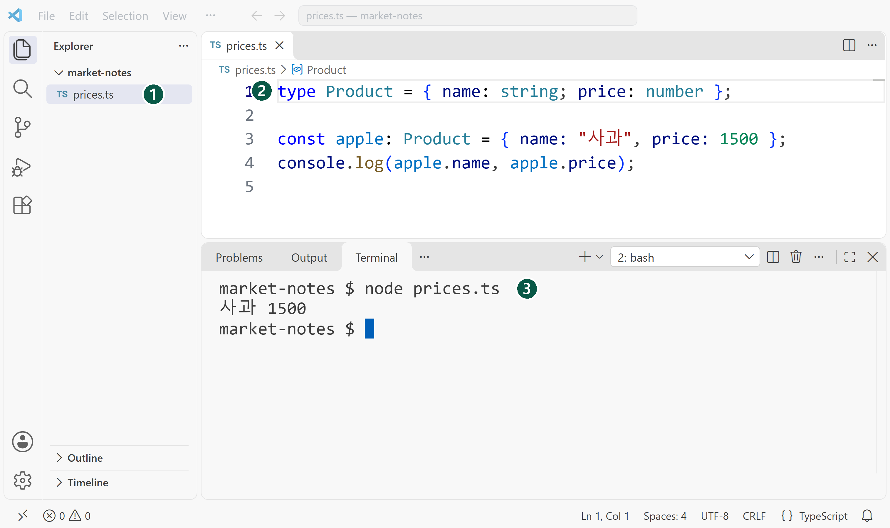

그림 2-8. Windows 데스크톱용 VS Code 실습 화면. ①은 파일을 고르는 곳, ②는 TypeScript 코드를 쓰는 곳, ③은 터미널에 명령을 입력하고 결과를 읽는 곳이다.

지금은 그림의 **①과 ②**가 같으면 된다. ③에 나오는 명령은 **2.3절에서 Node.js, 2.4절에서 Git Bash를 준비한 뒤 2.5절에서** 실행한다. 처음 연 VS Code에서 아래 칸이 아직 보이지 않는 것은 자연스럽다.

| 어느 곳인가 | 무엇을 쓰거나 보는가 | 예제에서 확인할 값 |
| --- | --- | --- |
| ① 왼쪽 탐색기 | 이미 만든 파일 이름을 눌러 연다 | `MARKET-NOTES → prices.ts` |
| ② 오른쪽 편집기 | 여러 줄의 코드를 입력하고 `Ctrl+S`로 저장한다 | `price: 1500` |
| ③ 아래 터미널 | 명령을 한 줄 입력하고 Enter를 누른 뒤 출력을 읽는다 | `node prices.ts` → `사과 1500` |

그림 2-9. 명령을 입력한 줄과 바로 아래 출력의 확대 모습. 실행할 때는 `node prices.ts`만 입력한다. 다음 줄의 `사과 1500`은 프로그램이 보여 주는 결과다.

코드를 쓰던 중 편집기에 `node prices.ts`가 글자로 들어갔다면 방금 입력한 줄을 지우고 저장한다. 터미널에서 `type Product = ...`를 입력해 명령 오류가 나왔다면 편집기 `prices.ts` 탭을 눌러 위 코드를 작성한다. 같은 VS Code 창에서도 클릭해 둔 영역에 따라 키보드 입력을 받는 프로그램이 달라진다.

## 2.3 Node.js와 npm을 설치하고 실행하기

Node.js는 브라우저 밖에서 JavaScript를 실행한다. 이 책에서는 터미널 계산 예제, 앱 개발 서버, 코드 검사에 사용한다. npm은 프로젝트가 지정한 패키지를 내려받거나 `start` 같은 프로젝트 명령을 실행한다. Windows용 Node 설치 프로그램에 함께 들어 있다.

1. [Node.js 다운로드](https://nodejs.org/en/download)에서 Windows용 설치 프로그램을 선택한다. 이 책의 코드 검사에 사용한 주 버전은 **26**이다. 같은 주 버전의 지원되는 패치 버전을 선택하고 실제 설치 버전을 노트에 적는다.
2. 설치를 마친 뒤 이미 열려 있던 터미널을 닫고 새로 연다. 설치를 시작하기 전에 실행한 VS Code도 필요하면 다시 연다.
3. VS Code의 **터미널(Terminal) → 새 터미널(New Terminal)**을 선택한다. 창 아래에 입력 줄이 생긴다.
4. 다음 두 줄을 차례로 입력한다. 한 줄마다 Enter를 누른다.

~~~bash
node -v
npm -v
~~~

첫 줄은 `v26.`으로 시작하는 버전, 둘째 줄은 예를 들어 `11.13.0` 같은 npm 버전을 출력한다. 소수점 뒤가 책의 숫자와 다르면 자기 숫자를 기록한다. 터미널에서 `node`만 입력했더니 `>`가 나타났다면 Node의 대화형 실행기로 들어간 것이다. `.exit`를 입력하면 원래 명령 입력 줄로 돌아온다.

**막히면 여기부터.** `node`를 찾을 수 없으면 새 터미널을 열고 다시 시도한다. 계속 실패한다면 Node 설치가 끝났는지, 시작 메뉴에 Node가 보이는지 확인한다. PowerShell에서 `npm.ps1` 실행 정책 메시지가 나오면 다음 절의 Git Bash에서 `npm -v`를 다시 입력한다. 프로그램을 계속 재설치하기 전에 어떤 터미널에서 나온 메시지인지 확인하자.

## 2.4 Git과 Git Bash를 설치하고 터미널 선택하기

Git은 파일이 어떻게 바뀌었는지 기록하는 프로그램이다. Bash는 글자로 입력한 명령을 해석하는 프로그램이다. Windows에서는 **Git for Windows** 설치 파일 하나에 두 프로그램이 함께 들어 있다. 설치를 마치면 시작 메뉴에서 **Git Bash**를 열 수 있다. 이 절은 GitHub 계정 없이 따라갈 수 있다.

### Windows에 맞는 설치 파일 받기

1. Windows에서 **설정 → 시스템 → 정보**를 열고 **시스템 종류(System type)**를 찾는다. `x64 기반 프로세서`라면 x64, `ARM 기반 프로세서`라면 ARM64 설치 파일을 고른다. ‘64비트 운영 체제’ 뒤쪽에 나오는 프로세서 종류까지 읽는다.
2. 브라우저로 [Git 공식 Windows 다운로드 페이지](https://git-scm.com/install/win)를 연다. 그림의 **Windows** 탭과 **Standalone Installer** 소제목을 찾는다.
3. x64 PC라면 **Git for Windows/x64 Setup**, ARM PC라면 **Git for Windows/ARM64 Setup**을 누른다. 이 책에서는 `Setup`이라고 적힌 설치 파일을 사용한다. 위에 표시된 버전 숫자는 내려받는 날에 따라 달라진다.

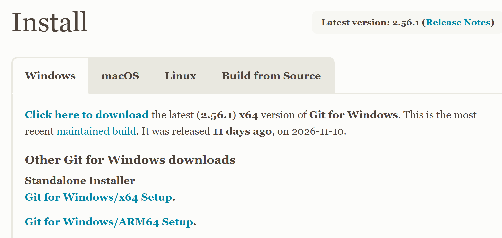

그림 2-10. Git 공식 다운로드 페이지에서 두 설치 파일의 위치를 볼 수 있다. 시스템 종류에 맞는 Setup 링크 하나를 누른다.

브라우저의 다운로드 목록에서 완료된 파일의 **폴더에 표시**를 누른다. 파일 탐색기에 보이는 `Git-…-64-bit.exe` 또는 ARM64용 설치 파일을 두 번 눌러 **Git Setup**을 연다. Windows에서 변경 허용을 묻는다면 방금 공식 페이지에서 내려받은 파일의 이름을 확인하고 설치를 계속한다. 이미 Git Bash가 있다면 아래 ‘시작 메뉴에서 첫 명령 입력하기’부터 해 보자. `git --version`이 버전을 돌려주면 기존 설치로 실습할 수 있다.

### Git Setup에서 무엇을 선택할까

그림 2-11~2-16은 실제 Git for Windows 설치 창을 바탕으로 다시 그렸다. 그림을 확대하면 창 안의 영문 설명과 선택지를 읽을 수 있다. 실제 촬영본은 HTML의 각 그림 아래 링크와 PDF 첨부 파일에서 열 수 있다.

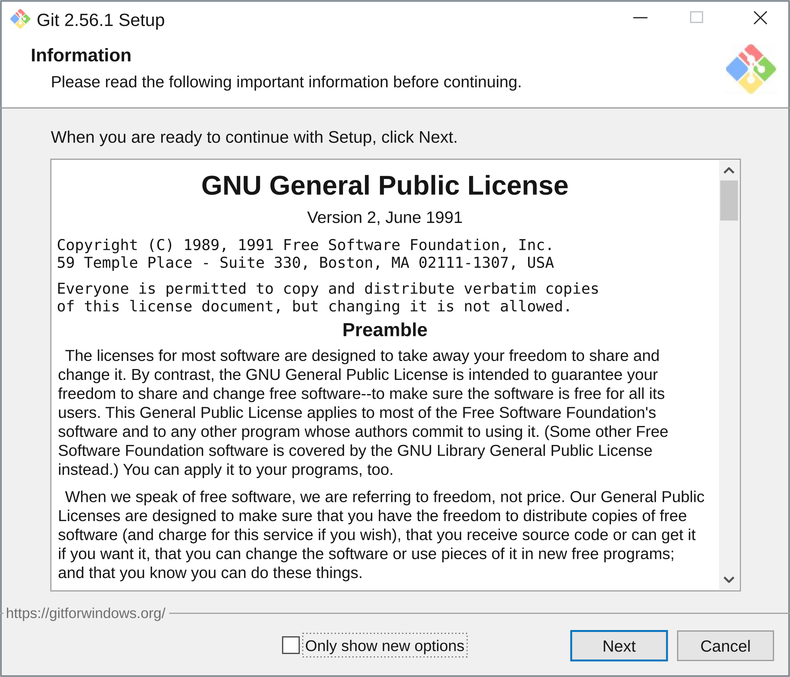

그림 2-11. 이 책을 위해 직접 촬영한 Git 2.56.1의 첫 창을 재구성했다. 위에 **Information**, 아래 오른쪽에 **Next**가 보인다.

처음 열리는 사용 조건 안내를 읽고 **Next**를 누른다. **Select Destination Location**을 만나면 Git 자체를 설치할 폴더가 표시된다. 이 책에서 앱을 만들 `market-book` 폴더는 나중에 여는 작업 폴더다. 설치 위치는 기본 경로대로 진행한다.

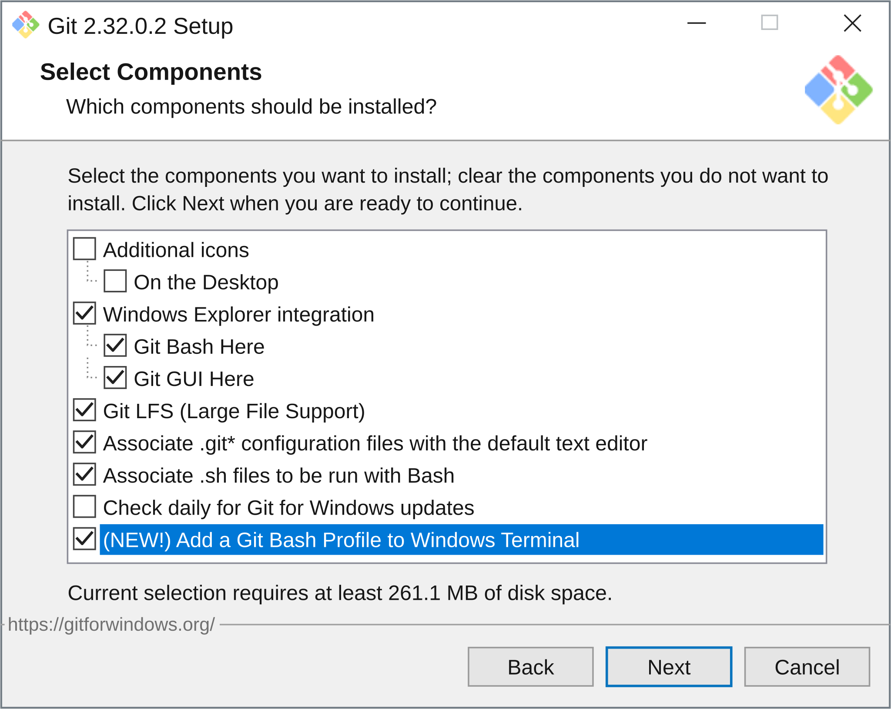

그림 2-12. UBC DSCI 310의 설치 화면을 바탕으로 그렸다. Windows Explorer integration 아래의 **Git Bash Here**가 체크되어 있다. 새 버전에는 **Open Git Bash here**로 표시될 수도 있다.

**Select Components**는 설치 후 탐색기에서 쓸 메뉴 등을 고르는 화면이다. 폴더를 마우스 오른쪽으로 눌러 그 위치에서 터미널을 열고 싶다면 **Windows Explorer integration → Open Git Bash here**를 선택하고 **Next**를 누른다. 이 항목을 선택하지 않아도 시작 메뉴의 Git Bash로 같은 실습을 할 수 있다. **Select Start Menu Folder**가 열리면 기본 폴더 이름을 두고 진행한다.

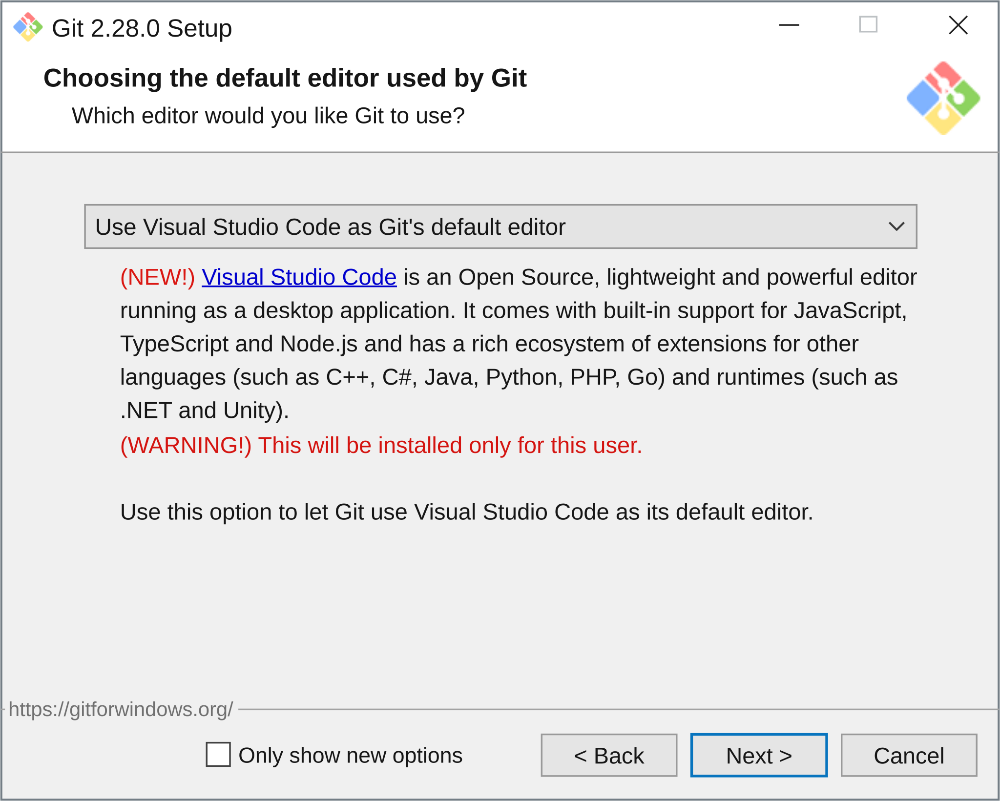

그림 2-13. Choosing the default editor used by Git 화면이다. 목록 오른쪽 화살표를 누르면 Git이 글 편집을 요청할 때 열 프로그램을 고를 수 있다.

**Choosing the default editor used by Git**에서 **Use Visual Studio Code as Git’s default editor**를 고른 뒤 **Next**를 누른다. 예를 들어 나중에 Git이 변경 사항을 설명하는 글을 요청하면 VS Code가 열린다. 이 선택은 VS Code **안에서** 어떤 터미널을 사용할지와 별개의 설정이다. 목록에 VS Code가 없으면 현재 선택을 두고 진행해도 이 장의 명령은 실행된다. `git commit -m "설명"`처럼 설명을 명령에 넣을 때는 별도 편집기가 열리지 않는다.

첫 브랜치 이름을 묻는 **Adjusting the name of the initial branch** 화면을 만나면 기본 선택대로 **Next**를 누른다. 이어서 아래의 PATH 화면을 찾는다.

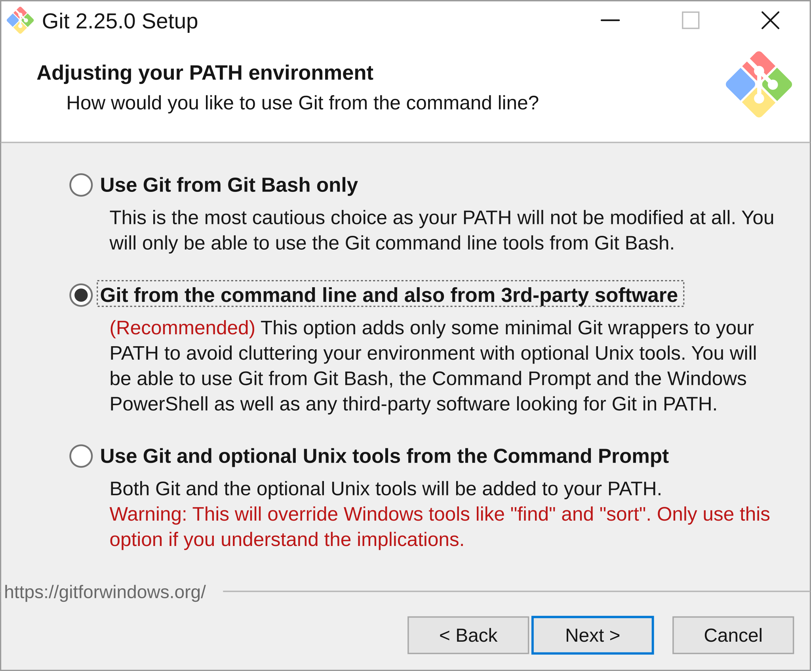

그림 2-14. Adjusting your PATH environment의 가운데 항목을 선택한다. Git Bash와 VS Code를 비롯한 다른 프로그램이 같은 Git을 찾는 설정이다.

**PATH**는 프로그램 이름만 입력해도 Windows가 실행 파일을 찾는 데 사용하는 경로 목록이다. 위 그림처럼 **Git from the command line and also from 3rd-party software**(Recommended)를 고르고 **Next**를 누른다. 이후 OpenSSH, HTTPS, 줄바꿈 방식 등을 묻는 화면이 나오면 처음 표시된 선택을 유지하며 진행한다.

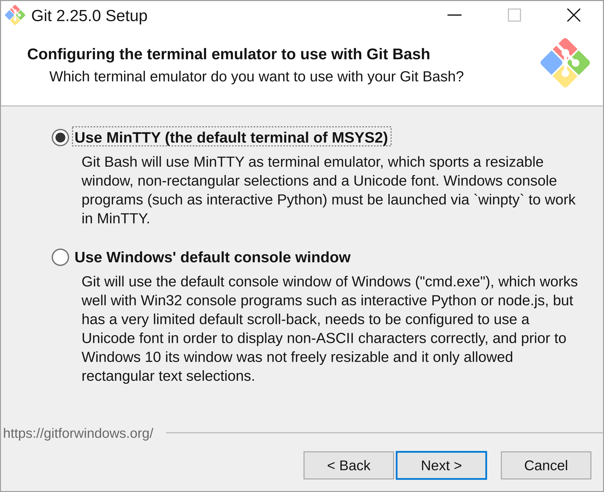

그림 2-15. Git Bash 단독 창을 고르는 화면이다. 그림처럼 **위쪽의 Use MinTTY**에 선택 표시가 있는지 확인한다.

**Configuring the terminal emulator to use with Git Bash**에서 **Use MinTTY**를 선택하고 **Next**를 누른다. Git Bash를 시작 메뉴에서 단독으로 실행할 때 사용할 창이 정해진다. 이후 pull 방식, 자격 증명 관리, 추가 옵션 등이 나오면 기본 선택을 유지한다. 마지막에 오른쪽 아래의 버튼이 **Install**로 바뀌면 클릭하고 진행 막대가 끝날 때까지 기다린다.

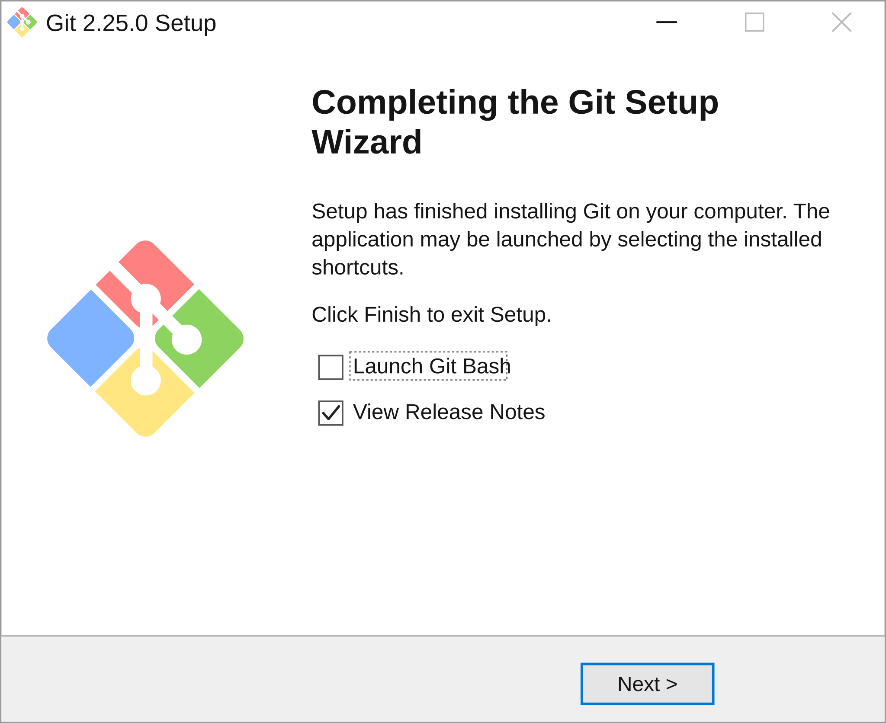

그림 2-16. **Completing the Git Setup Wizard**가 보이면 설치가 끝났다. 그림에서는 **View Release Notes**만 선택되어 있다. Git Bash를 바로 열려면 **Launch Git Bash**도 체크한다.

완료 화면에 **View Release Notes**가 선택되어 있으면 필요에 따라 해제한다. 화면 아래의 **Finish**, 또는 그림과 같이 **Next**로 표시된 마지막 버튼을 누른다. 창이 닫히면 시작 메뉴에서 Git Bash를 찾는다.

구성 요소·편집기 도해는 UBC DSCI 310의 `Windows` 설치 안내, PATH·터미널·완료 도해는 Tyler Matijevich의 `Git for Windows Tutorial`에 실린 창을 재구성했다. 두 자료의 원본은 CC BY 4.0으로 공개되었다. 그림에 표시된 Git 2.25.0·2.28.0·2.32.0.2와 현재 설치본은 중간 화면 수가 다를 수 있다. 창 위쪽의 굵은 제목으로 단계를 맞춘다. [UBC DSCI 310](https://ubc-dsci.github.io/dsci-310-student/install_instructions/install_stack_windows.html) · [Git for Windows Tutorial](https://tmatijevich.github.io/gfw-tutorial/installation/) · [CC BY 4.0](https://creativecommons.org/licenses/by/4.0/)

### 시작 메뉴에서 첫 명령 입력하기

키보드의 **Windows 키**를 한 번 누르고 `Git Bash`를 입력한다. 검색 결과 중 **Git Bash** 앱을 클릭한다. 잠시 기다리면 글자를 입력할 수 있는 터미널 창이 열린다.

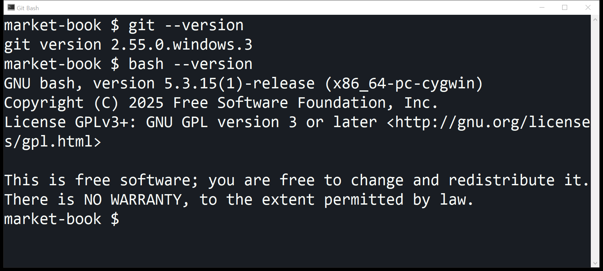

그림 2-17. 이 책의 실습용으로 실제 Windows Git Bash 창에 두 명령을 입력한 모습이다. 마지막 출력 아래에 다음 입력을 기다리는 프롬프트가 나타난다.

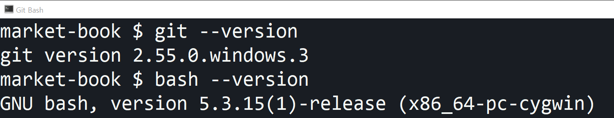

그림 2-18. 같은 창의 명령·결과 부분을 확대했다. **`$` 오른쪽**에는 사람이 입력한 명령이 있고, 바로 아래 한 줄에는 컴퓨터가 돌려준 버전이 있다.

**프롬프트**는 터미널이 다음 명령을 기다린다는 표시다. 위 그림의 `market-book $`는 실습 촬영용으로 짧게 설정한 프롬프트다. 처음 실행한 창에서는 사용자 이름과 컴퓨터 이름, `MINGW64`, 폴더를 뜻하는 `~`와 다음 줄의 `$`가 보일 수 있다. 프롬프트의 `$`는 이미 표시되어 있다. 커서가 있는 자리부터 다음 한 줄만 입력하고 **Enter**를 누른다.

~~~bash
git --version
~~~

`git` 뒤에 공백 한 칸과 짧은 붙임표 두 개가 들어간다. `git version`으로 시작하는 한 줄이 나타나고 다음 `$` 표시로 돌아오면 성공이다. 이번에는 같은 자리에 다음 한 줄을 입력하고 다시 Enter를 누른다.

~~~bash
bash --version
~~~

이번에는 `GNU bash, version`으로 시작해 여러 줄이 출력된다. 첫 줄에 버전 숫자가 있는지 살핀다. 아래는 집필에 사용한 Windows Git/Bash에서 두 명령을 실행한 결과 중 첫 줄이다. 독자의 버전 숫자는 달라도 된다.

~~~text
git version 2.55.0.windows.3
GNU bash, version 5.3.15(1)-release (x86_64-pc-cygwin)
~~~

처음 입력이 어색하면 `echo 1500`을 입력하고 Enter를 눌러 보자. 아래 줄에 `1500`이 나오면 한 줄의 명령을 정확히 입력한 것이다. `command not found`가 나오면 `$` 기호까지 옮겨 썼는지, 대시가 두 개인지 보고 새 프롬프트에 다시 입력한다. 창을 닫으려면 `exit`를 입력하고 Enter를 누른다.

### VS Code 아래쪽에 같은 Git Bash 열기

1. 앞에서 설치한 **Windows용 VS Code**에서 `market-notes` 폴더를 연다. 위쪽 메뉴의 **터미널(Terminal) → 새 터미널(New Terminal)**을 누른다. 첫 패널은 PowerShell로 열릴 수도 있다.
2. 창 아래쪽 **터미널** 패널의 오른쪽 위를 본다. **＋ 옆의 아래쪽 화살표**를 눌러 메뉴를 연다. 지금 한 번 Git Bash를 열려면 목록의 **Git Bash**를 클릭한다.
3. 앞으로 새 터미널을 열 때마다 Git Bash를 쓰려면 같은 메뉴의 **기본 프로필 선택(Select Default Profile)**을 고르고, 위에 나타나는 목록에서 **Git Bash**를 고른다. 그런 다음 패널 오른쪽의 **＋**를 눌러 **새 터미널**을 하나 연다. 기존 PowerShell 탭은 열려 있을 수 있으므로 방금 만든 탭을 선택한다.

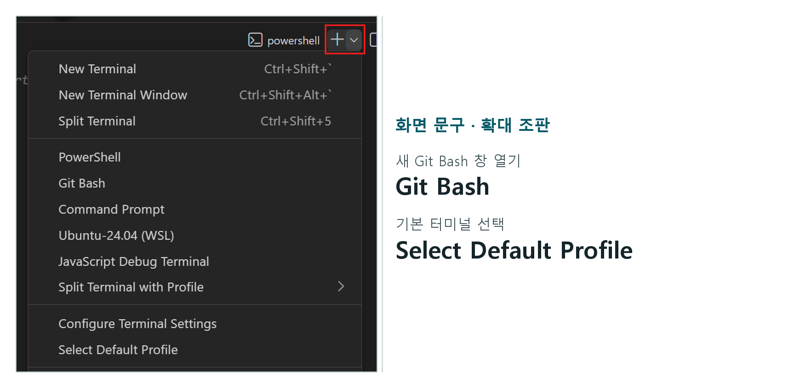

그림 2-19. Microsoft 공식 문서의 Windows용 VS Code 터미널 메뉴다. 메뉴 가운데 **Git Bash**는 바로 열기, 아래쪽 **Select Default Profile**은 이후 기본값 지정에 사용한다. Microsoft Corporation, CC BY 3.0 US. [VS Code 터미널 프로필 문서](https://code.visualstudio.com/docs/terminal/profiles) · [문서 라이선스](https://creativecommons.org/licenses/by/3.0/us/)

4. 아래쪽 터미널의 입력 줄을 한 번 클릭해 `git --version`을 실행한다. 조금 전 단독 Git Bash에서 본 것과 같은 버전이 표시되는지 살핀다. 이어서 `pwd`를 입력하면 현재 폴더가 나온다. 이 실습에서는 끝이 `/market-book/market-notes`면 된다.
5. 이제 VS Code **왼쪽** 탐색기에서 `prices.ts`를 누르면 **가운데** 편집기에서 코드 줄을 바꿀 수 있다. **아래쪽** 터미널을 누르면 같은 파일을 실행하는 명령을 입력할 수 있다. 2.5절에서는 이 두 위치를 실제로 오가며 파일과 출력을 대조한다.

**Git Bash가 목록에 없을 때.** 시작 메뉴에서 먼저 **Git Bash**를 찾아 실행해 본다. 단독 창이 열리면 VS Code의 파일을 저장하고 VS Code를 완전히 닫았다가 다시 연 뒤 새 터미널 메뉴를 확인한다. 메뉴가 보이지 않으면 `Ctrl+Shift+P`를 누르고 `Terminal: Select Default Profile`을 검색해도 된다. 시작 메뉴에서도 Git Bash를 찾을 수 없다면 설치 마법사의 **Finish**까지 끝났는지부터 확인한다.

## 2.5 터미널에서 현재 위치를 확인하고 이동하기

VS Code 아래쪽 패널의 `TERMINAL` 또는 **터미널** 탭을 누른다. 여러 터미널이 열려 있다면 2.4절에서 만든 **Git Bash**를 선택한다. 그림 2-8의 ③과 그림 2-9를 펴 놓는다. 커서가 깜빡이는 입력 줄에 명령 한 줄을 쓰고 Enter를 눌러 결과가 나온 뒤 다음 명령으로 간다. 위쪽 `prices.ts` 탭은 코드용이므로 열어 둔 채로 아래쪽만 클릭하면 된다.

터미널의 모양보다 중요한 것은 **어느 폴더에서 명령을 실행하는가**다. 창 제목에 앱 이름이 보여도, 실제 터미널은 다른 폴더에 있을 수 있다. 아래 명령은 그대로 따라 해도 파일을 바꾸지 않는다.

~~~bash
cd ~/market-book/market-notes
pwd
ls
cat prices.ts
~~~

`pwd`는 현재 작업 폴더를 보여 준다. 마지막이 `/market-book/market-notes`여야 한다. `ls`는 그 폴더에 있는 파일을 나열한다. `cat`은 지정한 파일의 내용을 출력한다. 편집기에 입력한 `사과`와 `1500`이 그대로 보이면 **편집기에서 저장한 파일과 터미널이 읽은 파일이 같다**는 뜻이다.

이번에는 한 단계 위 폴더로 간다.

~~~bash
cd ..
pwd
ls
cd market-notes
~~~

`..`는 상위 폴더다. 첫 `ls`에서 `prices.ts` 대신 `market-notes`가 보이는 것이 정상이다. 이런 상태에서 `node prices.ts`를 입력하면 Node는 상위 폴더에서 파일을 찾다가 실패한다. 파일이 없어진 것이 아니다. 마지막 줄로 정확한 폴더에 돌아간 뒤 `node prices.ts`를 입력해 보자. Node 26에서는 `사과 1500`이 출력된다.

| 입력 | 지금 확인하는 것 | 안 맞으면 |
| --- | --- | --- |
| `pwd` | 작업 위치 | 전체 폴더 경로로 다시 이동한다 |
| `ls` | 실행 파일 존재 | 상위·하위 디렉터리를 비교한다 |
| `cat prices.ts` | 파일 내용과 저장 여부 | VS Code의 경로와 저장 상태를 본다 |
| `node prices.ts` | 코드 실행 결과 | 오류의 첫 파일명과 줄 번호를 읽는다 |

## 2.6 예제 ZIP을 내려받아 VS Code에서 폴더 열기

### Windows PC에서 예제 받기

1. 실습할 PC에서 브라우저를 열고 주소창에 `https://ungjo.github.io/store-price/book/`을 입력한다. Enter를 누르면 **독자 자료실**이 열린다. [꼬마 시장 독자 자료실](https://ungjo.github.io/store-price/book/)
2. **장별 실습 예제 ZIP 받기**를 한 번 누른다. 다운로드가 끝나면 브라우저에서 `Ctrl+J`를 누른다. 목록의 `market-lab.zip` 옆 폴더 아이콘 또는 **폴더에 표시**를 누르면 Windows 파일 탐색기에서 받은 파일이 선택된다.

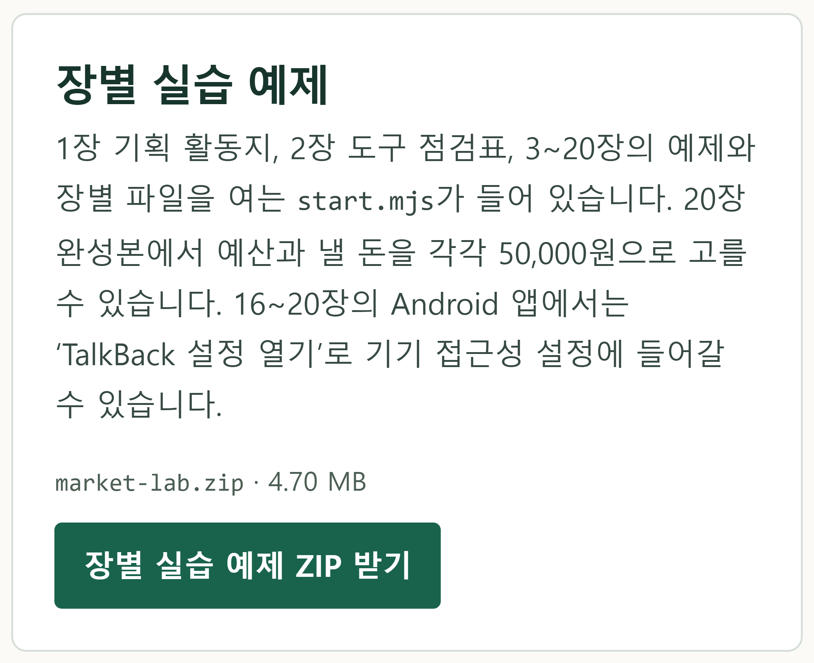

그림 2-20. 자료실의 첫 번째 카드다. 파일 이름 market-lab.zip 바로 아래에 있는 초록색 단추를 누른다.

### 압축을 풀고 열 폴더 확인하기

1. 파일 탐색기에서 `market-lab.zip`을 **오른쪽 클릭 → 압축 풀기(Extract All)** 한다. Windows 버전에 따라 **모두 압축 풀기**라고 표시된다.
2. 대상 위치에 제안된 **다운로드 → market-lab**을 그대로 두고 **압축 풀기**를 누른다. 여러 번 다운로드해서 이름이 `market-lab (1)`이면 그 이름으로 진행한다. 완료 후 자동으로 열리지 않으면 **다운로드**에서 방금 만든 폴더를 두 번 누른다.
3. 주소 표시줄이 폴더 이름으로 끝나고 목록에 `objects`, `practice`, `steps`, `README.md`, `index.json`, `start.mjs`가 보이는지 확인한다. 폴더 하나만 보이면 한 번 더 열어 이 파일들을 찾는다. `Alt+D`, `Ctrl+C`를 차례로 눌러 **이 폴더의 주소**를 복사해 둔다.

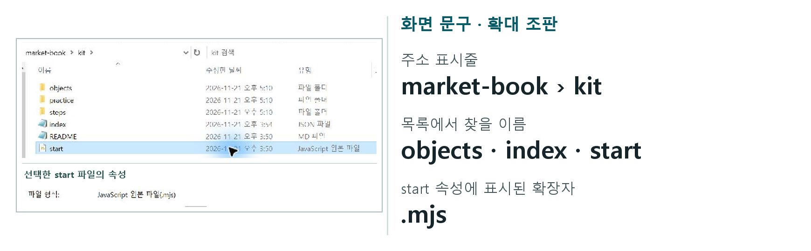

그림 2-21. 파일 탐색기에서 압축을 푼 결과. 책과 독자 자료실에서 쓰는 `kit`은 실습 파일을 모아 둔 폴더에 붙인 이름이다. `market-lab (1)` 안에 `start.mjs`와 `index.json`이 보이면 그 폴더가 여기서 말하는 `kit`이다.

책과 경로까지 맞추고 싶으면 Windows 파일 탐색기 주소창에 `%USERPROFILE%`을 입력해 **Enter**를 누른다. 열린 내 사용자 폴더에 `market-book`을 만들고, 그 안에 `kit` 폴더를 만든다. 압축 풀기 창에서 그 `kit`을 대상으로 선택하면 된다. 이미 다운로드 폴더에 푼 독자는 그 자리에서 다음 단계로 간다.

파일 확장명을 숨긴 PC에서는 `start.mjs`가 `start`로 보인다. 파일을 한 번 선택하고 `Alt+Enter`를 누른 뒤 **파일 형식**에서 `(.mjs)`를 확인한다. **확인**을 눌러 속성 창을 닫는다.

### VS Code에서 예제 폴더 통째로 열기

1. VS Code를 열고 위쪽 **파일(F) → 폴더 열기…** 메뉴를 누른다. 폴더 선택 창의 주소 표시줄을 클릭한 뒤 방금 복사한 주소를 붙여 넣고 Enter를 누른다. 아래쪽 **폴더 선택**을 누른다.
2. VS Code 왼쪽 세로 막대에서 종이 두 장 모양의 **탐색기**를 누른다. 방금 연 폴더 이름 옆의 화살표를 펼친다. `objects`, `steps`, `index.json`, `start.mjs`가 같은 깊이에 보이는지 확인한다. `start.mjs`를 누르면 그림처럼 가운데에 코드가 열린다.

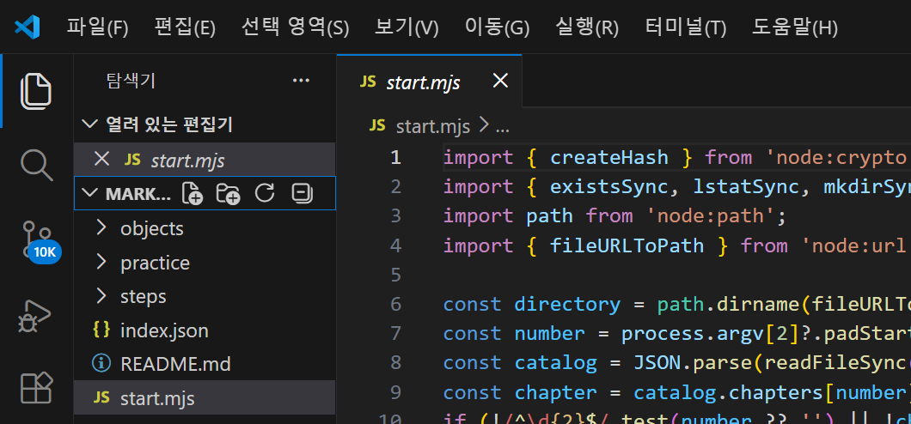

그림 2-22. 다운로드한 폴더에서 `start.mjs`를 연 모습. 가운데는 파일 내용을 읽고 수정하는 편집기다. 실행 명령은 다음 단계에서 화면 아래에 터미널을 열고 입력한다.

### steps를 펼치면 왜 11·13·14만 보일까?

왼쪽에서 **steps 옆의 화살표**를 누른다. 보이는 숫자는 따로 실행하는 보조 실험의 장 번호다. 11장에는 상품 조회, 13장에는 가격 관측 자료와 미리보기, 14장에는 늦게 도착한 응답을 시험하는 파일이 있다.

코드를 실행해 보는 개발 예제는 **03~20장, 모두 18개**다. 여러 장에서 같은 이미지와 코드를 쓰므로 ZIP에는 같은 파일을 `objects`에 한 번씩만 담았다. `index.json`에는 각 장에 필요한 파일 목록이 들어 있다. `node start.mjs 20`을 실행하면 20장의 파일들이 원래 이름과 구조로 `work/ch20`에 생긴다. 이 책에 첨부된 ZIP에는 1장 기획 활동지와 2장 도구 점검표도 있다.

### 지금 열린 화면에서 새 터미널 열기

1. 그림 2-22처럼 위쪽에 **터미널(T)** 메뉴가 보이면 **터미널(T) → 새 터미널**을 누른다. 좁은 창에서는 메뉴가 **…** 안에 들어간다. 영문판은 **Terminal → New Terminal**이다. 화면 아래에 **터미널** 탭이 열린다.
2. 아래쪽 입력 줄의 깜빡이는 커서를 클릭한다. Windows PowerShell이면 `PS`로 시작하는 경로 끝의 `>` 뒤에 입력한다. `ls start.mjs`를 쓰고 **Enter**를 눌러 파일 이름이 나타나는지 확인한다. 터미널 경로에 `market-lab (1)`처럼 공백이나 괄호가 있어도, 이미 그 폴더를 열었으므로 경로를 다시 입력할 필요가 없다.

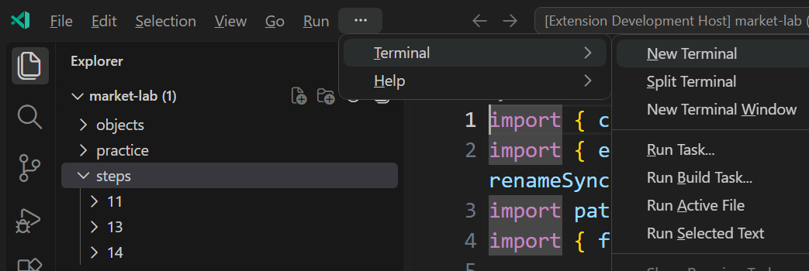

그림 2-23. 실제 영문 VS Code. 왼쪽 steps 아래에 11·13·14가 보이고, 오른쪽에는 **… → Terminal → New Terminal**이 펼쳐져 있다. 한글판의 **터미널 → 새 터미널**과 같은 메뉴다.

### 20장 완성본을 바로 열어 보기

`market-lab.zip`에는 장바구니에 상품을 담고 거스름돈을 계산해 영수증을 보여 주는 **20장 완성 앱의 소스코드**까지 들어 있다. 앞 장을 거치지 않고 바로 열 수 있다.

1. 방금 `start.mjs`를 확인한 **아래쪽 터미널**에서 다음 한 줄을 입력하고 **Enter**를 누른다.

~~~terminal
node start.mjs 20
~~~

2. 출력 경로 끝이 `work\ch20`인지 확인한다. VS Code **왼쪽 탐색기**에서 **work → ch20 → apps → mobile**을 펼치고 **App.tsx**를 클릭한다. 같은 위치의 **src**를 펼치면 기능별 코드가 보인다. 예를 들어 **components → shopping-receipt.tsx**는 영수증을 그리는 파일이다.

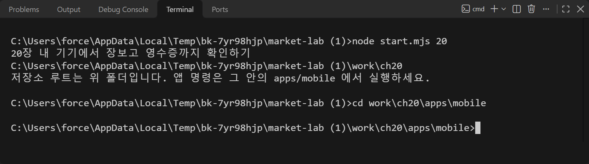

그림 2-24. VS Code의 Windows 명령 프롬프트(cmd)에서 실제로 실행했다. 첫 입력 줄은 `node start.mjs 20`, 그 아래 출력은 생성된 `work\ch20` 경로다. 마지막 입력 줄은 다음 단계에서 `apps\mobile`로 이동한 결과다. 내 PC에서는 앞쪽 경로가 달라도 된다.

‘폴더가 이미 있습니다’가 뜨면 기존 `work/ch20`을 펼쳐 계속 진행한다.

### VS Code에서 20장 완성 앱을 브라우저로 실행하기

**1. 같은 터미널에서 앱 폴더로 이동한다.** 20장의 생성이 끝나면 아래쪽 입력 줄은 처음의 예제 폴더에 있다. 왼쪽에서 `App.tsx`를 열어도 터미널의 위치는 그대로다. 다음 한 줄을 입력하고 **Enter**를 누른다. PowerShell과 Git Bash에서 같은 명령을 쓸 수 있다.

~~~terminal
cd work/ch20/apps/mobile
~~~

PowerShell 입력 줄의 끝이 `work\ch20\apps\mobile>`로 바뀌면 도착한 것이다. 이미 입력 줄이 그 위치라면 바로 2단계로 간다. 터미널을 닫았다면 왼쪽 탐색기에서 **mobile을 오른쪽 클릭 → 통합 터미널에서 열기**로 같은 위치에 새 터미널을 열 수 있다.

**2. 첫 실행에 필요한 파일을 설치한다.** 터미널에 `ls App.tsx`를 입력해 20장 앱의 첫 화면 파일이 보이는지 확인한다. 같은 터미널에서 아래 명령을 입력한다. 처음 설치할 때는 PC를 인터넷에 연결해 둔다.

~~~powershell
npm.cmd ci
~~~

위는 PowerShell 명령이다. Git Bash에서는 `npm ci`를 쓴다. 설치가 성공하면 패키지 수가 출력되고 입력 줄이 돌아온다. `npm error`가 표시되면 설치 오류를 먼저 확인한다. 앞서 이 **20장 앱 폴더**에서 설치를 마쳤다면 3단계부터 시작한다.

**3. 기본 브라우저를 연다.** 방금 설치한 터미널에서 다음 명령을 입력하고 Enter를 누른다.

~~~powershell
npm.cmd run web
~~~

Git Bash에서는 `npm run web`을 입력한다. 이 명령은 Expo 개발 서버를 켜고 PC의 기본 브라우저를 연다. 별도로 `w`를 누를 필요는 없다. 처음에는 코드가 준비되는 동안 잠시 기다린다. 탭이 자동으로 열리지 않으면 터미널에 표시된 웹 주소(`http://localhost:…`)를 복사해 브라우저 주소창에 붙여 넣는다. 숫자는 내 터미널에 표시된 포트를 사용한다.

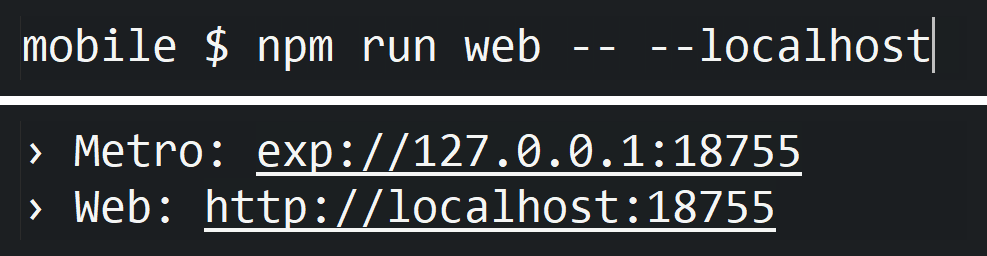

그림 2-25. 실제 Git Bash의 명령과 출력. 촬영할 때는 이 PC에서만 접속하도록 명령 끝에 `-- --localhost`를 덧붙였다. 브라우저 주소창에는 출력 중 `Web:` 뒤의 주소를 쓴다. 실습하는 동안 터미널은 열어 둔다.

**4. 예시 상품으로 시작한다.** 다운로드한 그대로 처음 실행하면 브라우저에 **가게를 준비하고 있어요**가 보인다. **예시 상품으로 바로 놀이하기**를 누른다. 이 경로는 앱에 들어 있는 상품을 사용하므로 계정 입력 없이 장보기를 해 볼 수 있다.

그림 2-26. 첫 실행의 PC 브라우저 화면. 탭 제목은 ‘꼬마 시장 검사’이고 앱 안의 이름은 ‘꼬마 시장’이다. 아래쪽 흰색 단추를 눌러 장보기를 시작한다.

그림 2-27. 20장 완성본의 PC 웹 화면. ‘오늘의 놀이돈’에서 기본 10,000원에 ✓가 있고 옆에 50,000원이 보인다. 아래로 스크롤해 상품을 찾는다.

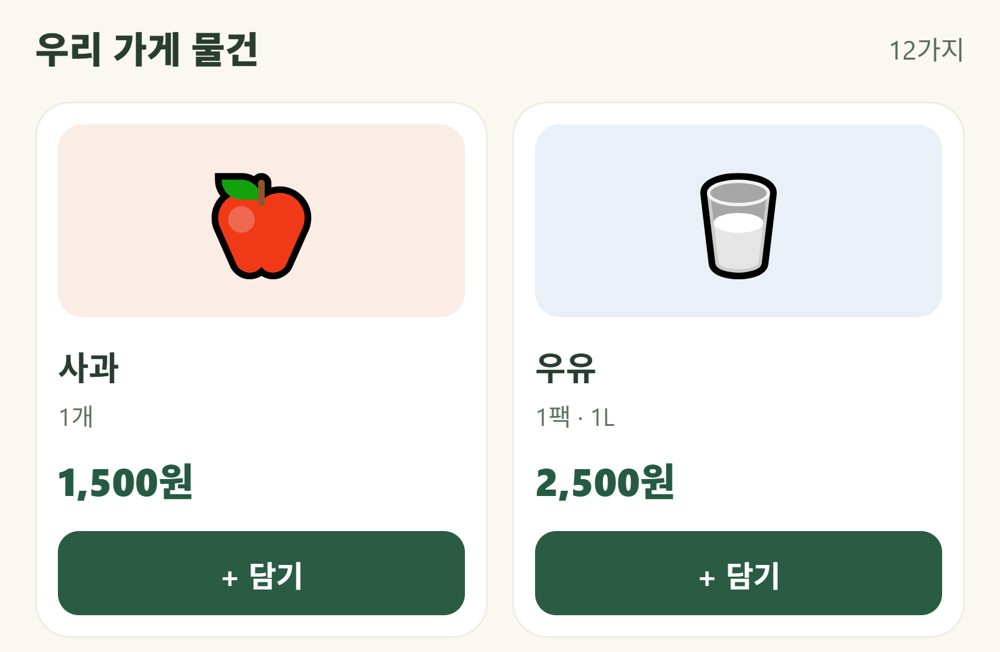

그림 2-28. 20장 완성 앱의 상품 목록. ‘우리 가게 물건’ 옆에 ‘12가지’가 보인다. 사과 카드의 ‘+ 담기’를 한 번 눌러 1,500원짜리 사과 한 개를 장바구니에 담아 보자.

**다음에 다시 열기.** 실습을 마치면 터미널을 클릭하고 `Ctrl+C`를 누른다. 다음에는 같은 `work/ch20/apps/mobile`에서 **`npm.cmd run web` 한 줄**이면 된다. 처음 푼 ZIP에서 준비와 실행까지 한 줄로 마치는 방법은 [부록 C.1](#appC-s1)에 있다.

### 장별 참고본을 하나씩 확인하기

1·2장은 앱을 기획하고 개발 도구를 준비하는 장이다. 활동지가 포함된 ZIP에서는 `node start.mjs 01`로 기획 활동지를, `node start.mjs 02`로 도구 점검표를 꺼낼 수 있다. **03~20**은 실행할 개발 예제의 장 번호다. 3장의 계산 예제와 4장의 첫 앱, 5장의 상품 목록을 차례로 비교해 보자.

| 보고 싶은 내용 | 예제 폴더의 터미널에 입력 | 왼쪽 탐색기에서 열 파일 |
| --- | --- | --- |
| 3장 계산 예제 | `node start.mjs 03` | `work/ch03/checkout.mts` |
| 4장 첫 앱 | `node start.mjs 04` | `work/ch04/apps/mobile/App.tsx` |
| 5장 상품 목록 | `node start.mjs 05` | `work/ch05/apps/mobile/App.tsx` |

**다음 장으로 넘어가기 전**, 터미널에 `ls start.mjs`를 입력한다. 오류 없이 파일 이름이 나타나면 표에서 다음 장의 명령을 실행한다. 왼쪽에서 코드 파일을 클릭하는 것만으로 터미널 위치가 바뀌지는 않는다.

예를 들어 4장 앱을 실행하느라 터미널이 `work/ch04/apps/mobile`에 있거나 개발 서버가 실행 중이라면, VS Code 위쪽 **터미널 → 새 터미널**을 누른다. 왼쪽 탐색기 맨 위가 **CH04**나 **MOBILE**이라면 먼저 **파일 → 폴더 열기**로 압축을 푼 **market-lab**(또는 **kit**) 폴더를 다시 연 뒤 새 터미널을 연다. 새 터미널에서 `ls start.mjs`로 위치를 확인하고 `node start.mjs 05`를 입력한다. ‘폴더가 이미 있습니다’가 표시되면 왼쪽의 기존 `work/ch05`를 열면 된다.

책의 순서대로 직접 만들려면 2.7절과 3장의 작은 연습을 마치고 [4.2절](#ch04-s2)에서 첫 앱을 준비한 뒤 5장의 안내대로 그 작업을 이어 간다. 장별 참고본은 내가 작성한 코드와 그 장의 완성 상태를 비교할 때도 사용할 수 있다.

**책 뒤에서 경로를 읽는 법.** 이후 Git Bash 명령에서 `~/market-book/kit`은 `start.mjs`가 있는 폴더를 가리킨다. Windows의 다운로드 폴더에 풀었다면 Git Bash에서 `cd ~/Downloads/market-lab`으로 이동한다. 폴더 이름이 `market-lab (1)`이면 `cd ~/Downloads/'market-lab (1)'`처럼 이름을 작은따옴표로 감싼다. 그 뒤의 `work/ch04/apps/mobile` 같은 경로는 같다. 다른 위치에 풀었을 때도 VS Code에서 그 폴더를 열고 새 터미널에 `cd work/ch04/apps/mobile`처럼 그 안의 경로를 입력할 수 있다. 이 경로는 4장 파일을 꺼낸 뒤에 생긴다.

### VS Code 도움말에서 장을 골라 열기

책을 덮어 둔 상태에서도 다음에 입력할 명령을 찾아볼 수 있다. 방금 브라우저 실습을 마쳤다면 개발 서버를 실행한 터미널에서 `Ctrl+C`를 누른다. VS Code 왼쪽 탐색기 맨 위에 `start.mjs`와 `index.json`이 함께 보이는지 확인한다. **mobile** 폴더만 열려 있다면 **파일 → 폴더 열기** 메뉴에서 처음 압축을 푼 폴더를 선택한다.

1. 키보드의 **F1**을 누른다. 위쪽 검색 칸에 **작업 실행**을 입력하고 **작업: 작업 실행**을 선택한다. 영문판에서는 **Tasks: Run Task**를 찾는다.
2. 새 목록에서 **실습 명령어 도움말**을 선택한다. 아래쪽 터미널에 **꼬마 시장 실습 꾸러미 — 명령어 도움말**이 뜬다. 위로 스크롤하면 1~20장의 번호·제목·열기 명령을, 맨 아래에서는 **20장 완성 앱을 PC 브라우저에서 실행**하는 순서를 볼 수 있다. 도움말은 Node.js만 설치되어 있으면 인터넷 연결 없이 읽을 수 있다.

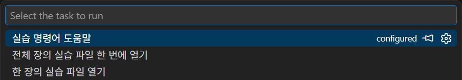

그림 2-29. **작업 실행**을 고르면 위쪽에 나타나는 목록이다. 첫 줄의 **실습 명령어 도움말**을 선택하면 터미널에 안내가 열린다. 그 아래 두 항목은 장별 파일을 여는 작업이다.

3. 한 장만 찾아보자. 위쪽 **터미널 → 새 터미널**을 열고 아래쪽 입력 줄에 `ls start.mjs`를 입력한다. 파일 이름을 확인한 자리에 다음 한 줄을 입력하고 **Enter**를 누른다.

~~~terminal
node start.mjs --help 20
~~~

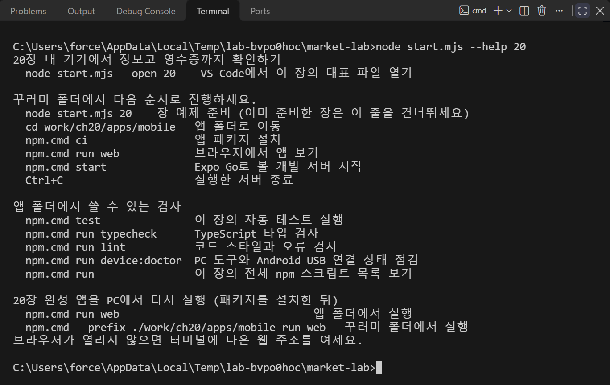

그림 2-30. VS Code에서 연 20장 상세 도움말. 터미널에서 `cd work/ch20/apps/mobile`로 시작하는 줄을 찾아보자. 처음 실행할 때의 설치 순서와 다음에 브라우저로 다시 여는 명령을 구분해 읽을 수 있다.

도움말을 읽기만 하면 아직 새 파일은 생기지 않는다. 실제로 6장 장바구니 코드를 열려면 다시 **F1 → 작업 실행**에서 **한 장의 실습 파일 열기**를 고르고 **6장 장바구니와 합계 계산하기**를 선택한다. 편집기에 `cart.ts`가 열리고, 왼쪽 탐색기의 `work/ch06` 안에서 그 장의 파일들을 확인할 수 있다. **전체 장의 실습 파일 한 번에 열기**를 선택하면 1·2장의 활동지와 3~20장의 대표 코드 파일이 같은 VS Code 창에 모두 열린다. 이미 준비한 장은 내가 수정한 파일을 그대로 연다.

| 하고 싶은 일 | 예제 최상위 폴더의 터미널에 입력 |
| --- | --- |
| 장 번호와 명령 목록 다시 보기 | `node start.mjs --help` |
| 6장의 폴더·실행·검사 명령 읽기 | `node start.mjs --help 06` |
| 6장 장바구니 코드를 편집기에 열기 | `node start.mjs --open 06` |
| 1~20장의 대표 파일 한꺼번에 열기 | `node start.mjs --open all` |

**작업 목록에 ‘실습 명령어 도움말’이 없을 때.** VS Code에서 처음 압축을 푼 폴더를 열고 왼쪽의 `.vscode`를 펼친다. `tasks.json`이 보이는지 확인한다. 예전 ZIP을 쓰고 있어 해당 파일이 없다면 이 전자책에 첨부된 `market-lab.zip`을 새 폴더에 풀고 그 폴더를 연다. 이렇게 하면 기존에 작성한 실습을 보관할 수 있다.

### 선택 실습 · Git으로 개발 이력 살펴보기

처음 앱을 실행하는 데 필요한 파일은 방금 받은 ZIP에 들어 있다. 개발자가 남긴 커밋도 읽고 싶을 때는 Git Bash에서 다음 명령을 한 줄씩 실행한다.

~~~bash
cd ~/market-book
git clone https://github.com/ungjo/store-price.git project-history
cd project-history
git status --short
ls apps/mobile
~~~

`git clone`은 저장소를 `project-history`에 받는다. 이미 복제했다면 기존 폴더로 이동한다. `git status --short`가 아무것도 출력하지 않으면 현재 커밋과 같은 상태다. 4장 실습으로 돌아올 때는 VS Code에서 `start.mjs`가 있는 예제 폴더를 다시 연다.

## 2.7 파일 한 줄을 수정하고 변경 전후 비교하기

버전 관리는 큰 프로젝트에서만 필요한 것이 아니다. 방금 바꾼 숫자가 무엇이었는지 확인할 수 있으면 가격이 예측과 달라졌을 때 원인을 찾기 쉽다. VS Code에서 **파일 → 폴더 열기**를 눌러 2.1절의 `market-notes`로 돌아간다. 왼쪽에 `prices.ts`가 보이면 2.4절처럼 Git Bash 터미널을 연다.

~~~bash
cd ~/market-book/market-notes
git init
git add -- prices.ts
git status --short
~~~

`A  prices.ts`처럼 표시되면 Git이 처음 본 파일을 다음 기록 대상으로 선택한 것이다. `git diff --cached -- prices.ts`로 내용을 읽는다. 첫 기록을 만들 사람의 이름과 이메일이 아직 없다면 이 연습 폴더에서만 사용할 두 값을 지정한다. 아래는 예시이며, 본인이 원하는 이름으로 바꿀 수 있다.

~~~bash
git config user.name "Market Learner"
git config user.email "learner@example.com"
git commit -m "Add the apple price example"
~~~

이제 VS Code에서 `price: 1500`을 `price: 1800`으로 바꾸고 저장한다. 왼쪽의 **소스 제어(Source Control)**를 눌러 `prices.ts`를 선택하면 이전 줄과 새 줄을 비교할 수 있다. Git Bash에서도 같은 내용을 읽어 보자.

~~~bash
git diff -- prices.ts
node prices.ts
~~~

`-`로 시작하는 줄은 이전 내용, `+`로 시작하는 줄은 새 내용이다. 실행 결과는 `사과 1800`이다. 실습을 마쳤으면 편집기에서 숫자를 다시 1500으로 바꿔 저장한다. `git diff -- prices.ts`의 출력이 사라진다. 이처럼 먼저 차이를 보면 무슨 파일을 되돌려야 하는지 알 수 있다.

### 파일이 세 곳에서 같은지 확인하기

다른 폴더에 같은 이름의 파일이 두 개 있으면 저장을 여러 번 눌러도 프로그램 결과는 바뀌지 않는다. 이 상황을 지금 작은 예제로 재현해 보자. Git Bash에서 아래 명령을 한 줄씩 실행한다. 첫 번째 경로는 지금까지 작업한 폴더다. 복사한 파일에는 새 이름을 붙인다.

~~~bash
cd ~/market-book/market-notes
cp prices.ts prices-copy.ts
ls
code prices-copy.ts
~~~

새로 열린 탭의 이름이 `prices-copy.ts`인지 본다. 복사본에서 사과 가격을 `2100`으로 바꾸고 저장한다. 이제 두 파일을 각각 실행한다.

~~~bash
node prices.ts
node prices-copy.ts
~~~

첫 결과는 `사과 1500`, 두 번째는 `사과 2100`이다. 오른쪽 탭에서는 2100을 보고 있는데 터미널에는 1500이 나온다면 어떤 파일을 실행했는지 먼저 본다. 파일을 찾아갈 때에는 아래 세 가지를 함께 읽는다.

| 확인하는 곳 | 처음 파일 | 복사본 |
| --- | --- | --- |
| VS Code 탭 제목 | prices.ts | prices-copy.ts |
| 터미널에 입력한 인수 | node prices.ts | node prices-copy.ts |
| 출력 속 사과값 | 1500 | 2100 |

두 파일을 주소로도 대조해 보자. 탐색기의 파일 이름을 마우스 오른쪽으로 눌러 **경로 복사(Copy Path)**를 선택하면 드라이브 문자부터 파일 이름까지 복사된다. Git Bash의 `pwd -W`는 현재 *폴더*를 Windows 주소로 표시한다. 앞부분이 같고 끝 파일명만 달라야 한다. `code` 명령을 설치하지 않았다면 왼쪽 탐색기에서 파일을 두 번 눌러도 같은 비교를 할 수 있다. 복사본은 연습 기록으로 두고 다음 장의 앱 코드는 `kit/work`에서 연다.

## 2.8 Android 기기에서 Expo Go 준비하기

Android 기기에서 Expo Go를 설치하고 연다. [Expo Go 공식 다운로드 페이지](https://expo.dev/go)에서 Android와 이 프로젝트의 Expo SDK 58을 확인한다. 특히 지금 휴대전화에 설치한 Expo Go가 어떤 SDK를 여는지 확인하자. 책과 다른 시점에 실습한다면 기본으로 제시되는 SDK가 달라질 수 있다.

이번 장에서는 기기에 Expo Go가 열리고 PC와 같은 Wi-Fi에 연결할 수 있으면 충분하다. QR 코드는 4장에서 개발 서버를 실행할 때 생긴다. 본문 그림에 보이는 기기에서 발생했던 QR을 가져다 쓰는 일이 아니라, **내 PC의 터미널이 방금 만든 QR**을 읽는 과정이다.

| 나중에 준비할 것 | 처음 필요한 장 | 쓰는 이유 |
| --- | --- | --- |
| Supabase 프로젝트 | 12장 | 공개 예시 목록을 DB에서 읽어 본다 |
| USB 디버깅과 ADB | 13장 | 내 PC와 Android 기기의 연결 상태를 본다 |
| Java와 Maestro | 17장 | 같은 장보기 동작을 반복 검사한다 |
| Expo 계정과 EAS CLI | 19장 | 내 이름으로 설치용 APK를 빌드한다 |

**준비 완료 연습.** VS Code를 종료하고 다시 열어 `market-notes` 폴더를 선택한다. 통합 터미널을 Git Bash로 열고 `pwd`, `ls`, `node prices.ts`를 차례로 실행한다. 폴더를 다시 열어도 저장한 파일은 남는다. 이 과정을 혼자서 한 번 할 수 있으면 다음부터 오류가 났을 때 ‘파일을 못 찾았는가, 파일 안의 코드가 잘못됐는가’를 나눠 볼 수 있다.
