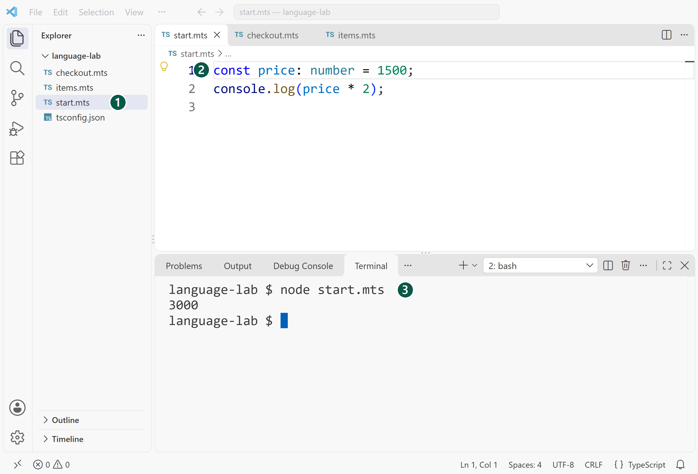
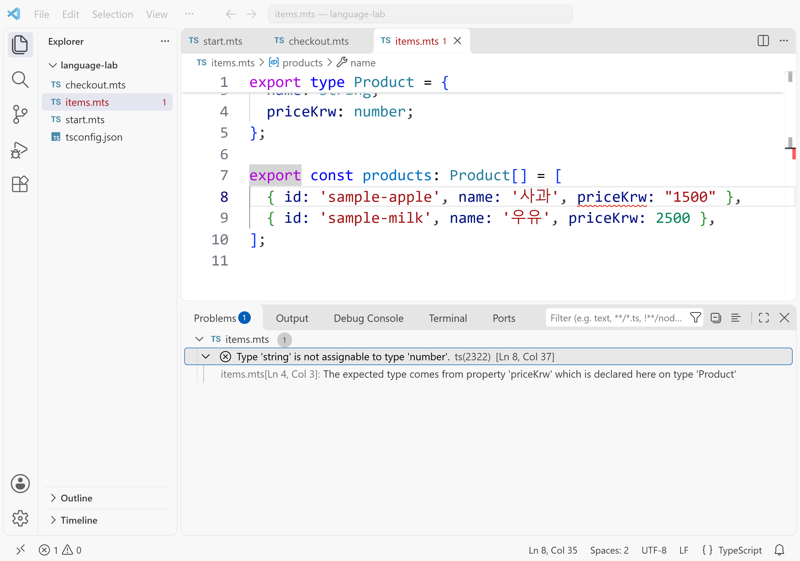
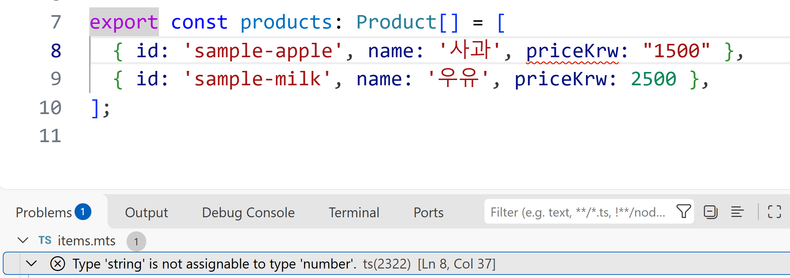
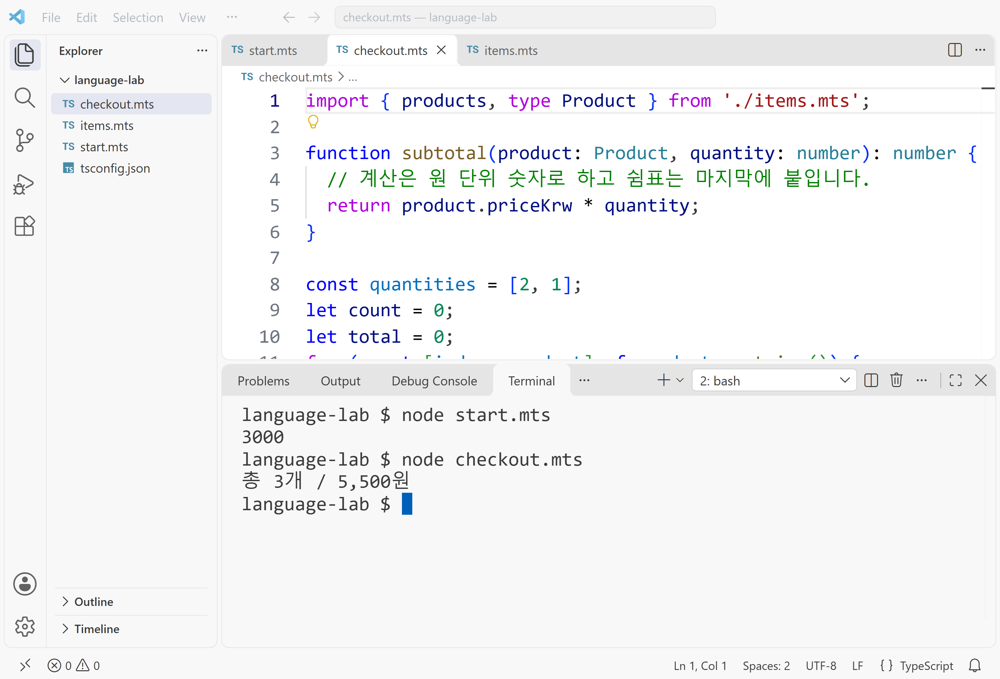
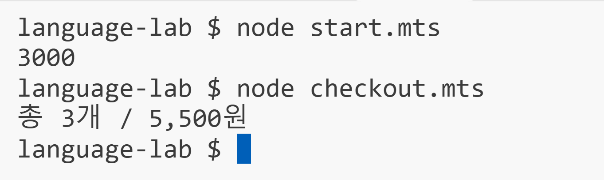

# 3장 실습에 필요한 언어와 개념 익히기

다음 장부터는 코드에 상품 이름을 적고, 버튼을 눌렀을 때 바뀔 숫자를 다룬다. 이 장에서는 화면을 띄우기 전에 두 상품으로 계산을 해 본다. 결과가 틀리면 어디를 확인해야 하는지도 배운다. 2장의 저장·실행 연습을 마쳤다면 빈 폴더 하나로 시작할 수 있다.

~~~bash
cd ~/market-book
mkdir -p language-lab
cd language-lab
code .
~~~

VS Code 명령이 없다면 **파일 → 폴더 열기**로 같은 폴더를 연다. 아래에서 파일 이름이 달라질 때마다 왼쪽 탐색기에서 새 파일을 하나 만든다. `.mts`는 TypeScript 파일을 모듈로 다룬다는 뜻이다. 이 장의 작은 계산은 Node 26으로 바로 실행한다. 앱 화면을 적는 `.tsx`는 4장에서 Expo가 실행한다.

## 3.1 JavaScript와 TypeScript의 역할

VS Code에서 `start.mts`를 만들고 아래 두 줄을 적는다.

~~~typescript
const price: number = 1500;
console.log(price * 2);
~~~

### 첫 실행을 한 화면에서 해 보기

1. 왼쪽 탐색기에 `language-lab`이 보이면 폴더 이름 옆의 새 파일 단추를 누른다. 이름을 `start.mts`로 입력하고 Enter를 누른다. 오른쪽 탭 제목에도 `start.mts`가 보인다.

2. 오른쪽의 줄 번호 **1** 옆을 클릭한다. 위의 두 줄만 입력하고 `Ctrl+S`를 누른다. 이 자리에서는 Enter가 코드의 다음 줄을 만든다.

3. 위쪽 메뉴의 **터미널 → 새 터미널**을 선택한다. 아래 패널의 프로필이 `bash` 또는 `Git Bash`인지 본다. 2장에서 등록한 프로필을 쓰면 입력 줄의 끝에 `$`가 보인다.

4. 아래 입력 줄을 클릭하고 `node start.mts`를 입력한 뒤 Enter를 누른다. 이번 Enter는 명령을 실행한다. 그 아래에 `3000`과 새 입력 줄이 나타난다.

그림 3-1. Windows용 VS Code에서 ① 파일, ② 두 줄의 코드, ③ 명령과 결과를 한 화면에서 확인했다. 아래쪽에 보이는 3000은 1500 × 2의 결과다.

**손을 떼기 전 확인.** 숫자를 `1600`으로 바꾸면 어떤 결과가 나올까? 오른쪽에서 `1500`만 바꿔 저장한다. 아래쪽을 한 번 누르고 키보드의 ↑를 누르면 직전에 실행한 명령이 돌아온다. Enter를 눌러 `3200`을 확인한다. 다음 실습을 위해 `1500`으로 되돌려 저장한다.

명령이 편집기 3번째 줄에 글자로 적혔다면 그 줄만 지우거나 `Ctrl+Z`를 누른다. `Ctrl+S`로 저장하고 아래 **터미널** 탭을 눌러 다시 실행한다. 반대로 터미널에 `const price`를 적어 오류가 났다면 새 입력 줄에서 계속할 수 있다.

저장하고 `node start.mts`를 실행한다. 화면에 `3000`이 나타난다. `const` 뒤의 `price`는 값에 붙인 이름이고, `: number`는 그 자리에 숫자를 넣겠다는 약속이다. 곱셈과 출력은 JavaScript에서도 같은 모양으로 작성한다. TypeScript를 쓰면 숫자가 와야 할 자리에 문자를 넣은 실수를 실행 전에 편집기에서 찾을 수 있다.

중요한 차이를 직접 체험해 보자. `price`의 값을 `"1500"`으로 바꿔 저장한다. 편집기에서는 타입이 맞지 않는다고 표시하지만, Node로 실행하면 곱셈 과정에서 문자열이 숫자로 바뀌어 여전히 3000이 나올 수 있다. Node가 TypeScript 표기를 읽고 실행하는 것과 타입 검사를 하는 것은 다른 단계다. 책에서는 단위 테스트와 타입 검사를 따로 한다. 실험을 마치면 따옴표를 뺀 숫자 `1500`으로 되돌린다. [Node.js의 TypeScript 실행 안내](https://nodejs.org/api/typescript.html)

## 3.2 변수와 조건문으로 가격 표현하기

놀잇돈으로 상황을 판단해 보자. `budget.mts`를 만들고 다음을 입력한다.

~~~typescript
const budget = 10000;
const price = 1500;
const quantity = 2;
const total = price * quantity;
const remaining = budget - total;

if (remaining < 0) {
  console.log('부족한 돈', -remaining);
} else if (remaining === 0) {
  console.log('예산에 딱 맞아요.');
} else {
  console.log('남을 돈', remaining);
}
~~~

`node budget.mts`의 출력은 `남을 돈 7000`이다. 이제 `quantity`를 7로 바꾸면 합계가 10,500원이므로 `부족한 돈 500`이 보인다. 계산 결과는 -500이지만, 아이에게 보여 줄 부족액은 500이다. 코드 속 값과 화면에 표시할 말이 만나는 지점이다.

정수 금액 1500을 코드에 `1,500`이라고 직접 쓰면 쉼표를 천 단위 표시로 읽어 주지 않는다. 숫자는 `1500`으로 보관하고, 화면에 쓸 때 `total.toLocaleString('ko-KR')`로 표시한다. 단위 ‘원’도 계산을 마친 다음에 붙인다. 그래야 덧셈이 `1500 + 2500` 대신 `"1,500원" + "2,500원"`처럼 글자를 잇는 동작이 되는 일을 막을 수 있다.

## 3.3 배열과 객체로 상품 목록 만들기

사과의 이름·단가·식별자를 각각 따로 적어 놓으면 우유를 추가할 때 연결이 헷갈린다. 한 상품의 속성을 중괄호 안에 모아 **객체**로 만들고, 그런 객체를 대괄호 안에 나열해 **배열**로 만든다. `items.mts`에 아래 전체 코드를 적는다.

~~~typescript
export type Product = {
  id: string;
  name: string;
  priceKrw: number;
};

export const products: Product[] = [
  { id: 'sample-apple', name: '사과', priceKrw: 1500 },
  { id: 'sample-milk', name: '우유', priceKrw: 2500 },
];
~~~

`type Product`는 설명서이고 `products`는 실제 데이터다. `products[0]`은 첫 상품인 사과, `products[1].priceKrw`는 두 번째 상품인 우유의 가격이다. `length`는 2다. 배열의 마지막 위치가 2가 아니라 1이라는 점에 주의하자.

`id`를 이름과 별도로 둔 데에는 이유가 있다. 나중에 화면에 표시할 ‘사과’를 ‘빨간 사과’로 고쳐도 장바구니가 가리키던 상품은 같아야 한다. 5장의 분류와 6장의 장바구니가 이 식별자로 연결된다. 여기서는 상품을 단순하게 살피려고 단위와 분류를 생략했다. 5장에서 추가할 때 어떤 값이 꼭 필요한지 다시 확인한다.

## 3.4 함수와 타입으로 계산 규칙 표현하기

`subtotal`이라는 함수를 만들기로 하자. 입력은 상품 하나와 수량이고, 결과는 해당 품목의 금액이다. ‘사과 두 개를 받으면 3000을 돌려준다’고 먼저 말한 뒤 코드를 읽으면 함수의 범위가 보인다.

~~~typescript
function subtotal(product: Product, quantity: number): number {
  return product.priceKrw * quantity;
}
~~~

`return` 이후의 값은 이 함수를 호출한 곳으로 돌아간다. 함수가 화면을 그리거나 상품 배열을 바꾸지 않기 때문에 입력과 결과만 대조해 검사할 수 있다. `subtotal(products[0], 2)`는 3000, `subtotal(products[1], 0)`은 0이어야 한다.

6장의 실제 합계 계산은 모든 상품을 돌면서 수량을 더한다. 같은 계산을 여러 번 할 때마다 `let total = 0`을 어디에 두는지가 중요하다. 반복문 **안**에서 매번 0으로 초기화하면 마지막 상품 금액만 남는다. 반복문 **밖**에서 시작해 품목별 금액을 차례로 더하면 모든 상품 합계가 된다.

잠깐 종이에 실행해 보자. 첫 줄에 `total = 0`, 둘째 줄에 `0 + 1500 × 2 = 3000`, 셋째 줄에 `3000 + 2500 × 1 = 5500`을 쓴다. 나중에 합계가 어긋나면 이렇게 한 줄씩 어떤 값이 들어왔는지 확인한다.

## 3.5 React 컴포넌트와 TSX 읽기

앱 화면에서는 값뿐 아니라 그 값을 어디에 보여 줄지도 작성한다. 아래는 4장의 앱 안에서 쓰게 될 **화면 조각**이다. `ProductLabel.tsx` 같은 이름의 파일을 읽는 방법을 살펴보자.

~~~tsx
import { Text } from 'react-native';

type LabelProps = { name: string; priceKrw: number };

export function ProductLabel({ name, priceKrw }: LabelProps) {
  return <Text>{name} · {priceKrw.toLocaleString('ko-KR')}원</Text>;
}
~~~

`ProductLabel`은 전달받은 이름과 금액을 `Text` 안에 놓는다. `<Text>`와 `</Text>` 사이의 중괄호는 JavaScript 값을 끼워 넣는 자리다. `{name}`이라고 써야 ‘사과’가 들어가고, 중괄호 없이 `name`이라고 쓰면 화면에는 글자 ‘name’이 뜬다.

사용하는 쪽은 `<ProductLabel name="사과" priceKrw={1500} />`이다. `name`을 따옴표로 감싸고 가격을 중괄호에 넣은 이유는 하나는 문자열, 하나는 숫자이기 때문이다. 이 컴포넌트를 `node ProductLabel.tsx`로 실행하면 앱은 열리지 않는다. 목록 같은 화면 요소는 Expo가 포함된 앱에서 실행한다.

## 3.6 상태, 이벤트, props로 화면이 바뀌는 원리

물건을 담는 버튼부터 생각해 보자. 화면에는 현재 수량, 사용자가 누르는 버튼, 버튼을 누를 때 실행할 함수가 필요하다. `props`는 부모 화면이 자식에게 건네는 값이고, `state`는 화면이 다음 렌더링까지 기억할 값이다. 버튼을 누르는 일은 **이벤트**다.

~~~tsx
import { useState } from 'react';
import { Button, Text, View } from 'react-native';

export function Counter() {
  const [quantity, setQuantity] = useState(0);
  return (
    <View>
      <Text>사과 {quantity}개</Text>
      <Button title="하나 담기" onPress={() => setQuantity(q => q + 1)} />
    </View>
  );
}
~~~

첫 화면에서 `quantity`는 0이다. 버튼을 누르면 `onPress`에 전달한 함수가 실행되고, 직전 값 `q`에 1을 더한 값으로 상태가 바뀐다. 다음에 화면을 그릴 때 ‘사과 1개’가 보인다. `onPress`에는 **나중에 실행할 함수**를 준다. 렌더링 중에 곧바로 `setQuantity(...)`를 호출하면 누르기도 전에 화면을 다시 그리게 된다.

장바구니가 커지면 ‘하나 담기’ 외에 ‘모두 빼기’, ‘전체 비우기’, ‘낼 돈 선택’이 생긴다. 6장에서는 이런 행동을 이름 붙인 동작으로 모으는 `useReducer`를 사용한다. 지금은 **사용자의 입력 → 상태 변경 → 화면 갱신** 순서만 따라가면 된다. [React의 상태 설명](https://react.dev/learn/state-a-components-memory)

## 3.7 JSON·YAML·SQL·터미널 명령 구분하기

코드 상자의 첫 줄을 보고 어디에 입력하는지 판단해 보자. 아래 네 줄은 눈으로는 비슷한 글자이지만 각기 다른 프로그램이 읽는다.

| 예 | 어디에서 읽는가 | 이 책에서 처음 만나는 곳 |
| --- | --- | --- |
| `npm start` | Git Bash가 명령으로 실행한다 | Expo 개발 서버 |
| `"start": "expo start"` | package.json 안의 이름과 값이다 | npm 스크립트 |
| `select count(*) from public.play_catalog;` | PostgreSQL이 데이터 조회로 처리한다 | SQL Editor |
| `- launchApp` | Maestro가 앱 실행 단계로 읽는다 | 실기기 검사 YAML |

JSON의 속성 이름에는 큰따옴표를 쓰고 마지막 항목 뒤에는 불필요한 쉼표를 남기지 않는다. YAML에서는 들여쓰기가 단계의 소속을 결정한다. SQL은 어떤 자료를 읽거나 바꿀지 지정한다. 팀원이 ‘이 코드를 넣어 보세요’라고 했을 때 가장 먼저 확인할 것은 **어느 파일에 넣는지, 아니면 터미널에 입력하는지**다.

## 3.8 타입 오류에서 수정할 줄 찾기

`items.mts`를 열고 사과 가격만 잠깐 `priceKrw: "1500"`으로 바꾼다. VS Code가 해당 부분에 밑줄을 표시한다. **보기 → 문제(Problems)**를 선택하거나 `Ctrl+Shift+M`으로 문제 패널을 연다. 항목을 누르면 문제의 줄로 이동한다. 아래 의미의 메시지를 찾는다.

~~~text
Type 'string' is not assignable to type 'number'.
~~~

뜻은 “숫자가 와야 하는 자리에 문자열을 넣었다”다. 파일 위에서 `Product`의 정의를 찾아 보면 `priceKrw: number`이다. 올바른 수정은 값을 숫자 `1500`으로 되돌리는 것이다. 실제 금액 데이터 대신 타입을 모두 `any`로 바꾸면 이후 계산 단계의 실수까지 숨길 수 있다.

상태 표시줄의 언어가 **Plain Text**라면 파일이 `.mts`로 저장되었는지 확인한다. 문제 패널의 숫자는 열린 파일 전체의 오류 합계일 수 있다. 먼저 방금 바꾼 줄 하나를 고치고 저장한 뒤 같은 오류가 사라졌는지 본다.

그림 3-2. 실제 `items.mts`를 저장했을 때의 Windows용 VS Code. 왼쪽의 파일 이름 옆과 아래 **Problems** 탭에 같은 진단 한 건이 표시된다.

그림 3-3. 그림 3-2의 오류 행과 진단을 확대한 모습. `[Ln 8, Col 37]`을 누르면 편집기가 그 파일의 8번째 줄로 이동한다.

아래 메시지에서 먼저 맨 끝의 파일 위치를 확인한다. `items.mts`가 아니라 다른 탭이 열렸다면 **Problems**의 오류 행을 한 번 누른다. 파란색으로 표시되는 위치나 한국어 문장은 설정에 따라 달라져도 `2322`와 `priceKrw`로 이 문제를 찾을 수 있다.

편집기에서 `"1500"`의 따옴표 두 개만 지우고 `Ctrl+S`로 저장한다. 사과 행의 밑줄과 아래 오류 항목이 사라지는지 차례로 본다. 원래 8번째였던 줄이 다른 번호가 되었더라도 상품 ID `sample-apple`과 가격 필드로 찾으면 된다. 함께 제공한 `tsconfig.json`이 있는 완성 예제에서도 이 과정을 다시 해 볼 수 있다.

터미널에서도 확인하려면 `items.mts`가 있는 폴더에서 다음 명령을 실행한다. `--ignoreConfig`는 이 한 파일을 명령에 적은 옵션으로 검사하게 한다. 최초 실행에는 검사 도구를 내려받을 인터넷 연결이 필요하다.

~~~bash
npx --yes --package=typescript@6.0.3 tsc --ignoreConfig --noEmit --strict --target es2022 --module nodenext items.mts
~~~

문자열로 바꾸어 오류를 확인한 뒤 숫자로 복원하고 같은 명령을 다시 실행한다. 수정 후에는 오류 메시지 없이 명령 입력 표시로 돌아와야 한다. `node items.mts`를 실행하는 것과 타입 검사 명령을 실행하는 것은 서로 다른 확인이다.

## 3.9 두 파일을 연결해 장바구니 합계 출력하기

마지막으로 `items.mts` 옆에 `checkout.mts`를 만든다. 두 파일이 같은 폴더에 있으므로 상대 경로는 `./items.mts`다. 아래는 이 파일의 전체 코드다.

~~~typescript
import { products, type Product } from './items.mts';

function subtotal(product: Product, quantity: number): number {
  // 계산은 원 단위 숫자로 하고 쉼표는 마지막에 붙입니다.
  return product.priceKrw * quantity;
}

const quantities = [2, 1];
let count = 0;
let total = 0;
for (const [index, product] of products.entries()) {
  const quantity = quantities[index] ?? 0;
  count += quantity;
  total += subtotal(product, quantity);
}
console.log('총 ' + count + '개 / ' + total.toLocaleString('ko-KR') + '원');
~~~

~~~bash
node checkout.mts
~~~

**예상 결과는 `총 3개 / 5,500원`이다.** `import`로 실제 상품 배열과 타입을 가져왔다. `type Product`는 타입 설명만 가져오는 표시다. `?? 0`은 해당 위치에 수량이 없을 때 0개로 처리한다. 이 작은 예제의 수량 배열은 처음 두 상품의 순서에 맞춰 만든 것이다. 앱에서는 분류 순서가 바뀔 수 있으므로 6장에서 상품 ID로 수량을 찾는다.

그림 3-4. 왼쪽 탐색기에 두 모듈이 보이고, 오른쪽 첫 줄이 `./items.mts`에서 상품을 불러온다. 아래 Git Bash에서 `node checkout.mts`로 프로그램을 시작했다.

그림 3-5. 터미널 영역 확대. `node start.mts`는 숫자 3000을, `node checkout.mts`는 총 3개와 5,500원을 출력한다. 실행한 파일에 따라 출력이 달라진다.

**파일 두 개가 연결됐는지 확인하기.** 왼쪽에서 `items.mts`를 열어 사과 단가를 `1600`으로 바꾸고 저장한다. 아래 터미널에서는 같은 `node checkout.mts`를 한 번 더 실행한다. 사과가 두 개이므로 합계는 200원 늘어 5,700원이 된다. 단가를 원래대로 되돌리고 저장한 뒤 다시 5,500원을 확인한다. 이렇게 하면 어느 파일이 데이터를 제공하고 어느 파일이 계산을 시작하는지 알 수 있다.

변형 실습은 하나씩 진행한다. 먼저 `[2, 1]`을 `[1, 1]`로 바꾸고 저장한다. 결과는 `총 2개 / 4,000원`이다. 이어서 `[0, 0]`으로 바꾸면 `총 0개 / 0원`이다. 마지막으로 `items.mts`의 사과 이름만 바꿔 본다. 이름을 바꿔도 계산 결과는 바뀌지 않아야 한다.

동봉 예제는 2.6절에서 연 폴더(`start.mjs`가 있는 곳)의 터미널에서 `node start.mjs 03`으로 꺼낸다. 이미 꺼냈다면 이 단계는 건너뛴다. 같은 터미널에서 아래 두 줄을 차례로 입력한다.

~~~bash
cd work/ch03
node checkout.mts
~~~

총 3개와 5,500원이 나오면 성공이다. 타입 검사도 이 폴더에서 `npx --yes --package=typescript@6.0.3 tsc -p .`으로 실행한다. 오류 없이 프롬프트로 돌아오면 통과한 것이다.

**다음 장으로 넘어갈 기준.** 이름을 바꾸는 작업과 금액을 바꾸는 작업이 각각 어떤 결과에 영향을 주는지 설명해 보자. 파일을 찾지 못하는 오류와 숫자 타입 오류를 구분할 수 있다면 이제 계산 결과를 Android 화면에 띄울 준비가 됐다.
