# 4장 Expo로 첫 Android 앱 실행하기

이 장에서는 예제 폴더에서 첫 앱을 꺼내 PC 브라우저에 **꼬마 시장 상품 여섯 개**를 띄운다. 이어서 Android에서 같은 앱을 열고 내가 바꾼 문장이 나타나는지 확인한다. 마지막에는 개발 서버를 종료하고 저장한 프로젝트를 다시 연다.

준비물은 2장에서 설치한 Git·Git Bash, Node.js·npm, VS Code와 Android 기기다. PC와 기기는 같은 Wi-Fi에 연결한다. 이 장의 첫 실행에는 데이터베이스 계정이나 Android Studio가 필요하지 않다.

VS Code 아래쪽 터미널을 사용한다. 오른쪽에 **powershell**이 보이면 PowerShell 명령을, **bash**가 보이면 Git Bash 명령을 따른다. `PS …>`와 `$`는 내 차례에 명령을 받을 준비가 되었다는 표시다. 상자에 적힌 명령만 한 줄씩 입력하고 Enter를 누른다. 뒤의 심화 실습에 있는 Git Bash 명령을 PowerShell에서 실행할 때는 `npm`을 `npm.cmd`로, `npx`를 `npx.cmd`로 입력한다.

## 4.1 Expo와 React Native와 React가 화면을 띄우는 과정

앱을 실행하려면 화면 코드만으로는 부족하다. 코드를 읽고 필요한 파일을 모아 휴대전화에 보내는 도구가 함께 필요하다.

| 이름 | 이 장에서 맡는 일 |
| --- | --- |
| React | 화면을 컴포넌트로 작성하는 방법을 제공한다. |
| React Native | `Text`, `View` 같은 컴포넌트를 Android 화면 요소로 연결한다. |
| Expo | 프로젝트 설정과 개발 서버, 기기 실행에 필요한 도구를 제공한다. |
| Expo Go | 개발 중인 앱을 Android 기기에서 열어 보는 실행 앱이다. |
| VS Code | 우리가 화면 코드를 읽고 수정하는 편집기다. |
| PowerShell 또는 Git Bash | VS Code 터미널에서 설치와 실행 명령을 받는다. |

이 프로젝트에서는 `App.tsx`가 첫 화면을 만든다. `index.ts`는 그 화면을 Expo의 시작점에 연결한다. `package.json`의 `start` 명령을 실행하면 Expo 개발 서버가 켜진다. Expo Go로 QR 코드를 읽으면 기기가 서버에 연결되고 앱 화면이 열린다. Expo의 시작점 등록 방법은 [SDK 58 Expo API 안내](https://docs.expo.dev/versions/v58.0.0/sdk/expo/)에서 확인할 수 있다.

`.tsx`는 TypeScript 코드 안에 화면 구조를 함께 작성할 때 쓰는 확장자다. 이 장에서는 우선 문구와 색상을 바꾸며 익힌다. 상품 데이터와 버튼 동작은 다음 장부터 추가한다.

개발 서버가 켜져 있는 터미널은 작업 중 계속 열어 둔다. 명령 입력 표시가 돌아오지 않아도 정상이다. 서버는 휴대전화의 요청과 코드 변경을 기다리고 있다.

## 4.2 첫 프로젝트를 준비하고 파일 찾기

### 열린 예제 폴더에서 4장 꺼내기

2.6절에서 ZIP을 풀고 VS Code로 연 폴더를 사용한다. 왼쪽 탐색기 맨 위가 `MARKET-LAB` 또는 `KIT`이고, 바로 아래에 `start.mjs`와 `index.json`이 보이는지 확인한다. `practice/cart-total.ts`가 가운데 열려 있어도 준비가 된 것이다. 다른 폴더를 열었다면 **파일 → 폴더 열기**에서 `start.mjs`가 들어 있는 폴더를 고른다.

1. 상단 **터미널 → 새 터미널**을 누른다. 아래쪽 **터미널** 탭의 마지막 줄을 클릭한다. PowerShell은 `PS …\market-lab>` 또는 `PS …\kit>`처럼 현재 위치를 보여 준다. Git Bash는 `pwd`로 확인한다.
2. 새 터미널에 `ls`를 입력하고 Enter를 누른다. 왼쪽 탐색기와 터미널 출력 양쪽에서 `start.mjs`를 찾는다. ZIP을 다운로드 폴더에 풀었든 2장에서 만든 폴더에 풀었든 이 파일이 보이는 곳에서 시작한다.
3. 왼쪽에 이미 **work → ch04**가 있으면 그 안의 작업을 이어 쓴다. 처음이라면 아래 한 줄을 **터미널**에 입력한다. 두 터미널에서 명령은 같다.

~~~terminal
node start.mjs 04
~~~

`04장 Expo로 첫 Android 앱 실행하기`와 `work\ch04`로 끝나는 경로가 출력되고 입력 표시가 돌아온다. 왼쪽 탐색기에 **work**가 생긴다. 여기까지는 4장 파일을 꺼낸 결과다. 앱 화면은 4.4절에서 연다. ‘폴더가 이미 있습니다’가 나오면 기존 `ch04`를 사용한다. `Cannot find module`과 함께 `start.mjs`가 표시되면 2단계의 파일 목록부터 확인한다.

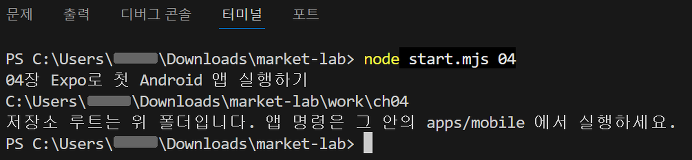

그림 4-1. 명령이 끝나면 터미널에 장 제목과 예제 폴더의 경로가 보인다. 마지막 줄은 다음 명령을 기다린다.

### 왼쪽에서 첫 화면 파일 열기

VS Code 왼쪽에서 **work → ch04 → apps → mobile → App.tsx** 순서로 펼치고 마지막 파일을 클릭한다. 자식 폴더가 하나이면 VS Code가 `work\ch04`, `apps\mobile`처럼 한 줄로 묶어 보여 준다. 위쪽 편집기의 경로가 `work > ch04 > apps > mobile > App.tsx`로 끝나면 책의 첫 앱 파일을 연 것이다. 이 폴더에는 다음 파일들이 있다.

```text
mobile
├─ App.tsx
├─ index.ts
├─ app.json
├─ package.json
├─ package-lock.json
├─ tsconfig.json
└─ src
   └─ data
      └─ sample-products.ts
```

`App.tsx`를 누르면 편집 영역에 첫 앱 코드가 열린다. 아직 수정하지 않고 `package.json`도 열어 본다. `"main": "index.ts"`와 `"start": "expo start"`를 찾아보자. 파일마다 역할이 다르다.

| 파일 | 살펴볼 내용 |
| --- | --- |
| `App.tsx` | 화면에 어떤 글자와 요소를 표시하는가 |
| `index.ts` | 어떤 컴포넌트로 앱을 시작하는가 |
| `app.json` | 앱 이름과 기본 설정은 무엇인가 |
| `package.json` | 어떤 패키지와 실행 명령을 사용하는가 |
| `package-lock.json` | 패키지의 실제 설치 버전을 어떻게 고정했는가 |
| `tsconfig.json` | TypeScript를 어떤 규칙으로 검사하는가 |

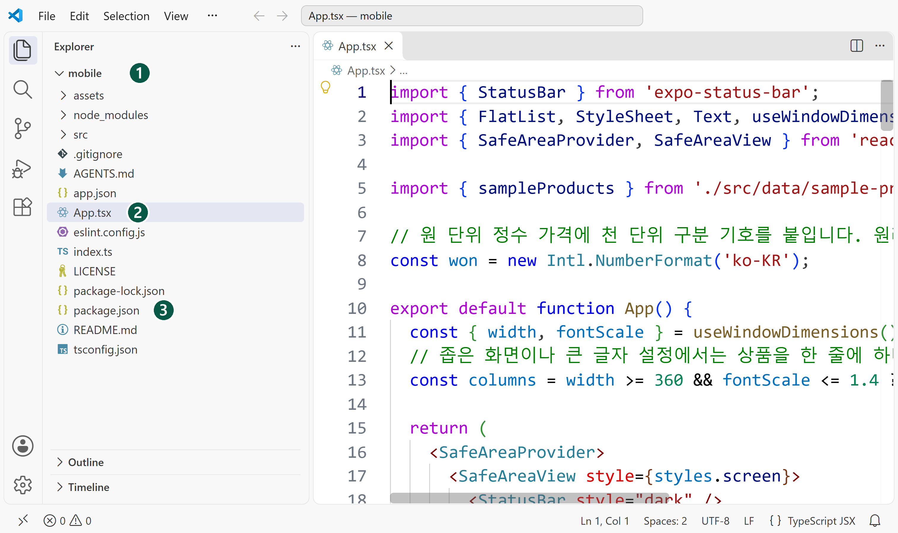

그림 4-2. ① 왼쪽 탐색기의 맨 위 폴더는 mobile, ② 앱 화면을 수정할 파일은 App.tsx, ③ npm의 실행 명령을 확인할 파일은 package.json이다.

지금 연 창에서는 왼쪽에 예제 폴더 전체가 보인다. 그림 4-2는 그 안의 `mobile`을 따로 열어 파일 이름을 크게 보여 준 화면이다. 왼쪽에서 `App.tsx`를 클릭하면 가운데에 코드가 열리고, 아래 터미널은 여전히 원래 폴더에서 명령을 기다린다.

**여러 줄에 빨간 밑줄이 보일 때.** 패키지 설치 전에는 VS Code가 `SafeAreaView` 같은 화면 요소나 `tsconfig.json`에서 불러오는 Expo 설정을 찾지 못할 수 있다. 한꺼번에 여러 진단이 표시될 때도 있다. 지금은 코드를 그대로 두고 4.3절에서 패키지를 설치한다.

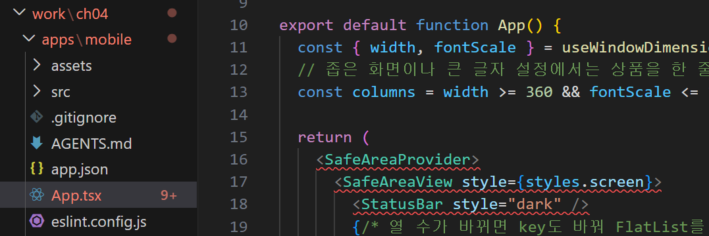

그림 4-3. 설치 전 App.tsx에 표시된 밑줄이다. 각 진단은 아래쪽 ‘문제’ 탭에서 읽을 수 있다.

## 4.3 잠금 파일로 패키지 설치하기

4.2절에서 명령을 입력했던 **아래쪽 터미널**로 돌아온다. 아직 `start.mjs`가 있는 폴더라면 다음 한 줄을 입력한다. 슬래시를 사용한 이 경로는 PowerShell과 Git Bash 양쪽에서 쓸 수 있다.

~~~terminal
cd work/ch04/apps/mobile
~~~

`pwd`를 입력해 경로 끝이 `work/ch04/apps/mobile` 또는 `work\ch04\apps\mobile`인지 확인한다. 이미 `mobile`에 있었다면 이동 명령을 건너뛴다. `ls`를 입력하면 `App.tsx`, `package.json`, `package-lock.json`이 함께 보인다. 이 세 파일이 보이는 위치에서 설치해야 한다.

**PowerShell**을 쓰고 있다면 다음 한 줄을 실행한다.

~~~powershell
npm.cmd ci
~~~

**Git Bash**를 쓰고 있다면 같은 작업을 다음 한 줄로 실행한다.

~~~bash
npm ci
~~~

설치 중에는 터미널에 출력이 이어진다. `added … packages` 같은 요약 뒤에 `PS …\mobile>` 또는 `$`가 돌아오면 설치 결과를 확인할 수 있다. 성공하면 왼쪽 `mobile` 아래에 `node_modules`가 생긴다. 첫 화면을 확인하려면 4.4절로 이어 간다.

`npm ci`는 기존 `package-lock.json`에 기록된 의존성 구성을 설치한다. `node_modules`가 이미 있으면 설치를 다시 구성하므로 서버를 종료한 상태에서 실행한다. 정상 설치를 마친 뒤에는 앱을 켤 때마다 반복할 필요가 없다. `package.json`과 잠금 파일이 서로 맞지 않으면 설치가 중단되며, 잠금 파일을 자동으로 새 구성에 맞춰 쓰지 않는다. [npm ci 공식 설명](https://docs.npmjs.com/cli/v11/commands/npm-ci/)

### 설치가 성공했는지 확인하기

설치 명령의 결과를 숫자로 확인하려면 프롬프트가 돌아온 직후 PowerShell에서는 `$LASTEXITCODE`, Git Bash에서는 `echo $?`를 입력한다. `0`이면 성공이다. 다른 숫자이거나 `npm error`가 보이면 터미널의 첫 오류를 읽는다. `package-lock.json`을 찾을 수 없다고 하면 현재 폴더에서 `ls`를 실행해 잠금 파일이 있는지 본다.

설치에 성공한 후에도 빨간 밑줄이 보이면 VS Code 아래쪽 **문제** 탭(단축키 `Ctrl+Shift+M`)을 클릭한다. 목록의 첫 항목에서 파일과 메시지를 읽는다. `App.tsx`나 `tsconfig.json`의 경로가 방금 설치한 `work/ch04/apps/mobile`에 속하는지 확인한다. **터미널** 탭을 눌러 돌아올 수 있다.

첫 실행을 기록한 환경은 Node.js `26.1.0`, npm `11.13.0`이었다. 설치된 버전은 `node --version`과 `npm.cmd --version`(Git Bash는 `npm --version`)으로 확인한다. 공식 Expo 시작 안내의 기본 요구사항은 [Node.js LTS](https://docs.expo.dev/get-started/create-a-project/)다.

아래는 설치된 패키지 버전을 확인하는 Git Bash 명령이다. PowerShell에서는 맨 앞을 `npm.cmd`로 바꾼다.

~~~bash
npm ls expo react react-native typescript --depth=0
~~~

책의 기준 잠금 파일에서는 다음 버전을 사용한다.

| 패키지 | 기준 잠금 파일의 설치 버전 |
| --- | --- |
| `expo` | 58.0.23 |
| `react` | 19.3.0 |
| `react-native` | 0.88.1 |
| `typescript` | 6.0.3 |
| `react-native-safe-area-context` | 5.11.1 |
| `react-native-web` | 0.21.4 |

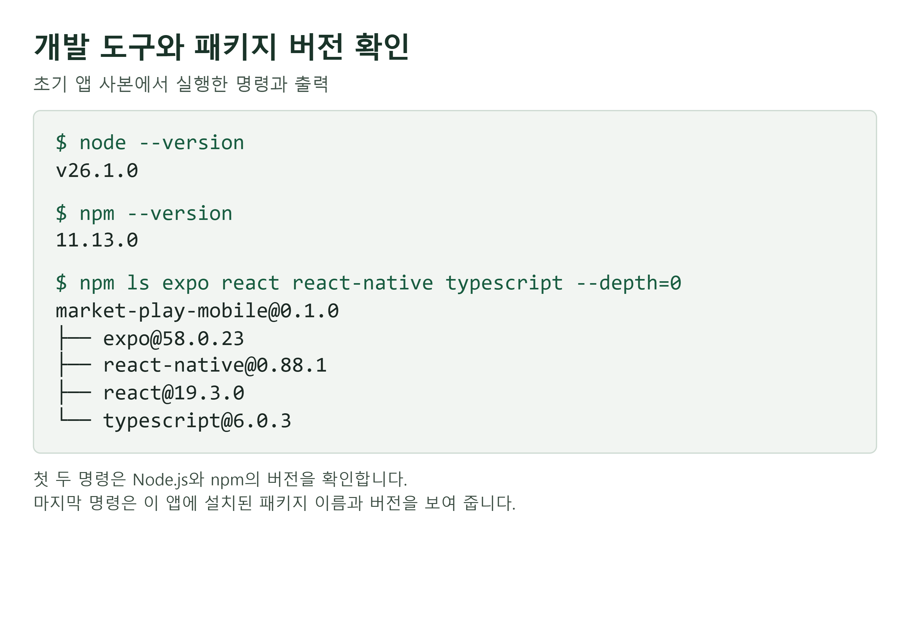

그림 4-4. 책의 첫 앱 사본에서 확인한 도구와 패키지 버전. 실제 명령 출력을 읽기 쉽게 조판한 자료다.

`package.json`의 `~58.0.23`은 허용 범위이고, 잠금 파일의 `58.0.23`은 이 예제에 기록된 구체적 버전이다. 재현 실습에서는 패키지를 하나씩 최신으로 바꾸기보다 이 조합을 먼저 실행한다.

설치 출력에 보안 경고가 함께 나올 수 있다. **설치 성공과 경고 해소는 다른 결과**다. 이 프로젝트의 최초 SDK 58 기록에도 의존성 경고가 남아 있었다. 경고를 없애려고 `npm audit fix --force`를 바로 실행하면 패키지 구성이 크게 바뀔 수 있으므로, 오류 메시지와 대상 패키지를 먼저 확인한다.

마지막으로 원래 코드의 검사를 실행한다.

```bash
npm run typecheck
npm run lint
```

첫 명령은 타입을, 둘째 명령은 코드 규칙을 검사한다. 각각 명령 입력 표시가 돌아온 뒤 다음 명령을 실행한다. 오류가 있으면 파일 이름과 줄 번호를 적는다. 이 단계가 통과해도 휴대전화 화면까지 확인한 것은 아니다.

## 4.4 개발 서버를 켜고 QR 코드 찾기

설치가 성공하면 같은 `mobile` 터미널의 마지막 줄을 클릭한다. **PowerShell**에서는 다음 명령으로 앱의 개발 서버를 켠다.

~~~powershell
npm.cmd start -- --lan --port 8082
~~~

**Git Bash**에서는 다음 한 줄을 입력한다. 사용하는 터미널에서 한 번만 실행한다.

~~~bash
npm start -- --lan --port 8082
~~~

`npm start`는 `package.json`의 `start`를 실행한다. 가운데 `--` 뒤의 옵션은 Expo에 전달한다. `--lan`은 같은 네트워크의 휴대전화에서 연결할 수 있게 하고, `--port 8082`는 이 실습 서버가 사용할 포트를 지정한다.

터미널에 QR 코드가 나오고 그 주변에 연결 주소가 표시된다. 주소의 IP 부분은 PC마다 다르다. 책이나 다른 사람의 화면에 나온 숫자를 그대로 쓰지 말고 **지금 자신의 터미널에서 생성된 QR**을 사용한다. [Expo 개발 시작 안내](https://docs.expo.dev/get-started/start-developing/)에서도 개발 서버의 QR로 앱을 여는 흐름을 안내한다.

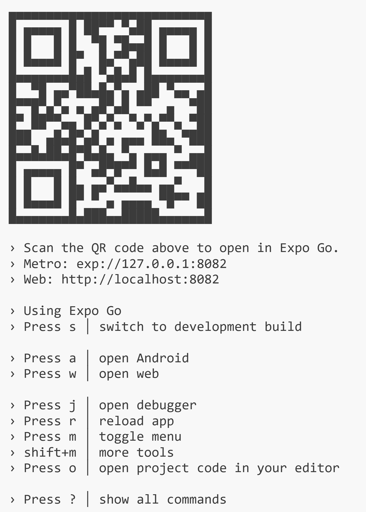

그림 4-5. 실제 Expo SDK 58의 터미널에서 QR과 안내 줄을 확대했다. 촬영용 서버는 PC 안에서만 열어 주소가 127.0.0.1이다. 휴대전화 실습에는 위의 LAN 명령으로 **내 PC에 표시한 QR**을 쓴다.

**위에서 아래로 읽기.** 큰 정사각형이 연결용 QR이다. 그 아래 `Metro: exp://…`는 Expo Go용 주소이며 `Web: http://…`는 브라우저에서 열 주소다. 다음 줄에서 `Using Expo Go`가 보이는지 확인한다. 단축키 안내가 접혀 있으면 터미널을 클릭하고 영문 입력 상태에서 **?**를 누른다. 펼친 목록에서 `Press w` 옆에 웹을 여는 설명을 볼 수 있다.

**PC에서 첫 화면 열기.** 터미널에 `Web: http://…`가 보이면 터미널 안을 클릭하고 영문 **w** 키를 한 번 누른다. 단축키 목록을 펼치지 않아도 된다. Enter는 누르지 않는다. 브라우저가 열리고 코드 묶기가 끝나면 화면에 **꼬마 시장**이 나타난다. 아래로 스크롤해 **사과·우유·당근·식빵·바나나·달걀** 여섯 상품을 확인한다. 브라우저가 자동으로 열리지 않으면 터미널의 `Web` 줄에 나온 주소를 PC 브라우저 주소창에 입력한다. 브라우저를 보는 동안 서버 터미널을 열어 둔다.

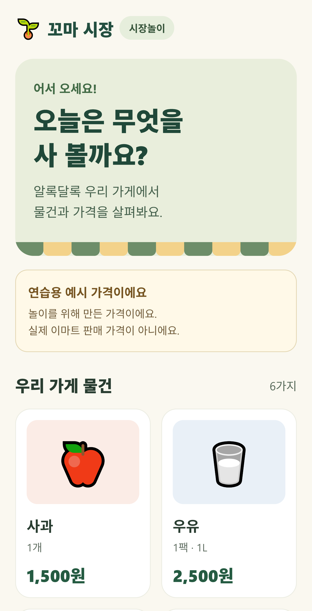

그림 4-6. 처음 실행한 꼬마 시장을 PC 브라우저에서 휴대전화 너비로 본 모습이다. 제목과 상품 목록을 내 화면과 비교한다.

다음 절에서 Android를 연결하기 위해 QR이 다시 필요하면 터미널을 클릭하고 영문 **c** 키를 한 번 누른다. `PS …>`나 `$`가 돌아와 있다면 서버가 종료된 상태다. 위에서 사용한 시작 명령으로 다시 켠다.

터미널이 `8082` 포트를 이미 사용 중이라고 알려 주면, 자신이 앞에서 켜 둔 같은 실습 서버인지 먼저 확인한다. 본인 실습 서버라면 그 터미널로 돌아가 `Ctrl+C`로 종료하고 다시 실행한다. 다른 작업이 쓰는 포트라면 그 작업을 중단하지 말고 다음처럼 다른 번호를 사용한다.

```bash
npm start -- --lan --port 8083
```

이후 연결에는 새 QR을 사용한다. 터미널에 QR이 보인다는 것은 서버가 준비되었다는 뜻이다. 휴대전화 연결과 화면 표시는 다음 절에서 확인한다.

## 4.5 같은 네트워크의 Android에서 첫 화면 열기

휴대전화의 Wi-Fi 이름과 PC가 연결한 네트워크를 확인한다. 가능하면 같은 공유기의 개인 네트워크에서 실습한다. 공용 Wi-Fi는 기기끼리 연결하지 못하게 설정되어 있을 수 있다.

Android에 설치할 Expo Go는 [Expo 공식 다운로드 페이지](https://expo.dev/go)에서 확인한다. 이 책의 예제는 **SDK 58**이므로 해당 SDK를 열 수 있는 Android용 Expo Go를 사용한다. 2026-11-21에 확인한 페이지는 SDK 58을 표시했다. 이후 버전이 달라지면 4.7절의 호환성 진단을 따른다.

Expo Go를 열고 QR을 읽는 기능으로 PC 터미널의 QR을 스캔한다. 카메라 권한을 묻는 경우 QR 읽기에 필요한 권한을 허용한다. 첫 연결에서는 앱 코드를 읽고 묶는 시간이 필요하다. 휴대전화의 로딩 표시와 PC 터미널의 진행 상황을 함께 본다.

### PC의 QR과 휴대전화의 스캐너를 연결하기

1. **PC**에서 QR이 보이는 터미널은 열어 둔다. 화면을 확대하려고 QR을 따로 저장할 필요가 없다.

2. **Android 기기**에서 Expo Go를 열고 홈의 **Development servers** 구역을 찾는다. 주소를 직접 입력하는 행 바로 아래에 QR 아이콘과 **Scan QR** 행이 있다. 그 행을 누른다. 화면 읽기를 사용하면 **Scan QR Code**라고 들릴 수 있다. 카메라 접근을 처음 묻는다면 앱을 사용하는 동안 허용한다.

3. **휴대전화 카메라**에 PC의 QR 사각형 네 모서리가 모두 들어오게 한다. 휴대전화 화면이 프로젝트 로딩으로 넘어가면 카메라를 내려도 된다. PC에 묶음 생성 진행 표시가 나오면 그동안 서버를 열어 둔다.

4. **휴대전화**에 꼬마 시장과 상품 목록이 보이면 연결을 확인한 것이다. QR만 표시된 상태, 로딩이 시작된 상태, 상품이 뜬 상태를 구분해 둔다. 스캔은 됐는데 계속 로딩이라면 아래 4.7절의 같은 Wi-Fi 확인부터 진행한다. [SDK 58의 실제 Android 홈 화면 구성](https://github.com/expo/expo/blob/sdk-58/apps/expo-go/android/expoview/src/main/java/host/exp/exponent/home/HomeScreen.kt#L123-L181) · [Expo의 Android QR 실행 안내](https://docs.expo.dev/tutorial/create-your-first-app/)

Android에서도 그림 4-6의 **꼬마 시장** 제목과 예시 상품 6개가 보이는지 확인한다. 상품 가격은 이 책의 실습용이다.

여기서 상품 목록이 나타나면 다음 세 가지가 연결된 것이다.

1. PC가 올바른 앱 폴더에서 서버를 실행했다.
2. Android의 Expo Go가 그 서버에 접속했다.
3. 첫 화면 코드와 예시 데이터를 읽어 화면을 만들었다.

이 결과는 개발 중인 코드를 Expo Go로 연 것이다. 아직 기기에 독립 실행 APK를 설치한 단계는 아니다. 휴대전화 화면을 확인한 뒤에도 서버 터미널을 열어 둔다.

## 4.6 App.tsx를 작은 화면으로 바꾸고 저장하기

이제 우리가 직접 입력한 문구를 표시해 보자. 이번 수정은 **학습용 복사본의 App.tsx 한 파일**에만 한다.

VS Code에서 현재 열어 둔 `App.tsx`의 경로를 다시 확인한다.

```text
work/ch04/apps/mobile/App.tsx
```

개발을 진행 중인 다른 저장소의 `App.tsx`나 저장소 최상위 폴더에 아래 코드를 붙여 넣지 않는다. 이 복사본에서는 상품 목록 대신 작은 첫 화면을 표시하며 편집 과정을 배우는 것이다.

서버는 켜 둔 채 파일 내용 전체를 아래 코드로 바꾼다. 코드 블록 위아래의 `tsx`와 울타리 기호는 입력하지 않는다.

```tsx
import { StyleSheet, Text, View } from 'react-native';
import {
  SafeAreaProvider,
  SafeAreaView,
} from 'react-native-safe-area-context';

export default function App() {
  return (
    <SafeAreaProvider>
      <SafeAreaView style={styles.screen}>
        <View style={styles.card}>
          <Text style={styles.title}>꼬마 시장</Text>
          <Text style={styles.message}>내 첫 Android 앱이 열렸어요.</Text>
          <Text style={styles.detail}>다음에는 상품을 골라 볼 거예요.</Text>
        </View>
      </SafeAreaView>
    </SafeAreaProvider>
  );
}

const styles = StyleSheet.create({
  screen: {
    flex: 1,
    backgroundColor: '#FAF8EF',
  },
  card: {
    // 본문 여백은 기기가 정하는 안전 영역과 별도로 둡니다.
    margin: 20,
    padding: 20,
    borderRadius: 20,
    backgroundColor: '#FFFFFF',
  },
  title: {
    fontSize: 30,
    fontWeight: '700',
    color: '#184F39',
  },
  message: {
    marginTop: 16,
    fontSize: 20,
    color: '#20392D',
  },
  detail: {
    marginTop: 12,
    fontSize: 16,
    color: '#526257',
  },
});
```

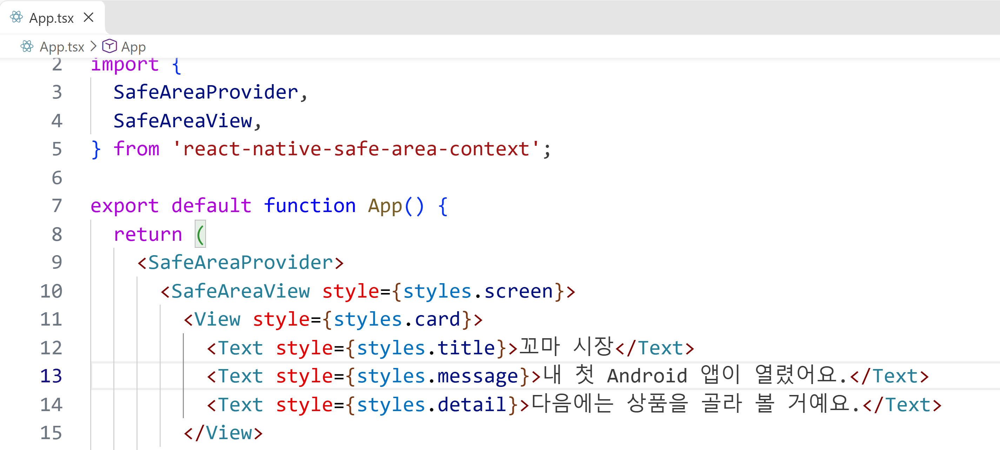

그림 4-7. 실행할 문장이 들어 있는 App.tsx의 편집 영역이다. 같은 이름의 파일을 열었는지 탭을 먼저 보고, `styles.message` 옆 한국어 문장을 찾는다.

파일 전체를 처음 바꿀 때는 오른쪽 **코드 위를 클릭한 후** `Ctrl+A`를 누른다. 선택 배경이 코드에 생긴 것을 보고 붙여 넣는다. 아래 터미널에 선택 배경이나 커서가 보이면 편집기 안을 다시 클릭한다. 긴 줄이 오른쪽으로 넘어가면 **보기 → 자동 줄 바꿈(Word Wrap)**으로 줄을 화면 안에 접어 볼 수 있다.

`Ctrl+S`를 눌러 저장한다. 저장 전에는 편집기 안의 내용만 바뀌고, 개발 서버가 읽는 파일에는 변경이 반영되지 않을 수 있다. 정상적으로 연결되어 있으면 휴대전화 화면이 자동으로 갱신되어 크림색 배경과 흰색 카드, 세 줄의 문구가 표시된다.

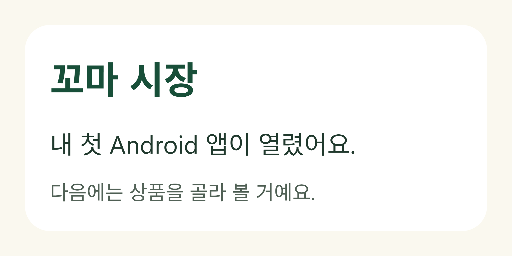

그림 4-8. 이 절의 App.tsx를 적용한 PC 웹 실행 결과. 제목과 안내 문구 세 줄을 확인했다.

두 import 문은 다른 패키지가 제공하는 기능을 가져온다. `Text`는 글자를, `View`는 요소를 담을 영역을 만든다. `StyleSheet.create`는 이름을 붙인 스타일을 정의하며 `styles.title`처럼 필요한 요소에 연결한다. [React Native Text](https://reactnative.dev/docs/text), [View](https://reactnative.dev/docs/view), [StyleSheet](https://reactnative.dev/docs/stylesheet)

`SafeAreaProvider`는 화면의 안전 영역 정보를 제공하고, `SafeAreaView`는 그 정보를 사용해 시스템 표시 영역과 내용이 겹치지 않게 배치한다. 이 둘은 `react-native-safe-area-context`에서 가져온다. 기준 예제에는 해당 패키지가 이미 들어 있으므로 추가 설치하지 않는다. [Expo SDK 58 안전 영역 안내](https://docs.expo.dev/versions/v58.0.0/sdk/safe-area-context/)

한 번 더 직접 바꿔 보자. 다음 한 줄의 **글자 부분만** 수정한다.

수정 전:

```tsx
<Text style={styles.message}>내 첫 Android 앱이 열렸어요.</Text>
```

수정 후:

```tsx
<Text style={styles.message}>내가 만든 꼬마 시장에 오세요!</Text>
```

`<Text`나 `</Text>`는 그대로 두고, `Ctrl+S`로 저장한다. 휴대전화에 새 문장이 보이는지 확인한다. 글자가 길어 두 줄로 나뉘는 것은 화면 너비에 따른 배치 결과다.

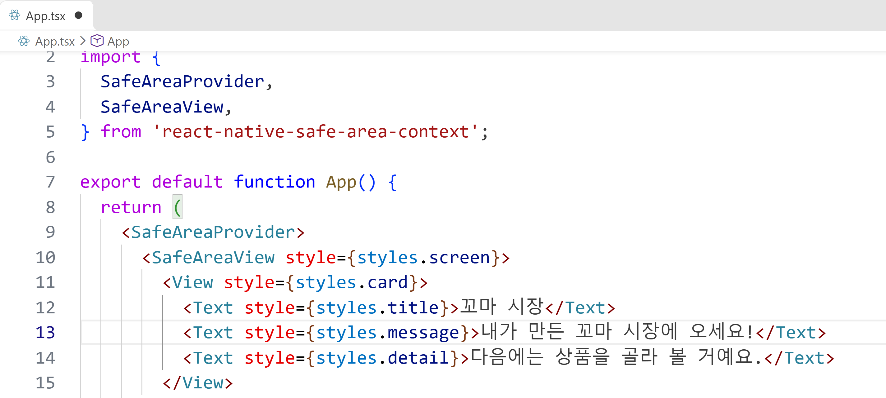

그림 4-9. 새 인사말을 입력한 직후의 실제 편집기다. 위쪽 `App.tsx` 탭의 점은 마지막 저장 뒤 수정한 내용이 있다는 표시다. 자동 저장을 켠 환경에서는 점이 잠깐 나타날 수 있다.

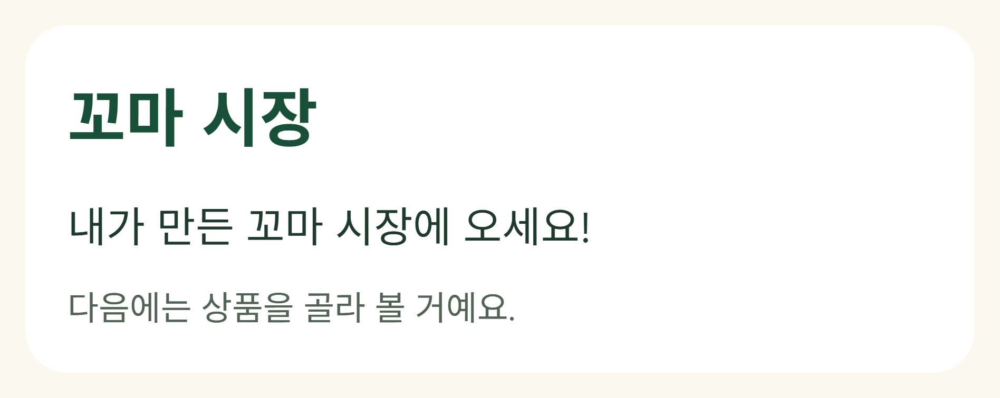

그림 4-10. 같은 소스의 PC 웹 미리보기에서 저장 뒤 가운데 줄이 ‘내가 만든 꼬마 시장에 오세요!’로 바뀌었다. 제목과 마지막 줄을 함께 보면 정확히 어느 부분을 수정했는지 알 수 있다.

세 화면을 순서대로 대조한다. **편집기 탭**에서는 저장 표시가 사라지고, **터미널**에서는 서버가 실행 중이며, **앱**에서는 바꾼 문장이 보인다. 한 곳만 다르면 그곳부터 점검한다. 예를 들어 탭에 점이 있으면 저장부터 하고, 프로그램이 종료되어 `$`가 보이면 서버를 다시 켠다.

### PC 웹 미리보기에서 같은 수정 확인하기

QR이 표시된 서버 터미널을 한 번 선택하고 키보드의 **w**를 누른다. 이는 서버가 제공하는 단축키이므로 명령 입력 줄에 `w`를 실행하는 것과 다르다. 브라우저가 열리면 휴대전화와 같은 문구인지 비교한다. 브라우저가 자동으로 열리지 않으면 터미널에 표시된 웹 주소를 PC 브라우저에 입력한다.

기본 경로의 잠금 파일에는 웹에 필요한 `react-dom`과 `react-native-web`이 포함되어 있다. 선택 실습에서 만든 새 템플릿에 웹 의존성이 없다면 해당 템플릿 폴더에서 공식 안내에 따라 별도로 설치해야 한다. [Expo 웹 개발 안내](https://docs.expo.dev/workflow/web/)의 설치 명령은 다음과 같다.

```bash
npx expo install react-dom react-native-web @expo/metro-runtime
```

이 추가 설치는 **새 빈 템플릿에 웹 의존성이 없을 때의 설명**이다. 책의 기준 복사본에서 문제가 없는데 잠금 파일을 바꾸기 위해 실행하지 않는다.

웹은 PC에서 빠르게 문구와 배치를 살피는 미리보기다. Android의 키보드·터치·화면 읽기 동작까지 확인한 것으로 대신하지 않는다.

### 바꾼 파일 검사하기

서버 터미널은 열어 둔다. 왼쪽 탐색기에서 `work → ch04 → apps → mobile`의 **mobile 폴더**를 오른쪽 클릭해 **통합 터미널에서 열기(Open in Integrated Terminal)**를 고른다. 새 터미널에서 `pwd`를 입력해 경로가 `apps/mobile`로 끝나는지 본다. Git Bash에서는 다음을 입력한다. PowerShell에서는 `npm.cmd`로 시작한다.

~~~bash
npm run typecheck
npm run lint
cat App.tsx
~~~

`cat`은 저장된 파일의 내용을 터미널에 표시한다. 이 절에서 입력한 제목과 안내 문장이 나오면 편집기에 보이는 파일과 방금 검사한 파일이 같다.

타입 검사에서 `Cannot find name`이나 구문 오류가 나오면 처음 오류의 파일과 줄로 이동한다. 파일 내용을 전부 붙였는지, 괄호와 닫는 태그가 빠지지 않았는지 살펴본다.

**작은 연습:** 제목을 ‘우리 동네 꼬마 시장’으로 바꾸고, `styles.title`의 `fontSize`를 `30`에서 `26`으로 바꿔 저장한다. 휴대전화와 PC에서 바뀐 문구와 글자 크기를 확인한 뒤 원하는 값으로 되돌린다. 한 번에 두세 곳만 바꾸면 어떤 코드가 화면에 영향을 주었는지 알아보기 쉽다.

## 4.7 QR 연결 실패와 SDK 호환 오류 구별하기

앱이 열리지 않을 때는 화면을 다시 만드는 것보다 **어느 단계에서 멈췄는지** 먼저 살핀다.

| 관찰한 상황 | 먼저 확인할 곳 |
| --- | --- |
| 터미널에 QR이 나오지 않았다 | 앱 폴더, 설치 결과, 서버의 첫 오류 |
| QR은 있지만 기기가 계속 접속을 기다린다 | 같은 네트워크, 현재 QR, PC 서버 실행 상태 |
| SDK가 맞지 않는다고 명시한다 | 프로젝트의 Expo 버전과 Expo Go 지원 SDK |
| 앱이 열렸지만 빨간 오류 화면이 나온다 | 오류에 적힌 파일·줄과 코드 문법 |
| 예전 문구가 계속 보인다 | 열린 파일 경로, 저장 여부, 접속한 서버 |

### 연결이 닿지 않는 경우

먼저 PC의 서버 터미널이 아직 켜져 있는지 확인한다. 브라우저를 닫은 것과 서버를 종료한 것은 다르다. 서버를 재시작했거나 포트가 바뀌었다면 현재 터미널의 QR을 다시 읽는다.

PC와 휴대전화의 Wi-Fi 이름도 비교한다. PC가 휴대전화와 다른 네트워크나 VPN 경로에 연결되어 있으면 같은 주소로 닿지 않을 수 있다. 공용망에서 접속이 안 되면 개인 네트워크에서 다시 확인한다. Windows 방화벽 안내가 나타났다면 현재 개발 서버를 신뢰하는 개인 네트워크에서 사용할 수 있도록 설정했는지 확인하고, 방화벽 전체를 끄는 방식으로 해결하지 않는다.

LAN 연결을 사용할 수 없는 경우에는 서버를 `Ctrl+C`로 종료한 뒤 아래 터널 연결을 시도할 수 있다.

```bash
npm start -- --tunnel
```

터널은 외부 중계 연결을 사용하므로 인터넷 연결이 필요하고 LAN보다 느릴 수 있다. 필요한 연결 도구의 추가 설치 안내가 나오면 출력 내용을 확인한다. 이 경우에도 **새로 만들어진 QR**을 읽는다. 터널은 네트워크 경로를 바꾸는 방법이며 SDK 불일치를 고치는 방법은 아니다. [Expo 연결 문제 안내](https://docs.expo.dev/get-started/start-developing/#having-problems)

### SDK가 맞지 않는 경우

프로젝트의 첫 개발에서도 다음 오류가 실제로 나타났다.

```text
Project is incompatible with this version of Expo Go
The installed version of Expo Go is for SDK 58.
The project you opened uses SDK 57.
```

이 메시지는 휴대전화가 프로젝트를 열어 보려 했지만 지원 버전이 달랐다는 뜻이다. 당시에는 프로젝트를 SDK 58로 올린 뒤 갤럭시의 상품 6개 표시를 확인했다. 이 장에서 복원한 `adcfaab`는 그 수정이 반영된 코드다.

기준 복사본에서 같은 문제가 나오면 4.6절처럼 `mobile` 폴더를 오른쪽 클릭해 통합 터미널을 연다. 그 위치에서 프로젝트의 Expo 버전을 확인한다.

~~~bash
npm ls expo --depth=0
~~~

예제의 결과는 `expo@58.0.23`이다. 휴대전화는 [공식 Expo Go 다운로드 페이지](https://expo.dev/go)에서 이 SDK에 맞는 Android 지원 여부를 확인한다. 시간이 지나 스토어의 Expo Go가 다른 SDK로 바뀌었다면 공식 배포 경로에서 맞는 버전을 확인한다. 지원되는 실행 앱을 찾지 못하면 웹 미리보기까지만 확인한 상태로 남기고, 책의 SDK를 올리는 작업과 별도로 다룬다.

`npx expo install --fix`는 설치된 SDK에 맞춰 의존성을 조정하는 명령이다. `npx expo-doctor`는 구성을 진단한다. 이런 명령은 오류 원인을 확인한 뒤 사용하는 도구이며, 모든 연결 문제에 무조건 실행하는 초기화 명령이 아니다. SDK 변경 절차는 [Expo 업그레이드 안내](https://docs.expo.dev/workflow/upgrading-expo-sdk-walkthrough/)를 확인한다.

### 저장했는데 화면이 바뀌지 않는 경우

먼저 VS Code의 파일 경로 끝이 `work/ch04/apps/mobile/App.tsx`인지 확인한다. 이어서 `Ctrl+S`를 누르고, QR이 있는 서버 터미널에서 **r**을 눌러 다시 불러온다. 휴대전화가 다른 프로젝트를 열고 있다면 현재 QR을 다시 읽는다.

패키지를 바꾼 뒤 이전 서버가 계속 켜져 있었다면 서버를 종료하고 캐시를 비워 다시 시작한다.

```bash
npm start -- --lan --port 8082 --clear
```

이 명령은 **이전 서버를 Ctrl+C로 종료한 다음** 실행한다. `--clear`는 개발 서버 캐시를 비우는 옵션이다. 오류 없이 실행되는 동안 매번 사용할 필요는 없다. 서버의 단축키와 연결 옵션은 [Expo CLI 안내](https://docs.expo.dev/more/expo-cli/)에서 확인할 수 있다.

## 4.8 서버를 종료하고 같은 앱 다시 열기

실습을 마치면 QR이 있는 터미널을 선택하고 `Ctrl+C`를 누른다. 명령 입력 표시가 돌아오면 서버가 종료된 것이다. 브라우저와 휴대전화에 마지막 화면이 남아 있어도 새로운 코드를 전달하는 서버는 멈춰 있다.

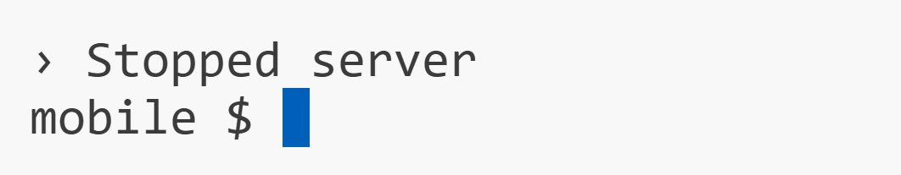

그림 4-11. 실행 중이던 터미널에서 `Ctrl+C`를 눌러 멈춘 결과다. 중지 안내 아래 `mobile $`와 커서가 나타나 새 명령을 받을 수 있다.

같은 `Ctrl+C`도 어디를 눌렀는지에 따라 결과가 다르다. 오른쪽 편집기에 커서가 있으면 복사가 된다. 아래 터미널 **안쪽의 빈 곳**을 먼저 누르고 실행한다. 종료한 뒤 파일 탐색기에는 `App.tsx`가 그대로 남는다. 다음에 여는 것은 저장한 앱 파일이고, 다시 시작하는 것은 코드를 전달하는 서버다.

다음 날 이어서 하려면 **파일 → 폴더 열기**로 `start.mjs`가 있는 원래의 예제 폴더를 연다. 왼쪽에서 **work → ch04 → apps → mobile**을 펼친 뒤 **mobile**을 오른쪽 클릭해 **통합 터미널에서 열기**를 선택한다. `pwd`로 끝이 `apps/mobile`인지 확인한다. 패키지는 이미 설치했으므로 4.4절에서 사용한 시작 명령만 다시 실행한다.

| 새로 연 터미널 | 입력할 명령 |
| --- | --- |
| PowerShell | `npm.cmd start -- --lan --port 8082` |
| Git Bash | `npm start -- --lan --port 8082` |

터미널에 `Web:` 주소가 보이면 **w**로 PC 미리보기를 열고, Android에서는 새 QR을 Expo Go로 읽는다. 마지막으로 저장한 제목과 문구가 보이면 같은 작업을 이어서 할 수 있다.

개발 서버가 여러 개라면 각 터미널에서 어느 경로를 실행했는지 확인한다. 이 장의 실습을 마칠 때에는 이 장에서 켠 서버만 종료한다.

### 선택 실습으로 빈 프로젝트와 비교하기

첫 앱을 실행한 뒤 새 템플릿이 궁금하다면 2장에서 만든 사용자 폴더의 `market-book`에서 별도로 만들어 볼 수 있다. 아래는 Git Bash 명령이다.

~~~bash
cd ~/market-book
npx create-expo-app@latest ch04-template --template blank-typescript
~~~

이 명령은 `ch04-template` 폴더를 만든다. `@latest`가 내려받는 도구와 템플릿은 실행 시점에 따라 달라진다. 생성된 파일과 책의 `work/ch04/apps/mobile`을 비교한 뒤 다음 장에서는 책의 장별 예제를 사용한다. [Expo 생성 도구 안내](https://docs.expo.dev/more/create-expo/)


### 이번 장 완료 확인

아래 항목을 실제로 수행한 뒤 표시한다.

- [ ] `node start.mjs 04`로 준비한 `work/ch04/apps/mobile/App.tsx`를 열었다.
- [ ] `apps/mobile`에서 패키지를 설치하고 타입·린트 검사를 실행했다.
- [ ] 서버에서 **w**를 눌러 PC 브라우저의 **꼬마 시장**과 상품 6개를 확인했다.
- [ ] Expo Go에서 수정 전 예시 상품 6개를 확인했다.
- [ ] 학습용 `App.tsx`를 작은 화면으로 바꿔 저장했다.
- [ ] 직접 바꾼 문구를 Android와 PC 웹에서 확인했다.
- [ ] 서버를 종료하고 다시 켜도 저장한 화면이 보인다.
- [ ] 연결 오류와 SDK 불일치 메시지의 차이를 설명할 수 있다.

날짜, Node·npm·Expo 버전, 기기 이름, 표시한 문구를 짧게 적어 두자. 휴대전화 연결이 안 되어 웹만 확인했다면 ‘PC 웹 확인, Android 미확인’으로 기록한다.

5장을 직접 따라 만들 때는 지금 작업한 `work/ch04/apps/mobile`에서 다음 장을 시작한다. **5장의 완성 참고본을 따로 보려면** VS Code의 **파일 → 폴더 열기**에서 처음 ZIP을 푼 폴더를 다시 선택한다. **터미널 → 새 터미널**을 열고 `ls` 목록에 `start.mjs`가 보이면 그곳에서 `node start.mjs 05`를 실행한다. 왼쪽의 `work`를 펼치면 직접 수정한 `ch04`와 새로 꺼낸 `ch05`를 나란히 볼 수 있다.

## 집필 근거와 검증 기록

이 절은 집필·검토용 기록이며 출판 본문에서는 참고자료와 검증표로 정리한다.

- 2026-11-21에 저장소의 `adcfaab` 전체 커밋 값, `apps/mobile/package.json`·`package-lock.json`·`index.ts`·`tsconfig.json`과 파일 목록을 읽었다. 잠금 파일 형식은 3이고 Expo 58.0.23·React Native 0.88.1 등의 구체적 설치 버전을 확인했다.
- 원래 SDK 58 첫 화면의 갤럭시 확인은 [기존 호환 오류 해결 기록](../chapters/01a-expo-go-sdk58.md)에 근거한다. 이 장의 새 작은 화면을 그 과거 실기기 결과로 대신 검증하지 않는다.
- Expo SDK 58 문서, Expo의 생성·시작·CLI·웹·업그레이드 문서, React Native 공식 Text·View·StyleSheet 문서와 npm 11의 `npm ci` 설명을 확인했다. React Native의 버전별 URL은 조회되지 않아, 당시 버전 선택에 0.88이 표시되는 공식 기본 문서로 API를 대조했다.
- 4.3절의 도구 버전 그림은 초기 커밋의 깨끗한 별도 사본에서 실제 실행한 `node --version`·`npm --version`·`npm ls expo react react-native typescript --depth=0`의 결과를 조판한 자료다. 원본 명령과 생략 범위는 `figures/04-tool-versions-excerpt.json`에 남긴다.
- 원고 작성 중 초기 커밋의 앱을 별도 복사본으로 분리해 `npm ci --offline`으로 741개 패키지를 설치하고, 해당 Expo SDK로 웹 내보내기를 완료했다. 그림 4-6은 그 초기 상품 화면의 PC 웹 미리보기다. 원격 GitHub 재복제·새 빈 템플릿 생성·QR 연결·Android 실기기 실행은 이번 검증에 포함하지 않았다.
- 새 작은 `App.tsx` 코드 블록은 현재 설치된 TypeScript의 가상 파일 검사에서 진단 0건, ESLint의 `lintText` 검사에서 오류 0건·경고 0건을 확인했다. 이어서 초기 커밋의 별도 복사본에 같은 코드를 적용해 `npm run typecheck`·`npm run lint`를 통과했고, `expo export --platform web --platform android`에서 웹 140개·Android 622개 모듈 내보내기를 완료했다. PC 브라우저에서 제목과 안내 문구 세 줄을 확인하고 그림 4-8을 캡처했다. 원래 작업 중인 앱 파일은 수정하지 않았다. Android 번들 생성은 휴대전화에서의 실행 검증과 구분한다.

<!-- 편집용 후속 그림 후보: 학습용 apps/mobile 파일 트리와 App.tsx·package.json, 해당 복사본에서 실제 실행한 QR 터미널, 이 장 작은 App.tsx의 Android 화면과 수정 후 문구. 그림 4-6은 figures/04-first-catalog-web.png, 그림 4-8은 figures/04-exercise-web.png로 연결했다. 미확보 그림에 가짜 화면이나 뒤 단계 기기 캡처를 대신 사용하지 않는다. -->
