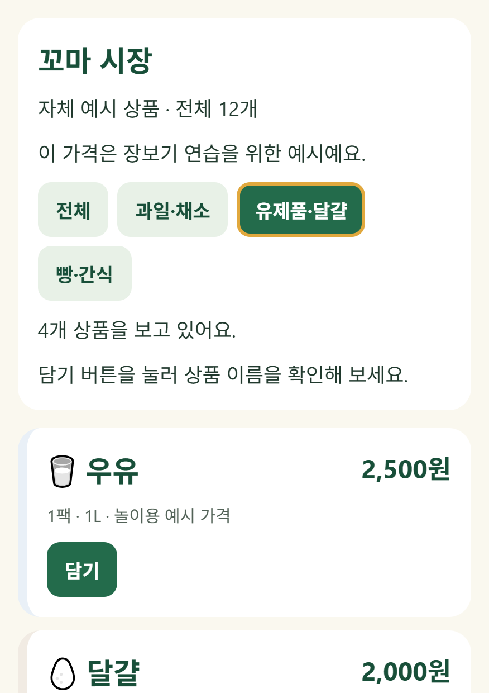

# 5장 상품 목록과 분류 만들기

4장에서 작은 카드에 세 줄의 문구를 띄웠다. 이제 화면의 중심을 상품 목록으로 바꾼다. 사과와 우유를 서로 다른 카드로 표시하고, 분류 버튼을 누르면 필요한 상품만 보이게 만든다. 이번 장을 마치면 상품 12개를 표시할 수 있고, 각 카드의 담기 버튼이 어떤 상품을 가리키는지 확인할 수 있다.

**이번 장의 담기 버튼은 상품 이름을 안내하는 단계**다. 수량과 금액을 누적하는 장바구니는 6장에서 연결한다. 목록과 버튼이 올바르게 연결되는지 먼저 확인하면, 다음 장에서 생긴 문제를 계산 문제와 화면 연결 문제로 나누어 찾기 쉽다.



그림 5-1. 유제품·달걀 분류를 선택한 PC 웹 미리보기(재현). Android 동작은 독자의 기기에서 별도로 확인한다.

### 작업 폴더와 완성 참고본

본문을 따라 입력할 폴더는 4장에서 사용한 `work/ch04/apps/mobile`이다. 이 책의 Git Bash 명령에서 `~/market-book/kit`은 예제를 푼 곳을 뜻한다. 2.6절처럼 다운로드에 풀었다면 명령의 그 부분을 `~/Downloads/market-lab`으로 바꾼다. 서버가 켜져 있으면 먼저 `Ctrl+C`로 종료한다. VS Code에서 이 폴더를 연다.

동봉 자료의 **완성 참고본**을 따로 보고 싶다면 ZIP을 `~/market-book/kit`에 푼 뒤 다음 명령을 실행한다. 완성 참고본에는 이번 장까지의 코드가 들어 있다. 직접 입력하는 작업 폴더와 서로 다른 폴더다.

```bash
cd ~/market-book/kit
node start.mjs 05
cd work/ch05/apps/mobile
npm ci
npm start -- --lan --port 8082
```

같은 포트를 사용하는 개인 작업 서버를 켜 두었다면 참고본은 `8083` 같은 다른 포트로 실행한다. 자신의 코드를 수정하며 배울 때에는 VS Code에서 `kit/work/ch04/apps/mobile`을 다시 열고, 그 서버의 QR을 사용한다. 새 참고본은 이미 있는 개인 작업을 덮어쓰는 용도로 사용하지 않는다.

## 5.1 자체 제작 예시 상품의 이름과 가격과 단위 정하기

상품 이름만으로는 가격의 뜻을 알 수 없다. ‘우유 2,500원’이 200mL 한 팩인지 1L 한 팩인지에 따라 다른 상품이 된다. 따라서 이름과 단위를 별도로 기록한다. 가격은 계산할 숫자 `2500`으로 저장하고, 화면에 보일 때만 `2,500원`으로 바꾼다.

이번 예시는 사과 1개 1,500원, 우유 1팩·1L 2,500원처럼 우리가 정한 놀이 가격이다. 실제 매장이나 온라인 판매점의 현재 가격을 옮긴 자료가 아니다. 화면에 예시 가격이라고 표시하는 이유도 여기에 있다.

상품마다 바뀌지 않는 이름표인 **ID**를 붙인다. 화면에 보이는 이름은 ‘사과’이지만 코드에서 찾는 값은 `sample-apple`이다. 이름을 ‘빨간 사과’로 고쳐도 ID는 그대로 두면 같은 상품을 이어서 다룰 수 있다.

| 필드 | 사과 예시 | 사용하는 곳 |
| --- | --- | --- |
| `id` | `sample-apple` | 카드 구분, 버튼, 장바구니 |
| `name` | 사과 | 화면 글자 |
| `unit` | 1개 | 가격 기준 설명 |
| `priceKrw` | 1500 | 합계 계산 |
| `categoryId` | `produce` | 분류 검색 |
| `emoji`·`color` | 사과 그림·배경색 | 카드의 시각적 구분 |
| `isSample` | `true` | 예시 가격 안내 |

ID에 상품 순서 번호를 쓰지 않는다. 목록 중간에 새 상품을 넣으면 순서는 달라져도 상품 자체는 그대로이기 때문이다.

## 5.2 sample-products.ts에 상품 데이터 작성하기

VS Code 탐색기에서 `src` 아래 `features/catalog` 폴더를 만들고 `categories.ts` 파일을 만든다. 운영체제 탐색기에서 파일 확장자를 숨겨 두면 `categories.ts.txt`로 저장할 수 있으므로, VS Code 안에서 파일을 생성하는 편이 명확하다.

먼저 세 분류와 필터 규칙을 작성한다. **파일 전체**는 다음과 같다.

```ts
export const PRODUCT_CATEGORIES = [
  { id: 'produce', label: '과일·채소' },
  { id: 'dairy-eggs', label: '유제품·달걀' },
  { id: 'bakery-snacks', label: '빵·간식' },
] as const;

export type ProductCategoryId = typeof PRODUCT_CATEGORIES[number]['id'];
export type CatalogFilter = 'all' | ProductCategoryId;
export type CategoryCounts = Readonly<Record<CatalogFilter, number>>;

export function isProductCategoryId(value: unknown): value is ProductCategoryId {
  return PRODUCT_CATEGORIES.some((category) => category.id === value);
}

export function filterProductsByCategory<T extends { categoryId: ProductCategoryId }>(
  products: readonly T[],
  category: CatalogFilter,
): readonly T[] {
  // 분류는 보이는 목록에만 적용합니다. 가격 계산과 장바구니에는 원래 전체 목록을 사용합니다.
  return category === 'all' ? products : products.filter((product) => product.categoryId === category);
}

export function getCategoryCounts(products: readonly { categoryId: ProductCategoryId }[]): CategoryCounts {
  const counts: Record<CatalogFilter, number> = { all: products.length, produce: 0, 'dairy-eggs': 0, 'bakery-snacks': 0 };
  for (const product of products) counts[product.categoryId] += 1;
  return counts;
}
```

`as const`는 분류 ID가 일반 문자열로 넓어지지 않게 한다. `ProductCategoryId`는 이 목록의 세 ID 중 하나만 허용하는 타입이다. 실제 값 목록과 타입을 별도로 두지 않아 둘이 어긋날 가능성을 줄인다.

같은 폴더에 `catalog.ts`를 만든다. 이후 상품을 앱 안에서 읽든 서버에서 받든 화면은 같은 필드를 사용하도록 정한 약속이다.

```ts
import type { ProductCategoryId } from './categories.ts';

// 화면은 상품을 받는 경로와 무관하게 같은 필드로 읽습니다.
export type CatalogProduct = Readonly<{
  id: string;
  name: string;
  unit: string;
  categoryId: ProductCategoryId;
  priceKrw: number;
  emoji: string;
  color: string;
  isSample: boolean;
  priceObservationId?: string;
}>;
```

다음은 `src/data/sample-products.ts`다. 4장 기준 파일의 내용 전체를 아래 내용으로 바꾼다.

```ts
import type { ProductCategoryId } from '../features/catalog/categories.ts';

/**
 * 직접 만든 학습용 예시입니다. 실제 이마트·SSG에서 확인한 상품 가격이 아닙니다.
 * 이후 허용된 실제 가격을 연결할 때도 예시 데이터와 출처를 구분합니다.
 */
export type SampleProduct = {
  id: string;
  name: string;
  unit: string;
  categoryId: ProductCategoryId;
  // 계산 오차를 피하도록 소수점 없는 원 단위 정수로 작성합니다.
  priceKrw: number;
  emoji: string;
  color: string;
  // 실제 가격으로 오인하지 않도록 예시 상품에만 true를 지정합니다.
  isSample: true;
};

export const sampleProducts: SampleProduct[] = [
  { id: 'sample-apple', name: '사과', unit: '1개', categoryId: 'produce', priceKrw: 1500, emoji: '🍎', color: '#FBECE6', isSample: true },
  { id: 'sample-milk', name: '우유', unit: '1팩 · 1L', categoryId: 'dairy-eggs', priceKrw: 2500, emoji: '🥛', color: '#E9F0F7', isSample: true },
  { id: 'sample-carrot', name: '당근', unit: '1개', categoryId: 'produce', priceKrw: 1000, emoji: '🥕', color: '#FFF0D7', isSample: true },
  { id: 'sample-bread', name: '식빵', unit: '1봉', categoryId: 'bakery-snacks', priceKrw: 3000, emoji: '🍞', color: '#F5EBDD', isSample: true },
  { id: 'sample-banana', name: '바나나', unit: '1송이', categoryId: 'produce', priceKrw: 3500, emoji: '🍌', color: '#FAF3D5', isSample: true },
  { id: 'sample-egg', name: '달걀', unit: '6개', categoryId: 'dairy-eggs', priceKrw: 2000, emoji: '🥚', color: '#F1EBE3', isSample: true },
  { id: 'sample-orange', name: '오렌지', unit: '1개', categoryId: 'produce', priceKrw: 1800, emoji: '🍊', color: '#FFF0DB', isSample: true },
  { id: 'sample-grapes', name: '포도', unit: '1송이', categoryId: 'produce', priceKrw: 4000, emoji: '🍇', color: '#F0E8F6', isSample: true },
  { id: 'sample-cucumber', name: '오이', unit: '1개', categoryId: 'produce', priceKrw: 800, emoji: '🥒', color: '#E8F1DF', isSample: true },
  { id: 'sample-yogurt', name: '요구르트', unit: '1병 · 150mL', categoryId: 'dairy-eggs', priceKrw: 1200, emoji: '🥤', color: '#F7E9EE', isSample: true },
  { id: 'sample-cheese', name: '치즈', unit: '1팩 · 5장', categoryId: 'dairy-eggs', priceKrw: 2000, emoji: '🧀', color: '#FFF1CE', isSample: true },
  { id: 'sample-cracker', name: '크래커', unit: '1봉', categoryId: 'bakery-snacks', priceKrw: 1500, emoji: '🍘', color: '#F6EBDD', isSample: true },
];
```

`priceKrw`를 `'1,500원'`처럼 문자열로 바꾸면 TypeScript가 오류를 표시한다. 이 오류는 계산에 쓸 숫자와 출력용 문장을 섞지 않도록 도와준다. 원 단위 계산에서는 이 예제처럼 정수를 쓰면 소수점 계산 오차를 피할 수 있다.

`SampleProduct`의 `isSample: true`는 아무 boolean이나 받는다는 뜻이 아니다. 이 내장 목록은 반드시 예시 상품이어야 한다는 뜻이다. 화면용 `CatalogProduct`는 이후 실제 자료까지 표현할 수 있도록 boolean을 사용한다.

이 장의 코드에는 `.ts` 확장자를 붙인 import가 있다. 앱 루트의 `tsconfig.json`을 아래와 같이 맞춘다. 이 파일은 TypeScript 검사 설정이며 앱 화면 코드가 아니다.

```json
{
  "extends": "expo/tsconfig.base",
  "compilerOptions": {
    "strict": true,
    "noEmit": true,
    "allowImportingTsExtensions": true
  },
  "exclude": [
    "node_modules",
    "dist"
  ]
}
```

`noEmit`은 검사 과정에서 JavaScript 결과 파일을 만들지 않게 한다. 실제 앱의 변환은 Expo 개발 서버가 맡는다. `dist` 제외는 나중에 생성한 번들을 다시 원본 코드처럼 검사하지 않게 한다.

## 5.3 상품 카드와 원화 가격 표시하기

화면 여러 곳에서 같은 버튼과 글자 모양을 사용할 예정이다. `src/components/book-ui.tsx`에 작은 공통 요소를 먼저 만든다. 이를 사용하면 상품 카드마다 글자 크기와 버튼 여백을 중복해서 작성하지 않아도 된다.

```tsx
import type { ReactNode } from 'react';
import { Pressable, ScrollView, StyleSheet, Text, View } from 'react-native';
import { SafeAreaView } from 'react-native-safe-area-context';

export function won(amount: number) {
  return amount.toLocaleString('ko-KR') + '원';
}

export function Page({ children }: { children: ReactNode }) {
  return (
    <SafeAreaView style={ui.screen}>
      <ScrollView contentContainerStyle={ui.content} keyboardShouldPersistTaps="handled">
        {children}
      </ScrollView>
    </SafeAreaView>
  );
}

export function Card({ children }: { children: ReactNode }) {
  return <View style={ui.card}>{children}</View>;
}

export function Title({ children }: { children: ReactNode }) {
  return <Text accessibilityRole="header" style={ui.title}>{children}</Text>;
}

export function Body({ children }: { children: ReactNode }) {
  return <Text style={ui.body}>{children}</Text>;
}

type ButtonProps = {
  title: string;
  onPress: () => void;
  disabled?: boolean;
  selected?: boolean;
  secondary?: boolean;
  accessibilityLabel?: string;
  testID?: string;
};

export function ActionButton({
  title, onPress, disabled = false, selected = false,
  secondary = false, accessibilityLabel, testID,
}: ButtonProps) {
  return (
    <Pressable
      accessibilityRole="button"
      accessibilityLabel={accessibilityLabel ?? title}
      accessibilityState={{ disabled, selected }}
      disabled={disabled}
      onPress={onPress}
      testID={testID}
      style={({ pressed }) => [
        ui.button, secondary && ui.secondary,
        selected && ui.selected, disabled && ui.disabled,
        pressed && !disabled && ui.pressed,
      ]}
    >
      <Text style={[ui.buttonText, secondary && ui.secondaryText]}>{title}</Text>
    </Pressable>
  );
}

export const ui = StyleSheet.create({
  screen: { flex: 1, backgroundColor: '#FAF8EF' },
  content: { padding: 16, paddingBottom: 48, gap: 16, width: '100%', maxWidth: 900, alignSelf: 'center' },
  card: { backgroundColor: '#FFFFFF', borderRadius: 20, padding: 18, gap: 12 },
  title: { color: '#184F39', fontSize: 26, fontWeight: '700' },
  body: { color: '#20392D', fontSize: 18, lineHeight: 28, flexShrink: 1 },
  small: { color: '#526257', fontSize: 15, lineHeight: 23 },
  row: { flexDirection: 'row', flexWrap: 'wrap', gap: 8, alignItems: 'center' },
  spread: { flexDirection: 'row', flexWrap: 'wrap', justifyContent: 'space-between', gap: 8 },
  button: { minHeight: 48, paddingHorizontal: 16, paddingVertical: 12, borderRadius: 12, backgroundColor: '#236B4B', justifyContent: 'center' },
  buttonText: { fontSize: 17, fontWeight: '700', color: '#FFFFFF', textAlign: 'center' },
  secondary: { backgroundColor: '#E8F1E7' },
  secondaryText: { color: '#184F39' },
  selected: { borderWidth: 3, borderColor: '#E1A83D', paddingHorizontal: 13, paddingVertical: 9 },
  disabled: { opacity: 0.4 },
  pressed: { opacity: 0.7 },
  price: { color: '#184F39', fontSize: 23, fontWeight: '700' },
  line: { borderTopWidth: 1, borderTopColor: '#D9E2D6', paddingTop: 12, gap: 8 },
  input: { minHeight: 50, minWidth: 140, flexGrow: 1, borderWidth: 2, borderColor: '#8AAB91', borderRadius: 10, paddingHorizontal: 12, fontSize: 22, backgroundColor: '#FFFFFF', color: '#20392D' },
});
```

`won(1500)`은 `1,500원`이라는 **표시용 문자열**을 만든다. 이 문자열을 합계 계산에 다시 넣지 않는다. 데이터에서는 1500으로 계산하고, 마지막에 화면으로 내보낼 때만 `won`을 호출한다.

`ActionButton`은 누를 수 있는 영역인 `Pressable`과 글자인 `Text`를 묶었다. `onPress`는 버튼을 눌렀을 때 실행할 함수다. 선택 여부와 비활성 여부를 접근성 상태에도 전달한다. 본문은 [React Native Pressable](https://reactnative.dev/docs/pressable)의 이벤트와 상태 속성을 사용한다.

`Page` 안에는 스크롤 영역이 있다. 상품이 화면보다 많아도 아래로 이동해 볼 수 있게 하기 위해서다. 지금은 12개 정도의 작은 목록을 이해하기 쉽게 표현한다. 아주 많은 상품을 표시하는 목록 최적화는 별도 과제다.

다음으로 `src/components/product-list.tsx`를 만든다.

```tsx
import { Text, View } from 'react-native';
import type { CatalogProduct } from '../features/catalog/catalog';
import { ActionButton, ui, won } from './book-ui';

type Props = {
  products: readonly CatalogProduct[];
  quantities?: Readonly<Record<string, number>>;
  onAdd: (id: string) => void;
  onDecrease?: (id: string) => void;
};

export function ProductList({ products, quantities = {}, onAdd, onDecrease }: Props) {
  return (
    <View style={{ gap: 12, flexDirection: 'row', flexWrap: 'wrap' }}>
      {products.map((product) => {
        const quantity = quantities[product.id] ?? 0;
        return (
          <View key={product.id} style={[ui.card, { flexGrow: 1, flexBasis: 240, borderLeftWidth: 8, borderLeftColor: product.color }]}>
            <View style={ui.spread}>
              <Text style={ui.title}>{product.emoji} {product.name}</Text>
              <Text style={ui.price}>{won(product.priceKrw)}</Text>
            </View>
            <Text style={ui.small}>{product.unit} · {product.isSample ? '놀이용 예시 가격' : '확인된 가격'}</Text>
            <View style={ui.row}>
              <ActionButton
                title={quantity === 0 ? '담기' : '하나 더 담기'}
                accessibilityLabel={product.name + ' 담기'}
                testID={'product-' + product.id + '-add'}
                disabled={quantity >= 9}
                onPress={() => onAdd(product.id)}
              />
              {onDecrease && quantity > 0 && (
                <ActionButton
                  title="하나 빼기"
                  accessibilityLabel={product.name + ' 하나 빼기'}
                  testID={'product-' + product.id + '-decrease'}
                  secondary
                  onPress={() => onDecrease(product.id)}
                />
              )}
              {onDecrease && <Text style={ui.body}>{quantity}개 담김</Text>}
            </View>
            {quantity >= 9 && <Text style={ui.small}>한 상품은 9개까지 담을 수 있어요.</Text>}
          </View>
        );
      })}
    </View>
  );
}
```

`map`은 상품 배열의 각 항목을 카드 하나로 바꾼다. `key={product.id}`는 React가 카드의 정체를 구분하는 기준이다. 상품 이름이나 배열의 현재 순서를 key로 삼지 않는다.

`quantity`는 아직 전달하지 않으므로 기본값 0이다. 수량 버튼 관련 속성은 6장에서 연결할 준비를 해 둔 것이다. 이 장에서 담기를 눌러도 ‘1개 담김’으로 바뀌지 않는 것은 아직 장바구니 상태를 만들지 않았기 때문이다.

## 5.4 목록과 상품 담기 버튼 배치하기

상품 데이터와 카드를 모으는 화면 파일을 만든다. `src/screens` 폴더는 이번 장에서 새로 만든다. 그 안의 `shopping-screen.tsx`가 시장놀이 화면을 담당한다.

`App.tsx`에는 전체 세부 화면을 계속 추가하지 않고, 필요한 데이터와 화면을 연결하는 역할을 남긴다. 앱 루트의 `App.tsx` 전체를 다음으로 바꾼다.

```tsx
import { SafeAreaProvider } from 'react-native-safe-area-context';
import { sampleProducts } from './src/data/sample-products';
import { ShoppingScreen } from './src/screens/shopping-screen';

export default function App() {
  return (
    <SafeAreaProvider>
      <ShoppingScreen products={sampleProducts} sourceLabel="자체 예시 상품" />
    </SafeAreaProvider>
  );
}
```

`sampleProducts`는 데이터, `ShoppingScreen`은 화면이다. 두 파일이 어떻게 연결되는지 import 경로를 손가락으로 따라 읽어 보자. `./src`는 현재 `App.tsx` 위치에서 `src` 폴더로 내려간다는 뜻이다.

화면 파일 전체는 5.6절에서 입력한다. 먼저 그 화면이 사용할 분류 버튼을 만든다. 파일을 작성하는 도중에는 아직 없는 import 때문에 빨간 밑줄이 보일 수 있다. 이번 장의 파일들을 모두 저장한 뒤 전체 검사를 실행한다.

## 5.5 세 가지 분류 버튼 만들기

`src/components/category-filter.tsx`를 만든다.

```tsx
import { View } from 'react-native';
import { PRODUCT_CATEGORIES, type CatalogFilter } from '../features/catalog/categories';
import { ActionButton, ui } from './book-ui';

type Props = { value: CatalogFilter; onChange: (value: CatalogFilter) => void };
export function CategoryFilter({ value, onChange }: Props) {
  const choices = [{ id: 'all' as const, label: '전체' }, ...PRODUCT_CATEGORIES];
  return (
    <View style={ui.row}>
      {choices.map((item) => (
        <ActionButton
          key={item.id}
          title={item.label}
          selected={value === item.id}
          secondary={value !== item.id}
          testID={'category-' + item.id}
          onPress={() => onChange(item.id)}
        />
      ))}
    </View>
  );
}
```

화면에 보여 줄 선택지는 전체와 세 분류, 총 네 가지다. ‘전체’는 상품의 실제 분류가 아니라 **필터를 적용하지 않는 선택지**다. 따라서 실제 상품의 `categoryId`에 `all`을 넣지 않는다.

버튼을 누르면 `onChange(item.id)`가 실행된다. 버튼 컴포넌트가 전체 상품 배열을 직접 고치지 않고 선택한 ID만 부모 화면으로 보내도록 했다. 선택 상태는 한 곳에서 관리한다.

## 5.6 선택한 분류에 맞춰 목록 표시하기

이제 `src/screens/shopping-screen.tsx`에 아래 전체 코드를 입력한다.

```tsx
import { useState } from 'react';
import type { CatalogProduct } from '../features/catalog/catalog';
import { filterProductsByCategory, type CatalogFilter } from '../features/catalog/categories';
import { Body, Card, Page, Title } from '../components/book-ui';
import { CategoryFilter } from '../components/category-filter';
import { ProductList } from '../components/product-list';

type Props = {
  products: readonly CatalogProduct[];
  sourceLabel?: string;
  onNewRound?: () => void;
};

export function ShoppingScreen({ products, sourceLabel = '자체 예시 상품' }: Props) {
  const [category, setCategory] = useState<CatalogFilter>('all');
  const [notice, setNotice] = useState('담기 버튼을 눌러 상품 이름을 확인해 보세요.');
  const visible = filterProductsByCategory(products, category);
  return (
    <Page>
      <Card>
        <Title>꼬마 시장</Title>
        <Body>{sourceLabel} · 전체 {products.length}개</Body>
        <Body>이 가격은 장보기 연습을 위한 예시예요.</Body>
        <CategoryFilter value={category} onChange={setCategory} />
        <Body>{visible.length}개 상품을 보고 있어요.</Body>
        <Body>{notice}</Body>
      </Card>
      <ProductList products={visible} onAdd={(id) => {
        const product = products.find((item) => item.id === id);
        if (product) setNotice(product.name + '를 골랐어요. 다음 장에서 장바구니에 담아요.');
      }} />
    </Page>
  );
}
```

`useState<CatalogFilter>('all')`은 첫 선택이 전체라는 뜻이다. `setCategory`를 호출하면 React가 변경된 선택으로 화면을 다시 계산한다. `visible`은 그때그때 전체 상품과 선택된 분류에서 구한다. 필터를 누를 때마다 별도 상품 배열 상태를 저장하지 않는다. [React useState 안내](https://react.dev/reference/react/useState)

필터 함수는 `products.filter(...)`로 **보일 배열을 새로 만든다**. 원래 `products` 배열을 지우지 않는다. 다음 장에서 장바구니가 분류 변경과 무관하게 유지될 수 있는 바탕이다.

담기 버튼은 상품 ID를 전달하고, 화면은 `find`로 그 상품을 찾는다. ‘사과를 골랐어요’ 안내가 나온다면 사과 카드의 버튼과 `sample-apple`이 연결된 것이다. 우유를 누르면 안내가 우유로 바뀌는지도 확인한다.

모든 파일을 저장한 뒤 자신의 작업 폴더에서 검사한다.

```bash
cd ~/market-book/kit/work/ch04/apps/mobile
npm run typecheck
npm run lint
npm start -- --lan --port 8082
```

터미널의 QR을 읽고 처음에 ‘전체 12개’와 ‘12개 상품을 보고 있어요’가 표시되는지 확인한다. PC에서는 서버 터미널에서 `w`를 누른다. 단순히 편집기를 저장한 것과 실제 앱을 연 것은 서로 다른 단계다.

## 5.7 작은 예제에서 예시 상품 12개로 확장하기

상품 카드 코드는 12번 복사하지 않았다. 데이터 배열에 상품을 추가했기 때문에 같은 카드 코드가 12개를 그린다. 이제 목록을 세 분류로 바꾸며 다음 값을 확인한다.

| 누른 버튼 | 표시할 상품 수 | 확인할 대표 상품 |
| --- | ---: | --- |
| 전체 | 12 | 사과, 우유, 크래커 |
| 과일·채소 | 6 | 사과, 오이 |
| 유제품·달걀 | 4 | 우유, 치즈 |
| 빵·간식 | 2 | 식빵, 크래커 |

숫자가 다르면 분류 함수부터 고치기보다 해당 상품의 `categoryId`를 확인한다. `dairy-eggs`의 하이픈을 빠뜨리는 실수는 타입 검사에서도 찾을 수 있다.

연습으로 오렌지의 이름만 ‘달콤한 오렌지’로 바꾸고 저장한다. 분류와 담기 안내의 이름이 함께 바뀌는지 확인한 뒤 원래 이름으로 되돌린다. 새 상품을 연습으로 추가한다면 기존 상품과 겹치지 않는 ID를 사용한다. 장별 예상 금액을 재현할 때에는 책의 기본 12개를 유지한다.

## 5.8 VS Code에서 상품 ID를 검색하기

`Ctrl+Shift+F`를 눌러 전체 검색을 열고 `sample-apple`을 입력한다. 내장 데이터에서 사과의 ID를 찾을 수 있다. 이어서 `product.id`를 검색하면 카드의 key, 버튼이 전달하는 값, 수량을 찾는 위치가 보인다.

문자열 `sample-apple`이 카드 코드에 직접 반복되지 않아도 연결이 이루어진다. `products`의 항목이 `product`가 되고 그 안의 `id`를 읽기 때문이다. 이 흐름을 이해하면 상품 하나를 추가할 때 카드의 소스를 고칠 필요가 없다는 것도 알 수 있다.

**막혔을 때 확인하기**

- `Cannot find module`이면 import 경로, 파일 이름의 철자와 확장자를 확인한다. `components`와 `screens`를 앱 루트가 아닌 `src` 아래에 만들었는지 본다.
- ‘각 항목에 고유한 key가 필요하다’는 경고가 나오면 ID가 중복되지 않았는지 확인한다.
- 담기 안내가 바뀌지 않으면 현재 열어 둔 서버가 이 폴더의 서버인지 확인하고 새 QR을 읽는다.
- 상품이 안 보이면 ‘전체’를 먼저 누른다. 선택한 분류에 속하는 데이터가 있는지 확인한다.

이번 장의 완료 기준은 **12개 표시, 6·4·2개 분류, 서로 다른 상품 버튼의 올바른 이름 안내**다. 확인한 기기와 결과를 기록한다. 다음 장에서는 ID에 연결할 수량을 장바구니 상태로 만들고, 담기 버튼이 실제 수량을 바꾸게 한다.

### 앱 실행 명령을 Android와 웹에 맞추기

4장 첫 앱의 잠금 파일과 의존성은 계속 사용한다. 직접 입력해 온 작업 폴더에서는 `package.json`을 열고 `"scripts"` 속성만 아래 내용으로 바꾼다. 이 코드 상자의 바깥 중괄호는 `scripts`의 **값**이다. 파일 전체에는 원래 있던 `name`, `version`, `dependencies` 등의 속성이 남아 있어야 한다.

~~~json
{
  "start": "expo start",
  "android": "expo start --android",
  "web": "expo start --web",
  "typecheck": "tsc --noEmit",
  "lint": "expo lint",
  "export:check": "expo export --platform android --platform web"
}
~~~

Git Bash에서 `npm run`을 입력한다. `typecheck`, `lint`, `export:check`가 목록에 보이면 JSON을 제대로 저장했다. `npm run typecheck`를 실행해 타입을 확인한다. 6장에서는 같은 `scripts` 안에 `test` 한 줄을 추가한다. 동봉한 5장 완성 참고본에는 위 설정이 이미 들어 있다.

### 다음 장에 넘길 파일

`App.tsx`, `src/data/sample-products.ts`, `src/features/catalog`, `src/components/book-ui.tsx`·`category-filter.tsx`·`product-list.tsx`, `src/screens/shopping-screen.tsx`와 `tsconfig.json`을 함께 유지한다. 한 파일만 다른 장의 코드로 바꾸면 아직 없는 기능을 import할 수 있다. 동봉 자료의 `kit`에서 `node start.mjs 05`를 실행하면 `work/ch05/apps/mobile`에 완성 참고본이 생긴다.
