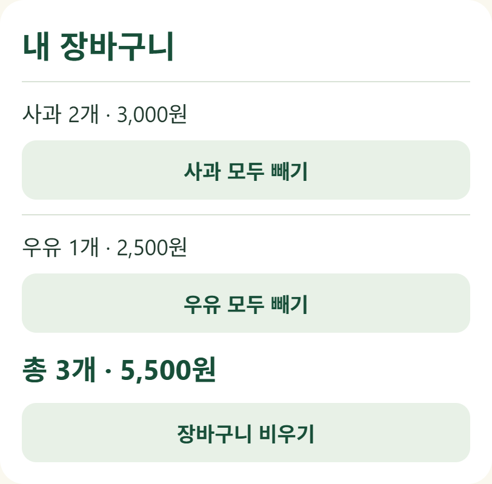
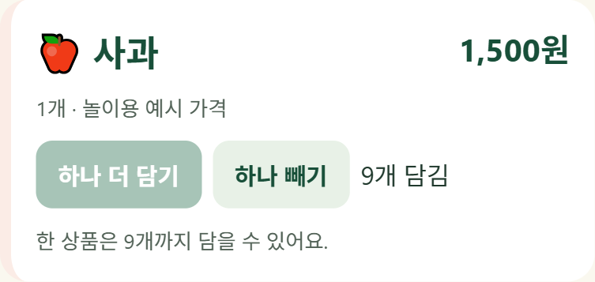

# 6장 장바구니와 합계 계산하기

상품 이름을 안내하던 담기 버튼에 이제 수량을 연결한다. 사과를 두 번, 우유를 한 번 담으면 ‘총 3개 · 5,500원’이 표시되어야 한다. 하나를 빼면 수량과 금액이 함께 줄어야 하고, 마지막 하나를 빼면 그 상품은 장바구니에서 사라져야 한다.

이번 장의 핵심은 **화면에 보이는 금액을 직접 고치지 않는 것**이다. 버튼은 장바구니 상태를 바꾸고, 화면은 바뀐 상태에서 합계를 다시 계산한다. 이 규칙을 한곳에 두면 상품을 담을 때와 뺄 때 서로 다른 금액을 표시하는 문제를 줄일 수 있다.



그림 6-1. 장바구니 패널의 PC 웹 미리보기(재현). 상품별 금액과 전체 합계를 비교한다.

### 시작 위치와 바뀔 파일

5장을 직접 입력했다면 `~/market-book/kit/work/ch04/apps/mobile`을 계속 사용한다. 이번 장에서는 아래 파일을 추가하거나 바꾼다.

| 파일 | 작업 |
| --- | --- |
| `src/features/cart/cart.ts` | 장바구니 규칙과 합계 함수 새로 작성 |
| `src/features/cart/cart.test.mjs` | 화면 없이 규칙을 검사하는 파일 작성 |
| `src/examples/cart-total.ts` | 6.4절의 작은 계산 실습 작성 |
| `src/components/cart-panel.tsx` | 담은 상품과 합계 표시 |
| `src/screens/shopping-screen.tsx` | 상태와 화면 연결 코드로 교체 |
| `package.json` | `scripts` 안에 테스트 명령 추가 |

`App.tsx`, 상품 데이터, 분류 버튼은 5장 그대로 유지한다. 완성 참고본은 다음과 같이 별도 폴더에 만든다.

```bash
cd ~/market-book/kit
node start.mjs 06
cd work/ch06/apps/mobile
npm ci
npm test
npm start -- --lan --port 8082
```

완성 참고본에는 아래 본문에서 만드는 코드가 이미 들어 있다. 개인 작업 폴더와 참고본을 동시에 열면 터미널과 편집기 경로를 먼저 확인한다.

## 6.1 상품을 담고 수량 늘리기

장바구니에는 상품 전체를 복사해서 저장하지 않는다. 상품 ID와 수량만 저장한다.

```ts
const cart = {
  'sample-apple': 2,
  'sample-milk': 1,
};
```

이 값은 사과 2개, 우유 1개라는 뜻이다. 사과 이름과 가격은 상품 목록에서 읽는다. 장바구니에 이름과 가격까지 중복 저장하면 상품 가격을 고칠 때 두 곳을 함께 수정해야 한다.

버튼이 보낼 요청도 작은 객체로 표현한다.

```ts
{ type: 'add', productId: 'sample-apple' }
```

`type`은 무엇을 할지, `productId`는 어떤 상품에 적용할지를 나타낸다. 이 객체를 **액션**이라고 부른다. 실제 장바구니 상태를 변경하는 함수는 현재 상태와 액션을 받아 다음 상태를 돌려준다.

VS Code에서 `src/features/cart` 폴더를 만들고 `cart.ts`에 아래 전체 코드를 입력한다. 먼저 입력한 뒤 6.1~6.5절에서 각 부분을 나누어 읽는다.

```ts
export const MAX_QUANTITY = 9;

export type CartState = Readonly<Record<string, number>>;

export type CartAction =
  | { type: 'add' | 'decrease' | 'remove'; productId: string }
  | { type: 'clear' };

type CartProduct = {
  id: string;
  priceKrw: number;
};

export function createCartReducer(catalog: readonly CartProduct[]) {
  // 화면에 등록된 상품만 담도록 제한해 상품 목록과 장바구니가 어긋나지 않게 합니다.
  const productIds = new Set(catalog.map((product) => product.id));

  return function cartReducer(state: CartState, action: CartAction): CartState {
    if (action.type === 'clear') {
      return {};
    }

    if (!productIds.has(action.productId)) {
      return state;
    }

    const quantity = state[action.productId] ?? 0;

    if (action.type === 'add') {
      if (quantity >= MAX_QUANTITY) {
        return state;
      }

      // 이전 상태를 보존해야 React가 변경을 알아차리고 화면을 다시 그릴 수 있습니다.
      return { ...state, [action.productId]: quantity + 1 };
    }

    if (!Object.hasOwn(state, action.productId)) {
      return state;
    }

    const nextState = { ...state };

    if (action.type === 'decrease' && quantity > 1) {
      nextState[action.productId] = quantity - 1;
    } else {
      // 수량이 0이 되는 상품은 키도 지워 빈 장바구니 판단을 간단하게 유지합니다.
      delete nextState[action.productId];
    }

    return nextState;
  };
}

export function getCartSummary(state: CartState, catalog: readonly CartProduct[]) {
  let totalQuantity = 0;
  let totalPriceKrw = 0;
  let distinctProducts = 0;

  // 원 단위 정수 가격에 수량을 곱합니다. 목록에 없는 상품은 합계에 포함하지 않습니다.
  for (const product of catalog) {
    const quantity = state[product.id] ?? 0;
    if (quantity === 0) {
      continue;
    }

    totalQuantity += quantity;
    totalPriceKrw += product.priceKrw * quantity;
    distinctProducts += 1;
  }

  return { totalQuantity, totalPriceKrw, distinctProducts };
}
```

`CartState`의 `Record<string, number>`는 문자열 ID를 키로, 수량을 숫자로 가진 객체를 뜻한다. `Readonly`는 이 상태를 받은 쪽에서 직접 값을 바꾸지 않게 타입으로 제약한다.

`state[action.productId] ?? 0`은 현재 수량이 없으면 0으로 읽는다. 아직 담지 않은 상품이 객체에 없더라도 첫 담기를 0에서 시작할 수 있다. `add` 액션에서는 수량에 1을 더한 **새 객체**를 반환한다.

`{ ...state, [action.productId]: quantity + 1 }`에서 펼치기 문법 `...state`는 기존 항목을 새 객체에 복사한다. 대괄호 안의 ID는 지금 선택한 상품에 해당하는 키다. 사과를 담을 때도 우유를 담을 때도 같은 코드를 사용한다.

## 6.2 하나 빼기와 품목 삭제와 전체 비우기

빼는 동작은 세 가지로 나눈다. 하나 빼기는 수량을 1 줄이고, 품목 삭제는 해당 상품의 수량 전체를 없앤다. 전체 비우기는 장바구니를 빈 객체로 바꾼다.

| 현재 장바구니 | 액션 | 다음 장바구니 |
| --- | --- | --- |
| 사과 2개·우유 1개 | 사과 하나 빼기 | 사과 1개·우유 1개 |
| 사과 1개·우유 1개 | 사과 하나 빼기 | 우유 1개 |
| 사과 9개·우유 1개 | 사과 모두 빼기 | 우유 1개 |
| 사과 2개·우유 1개 | 전체 비우기 | 빈 장바구니 |

수량 0인 상품은 `'sample-apple': 0`으로 남겨 두지 않고 키를 지운다. 장바구니에 표시할 상품과 실제 담은 상품을 맞추기 위해서다.

`delete nextState[action.productId]`는 원본 `state`를 지우는 명령이 아니다. 앞에서 `const nextState = { ...state }`로 복사한 새 객체에서 키를 삭제한다. 원본을 바꾸지 않으면 이전 상태와 다음 상태를 비교하기 쉽고 테스트도 안정적으로 작성할 수 있다.

등록되지 않은 ID의 요청은 그대로 무시한다. 화면에서 정상 상품만 눌렀다고 가정해도 계산 함수의 입력 경계를 확인해 두면 이후 데이터를 연결할 때 도움이 된다.

## 6.3 한 상품은 최대 9개까지 담기

`MAX_QUANTITY = 9`는 이 놀이의 수량 제한이다. 화면의 버튼과 실제 계산 규칙에서 모두 제한을 적용한다.

상품 카드에서는 수량이 9 이상이면 담기 버튼을 비활성화하고 이유를 표시한다. reducer에서도 9개 상태의 추가 요청을 받으면 기존 상태를 그대로 돌려준다. 버튼 모양만 바꾸고 계산 규칙을 열어 두면 다른 코드 경로에서 10개를 만들 수 있기 때문이다.

상한에 도달해 변화가 없으면 새 객체를 만들지 않는 것도 의미가 있다. 8장에서는 ‘실제로 상품 구성이 바뀌었는가’를 기준으로 돈 선택을 초기화한다. 9개에서 담기를 다시 눌렀다는 이유만으로 선택을 지우지 않아야 한다.

화면을 연결한 뒤 사과를 9번 담아 보자. 9개·13,500원이 되어야 한다. 열 번째 요청은 수량을 늘리지 않아야 한다. 수량 하나 빼기를 누르면 8개·12,000원이 되고 담기 버튼이 다시 활성화되어야 한다.



그림 6-2. 6장 예제에서 사과를 아홉 번 담은 PC 웹 미리보기. 사과 카드의 수량, 담기 버튼 색과 한도 안내를 함께 본다.

여기서 **하나 빼기**를 누르면 사과가 8개가 되고 담기 버튼을 다시 누를 수 있다. 한도를 맞춘 뒤에도 수량을 줄일 수 있어야 한다. 버튼의 색만 비교하지 말고, 8개에서 다시 한 번 담아 9개로 돌아오는지 확인한다.

## 6.4 상품별 금액과 전체 합계 계산하기

합계 함수에 들어가기 전에 독립된 작은 프로그램으로 계산을 확인한다. `src/examples` 폴더를 만들고 `cart-total.ts`에 다음 전체 코드를 입력한다. 이 예제는 [6.4절 실습 견본](../output/pdf/cart-total-sample.pdf)의 계산 흐름과 같다.

```ts
type Line = { price: number; quantity: number };

const apple: Line = { price: 1500, quantity: 2 };
const milk: Line = { price: 2500, quantity: 1 };

let count = 0;
let total = 0;
for (const item of [apple, milk]) {
  // 단가에 수량을 곱하면 이 품목의 금액이 됩니다.
  count += item.quantity;
  total += item.price * item.quantity;
}

const label = total.toLocaleString('ko-KR');
console.log(count + '개 / ' + label + '원');
```

앱 폴더의 Git Bash에서 실행한다.

```bash
node --experimental-strip-types src/examples/cart-total.ts
```

기대 출력은 다음과 같다.

```text
3개 / 5,500원
```

사과의 상품 금액은 `1500 × 2 = 3000`이다. 우유의 상품 금액은 `2500 × 1 = 2500`이다. 전체 합계는 `3000 + 2500 = 5500`이다. 상품 종류는 2종류지만 총수량은 3개다. 이 세 숫자를 혼동하지 않는다.

`count += item.quantity`는 지금까지의 수량에 이번 항목의 수량을 더한다. `total += item.price * item.quantity`는 지금까지의 합계에 이번 품목 금액을 더한다. 반복이 끝나면 전체 값을 가진다.

이제 사과의 `quantity`만 `2`에서 `3`으로 바꾸고 저장한 뒤 같은 명령을 다시 실행한다. 기대 출력은 `4개 / 7,000원`이다. 가격을 바꾸지 않았는데 합계가 달라지는 이유를 먼저 계산해 보고 실행한다. 확인 후에는 `2`로 되돌린다.

실제 앱의 `getCartSummary`도 같은 원리다. 다만 상품 목록과 장바구니 상태가 분리되어 있으므로 `product.id`로 수량을 찾는다. 세 값을 반환한다.

| 반환 값 | 의미 | 사과 2개·우유 1개 |
| --- | --- | ---: |
| `totalQuantity` | 총수량 | 3 |
| `totalPriceKrw` | 전체 금액 | 5500 |
| `distinctProducts` | 담은 상품 종류 수 | 2 |

합계를 만드는 동안 `'5,500원'` 같은 문자열은 사용하지 않는다. `won`과 `toLocaleString`은 화면에 표시할 때만 적용한다. 문자열을 숫자처럼 더하면 `'1500' + '2500'`이 `'15002500'`으로 연결되는 실수를 할 수 있다.

## 6.5 useReducer로 장바구니 상태 관리하기

계산 함수를 만들었으니 React 화면에 연결한다. `useReducer`는 reducer가 만든 다음 상태를 화면에 반영한다. 화면은 상태를 읽고, 버튼은 `dispatch`로 액션을 보낸다. [React useReducer](https://react.dev/reference/react/useReducer)

`src/screens/shopping-screen.tsx`를 아래 전체 내용으로 바꾼다. 아직 `cart-panel.tsx`를 만들지 않았다면 다음 절까지 이어서 작성한다.

```tsx
import { useMemo, useReducer, useState } from 'react';
import type { CatalogProduct } from '../features/catalog/catalog';
import { filterProductsByCategory, type CatalogFilter } from '../features/catalog/categories';
import { createCartReducer, type CartState } from '../features/cart/cart';
import { Body, Card, Page, Title } from '../components/book-ui';
import { CategoryFilter } from '../components/category-filter';
import { ProductList } from '../components/product-list';
import { CartPanel } from '../components/cart-panel';

type Props = {
  products: readonly CatalogProduct[];
  sourceLabel?: string;
  onNewRound?: () => void;
};

export function ShoppingScreen({ products, sourceLabel = '자체 예시 상품' }: Props) {
  const [category, setCategory] = useState<CatalogFilter>('all');
  const reducer = useMemo(() => createCartReducer(products), [products]);
  const [cart, dispatch] = useReducer(reducer, {} as CartState);
  // 계산에는 전체 상품을 쓰고, 분류는 화면에 보이는 목록만 바꿉니다.
  const visible = filterProductsByCategory(products, category);

  return (
    <Page>
      <Card>
        <Title>꼬마 시장</Title>
        <Body>{sourceLabel} · 전체 {products.length}개</Body>
        <Body>이 가격은 장보기 연습을 위한 예시예요.</Body>
        <CategoryFilter value={category} onChange={setCategory} />
        <Body>{visible.length}개 상품을 보고 있어요.</Body>
      </Card>
      <ProductList products={visible} quantities={cart}
        onAdd={(id) => dispatch({ type: 'add', productId: id })}
        onDecrease={(id) => dispatch({ type: 'decrease', productId: id })} />
      <CartPanel cart={cart} products={products} onAction={dispatch} />
    </Page>
  );
}
```

`useMemo`는 현재 상품 목록에 맞는 reducer를 만든다. 이 장에서는 상품 목록이 고정되어 있지만, 이후 서버 목록을 전달해도 같은 화면 구조를 사용할 수 있게 준비한 것이다.

`const [cart, dispatch] = useReducer(reducer, {} as CartState)`에서 `cart`는 현재 상태, `dispatch`는 액션을 전달하는 함수다. `dispatch({ type: 'add', productId: id })`를 실행하면 reducer가 새 장바구니를 만들고 React가 새 수량으로 화면을 다시 그린다.

버튼에서 `cart[id] += 1`처럼 상태를 직접 수정하지 않는다. 직접 바꾸면 React가 새로운 상태를 전달받지 못하고, 이전 상태를 보존한다는 reducer 규칙도 무너진다.

분류 상태 `category`는 계속 `useState`로 관리한다. 분류 선택과 장바구니는 서로 다른 정보다. 사용자가 분류를 바꾸어도 `cart`를 초기화하지 않는다.

## 6.6 화면 코드와 계산 함수 나누기

`src/components/cart-panel.tsx`를 만든다. 이 파일은 장바구니를 계산하는 규칙을 새로 쓰지 않고 `getCartSummary`의 결과를 표시한다.

```tsx
import { Text, View } from 'react-native';
import type { CatalogProduct } from '../features/catalog/catalog';
import { getCartSummary, type CartAction, type CartState } from '../features/cart/cart';
import { ActionButton, Body, Card, Title, ui, won } from './book-ui';

type Props = { cart: CartState; products: readonly CatalogProduct[]; onAction: (action: CartAction) => void };
export function CartPanel({ cart, products, onAction }: Props) {
  const total = getCartSummary(cart, products);
  return (
    <Card>
      <Title>내 장바구니</Title>
      {total.totalQuantity === 0 && <Body>장바구니가 비었어요. 물건을 골라 주세요.</Body>}
      {products.filter((product) => (cart[product.id] ?? 0) > 0).map((product) => (
        <View key={product.id} style={ui.line}>
          <Text style={ui.body}>{product.name} {cart[product.id]}개 · {won(product.priceKrw * cart[product.id])}</Text>
          <ActionButton title={product.name + ' 모두 빼기'} secondary
            testID={'cart-' + product.id + '-remove'}
            onPress={() => onAction({ type: 'remove', productId: product.id })} />
        </View>
      ))}
      <Text testID="cart-summary" style={ui.price}>총 {total.totalQuantity}개 · {won(total.totalPriceKrw)}</Text>
      <ActionButton title="장바구니 비우기" secondary testID="cart-clear"
        disabled={total.totalQuantity === 0} onPress={() => onAction({ type: 'clear' })} />
    </Card>
  );
}
```

담은 상품 행은 전체 상품 중 수량이 0보다 큰 것만 표시한다. 이때 상품 화면에서 선택한 분류를 사용하지 않는다. 사과를 담은 뒤 유제품 분류로 바꾸었다고 장바구니에서 사과가 사라지면 안 되기 때문이다.

‘사과 모두 빼기’ 버튼은 `remove` 액션을 보낸다. 패널은 자체 장바구니 상태를 갖지 않는다. 부모 화면이 관리하는 상태와 같은 `dispatch`를 사용한다. 상품 카드와 장바구니 패널이 동일한 상태를 함께 읽는 구조다.

모든 파일을 저장한 뒤 타입과 린트를 검사한다. 아직 테스트 파일을 만들기 전이라면 테스트 명령은 다음 절에서 실행한다.

```bash
npm run typecheck
npm run lint
npm start -- --lan --port 8082
```

사과를 두 번 담고, 유제품·달걀 분류로 바꾼 뒤 우유를 한 번 담는다. 아래 장바구니까지 스크롤하면 사과 2개 3,000원, 우유 1개 2,500원, 총 3개 5,500원이 보여야 한다.

## 6.7 빈 장바구니와 수량 경계 테스트하기

화면을 누르는 검사는 필요하지만, 같은 합계 계산을 여러 번 손으로 확인하면 작은 경계를 놓칠 수 있다. 이번에는 Node의 테스트 도구로 규칙을 실행한다.

`src/features/cart/cart.test.mjs`에 다음 코드를 입력한다. `.mjs` 파일은 JavaScript 모듈이며, 검사할 로직은 `cart.ts`에서 가져온다. 테스트 안에서는 화면 컴포넌트를 import하지 않는다.

```js
import assert from 'node:assert/strict';
import test from 'node:test';
import { createCartReducer, getCartSummary } from './cart.ts';

const products = [
  { id: 'sample-apple', priceKrw: 1500 },
  { id: 'sample-milk', priceKrw: 2500 },
];
const reduce = createCartReducer(products);

test('사과 2개와 우유 1개는 3개와 5500원이다', () => {
  let state = {};
  state = reduce(state, { type: 'add', productId: 'sample-apple' });
  state = reduce(state, { type: 'add', productId: 'sample-apple' });
  state = reduce(state, { type: 'add', productId: 'sample-milk' });
  assert.deepEqual(getCartSummary(state, products), {
    totalQuantity: 3, totalPriceKrw: 5500, distinctProducts: 2,
  });
});
test('10번 담아도 9개이며 무변화는 원래 상태를 돌려준다', () => {
  let state = {};
  for (let i = 0; i < 9; i += 1) state = reduce(state, { type: 'add', productId: 'sample-apple' });
  assert.equal(state['sample-apple'], 9);
  assert.equal(reduce(state, { type: 'add', productId: 'sample-apple' }), state);
});
test('수량이 0이면 키를 지우고 이전 상태는 보존한다', () => {
  const before = { 'sample-apple': 1 };
  const after = reduce(before, { type: 'decrease', productId: 'sample-apple' });
  assert.deepEqual(after, {});
  assert.deepEqual(before, { 'sample-apple': 1 });
});
test('품목 삭제와 전체 비우기를 구별한다', () => {
  const before = { 'sample-apple': 2, 'sample-milk': 1 };
  assert.deepEqual(reduce(before, { type: 'remove', productId: 'sample-apple' }), { 'sample-milk': 1 });
  assert.deepEqual(reduce(before, { type: 'clear' }), {});
});
test('등록되지 않은 상품은 담기와 합계에서 제외한다', () => {
  const state = {};
  assert.equal(reduce(state, { type: 'add', productId: 'unknown' }), state);
  assert.equal(getCartSummary({ unknown: 2 }, products).totalPriceKrw, 0);
});
test('빈 장바구니는 0개와 0원이다', () => {
  assert.deepEqual(getCartSummary({}, products), { totalQuantity: 0, totalPriceKrw: 0, distinctProducts: 0 });
});
```

`assert.equal`은 두 값이 같은지 확인하고, `assert.deepEqual`은 객체 안의 값까지 비교한다. 실제 값이 기대와 다르면 테스트가 실패하며 어느 줄에서 어긋났는지 알려 준다.

앱 폴더에서 먼저 이 파일만 실행한다.

```bash
node --experimental-strip-types --test src/features/cart/cart.test.mjs
```

여섯 검사가 모두 통과해야 한다. Node의 TypeScript 실행 기능은 타입 표시를 제거해 코드를 실행하는 경로다. 타입의 정확성까지 검사하는 `npm run typecheck`와 역할이 다르다.

`package.json`의 `scripts` 객체에 다음 항목을 추가한다. 앞 항목과 쉼표로 구분하며, JSON의 마지막 항목 뒤에는 쉼표를 넣지 않는다.

```json
"test": "node --experimental-strip-types --test src/features/cart/cart.test.mjs"
```

이제 `npm test`로 같은 검사를 실행할 수 있다. 새 패키지를 설치한 것이 아니라 명령 이름을 붙인 것이므로, 이 스크립트 추가만으로 `npm ci`를 다시 할 필요는 없다.

## 6.8 분류를 바꿔도 수량과 합계 유지하기

사과 2개와 우유 1개를 담은 상태에서 ‘빵·간식’을 누른다. 화면 목록에는 식빵과 크래커만 보여야 하지만, 장바구니에는 사과와 우유가 남아 있어야 한다. 합계도 5,500원이다.

이 동작은 `visible`과 `products`를 구분한 덕분이다. `ProductList`에는 `visible`을 전달하고, `CartPanel`에는 전체 `products`를 전달한다. 합계를 보이는 상품만으로 구하면 분류를 바꿀 때 금액이 줄어드는 버그가 생긴다.

다음 순서로 확인한다.

1. ‘전체’에서 사과 2개·우유 1개를 담는다.
2. ‘빵·간식’으로 바꾸고 장바구니 합계 5,500원을 확인한다.
3. ‘과일·채소’에서 사과 하나를 뺀다.
4. 사과 1개·우유 1개, 총 2개·4,000원을 확인한다.
5. 장바구니의 ‘사과 모두 빼기’를 누른다.
6. 우유 1개·2,500원만 남는지 확인한다.
7. ‘장바구니 비우기’를 눌러 0개·0원과 빈 안내를 확인한다.

## 6.9 실제 값과 예상값이 다른 줄 찾아 고치기

테스트가 실패하는 화면도 한 번 경험해 보자. 실제 계산 로직을 고장 내기보다 테스트의 기대값을 의도적으로 바꾼다.

`cart.test.mjs` 첫 검사에서 `totalPriceKrw: 5500`만 `5000`으로 수정하고 저장한다. 다음 명령으로 해당 검사만 실행한다.

```bash
node --experimental-strip-types --test --test-name-pattern="사과 2개" src/features/cart/cart.test.mjs
```

이제 실패가 나야 한다. 출력에서 actual은 함수가 계산한 값, expected는 테스트에 적은 기대값이다. 상품 데이터가 사과 1,500원·우유 2,500원이고 수량이 2·1이면 5,500원이 맞다. 기대값을 5,500원으로 되돌리고 같은 명령을 다시 실행한다.

그 다음 전체 검사를 실행한다.

```bash
npm test
npm run typecheck
npm run lint
```

**문제 해결:** `Unknown file extension .ts`가 나오면 2장에서 확인한 Node 버전과 실제 실행 중인 Node가 같은지 `node --version`으로 확인한다. `Missing script: test`는 테스트 실패가 아니라 현재 `package.json`에 명령이 없다는 뜻이다. 작업 폴더와 scripts를 확인한다.

이번 장의 완료 기준은 여섯 자동 검사 통과와 휴대전화의 담기·빼기·삭제·비우기·분류 유지 확인이다. 테스트 결과와 실제 기기 결과를 각각 기록한다. 웹 캡처만 보았다면 Android 확인 칸은 남겨 둔다.
