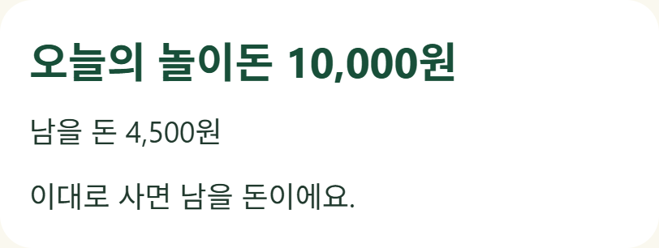

# 7장 예산과 남은 돈 표시하기

장바구니 합계를 알게 되었으니 다음 질문을 던질 수 있다. ‘10,000원으로 이 물건을 모두 살 수 있을까?’ 합계가 5,500원이면 4,500원이 남고, 13,500원이면 3,500원이 부족하다. 이 관계를 숫자와 짧은 문장으로 함께 보여 준다.

이 장의 **남을 돈**은 예산 10,000원에서 장바구니 합계를 뺀 금액이다. 아직 어떤 돈을 실제로 낼지는 고르지 않는다. 예산과 지불할 돈을 구분해 두면 8장의 거스름돈 계산을 정확히 이해할 수 있다.



그림 7-1. 예산 패널의 PC 웹 미리보기(재현). 10,000원 예산과 현재 장바구니의 관계를 표시한다.

### 실습 준비

6장 작업 폴더를 이어서 사용한다. `src/features/budget` 폴더와 `src/components/budget-panel.tsx`를 새로 만들고, 기존 `shopping-screen.tsx`에 예산 패널을 연결한다. 상품이나 장바구니 규칙은 바꾸지 않는다.

이번 장의 완성 참고본은 다음과 같이 만든다.

```bash
cd ~/market-book/kit
node start.mjs 07
cd work/ch07/apps/mobile
npm ci
npm test
npm start -- --lan --port 8082
```

본문을 직접 입력할 때는 4장에서 이어 온 `kit/work/ch04/apps/mobile`이 작업 폴더다. 명령의 앞부분이 어느 폴더를 가리키는지 매번 확인한다.

## 7.1 놀이돈 10,000원으로 시작하기

7장 참고본에서는 10,000원으로 시작해 예산 계산부터 확인한다. 20장 완성본에서는 **오늘의 놀이돈**에서 50,000원도 고른다. [20.7절](#ch20-s7)에서 같은 계산 함수에 선택한 예산을 전달하는 코드를 확인한다.

`src/features/budget/budget.ts`에 아래 전체 코드를 작성한다.

```ts
export const STARTING_BUDGET_KRW = 10000;

type BudgetSummary = {
  remainingKrw: number;
  shortfallKrw: number;
  status: 'within' | 'exact' | 'over';
};

export function getBudgetSummary(
  totalPriceKrw: number,
  budgetKrw: number = STARTING_BUDGET_KRW,
): BudgetSummary {
  // 잔액을 따로 저장하지 않고 현재 합계에서 계산해야 상품을 빼거나 비워도 값이 어긋나지 않습니다.
  const differenceKrw = budgetKrw - totalPriceKrw;

  // 부족한 금액을 음수 잔액 대신 별도 값으로 돌려줘 아이에게 남을 돈과 부족한 돈을 구분해 보여줍니다.
  return {
    remainingKrw: Math.max(0, differenceKrw),
    shortfallKrw: Math.max(0, -differenceKrw),
    status: differenceKrw === 0 ? 'exact' : differenceKrw > 0 ? 'within' : 'over',
  };
}
```

`STARTING_BUDGET_KRW`는 여러 파일에서 함께 사용할 기본값이다. UI에서 ‘10,000원’을 따로 계산 규칙으로 작성하지 않고 같은 값을 읽게 한다. 이름의 KRW는 원화 단위임을 나타낸다.

함수의 두 번째 매개변수 `budgetKrw`에는 기본값이 있다. 화면에서는 생략해 10,000원을 사용하고, 테스트에서는 5,000원처럼 다른 예산을 넣어 계산 자체가 특정 숫자에만 묶여 있지 않은지 검사할 수 있다.

## 7.2 예산에서 물건값을 빼기

계산의 시작은 한 줄이다.

```ts
const differenceKrw = budgetKrw - totalPriceKrw;
```

합계가 5,500원이면 차이는 4,500원이다. 합계가 13,500원이면 차이는 -3,500원이다. 화면에는 후자를 ‘남을 돈 -3,500원’이라고 쓰기보다 ‘부족한 돈 3,500원’이라고 전달한다.

그래서 함수는 남을 돈과 부족한 돈을 나누어 돌려준다.

```ts
remainingKrw: Math.max(0, differenceKrw),
shortfallKrw: Math.max(0, -differenceKrw),
```

`Math.max`는 두 값 중 큰 값을 고른다. 예산 안에서는 `remainingKrw`가 양수이고 부족한 돈은 0이다. 예산을 넘으면 그 반대다. 두 금액을 동시에 양수로 만들지 않는다.

종이에 먼저 계산해 보자. 사과 2개 3,000원과 우유 1개 2,500원을 합하면 5,500원이다. 예산에서 빼면 4,500원이다. 이 손계산을 프로그램의 기대값으로 사용한다. 코드를 보고 그 코드와 같은 방식으로 기대값을 만들면 같은 실수를 두 번 적을 수 있다.

## 7.3 예산 안과 정확히 일치와 초과 구분하기

금액만 반환하면 화면에서 상태 판단을 반복하게 된다. 함수는 `status`도 함께 반환한다.

| 차이 | 상태 | 화면에서의 의미 |
| --- | --- | --- |
| 0보다 큼 | `within` | 예산 안이며 돈이 남음 |
| 0과 같음 | `exact` | 예산에 정확히 맞음 |
| 0보다 작음 | `over` | 물건을 줄이거나 구성을 바꿔야 함 |

코드의 조건식은 차이가 0인지 먼저 확인하고, 아니면 양수인지 확인한다. `0`은 실패나 값 없음이 아니라 ‘정확히 맞는 결과’다. 금액의 참·거짓만 검사하면 0원을 놓칠 수 있으므로 명시적으로 비교한다.

정확히 맞는 상태를 직접 만드는 쉬운 방법은 장바구니를 비우고 우유를 4개 담는 것이다. 2,500원에 4를 곱하면 10,000원이다. 여기서 당근 1개를 추가하면 11,000원이 되어 1,000원이 부족하다.

## 7.4 부족한 금액을 쉬운 문장으로 안내하기

`src/components/budget-panel.tsx`를 만든다. 화면은 계산 함수가 돌려준 결과만 읽는다.

```tsx
import { getBudgetSummary, STARTING_BUDGET_KRW } from '../features/budget/budget';
import { Body, Card, Title, won } from './book-ui';

export function BudgetPanel({ totalPriceKrw, hideRemaining = false }: { totalPriceKrw: number; hideRemaining?: boolean }) {
  const budget = getBudgetSummary(totalPriceKrw);
  const message = budget.status === 'over'
    ? '물건을 조금 빼 볼까요?'
    : budget.status === 'exact' ? '놀이돈에 딱 맞아요!' : '이대로 사면 남을 돈이에요.';
  return (
    <Card>
      <Title>오늘의 놀이돈 {won(STARTING_BUDGET_KRW)}</Title>
      {hideRemaining ? (
        <Body>남을 돈 ?원 · 거스름돈을 맞히면 보여 줘요.</Body>
      ) : (
        <>
          <Body>{budget.status === 'over' ? '부족한 돈 ' + won(budget.shortfallKrw) : '남을 돈 ' + won(budget.remainingKrw)}</Body>
          <Body>{message}</Body>
        </>
      )}
    </Card>
  );
}
```

기본 화면에서는 `hideRemaining`을 전달하지 않으므로 false다. 이 속성은 9장에서 거스름돈 문제를 푸는 동안 정답과 같은 금액을 미리 보여 주지 않을 때 사용한다. 이번 장의 화면에서는 잔액을 항상 확인한다.

‘부족한 돈’과 ‘남을 돈’을 문장으로 구분하므로 색상을 구별하기 어려워도 의미를 알 수 있다. 버튼을 막는 대신 예산 초과 상태도 표시한다. 물건을 더 담아 초과해 보고 하나씩 빼며 차이가 줄어드는 것을 배우기 위해서다.

이제 `src/screens/shopping-screen.tsx`를 다음 전체 내용으로 바꾼다.

```tsx
import { useMemo, useReducer, useState } from 'react';
import type { CatalogProduct } from '../features/catalog/catalog';
import { filterProductsByCategory, type CatalogFilter } from '../features/catalog/categories';
import { createCartReducer, getCartSummary, type CartState } from '../features/cart/cart';
import { Body, Card, Page, Title } from '../components/book-ui';
import { CategoryFilter } from '../components/category-filter';
import { ProductList } from '../components/product-list';
import { CartPanel } from '../components/cart-panel';
import { BudgetPanel } from '../components/budget-panel';

type Props = {
  products: readonly CatalogProduct[];
  sourceLabel?: string;
  onNewRound?: () => void;
};

export function ShoppingScreen({ products, sourceLabel = '자체 예시 상품' }: Props) {
  const [category, setCategory] = useState<CatalogFilter>('all');
  const reducer = useMemo(() => createCartReducer(products), [products]);
  const [cart, dispatch] = useReducer(reducer, {} as CartState);
  // 계산에는 전체 상품을 쓰고, 분류는 화면에 보이는 목록만 바꿉니다.
  const total = getCartSummary(cart, products);
  const visible = filterProductsByCategory(products, category);

  return (
    <Page>
      <Card>
        <Title>꼬마 시장</Title>
        <Body>{sourceLabel} · 전체 {products.length}개</Body>
        <Body>이 가격은 장보기 연습을 위한 예시예요.</Body>
        <CategoryFilter value={category} onChange={setCategory} />
        <Body>{visible.length}개 상품을 보고 있어요.</Body>
      </Card>
      <BudgetPanel totalPriceKrw={total.totalPriceKrw} />
      <ProductList products={visible} quantities={cart}
        onAdd={(id) => dispatch({ type: 'add', productId: id })}
        onDecrease={(id) => dispatch({ type: 'decrease', productId: id })} />
      <CartPanel cart={cart} products={products} onAction={dispatch} />
    </Page>
  );
}
```

6장과 비교하면 두 변화가 핵심이다. `getCartSummary`로 합계를 구하고, `BudgetPanel`에 `total.totalPriceKrw`를 전달한다. 상품 목록과 장바구니는 같은 상태를 계속 사용한다.

저장한 뒤 타입과 린트를 확인하고 앱을 실행한다.

```bash
npm run typecheck
npm run lint
npm start -- --lan --port 8082
```

예산 패널은 상품 목록 위에 있다. 먼저 아무것도 담지 않았을 때 10,000원이 남는지 확인한다. 상품을 담은 뒤 위쪽으로 돌아와 잔액이 바뀌었는지 확인한다. 브라우저와 Android 모두 같은 값을 보여야 한다.

## 7.5 저장할 값과 계산할 값 나누기

장바구니 수량은 사용자가 누른 결과이므로 상태로 저장한다. 남을 돈은 장바구니 합계와 예산만 알면 구할 수 있으므로 매번 계산한다.

예를 들어 `remainingMoney`라는 별도 상태를 만들고 사과를 담을 때 1,500원을 빼는 방법도 떠올릴 수 있다. 하지만 사과 모두 빼기, 장바구니 비우기, 수량 상한에서 담기처럼 모든 경우에 잔액을 따로 맞춰야 한다. 한 경로를 놓치면 상품은 사라졌는데 잔액은 돌아오지 않는다.

현재 구조에서는 `cart`가 바뀌면 합계를 다시 구하고, 그 합계에서 예산 상태를 다시 구한다. 같은 정보의 복사본을 여러 개 유지하지 않는다.

다음 흐름을 말로 읽어 보자.

```text
사과 하나 빼기
→ cart reducer가 새 수량 생성
→ 전체 합계 다시 계산
→ 예산 차이 다시 계산
→ 새 안내 문구 표시
```

이처럼 상태에서 계산한 값을 **파생 값**이라고 부른다. 어려운 이름보다 ‘원본 상태가 있으면 다시 구할 수 있는 값’으로 기억하면 된다.

## 7.6 예산 계산의 경계값 테스트하기

`src/features/budget/budget.test.mjs`를 만들고 다음 코드를 입력한다.

```js
import assert from 'node:assert/strict';
import test from 'node:test';
import { getBudgetSummary } from './budget.ts';
for (const [total, remaining, shortfall, status] of [
  [0, 10000, 0, 'within'], [5500, 4500, 0, 'within'],
  [10000, 0, 0, 'exact'], [13500, 0, 3500, 'over'],
]) {
  test('합계 ' + total + '원의 예산 상태', () => {
    assert.deepEqual(getBudgetSummary(total), { remainingKrw: remaining, shortfallKrw: shortfall, status });
  });
}
test('수량을 줄여 합계가 9000원이 되면 잔액이 복구된다', () => {
  assert.equal(getBudgetSummary(13500).status, 'over');
  assert.equal(getBudgetSummary(9000).remainingKrw, 1000);
});
test('다른 예산도 같은 계산식으로 처리한다', () => {
  assert.equal(getBudgetSummary(3000, 5000).remainingKrw, 2000);
});
```

네 대표 금액은 빈 장바구니, 일반 구매, 예산 일치, 예산 초과를 나타낸다. 배열의 각 행이 한 검사다. 처음에는 반복문이 낯설어도 각 숫자와 기대 상태를 직접 대조해 보면 된다.

새 테스트만 먼저 실행한다.

```bash
node --experimental-strip-types --test src/features/budget/budget.test.mjs
```

그다음 `package.json`의 `test` 값을 아래와 같이 바꾼다. 기존 장바구니 검사를 빼지 않고 예산 검사를 추가한다.

```json
"test": "node --experimental-strip-types --test src/features/cart/cart.test.mjs src/features/budget/budget.test.mjs"
```

`npm test`를 실행하면 장바구니 6개와 예산 6개, 모두 12개의 검사를 실행한다. 새 기능의 테스트만 통과하고 예전 기능이 망가지는 일을 막기 위한 구성이다.

휴대전화에서도 다음 순서로 확인한다.

| 조작 | 합계 | 기대 안내 |
| --- | ---: | --- |
| 장바구니 비우기 | 0원 | 남을 돈 10,000원 |
| 사과 2개·우유 1개 | 5,500원 | 남을 돈 4,500원 |
| 비우고 우유 4개 | 10,000원 | 남을 돈 0원, 딱 맞음 |
| 당근 1개 추가 | 11,000원 | 부족한 돈 1,000원 |
| 당근 하나 빼기 | 10,000원 | 딱 맞음으로 복귀 |
| 우유 하나 빼기 | 7,500원 | 남을 돈 2,500원 |
| 전체 비우기 | 0원 | 남을 돈 10,000원 |

**연습:** 테스트 파일에 예산 5,000원·합계 5,000원일 때 `exact`인지 확인하는 검사를 하나 추가한다. 함수의 기본 예산이나 앱 화면을 바꿀 필요는 없다. 연습 후 기본 참고본과 비교해 자신이 추가한 검사만 남아 있는지 `git diff`로 살펴본다.

**막혔을 때:** 상품 금액은 바뀌는데 잔액이 그대로라면 `BudgetPanel`에 고정 숫자를 전달하지 않았는지 확인한다. 예산 초과 때 -1,000원이 ‘남을 돈’으로 표시된다면 계산 차이를 그대로 표시하지 말고 `shortfallKrw`와 `status`를 사용하는지 본다. 수량을 줄여도 초과 안내가 남으면 과거 안내 문장을 별도 상태에 저장하지 않았는지 확인한다.

이 장에서 돈은 아직 차감되지 않는다. ‘지금 이 구성을 산다면’의 예산 관계를 확인하는 단계다. 다음 장에서 낼 돈을 고르면, 예산 잔액과 별개로 받을 거스름돈을 계산한다.
