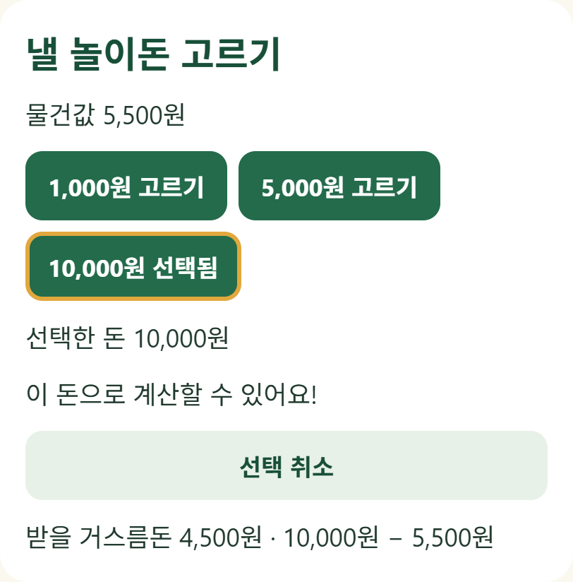
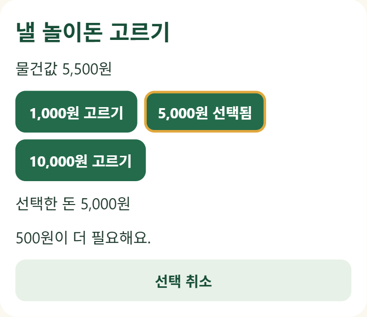

# 8장 낼 놀이돈 선택하고 거스름돈 계산하기

10,000원의 예산으로 1,000원짜리 당근을 산다고 생각해 보자. 예산에서 남을 돈은 9,000원이다. 그런데 5,000원짜리 놀이돈을 내면 받을 거스름돈은 4,000원이다. 두 숫자는 서로 다른 질문의 답이다.

8장 참고본에서는 1,000원·5,000원·10,000원 중 **하나를 선택**한다. [20.7절](#ch20-s7)의 20장 완성본에는 50,000원권이 추가된다. 50,000원권을 쓰려면 먼저 오늘의 예산을 50,000원으로 고른다. 버튼을 여러 번 눌러 금액을 쌓지 않는다. 선택 금액이 부족하면 얼마가 더 필요한지 알려 주고, 충분하면 거스름돈을 표시한다.



그림 8-1. 10,000원 선택과 거스름돈 안내의 PC 웹 미리보기(재현).

### 실습 준비와 참고본

7장 작업 폴더를 사용한다. `src/features/payment/payment.ts`와 `payment.test.mjs`, `src/components/payment-panel.tsx`를 새로 만들고 `shopping-screen.tsx`를 교체한다. 장바구니 reducer는 그대로 재사용한다.

완성 참고본은 별도로 만든다.

```bash
cd ~/market-book/kit
node start.mjs 08
cd work/ch08/apps/mobile
npm ci
npm test
npm start -- --lan --port 8082
```

## 8.1 세 가지 놀이돈 선택 버튼 만들기

선택할 돈은 `PAYMENT_OPTIONS_KRW = [1000, 5000, 10000]`으로 정한다. 낼 돈이 아직 없을 때에는 `0` 대신 `null`을 사용한다. 0원은 숫자 값이고, null은 아직 선택하지 않았다는 뜻이다.

장바구니와 선택한 돈을 하나의 쇼핑 상태로 묶는다.

```ts
type ShoppingState = {
  cart: CartState;
  selectedPaymentKrw: number | null;
};
```

지금까지 화면이 `CartState`를 바로 관리했다면, 이제 `ShoppingState` 안의 `cart`를 읽는다. 상품을 바꾸었을 때 돈 선택도 같은 상태 변경 안에서 초기화하기 위해서다.

`src/features/payment/payment.ts`의 전체 코드를 입력한다. 길게 보이지만 장바구니 계산은 다시 만들지 않는다.

```ts
import { STARTING_BUDGET_KRW } from '../budget/budget.ts';
import { createCartReducer, getCartSummary, type CartAction, type CartState } from '../cart/cart.ts';

export const PAYMENT_OPTIONS_KRW = [1000, 5000, 10000] as const;

export type ShoppingState = {
  cart: CartState;
  selectedPaymentKrw: number | null;
};

export type ShoppingAction =
  | CartAction
  | { type: 'select-payment'; amountKrw: number }
  | { type: 'clear-payment' };

type PaymentSummary = {
  status: 'empty' | 'over-budget' | 'unselected' | 'insufficient' | 'ready';
  missingAmountKrw: number;
  changeAmountKrw: number | null;
};

function isAvailablePayment(amountKrw: number | null, budgetKrw: number): amountKrw is number {
  return amountKrw !== null
    && amountKrw <= budgetKrw
    && PAYMENT_OPTIONS_KRW.some((option) => option === amountKrw);
}

export function createShoppingReducer(
  catalog: readonly { id: string; priceKrw: number }[],
  budgetKrw: number = STARTING_BUDGET_KRW,
) {
  const cartReducer = createCartReducer(catalog);

  return function shoppingReducer(state: ShoppingState, action: ShoppingAction): ShoppingState {
    if (action.type === 'select-payment') {
      const { totalPriceKrw } = getCartSummary(state.cart, catalog);

      // 빈 장바구니나 예산 초과 상태에서는 먼저 물건을 고쳐 고른 뒤 지불할 돈을 선택합니다.
      if (
        !isAvailablePayment(action.amountKrw, budgetKrw)
        || totalPriceKrw <= 0
        || totalPriceKrw > budgetKrw
        || state.selectedPaymentKrw === action.amountKrw
      ) {
        return state;
      }

      // 적게 고른 돈도 받아 부족한 금액을 배우게 합니다. 여러 번 눌러도 금액은 누적하지 않습니다.
      return { ...state, selectedPaymentKrw: action.amountKrw };
    }

    if (action.type === 'clear-payment') {
      return state.selectedPaymentKrw === null ? state : { ...state, selectedPaymentKrw: null };
    }

    const cart = cartReducer(state.cart, action);

    // 실제 상품 구성이 바뀐 경우에만 선택을 비웁니다. 수량 상한처럼 변화 없는 동작은 선택을 유지합니다.
    return cart === state.cart ? state : { cart, selectedPaymentKrw: null };
  };
}

export function getPaymentSummary(
  totalPriceKrw: number,
  selectedPaymentKrw: number | null,
  budgetKrw: number = STARTING_BUDGET_KRW,
): PaymentSummary {
  // 먼저 장바구니의 구매 가능 여부를 알려야 돈 선택 안내와 예산 초과 안내가 충돌하지 않습니다.
  // 계산할 수 없는 거스름돈은 null로 두어, 정확히 냈을 때의 유효한 0원과 구분합니다.
  if (totalPriceKrw <= 0) {
    return { status: 'empty', missingAmountKrw: 0, changeAmountKrw: null };
  }

  if (totalPriceKrw > budgetKrw) {
    return { status: 'over-budget', missingAmountKrw: 0, changeAmountKrw: null };
  }

  if (!isAvailablePayment(selectedPaymentKrw, budgetKrw)) {
    return { status: 'unselected', missingAmountKrw: 0, changeAmountKrw: null };
  }

  if (selectedPaymentKrw < totalPriceKrw) {
    return { status: 'insufficient', missingAmountKrw: totalPriceKrw - selectedPaymentKrw, changeAmountKrw: null };
  }

  // 거스름돈은 실제로 고른 놀이돈에서 물건값을 뺍니다. 전체 예산에서 뺀 남을 돈과는 다릅니다.
  // 계산 결과만 돌려주며 장바구니·돈 선택을 바꾸거나 결제 완료로 처리하지 않습니다.
  return { status: 'ready', missingAmountKrw: 0, changeAmountKrw: selectedPaymentKrw - totalPriceKrw };
}

export function createInitialShoppingState(): ShoppingState {
  return { cart: {}, selectedPaymentKrw: null };
}
```

맨 아래 `createInitialShoppingState`는 앱의 처음 상태를 만든다. 새 놀이를 추가할 때도 같은 함수를 사용할 수 있다.

선택 가능한 금액을 확인할 때에는 배열에 있는지와 예산 이하인지를 함께 본다. UI에 세 버튼만 있다고 해서 다른 입력이 절대로 들어오지 않는다고 가정하지 않는다. reducer는 지원하지 않는 금액을 거부한다.

## 8.2 선택한 돈 바꾸기와 선택 취소하기

`selectedPaymentKrw`는 하나의 숫자다. 5,000원 버튼을 누른 뒤 10,000원 버튼을 누르면 값은 10,000원이 된다. 15,000원이 되지 않는다.

`select-payment` 액션은 다음처럼 보낸다.

```ts
dispatch({ type: 'select-payment', amountKrw: 10000 });
```

같은 금액을 다시 고르면 기존 상태를 돌려준다. 값이 바뀌지 않았는데 화면의 다른 상태까지 초기화할 필요가 없기 때문이다.

`clear-payment`는 돈 선택만 null로 바꾼다. `state.cart`는 그대로 유지한다. 장바구니 전체 비우기와 돈 선택 취소가 같은 기능이 아님을 화면에서도 확인해야 한다.

아직 상품이 없거나 예산을 넘은 상태에서는 돈을 선택할 수 없게 한다. 먼저 물건 구성을 정해야 어떤 돈을 낼지 판단할 수 있기 때문이다. 반면 물건값보다 적은 돈은 선택할 수 있게 두어 부족한 금액을 배우게 한다.

## 8.3 물건값보다 적은 돈을 골랐을 때 안내하기

`getPaymentSummary`는 먼저 해결해야 하는 상태부터 판단한다.

```text
빈 장바구니
→ 예산 초과
→ 돈 미선택
→ 선택 금액 부족
→ 계산할 수 있음
```

이 순서가 중요한 이유는 안내가 서로 충돌하지 않게 하기 위해서다. 장바구니가 비었는데 ‘10,000원을 고르세요’라고 먼저 안내하면 무엇을 사려는지 없는 상태에서 돈 선택을 유도한다.

상태마다 화면에 보여 줄 문장을 정한다. `src/components/payment-panel.tsx`의 전체 코드는 다음과 같다.

```tsx
import { View } from 'react-native';
import { getPaymentSummary, PAYMENT_OPTIONS_KRW } from '../features/payment/payment';
import { ActionButton, Body, Card, Title, ui, won } from './book-ui';

type Props = {
  totalPriceKrw: number;
  selectedPaymentKrw: number | null;
  onSelect: (amount: number) => void;
  onClear: () => void;
  revealChange?: boolean;
};

export function PaymentPanel({ totalPriceKrw, selectedPaymentKrw, onSelect, onClear, revealChange = true }: Props) {
  const result = getPaymentSummary(totalPriceKrw, selectedPaymentKrw);
  const disabled = result.status === 'empty' || result.status === 'over-budget';
  // 먼저 해결할 상태를 우선 안내해 빈 장바구니에서 돈 선택을 유도하지 않습니다.
  const guidance = result.status === 'empty' ? '먼저 물건을 담아 주세요.'
    : result.status === 'over-budget' ? '물건을 조금 빼고 놀이돈을 골라요.'
      : result.status === 'unselected' ? '낼 놀이돈을 하나 골라 주세요.'
        : result.status === 'insufficient' ? won(result.missingAmountKrw) + '이 더 필요해요.'
          : '이 돈으로 계산할 수 있어요!';
  return (
    <Card>
      <Title>낼 놀이돈 고르기</Title>
      <Body>물건값 {won(totalPriceKrw)}</Body>
      <View style={ui.row}>
        {PAYMENT_OPTIONS_KRW.map((amount) => (
          <ActionButton key={amount} title={won(amount) + (amount === selectedPaymentKrw ? ' 선택됨' : ' 고르기')}
            selected={amount === selectedPaymentKrw} disabled={disabled}
            testID={'payment-option-' + amount} onPress={() => onSelect(amount)} />
        ))}
      </View>
      <Body>{selectedPaymentKrw === null ? '아직 안 골랐어요' : '선택한 돈 ' + won(selectedPaymentKrw)}</Body>
      <Body>{guidance}</Body>
      {selectedPaymentKrw !== null && <ActionButton title="선택 취소" secondary testID="payment-clear" onPress={onClear} />}
      {revealChange && result.changeAmountKrw !== null && selectedPaymentKrw !== null && (
        <Body>받을 거스름돈 {won(result.changeAmountKrw)} · {won(selectedPaymentKrw)} − {won(totalPriceKrw)}</Body>
      )}
    </Card>
  );
}
```

5,500원어치 물건에 5,000원을 선택하면 `missingAmountKrw`는 500이다. UI는 ‘500원이 더 필요해요’라고 표시한다. 이때 예산 패널의 남을 돈 4,500원은 바뀌지 않는다. 돈 선택 자체는 구매나 예산 차감이 아니기 때문이다.

선택한 버튼에는 ‘선택됨’ 글자와 테두리를 함께 표시한다. 색만으로 선택 여부를 전달하지 않는다. 다른 금액을 선택했을 때 선택됨이 한 개만 남는지 확인한다.



그림 8-2. 8장 예제의 PC 웹 미리보기. 사과 두 개와 우유 한 팩을 담고 5,000원을 고른 경우다.

같은 장바구니를 그대로 두고 **10,000원**을 누르자. 바뀌는 값은 지갑 속에서 꺼낸 지폐와 그 지폐를 기준으로 한 안내다. 품목별 수량과 물건값 5,500원은 그대로 있어야 한다. 두 화면을 연속해서 보면 장바구니 계산과 지불 선택 중 어디를 조사할지 판단하기 쉽다.

## 8.4 낼 돈에서 물건값을 빼기

돈이 충분할 때의 계산은 다음 한 줄이다.

```ts
selectedPaymentKrw - totalPriceKrw
```

10,000원에서 5,500원을 빼면 4,500원이다. 1,000원에서 1,000원을 빼면 0원이다. 돈이 모자란 상황에서는 음수 거스름돈을 보여 주지 않고 부족한 금액을 안내한다.

그 결과를 표현하기 위해 `changeAmountKrw`는 숫자 또는 null이다. null은 아직 계산할 수 없다는 뜻이고, 0은 정확히 냈을 때의 유효한 결과다. 화면 코드의 조건이 `!== null`인 이유다.

아래처럼 조건을 쓰면 0원을 놓친다.

```ts
Boolean(0)
```

그 결과는 false다. 따라서 거스름돈 카드의 표시 조건에는 ‘0보다 큰가’나 값의 참·거짓 대신 ‘계산 결과가 있는가’를 사용한다.

돈 선택 패널에는 금액뿐 아니라 `10,000원 − 5,500원`처럼 계산 관계도 함께 표시한다. 다음 장에서는 정답을 맞힌 뒤에만 결과를 보여 주도록 바꾼다.

## 8.5 예산 잔액과 거스름돈의 차이

두 계산을 표로 비교해 보자.

| 물건값 | 낼 돈 | 받을 거스름돈 | 예산에서 남을 돈 |
| ---: | ---: | ---: | ---: |
| 5,500원 | 10,000원 | 4,500원 | 4,500원 |
| 1,000원 | 5,000원 | 4,000원 | 9,000원 |
| 1,000원 | 1,000원 | 0원 | 9,000원 |
| 10,000원 | 10,000원 | 0원 | 0원 |
| 5,500원 | 5,000원 | 계산하지 않음 | 4,500원 |

첫 번째 줄만 확인하면 두 금액을 잘못 연결해도 오류를 놓친다. 낼 돈과 예산이 모두 10,000원이어서 우연히 결과가 같기 때문이다. **당근 1,000원에 5,000원을 고르는 두 번째 줄**을 반드시 확인한다.

VS Code에서 `STARTING_BUDGET_KRW`와 `selectedPaymentKrw`를 각각 검색해 보자. 예산 함수는 전자를 기본값으로 사용하고, 거스름돈 함수는 현재 선택 금액을 사용한다. 변수 이름을 단순히 `money`로 통일하지 않은 이유도 두 역할을 구분하기 위해서다.

## 8.6 장바구니 변경 시 돈 선택 초기화하기

사과 2개·우유 1개에 10,000원을 골랐다고 하자. 사과를 하나 더 담으면 물건값이 7,000원으로 바뀐다. 앱은 돈을 다시 고르도록 이전 선택을 비운다.

상품 관련 액션은 기존 `cartReducer`로 보낸다. 그 결과가 이전 장바구니와 다를 때만 선택을 null로 만든다.

```ts
const cart = cartReducer(state.cart, action);
return cart === state.cart
  ? state
  : { cart, selectedPaymentKrw: null };
```

이 블록은 `payment.ts`의 실제 처리다. 동일한 ID를 잘못 요청했거나 수량 상한 때문에 변화가 없는 경우에는 원래 객체를 돌려준다. `===`는 객체 안의 값들을 하나씩 비교하는 대신 동일한 객체인지 확인한다. 6장에서 무변화일 때 원래 상태를 반환한 규칙이 여기서 활용된다.

화면 연결을 위해 `src/screens/shopping-screen.tsx`를 아래 코드로 교체한다.

```tsx
import { useMemo, useReducer, useState } from 'react';
import type { CatalogProduct } from '../features/catalog/catalog';
import { filterProductsByCategory, type CatalogFilter } from '../features/catalog/categories';
import { getCartSummary } from '../features/cart/cart';
import { Body, Card, Page, Title } from '../components/book-ui';
import { CategoryFilter } from '../components/category-filter';
import { ProductList } from '../components/product-list';
import { CartPanel } from '../components/cart-panel';
import { BudgetPanel } from '../components/budget-panel';
import { Keyboard } from 'react-native';
import { createInitialShoppingState, createShoppingReducer } from '../features/payment/payment';
import { PaymentPanel } from '../components/payment-panel';

type Props = {
  products: readonly CatalogProduct[];
  sourceLabel?: string;
  onNewRound?: () => void;
};

export function ShoppingScreen({ products, sourceLabel = '자체 예시 상품' }: Props) {
  const [category, setCategory] = useState<CatalogFilter>('all');
  const reducer = useMemo(() => createShoppingReducer(products), [products]);
  const [shopping, dispatch] = useReducer(reducer, undefined, createInitialShoppingState);
  const cart = shopping.cart;
  // 계산에는 전체 상품을 쓰고, 분류는 화면에 보이는 목록만 바꿉니다.
  const total = getCartSummary(cart, products);
  const visible = filterProductsByCategory(products, category);

  return (
    <Page>
      <Card>
        <Title>꼬마 시장</Title>
        <Body>{sourceLabel} · 전체 {products.length}개</Body>
        <Body>이 가격은 장보기 연습을 위한 예시예요.</Body>
        <CategoryFilter value={category} onChange={setCategory} />
        <Body>{visible.length}개 상품을 보고 있어요.</Body>
      </Card>
      <BudgetPanel totalPriceKrw={total.totalPriceKrw} />
      <ProductList products={visible} quantities={cart}
        onAdd={(id) => dispatch({ type: 'add', productId: id })}
        onDecrease={(id) => dispatch({ type: 'decrease', productId: id })} />
      <CartPanel cart={cart} products={products} onAction={dispatch} />
      <PaymentPanel totalPriceKrw={total.totalPriceKrw}
        selectedPaymentKrw={shopping.selectedPaymentKrw}
        
        onSelect={(amountKrw) => { Keyboard.dismiss(); dispatch({ type: 'select-payment', amountKrw }); }}
        onClear={() => { Keyboard.dismiss(); dispatch({ type: 'clear-payment' }); }} />
    </Page>
  );
}
```

이제 `useReducer`가 받는 함수는 `createShoppingReducer`다. `cart`는 `shopping.cart`에서 읽으므로 기존 상품 목록과 장바구니 패널은 같은 형태로 연결할 수 있다.

상품 선택과 돈 선택은 같은 reducer에 들어가지만, 분류 선택은 계속 독립적인 화면 상태다. 분류만 바꿀 때는 물건값이 달라지지 않으므로 낼 돈을 지우지 않는다.

## 8.7 휴대전화에서 안내가 바뀌는 조건 확인하기

모든 파일을 저장하고 앱을 실행한다. 빈 장바구니에서 돈 버튼이 비활성인지 먼저 확인한다. 이후 다음 순서를 따른다.

1. 사과를 두 번, 우유를 한 번 담아 합계 5,500원을 만든다.
2. 돈 선택 패널에서 1,000원을 누른다. 4,500원이 더 필요하다는 안내를 확인한다.
3. 5,000원을 누른다. 부족한 돈이 500원으로 바뀌는지 확인한다.
4. 10,000원을 누른다. 충분하다는 안내와 거스름돈 4,500원을 확인한다.
5. 선택 취소를 누른다. 상품과 합계는 유지되고 선택만 없어져야 한다.
6. 10,000원을 다시 고른 뒤 사과를 하나 더 담는다. 합계 7,000원과 돈 선택 초기화를 확인한다.
7. 장바구니를 비우고 당근 1개에 5,000원을 고른다. 거스름돈 4,000원·예산 잔액 9,000원을 비교한다.

단위 테스트도 추가한다. `src/features/payment/payment.test.mjs`를 만든다.

```js
import assert from 'node:assert/strict';
import test from 'node:test';
import { sampleProducts } from '../../data/sample-products.ts';
import { createInitialShoppingState, createShoppingReducer, getPaymentSummary } from './payment.ts';
const reduce = createShoppingReducer(sampleProducts);
test('거스름돈은 선택한 돈에서 계산하며 0원도 결과다', () => {
  assert.equal(getPaymentSummary(1000, 5000).changeAmountKrw, 4000);
  assert.equal(getPaymentSummary(1000, 1000).changeAmountKrw, 0);
});
test('부족한 돈과 선택 전은 거스름돈을 만들지 않는다', () => {
  assert.deepEqual(getPaymentSummary(5500, 5000), { status: 'insufficient', missingAmountKrw: 500, changeAmountKrw: null });
  assert.equal(getPaymentSummary(5500, null).changeAmountKrw, null);
});
test('빈 장바구니와 예산 초과에서는 선택을 거부한다', () => {
  const empty = createInitialShoppingState();
  assert.equal(reduce(empty, { type: 'select-payment', amountKrw: 10000 }), empty);
  const over = { ...empty, cart: { 'sample-apple': 9 } };
  assert.equal(reduce(over, { type: 'select-payment', amountKrw: 10000 }), over);
});
test('상품이 바뀌면 선택을 지우고 취소는 상품을 유지한다', () => {
  let state = reduce(createInitialShoppingState(), { type: 'add', productId: 'sample-carrot' });
  state = reduce(state, { type: 'select-payment', amountKrw: 5000 });
  assert.equal(reduce(state, { type: 'clear-payment' }).cart, state.cart);
  state = reduce(state, { type: 'add', productId: 'sample-carrot' });
  assert.equal(state.selectedPaymentKrw, null);
});
test('같은 선택과 수량 상한은 선택을 유지한다', () => {
  let state = { ...createInitialShoppingState(), cart: { 'sample-carrot': 9 } };
  state = reduce(state, { type: 'select-payment', amountKrw: 10000 });
  assert.equal(reduce(state, { type: 'select-payment', amountKrw: 10000 }), state);
  assert.equal(reduce(state, { type: 'add', productId: 'sample-carrot' }), state);
});
```

`package.json`의 test 값을 아래처럼 늘린다.

```json
"test": "node --experimental-strip-types --test src/features/cart/cart.test.mjs src/features/budget/budget.test.mjs src/features/payment/payment.test.mjs"
```

전체 테스트는 17개다. 다음 명령을 순서대로 실행한다.

```bash
npm test
npm run typecheck
npm run lint
```

**문제 해결:** 금액을 바꿨는데 두 버튼이 모두 선택되면 각 버튼의 별도 boolean 상태를 만들지 않았는지 확인한다. 거스름돈 0원이 사라지면 표시 조건의 `!== null`을 확인한다. 분류를 바꿀 때 돈 선택이 사라지면 분류 변경을 장바구니 액션과 함께 처리하지 않았는지 본다.

**연습:** 당근 9개로 9,000원을 만들고 10,000원을 고른다. 비활성 담기 버튼을 누르거나 같은 돈을 다시 눌러도 선택은 유지되어야 한다. 당근 하나 빼기를 누르면 실제 상품 구성이 달라지므로 선택이 초기화되어야 한다.

이번 장은 돈을 고르고 결과를 알아보는 기능까지다. 실제 결제나 예산 차감은 하지 않는다. 다음 장에서는 거스름돈 결과를 바로 보여 주는 대신 직접 답을 입력하고 확인하는 놀이로 확장한다.
