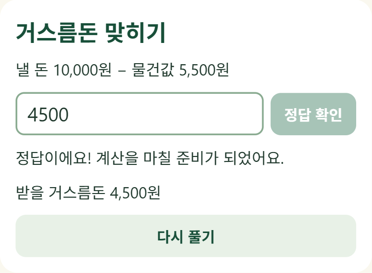
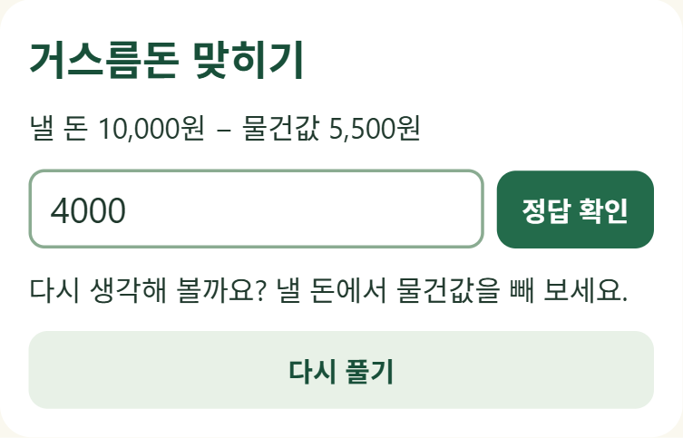

# 9장 거스름돈 맞히기 퀴즈 만들기

지금 앱은 돈을 고르는 즉시 거스름돈을 보여 준다. 이번 장에서는 아이가 먼저 답을 생각하도록 바꾼다. 물건값과 낼 돈을 보고 숫자를 입력한 뒤 ‘정답 확인’을 누른다. 오답이면 힌트를 보고 고치고, 정답이면 거스름돈과 계산 결과를 공개한다.

입력창을 만드는 것만큼 중요한 일이 있다. 빈칸을 0원으로 착각하지 않는 것, 상품이 달라지면 이전 문제의 답을 지우는 것, 정답을 다른 화면에서 미리 보여 주지 않는 것이다. 이 장에서는 화면과 계산 규칙을 함께 다룬다.



그림 9-1. 정답을 확인한 퀴즈의 PC 웹 미리보기(재현). Android 숫자 키보드의 실제 높이는 기기에서 따로 확인한다.

### 시작 위치와 완성 참고본

8장의 작업 폴더를 이어 사용한다. `src/features/payment/change-quiz.ts`와 `change-quiz.test.mjs`, `src/components/quiz-panel.tsx`를 추가한다. `payment.ts`와 `shopping-screen.tsx`를 이번 단계로 교체하고, 공통 `Page`의 키보드 대응을 보완한다.

완성 참고본을 별도로 실행할 때는 다음 순서를 사용한다.

```bash
cd ~/market-book/kit
node start.mjs 09
cd work/ch09/apps/mobile
npm ci
npm test
npm start -- --lan --port 8082
```

## 9.1 정답을 먼저 보여 주지 않기

9장 참고본에서 5,500원에 10,000원을 고르면 거스름돈은 4,500원이다. 완성 앱에서 50,000원권으로 같은 물건을 사는 문제의 답은 44,500원이다. 두 문제는 [20.7절](#ch20-s7)에서 비교한다. 그런데 7장의 예산 패널에도 남을 돈 4,500원이 보인다. 거스름돈 카드만 숨기고 예산 잔액을 그대로 두면 답을 다른 곳에서 읽을 수 있다.

따라서 충분한 돈을 고른 뒤 정답을 맞히기 전까지 예산 패널은 ‘남을 돈 ?원’으로 표시한다. 장바구니 총액과 오늘의 예산은 계속 보인다. 아이가 풀어야 하는 계산의 입력은 유지하고, 결과만 가린다.

돈이 부족하거나 아직 선택하지 않았다면 문제를 출제하지 않는다. 문제의 정답을 구할 수 있는 `ready` 상태에서만 입력창을 보여 준다. 정답을 맞히면 거스름돈과 예산 잔액을 함께 공개한다.

이번 장의 흐름을 먼저 종이에 적어 보자.

```text
충분한 돈 선택
→ 답 입력
→ 정답 확인
→ 오답이면 수정
→ 정답이면 결과 공개
→ 다시 풀기 또는 다음 단계
```

이 순서가 화면과 상태 코드의 기준이다.

## 9.2 숫자 입력창과 입력 상태 연결하기

답을 숫자형으로 저장하면 빈 입력을 표현하기 어렵다. 입력창에서 받은 값은 문자열 그대로 보관하고, 채점할 때 형식을 확인한 뒤 숫자로 바꾼다.

`src/features/payment/change-quiz.ts` 전체를 작성한다.

```ts
export const MAX_CHANGE_ANSWER_LENGTH = 5;

export type ChangeQuizState = {
  answer: string;
  status: 'unanswered' | 'invalid' | 'incorrect' | 'correct';
};

export function gradeChangeAnswer(
  answer: string,
  expected: number,
): Exclude<ChangeQuizState['status'], 'unanswered'> {
  // 빈 입력을 0원으로 바꾸거나 쉼표·소수를 몰래 보정하지 않고, 아이가 입력한 원 단위 숫자만 채점합니다.
  // 숫자 외 문자를 따로 검사해 줄바꿈이나 다른 문자권의 숫자도 정답으로 통과하지 못하게 합니다.
  if (answer.length === 0 || answer.length > MAX_CHANGE_ANSWER_LENGTH || /[^0-9]/u.test(answer)) {
    return 'invalid';
  }

  return Number(answer) === expected ? 'correct' : 'incorrect';
}
```

`ChangeQuizState`는 입력 내용 `answer`와 상태 `status`를 묶는다. 상태는 아직 채점하지 않음, 잘못된 형식, 오답, 정답으로 나눈다.

| 상태 | 뜻 | 다음에 할 일 |
| --- | --- | --- |
| `unanswered` | 아직 현재 답을 채점하지 않음 | 입력 후 확인 |
| `invalid` | 빈 값이나 숫자가 아닌 형식 | 형식을 고침 |
| `incorrect` | 형식은 맞지만 값이 틀림 | 힌트를 보고 다시 입력 |
| `correct` | 정답 | 결과를 보거나 다시 풀기 |

이번에는 쇼핑 상태에도 `quiz`가 필요하다. `src/features/payment/payment.ts`를 아래 전체 내용으로 바꾼다. 기존 파일의 일부를 여러 군데 놓치지 않도록 이번 단계의 완전한 파일을 제공한다.

```ts
import { STARTING_BUDGET_KRW } from '../budget/budget.ts';
import { createCartReducer, getCartSummary, type CartAction, type CartState } from '../cart/cart.ts';

import { gradeChangeAnswer, type ChangeQuizState } from './change-quiz.ts';

export const PAYMENT_OPTIONS_KRW = [1000, 5000, 10000] as const;

export type ShoppingState = {
  cart: CartState;
  selectedPaymentKrw: number | null;
  quiz: ChangeQuizState;
};

export type ShoppingAction =
  | CartAction
  | { type: 'select-payment'; amountKrw: number }
  | { type: 'clear-payment' }
  | { type: 'change-answer'; answer: string }
  | { type: 'check-answer' }
  | { type: 'retry-quiz' };

type PaymentSummary = {
  status: 'empty' | 'over-budget' | 'unselected' | 'insufficient' | 'ready';
  missingAmountKrw: number;
  changeAmountKrw: number | null;
};

function createUnansweredQuiz(): ChangeQuizState {
  return { answer: '', status: 'unanswered' };
}

export function createInitialShoppingState(): ShoppingState {
  return { cart: {}, selectedPaymentKrw: null, quiz: createUnansweredQuiz() };
}

function isAvailablePayment(amountKrw: number | null, budgetKrw: number): amountKrw is number {
  return amountKrw !== null
    && amountKrw <= budgetKrw
    && PAYMENT_OPTIONS_KRW.some((option) => option === amountKrw);
}

export function createShoppingReducer(
  catalog: readonly { id: string; priceKrw: number }[],
  budgetKrw: number = STARTING_BUDGET_KRW,
) {
  const cartReducer = createCartReducer(catalog);

  return function shoppingReducer(state: ShoppingState, action: ShoppingAction): ShoppingState {
    if (action.type === 'change-answer' || action.type === 'check-answer' || action.type === 'retry-quiz') {
      const { totalPriceKrw } = getCartSummary(state.cart, catalog);
      const { changeAmountKrw } = getPaymentSummary(totalPriceKrw, state.selectedPaymentKrw, budgetKrw);

      // 채점의 기준은 현재 장바구니와 고른 돈입니다. 돈이 부족하거나 선택 전이면 오래된 답을 채점하지 않습니다.
      // 0원도 유효한 정답이므로 참/거짓 대신 null 여부로 준비 상태를 구분합니다.
      if (changeAmountKrw === null) {
        return state;
      }

      if (action.type === 'retry-quiz') {
        return state.quiz.answer === '' && state.quiz.status === 'unanswered'
          ? state
          : { ...state, quiz: createUnansweredQuiz() };
      }

      // 정답을 맞힌 화면은 다시 풀기를 선택할 때까지 보존해 입력 실수로 결과가 사라지지 않게 합니다.
      if (state.quiz.status === 'correct') {
        return state;
      }

      if (action.type === 'change-answer') {
        return state.quiz.answer === action.answer && state.quiz.status === 'unanswered'
          ? state
          : { ...state, quiz: { answer: action.answer, status: 'unanswered' } };
      }

      const status = gradeChangeAnswer(state.quiz.answer, changeAmountKrw);
      return status === state.quiz.status ? state : { ...state, quiz: { ...state.quiz, status } };
    }

    if (action.type === 'select-payment') {
      const { totalPriceKrw } = getCartSummary(state.cart, catalog);

      // 빈 장바구니나 예산 초과 상태에서는 먼저 물건을 고쳐 고른 뒤 지불할 돈을 선택합니다.
      if (
        !isAvailablePayment(action.amountKrw, budgetKrw)
        || totalPriceKrw <= 0
        || totalPriceKrw > budgetKrw
        || state.selectedPaymentKrw === action.amountKrw
      ) {
        return state;
      }

      // 적게 고른 돈도 받아 부족한 금액을 배우게 합니다. 여러 번 눌러도 금액은 누적하지 않습니다.
      // 고른 돈이 달라지면 문제의 정답도 달라지므로 이전 입력과 채점 결과를 함께 지웁니다.
      return { ...state, selectedPaymentKrw: action.amountKrw, quiz: createUnansweredQuiz() };
    }

    if (action.type === 'clear-payment') {
      return state.selectedPaymentKrw === null
        ? state
        : { ...state, selectedPaymentKrw: null, quiz: createUnansweredQuiz() };
    }

    const cart = cartReducer(state.cart, action);

    // 상품 구성이 바뀌면 돈 선택과 퀴즈도 같은 상태 변경에서 지워 이전 문제의 답이 남지 않게 합니다.
    // 수량 상한처럼 실제 변화 없는 동작은 선택과 풀이를 그대로 유지합니다.
    return cart === state.cart ? state : { cart, selectedPaymentKrw: null, quiz: createUnansweredQuiz() };
  };
}

export function getPaymentSummary(
  totalPriceKrw: number,
  selectedPaymentKrw: number | null,
  budgetKrw: number = STARTING_BUDGET_KRW,
): PaymentSummary {
  // 먼저 장바구니의 구매 가능 여부를 알려야 돈 선택 안내와 예산 초과 안내가 충돌하지 않습니다.
  // 계산할 수 없는 거스름돈은 null로 두어, 정확히 냈을 때의 유효한 0원과 구분합니다.
  if (totalPriceKrw <= 0) {
    return { status: 'empty', missingAmountKrw: 0, changeAmountKrw: null };
  }

  if (totalPriceKrw > budgetKrw) {
    return { status: 'over-budget', missingAmountKrw: 0, changeAmountKrw: null };
  }

  if (!isAvailablePayment(selectedPaymentKrw, budgetKrw)) {
    return { status: 'unselected', missingAmountKrw: 0, changeAmountKrw: null };
  }

  if (selectedPaymentKrw < totalPriceKrw) {
    return { status: 'insufficient', missingAmountKrw: totalPriceKrw - selectedPaymentKrw, changeAmountKrw: null };
  }

  // 거스름돈은 실제로 고른 놀이돈에서 물건값을 뺍니다. 전체 예산에서 뺀 남을 돈과는 다릅니다.
  // 계산 결과만 돌려주며 장바구니·돈 선택을 바꾸거나 결제 완료로 처리하지 않습니다.
  return { status: 'ready', missingAmountKrw: 0, changeAmountKrw: selectedPaymentKrw - totalPriceKrw };
}
```

`createUnansweredQuiz`는 빈 입력 상태를 만든다. 상품이나 돈이 바뀔 때 이 함수를 호출하므로 이전 답과 채점 상태를 함께 지운다. 답만 비우고 `correct`가 남거나, 상태만 바꾸고 이전 답을 남기는 실수를 막는다.

`change-answer` 액션을 받으면 문자열을 그대로 저장한다. 숫자 키보드를 사용하더라도 붙여넣기나 다른 입력 경로가 있을 수 있으므로, 입력창의 종류만 믿고 형식 검사를 생략하지 않는다.

## 9.3 빈 입력과 0원 답 구분하기

JavaScript에서 `Number('')`는 0이 된다. 하지만 아이가 아무것도 입력하지 않은 것과 ‘거스름돈은 0원’이라고 답한 것은 다르다.

우리 함수는 먼저 문자열 길이가 0인지 확인한다. 숫자가 아닌 문자가 있는지도 확인한다. 이 과정을 통과한 문자열에만 `Number(answer)`를 적용한다.

| 입력 | 기대 처리 |
| --- | --- |
| 빈칸 | 입력 안내 |
| `0` | 0원이라는 답으로 채점 |
| `4000` | 4,000원이라는 답으로 채점 |
| `4,000` | 쉼표가 있으므로 형식 안내 |
| `-1` | 음수 기호가 있으므로 형식 안내 |
| `1.5` | 소수점이 있으므로 형식 안내 |
| 공백 | 형식 안내 |

입력을 자동으로 ‘친절하게’ 바꾸는 것보다 이번 놀이의 입력 규칙을 명확히 알린다. 예를 들어 `parseInt('4000원')`로 문자 일부를 받아들이면 입력 형식을 연습하는 기준이 흐려질 수 있다.

숫자 길이는 최대 5자리다. 이 앱의 예산과 지불 금액 범위를 표현하기에 충분하다. 이 제한은 입력창과 채점 함수 양쪽에 있다.

## 9.4 입력값 검사와 정답 판정하기

`check-answer` 액션이 오면 현재 장바구니 합계와 선택한 돈에서 정답을 다시 구한다. 예전에 계산해 둔 값을 계속 저장하지 않는다.

기준 거스름돈이 null이면 문제를 채점하지 않는다. 빈 장바구니나 돈 부족 상태에서 오래된 입력이 들어와도 의미 없는 정답 판정을 하지 않기 위해서다. 거스름돈 0원은 유효하므로 null만 제외한다.

형식이 올바르면 입력한 숫자와 현재 정답을 비교한다. 이 비교는 `gradeChangeAnswer`에 모아 두었기 때문에 화면을 열지 않고도 검사할 수 있다.

이제 `src/components/quiz-panel.tsx`를 만든다.

```tsx
import { Keyboard, TextInput, View } from 'react-native';
import { MAX_CHANGE_ANSWER_LENGTH, type ChangeQuizState } from '../features/payment/change-quiz';
import { ActionButton, Body, Card, Title, ui, won } from './book-ui';

type Props = {
  quiz: ChangeQuizState;
  totalPriceKrw: number;
  selectedPaymentKrw: number;
  onAnswer: (answer: string) => void;
  onCheck: () => void;
  onRetry: () => void;
};

export function QuizPanel({ quiz, totalPriceKrw, selectedPaymentKrw, onAnswer, onCheck, onRetry }: Props) {
  const correct = quiz.status === 'correct';
  const guidance = quiz.status === 'invalid' ? '0부터 9까지의 숫자로 답을 입력해 주세요.'
    : quiz.status === 'incorrect' ? '다시 생각해 볼까요? 낼 돈에서 물건값을 빼 보세요.'
      : correct ? '정답이에요! 계산을 마칠 준비가 되었어요.' : '받을 거스름돈은 얼마일까요?';
  return (
    <Card>
      <Title>거스름돈 맞히기</Title>
      <Body>낼 돈 {won(selectedPaymentKrw)} − 물건값 {won(totalPriceKrw)}</Body>
      <View style={ui.row}>
        <TextInput value={quiz.answer} onChangeText={onAnswer}
          keyboardType="number-pad" maxLength={MAX_CHANGE_ANSWER_LENGTH}
          editable={!correct} placeholder="답 입력" accessibilityLabel="거스름돈 답"
          testID="quiz-answer" style={ui.input} />
        <ActionButton title="정답 확인" testID="quiz-check" disabled={correct}
          onPress={() => { Keyboard.dismiss(); onCheck(); }} />
      </View>
      <Body>{guidance}</Body>
      {correct && <Body>받을 거스름돈 {won(selectedPaymentKrw - totalPriceKrw)}</Body>}
      <ActionButton title="다시 풀기" secondary testID="quiz-retry"
        onPress={() => { Keyboard.dismiss(); onRetry(); }} />
    </Card>
  );
}
```

`TextInput`의 `value`는 현재 상태에서 읽고, `onChangeText`는 새 문자열을 상태로 보낸다. 화면과 상태가 같은 값을 사용하는 **제어된 입력창**이다. 텍스트를 바꿨는데 `value`에 고정 문자열을 넣어 두면 입력이 매번 되돌아갈 수 있다. [React Native TextInput](https://reactnative.dev/docs/textinput)

정답 확인 버튼은 먼저 키보드를 닫고 `onCheck`를 호출한다. 화면의 안내는 `quiz.status`에 따라 달라진다. 컴포넌트에서 별도의 ‘정답 여부’ 상태를 만들어 중복 관리하지 않는다.

## 9.5 오답 힌트와 다시 풀기

오답 안내는 정답 숫자를 바로 알려 주지 않고 계산 방향을 알려 준다. ‘낼 돈에서 물건값을 빼 보세요’라고 안내해 다시 생각하도록 한다.

오답 상태에서 입력을 고치면 상태는 다시 `unanswered`가 된다. 사용자가 바꾼 답에 이전 오답 표시를 계속 붙이지 않는 것이다. 새 답을 확인해야 새 결과를 표시한다.

정답 이후에는 입력창과 확인 버튼을 잠근다. 이때 잘못 터치한 키로 정답 화면이 사라지지 않게 reducer에서도 답 변경을 무시한다. 다시 풀기를 누르면 입력과 상태를 비우고, 상품과 낼 돈은 그대로 둔다.

당근 1개에 5,000원을 선택해 보자. 9,000원을 입력하면 오답이어야 한다. 이것은 예산에서 남을 돈을 거스름돈과 혼동한 답이다. 4,000원으로 고치고 확인하면 정답이다. 다시 풀기를 누르면 같은 문제의 입력창이 비고 결과가 다시 가려져야 한다.



그림 9-2. 9장 예제에서 4,000원을 입력하고 확인한 PC 웹 미리보기. 아직 계산을 끝낼 수 없다.

이 화면에서는 아이가 어느 계산을 다시 해야 하는지 읽어 보자. 10,000원에서 5,500원을 뺀다. 입력창의 4000을 4500으로 바꾸고 **정답 확인**을 누른 뒤 그림 9-1과 대조한다. 답을 고칠 때는 상품을 새로 담거나 지폐를 다시 고를 필요가 없다.

## 9.6 정답 뒤 계산 완료 단계로 연결하기

이번 장의 정답 안내에는 ‘계산을 마칠 준비가 되었어요’라는 문장이 나온다. 여기까지는 **퀴즈를 맞힌 상태**다. 영수증을 만드는 실제 계산 완료는 10장에서 추가한다.

현재 정답 상태만 확인하면 다음 단계로 넘어갈 수 있을 것처럼 보이지만, 10장에서는 현재 물건값과 선택한 돈으로 답을 다시 확인한다. 상품이 바뀐 뒤 옛 정답 표시가 남는 상황까지 막기 위해서다.

현재 화면을 조립하는 `src/screens/shopping-screen.tsx`는 다음과 같다.

```tsx
import { useMemo, useReducer, useState } from 'react';
import type { CatalogProduct } from '../features/catalog/catalog';
import { filterProductsByCategory, type CatalogFilter } from '../features/catalog/categories';
import { getCartSummary } from '../features/cart/cart';
import { Body, Card, Page, Title } from '../components/book-ui';
import { CategoryFilter } from '../components/category-filter';
import { ProductList } from '../components/product-list';
import { CartPanel } from '../components/cart-panel';
import { BudgetPanel } from '../components/budget-panel';
import { Keyboard } from 'react-native';
import { createInitialShoppingState, createShoppingReducer, getPaymentSummary } from '../features/payment/payment';
import { PaymentPanel } from '../components/payment-panel';
import { QuizPanel } from '../components/quiz-panel';

type Props = {
  products: readonly CatalogProduct[];
  sourceLabel?: string;
  onNewRound?: () => void;
};

export function ShoppingScreen({ products, sourceLabel = '자체 예시 상품' }: Props) {
  const [category, setCategory] = useState<CatalogFilter>('all');
  const reducer = useMemo(() => createShoppingReducer(products), [products]);
  const [shopping, dispatch] = useReducer(reducer, undefined, createInitialShoppingState);
  const cart = shopping.cart;
  // 계산에는 전체 상품을 쓰고, 분류는 화면에 보이는 목록만 바꿉니다.
  const total = getCartSummary(cart, products);
  const visible = filterProductsByCategory(products, category);
  const payment = getPaymentSummary(total.totalPriceKrw, shopping.selectedPaymentKrw);
  const correct = shopping.quiz.status === 'correct';

  return (
    <Page>
      <Card>
        <Title>꼬마 시장</Title>
        <Body>{sourceLabel} · 전체 {products.length}개</Body>
        <Body>이 가격은 장보기 연습을 위한 예시예요.</Body>
        <CategoryFilter value={category} onChange={setCategory} />
        <Body>{visible.length}개 상품을 보고 있어요.</Body>
      </Card>
      <BudgetPanel totalPriceKrw={total.totalPriceKrw} hideRemaining={payment.status === 'ready' && !correct} />
      <ProductList products={visible} quantities={cart}
        onAdd={(id) => dispatch({ type: 'add', productId: id })}
        onDecrease={(id) => dispatch({ type: 'decrease', productId: id })} />
      <CartPanel cart={cart} products={products} onAction={dispatch} />
      <PaymentPanel totalPriceKrw={total.totalPriceKrw}
        selectedPaymentKrw={shopping.selectedPaymentKrw}
        revealChange={correct}
        onSelect={(amountKrw) => { Keyboard.dismiss(); dispatch({ type: 'select-payment', amountKrw }); }}
        onClear={() => { Keyboard.dismiss(); dispatch({ type: 'clear-payment' }); }} />
      {payment.status === 'ready' && shopping.selectedPaymentKrw !== null && (
        <QuizPanel quiz={shopping.quiz} totalPriceKrw={total.totalPriceKrw}
          selectedPaymentKrw={shopping.selectedPaymentKrw}
          onAnswer={(answer) => dispatch({ type: 'change-answer', answer })}
          onCheck={() => dispatch({ type: 'check-answer' })}
          onRetry={() => dispatch({ type: 'retry-quiz' })} />
      )}
    </Page>
  );
}
```

`correct`는 `shopping.quiz.status === 'correct'`에서 구한 파생 값이다. `PaymentPanel`에는 `revealChange={correct}`를 전달한다. 같은 상태를 기준으로 거스름돈 공개와 예산 잔액 공개를 맞춘다.

화면에 정답이 보이는지 확인할 때 눈에 보이는 카드만 검사하지 않는다. 숨겨야 할 결과가 다른 문구나 접근성 설명에 남아 있지 않은지도 살펴본다. 이 예제는 해당 결과 영역 자체를 렌더링하지 않는 방식으로 처리한다.

## 9.7 상품이나 낼 돈이 바뀌면 답 초기화하기

사과 2개·우유 1개에 10,000원을 내는 문제의 답은 4,500원이다. 사과를 하나 더 담으면 문제의 답은 3,000원이 된다. 이전 4,500원을 그대로 정답 상태로 두어서는 안 된다.

쇼핑 reducer는 상품 구성이 실제로 바뀌면 낼 돈과 퀴즈를 함께 초기화한다. 돈만 5,000원에서 10,000원으로 바뀌면 장바구니는 유지하고 퀴즈를 초기화한다.

반대로 다음 동작에서는 현재 풀이를 유지한다.

- 같은 돈을 다시 선택한다.
- 수량 9개에서 더 담기 요청이 들어오지만 실제 수량은 바뀌지 않는다.
- 없는 품목을 지우려 하지만 장바구니가 그대로다.
- 상품 분류만 바꾼다.

‘버튼을 눌렀는가’보다 **계산에 쓰는 값이 바뀌었는가**가 기준이다. 기존 reducer의 무변화 반환 규칙을 재사용하면 이런 구분을 여러 화면에서 따로 구현할 필요가 없다.

## 9.8 키보드가 열린 상태에서 버튼 누르기

PC 웹에서는 입력창 아래에 숫자 키보드가 나타나지 않는다. Android 기기는 키보드가 화면 공간을 차지한다. 입력창은 보이는데 확인 버튼이 가려지면 실제 놀이를 진행하기 어렵다.

현재 퀴즈는 입력창과 확인 버튼을 같은 행에 두고, 폭이 부족하면 줄을 바꿀 수 있게 했다. 전체 페이지는 스크롤이 가능하다. 공통 `src/components/book-ui.tsx`의 React Native import에 `KeyboardAvoidingView`를 추가한다.

```tsx
import {
  KeyboardAvoidingView, Pressable, ScrollView,
  StyleSheet, Text, View,
} from 'react-native';
```

이 파일의 `Page` 함수만 다음으로 바꾼다. 다른 공통 함수와 `ui` 스타일은 그대로 유지한다.

```tsx
export function Page({ children }: { children: ReactNode }) {
  return (
    <SafeAreaView style={ui.screen}>
      <KeyboardAvoidingView style={{ flex: 1 }} behavior="height">
        <ScrollView
          contentContainerStyle={ui.content}
          keyboardShouldPersistTaps="handled"
        >
          {children}
        </ScrollView>
      </KeyboardAvoidingView>
    </SafeAreaView>
  );
}
```

`keyboardShouldPersistTaps="handled"`는 자식 버튼이 처리하는 탭이 키보드 닫기에만 소비되지 않도록 하는 설정이다. `KeyboardAvoidingView`는 키보드에 대응할 영역 높이를 조정한다. 실제 기기의 화면과 키보드에 따라 배치가 달라지므로 아래 확인을 수행한다. [ScrollView](https://reactnative.dev/docs/scrollview), [KeyboardAvoidingView](https://reactnative.dev/docs/keyboardavoidingview)

Android에서 답 입력창을 눌러 숫자 키보드를 연다. 빈 상태에서 정답 확인을 **한 번** 누른다. 입력 안내가 표시되는지, 한 번의 탭이 키보드 닫기로만 끝나지 않는지 본다. 이어 숫자를 입력하고 다시 확인한다. 입력창이나 버튼이 가려지면 실제 기기 이름, 화면 크기 설정과 함께 결과를 기록한다.

이번 웹 재현 그림은 키보드 동작의 성공 근거로 사용하지 않는다. 큰 글자와 작은 화면 조건은 뒤의 사용성 장에서 더 다룬다.

## 9.9 오답과 빈칸과 0원을 테스트와 대조하기

`src/features/payment/change-quiz.test.mjs`에 아래 코드를 작성한다.

```js
import assert from 'node:assert/strict';
import test from 'node:test';
import { sampleProducts } from '../../data/sample-products.ts';
import { gradeChangeAnswer } from './change-quiz.ts';
import { createInitialShoppingState, createShoppingReducer } from './payment.ts';
test('빈칸은 0원이 아니며 숫자 0은 정답이다', () => {
  assert.equal(gradeChangeAnswer('', 0), 'invalid');
  assert.equal(gradeChangeAnswer('0', 0), 'correct');
});
test('입력 형식을 숫자 키보드와 별도로 검사한다', () => {
  for (const answer of [' ', '-1', '1.5', '4,000', '1e3', '123456', '４０００']) {
    assert.equal(gradeChangeAnswer(answer, 4000), 'invalid');
  }
  assert.equal(gradeChangeAnswer('9000', 4000), 'incorrect');
  assert.equal(gradeChangeAnswer('4000', 4000), 'correct');
});
test('정답·다시 풀기·상품 변경의 상태 경계를 확인한다', () => {
  const reduce = createShoppingReducer(sampleProducts);
  let s = reduce(createInitialShoppingState(), { type: 'add', productId: 'sample-carrot' });
  s = reduce(s, { type: 'select-payment', amountKrw: 5000 });
  s = reduce(s, { type: 'change-answer', answer: '9000' });
  s = reduce(s, { type: 'check-answer' });
  assert.equal(s.quiz.status, 'incorrect');
  s = reduce(s, { type: 'change-answer', answer: '4000' });
  s = reduce(s, { type: 'check-answer' });
  assert.equal(s.quiz.status, 'correct');
  assert.equal(reduce(s, { type: 'change-answer', answer: '1' }), s);
  const retry = reduce(s, { type: 'retry-quiz' });
  assert.equal(retry.quiz.answer, '');
  assert.equal(retry.selectedPaymentKrw, 5000);
  const changed = reduce(s, { type: 'add', productId: 'sample-carrot' });
  assert.equal(changed.quiz.status, 'unanswered');
  assert.equal(changed.selectedPaymentKrw, null);
});
```

테스트는 입력 형식뿐 아니라 쇼핑 reducer와의 연결도 확인한다. 오답에서 정답으로 바뀌는지, 정답 뒤 입력이 잠기는지, 다시 풀기와 상품 변경이 올바른 상태를 만드는지 검사한다.

`package.json`의 test 명령에 새 파일을 추가한다.

```json
"test": "node --experimental-strip-types --test src/features/cart/cart.test.mjs src/features/budget/budget.test.mjs src/features/payment/payment.test.mjs src/features/payment/change-quiz.test.mjs"
```

전체 20개의 검사를 실행하고 타입과 린트도 확인한다.

```bash
npm test
npm run typecheck
npm run lint
```

휴대전화에서 대조할 순서는 다음과 같다.

| 준비 | 입력과 조작 | 기대 결과 |
| --- | --- | --- |
| 당근 1개·5,000원 선택 | 빈칸 확인 | 숫자 입력 안내 |
| 같은 문제 | 9000 입력 후 확인 | 오답 힌트 |
| 같은 문제 | 4000 입력 후 확인 | 정답, 거스름돈 4,000원 |
| 정답 상태 | 다시 풀기 | 같은 문제, 빈 입력 |
| 당근 1개·1,000원 선택 | 빈칸 확인 | 0원 정답으로 처리하지 않음 |
| 같은 문제 | 0 입력 후 확인 | 거스름돈 0원 정답 |
| 정답 상태 | 당근 하나 더 담기 | 돈 선택과 답 초기화 |

쉼표나 문자를 입력하는 검사는 숫자 키보드에서 직접 하기 어려울 수 있다. 그 경계는 자동 테스트로 검사하고, 필요하면 PC 웹 입력창에서 같은 문자열을 붙여 넣어 확인한다. `maxLength`가 긴 문자열을 제한하더라도 함수 자체의 형식 검사는 유지한다.

**문제 해결:** 답이 입력되지 않으면 정답 뒤 잠긴 상태인지 먼저 보고 다시 풀기를 누른다. 아무 답도 입력하지 않았는데 정답이면 Number 변환보다 앞에서 빈 문자열을 검사하는지 본다. 채점 버튼이 두 번 눌러야 반응하면 Page의 탭 설정과 실제 키보드 상태를 확인한다.

**연습:** 정답 상태에서 상품 분류만 바꿔 본다. 상품 수량과 지불 금액이 같으므로 풀이가 유지되어야 한다. 그다음 실제 수량을 바꾸어 초기화와 비교한다. ‘화면에서 무엇을 눌렀는가’와 ‘계산 입력이 바뀌었는가’의 차이를 설명할 수 있으면 이번 상태 설계를 이해한 것이다.

다음 장에서는 이 정답 상태에 계산 완료 버튼을 연결한다. 완료 순간의 상품과 금액을 값으로 복사해 놀이 영수증을 만든다.
