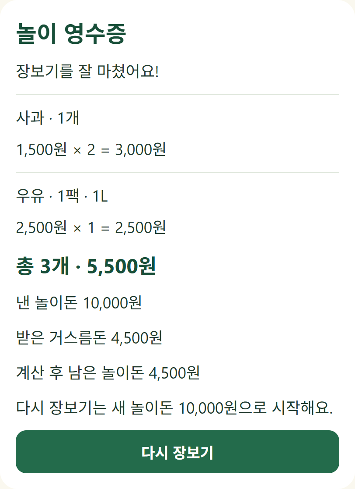

# 10장 계산 완료와 놀이 영수증 만들기

상품을 담고 거스름돈을 맞혔다면 놀이를 끝맺을 차례다. ‘계산 완료’를 누르면 산 물건과 금액을 영수증에 보여 주고, ‘다시 장보기’를 누르면 새 놀이돈으로 시작한다.

이번 장을 마치면 **상품 선택 → 예산 확인 → 낼 돈 선택 → 거스름돈 문제 → 영수증**으로 이어지는 첫 번째 완성 앱이 된다. 데이터베이스를 연결하지 않아도 이 전체 놀이를 실행할 수 있다.

영수증은 현재 실행 중인 앱의 메모리에만 보관한다. 새 놀이를 시작하거나 앱을 다시 시작하면 이전 영수증은 사라진다. 실제 결제, 영수증 저장·공유, 구매 이력 기능은 이번 구현에 포함되지 않는다.



그림 10-1. 놀이 영수증의 PC 웹 미리보기(재현). 현재 놀이에서 확정한 값을 표시한다.

### 이번 장의 파일

| 파일 | 변경 |
| --- | --- |
| `src/features/payment/receipt.ts` | 영수증 타입과 생성 함수 추가 |
| `src/features/payment/payment.ts` | 완료 조건과 새 놀이 상태 추가 |
| `src/features/payment/receipt.test.mjs` | 완료·복사·잠금·새 놀이 검사 |
| `src/components/receipt-panel.tsx` | 영수증 화면 추가 |
| `src/screens/shopping-screen.tsx` | 놀이 화면과 영수증 화면 연결 |
| `package.json` | 새 테스트 파일 추가 |

9장 작업 폴더에서 이어서 입력한다. 완성 참고본이 필요하면 별도 경로를 사용한다.

```bash
cd ~/market-book/kit
node start.mjs 10
cd work/ch10/apps/mobile
npm ci
npm test
npm start -- --lan --port 8082
```

## 10.1 계산을 완료할 수 있는 조건 정하기

계산 완료 버튼을 누를 수 있는 조건은 두 가지다. 선택한 돈으로 현재 물건값을 낼 수 있어야 하고, 현재 거스름돈 문제를 맞혀야 한다. 빈 장바구니, 예산 초과, 돈 부족, 빈 답이나 오답에서는 완료할 수 없다.

화면에서 버튼을 비활성화하는 것만으로 충분하지 않다. reducer도 완료 요청을 받을 때 현재 값을 다시 검사한다. 화면을 갱신하기 전 늦게 들어온 요청이나 잘못 호출된 액션으로 틀린 영수증을 만들지 않기 위해서다.

완료 시점에 확인할 값은 다음과 같다.

1. 현재 장바구니로 합계를 다시 구한다.
2. 현재 선택한 돈으로 낼 수 있는지 확인한다.
3. 퀴즈 상태가 correct인지 확인한다.
4. 현재 입력한 답을 현재 거스름돈과 다시 비교한다.
5. 조건이 모두 맞으면 영수증을 만든다.

4번이 중복처럼 보여도 역할이 있다. correct라는 표시만 남고 답 문자열이 바뀐 비정상 상태를 거부할 수 있다. 실제 완료에 필요한 조건을 한곳에서 확인한다.

## 10.2 완료 순간의 상품과 가격 복사하기

영수증에는 상품 ID뿐 아니라 **완료 당시의 이름, 단위, 단가, 수량, 품목 금액**을 담는다. 장바구니와 달리 나중에 원본 목록에서 이름과 가격을 다시 읽어서는 안 된다. 이미 끝낸 놀이의 영수증이 이후 가격 변경에 따라 달라지면 안 되기 때문이다.

`src/features/payment/receipt.ts`를 만든다.

```ts
import { STARTING_BUDGET_KRW } from '../budget/budget.ts';
import { getCartSummary, type CartState } from '../cart/cart.ts';

export type ReceiptCatalogProduct = Readonly<{
  id: string;
  name: string;
  unit: string;
  priceKrw: number;
}>;

export type ReceiptItem = Readonly<{
  productId: string;
  name: string;
  unit: string;
  unitPriceKrw: number;
  quantity: number;
  lineTotalKrw: number;
}>;

export type Receipt = Readonly<{
  items: readonly ReceiptItem[];
  totalQuantity: number;
  totalPriceKrw: number;
  paidAmountKrw: number;
  changeAmountKrw: number;
  startingBudgetKrw: number;
  remainingBudgetKrw: number;
}>;

export function createReceipt(
  cart: CartState,
  catalog: readonly ReceiptCatalogProduct[],
  paidAmountKrw: number,
  startingBudgetKrw: number = STARTING_BUDGET_KRW,
): Receipt {
  const { totalQuantity, totalPriceKrw } = getCartSummary(cart, catalog);
  const items: ReceiptItem[] = [];

  // 계산 가능 여부는 쇼핑 reducer가 확인합니다. 영수증은 그 순간의 이름·가격·수량을 새 값으로 복사합니다.
  // 이후 장바구니를 비우거나 상품 목록을 바꿔도 이미 끝낸 놀이의 내용이 달라지지 않아야 합니다.
  for (const product of catalog) {
    const quantity = cart[product.id] ?? 0;
    if (quantity === 0) {
      continue;
    }

    items.push({
      productId: product.id,
      name: product.name,
      unit: product.unit,
      unitPriceKrw: product.priceKrw,
      quantity,
      lineTotalKrw: product.priceKrw * quantity,
    });
  }

  return {
    items,
    totalQuantity,
    totalPriceKrw,
    paidAmountKrw,
    changeAmountKrw: paidAmountKrw - totalPriceKrw,
    startingBudgetKrw,
    // 거스름돈은 낸 돈의 차액이고, 남은 놀이돈은 시작 예산의 차액이므로 따로 기록합니다.
    remainingBudgetKrw: startingBudgetKrw - totalPriceKrw,
  };
}
```

`ReceiptItem`은 영수증 한 줄, `Receipt`는 한 번의 놀이 전체다. 계산은 여전히 원 단위 정수로 수행한다. 파일에는 화면 컴포넌트가 없어서 Node 테스트로 결과를 확인할 수 있다.

`items.push`에 넣는 객체는 원본 상품 객체와 별개다. 이름과 단가를 새로운 필드에 값으로 옮긴다. 물건 목록을 표시할 때와 달리 여기서 중복 저장하는 이유는 과거 시점의 결과를 보존하기 위해서다.

영수증에는 전체 수량, 총액, 낸 돈, 거스름돈, 시작 예산, 남은 예산을 함께 담는다. 시간이나 임의 번호는 넣지 않았다. 같은 입력이 같은 결과를 만들면 테스트에서 비교하기 쉽다.

## 10.3 상품별 수량과 금액과 합계 표시하기

`src/components/receipt-panel.tsx`를 만든다.

```tsx
import { Text, View } from 'react-native';
import type { Receipt } from '../features/payment/receipt';
import { ActionButton, Body, Card, Title, ui, won } from './book-ui';

export function ReceiptPanel({ receipt, onNewRound }: { receipt: Receipt; onNewRound: () => void }) {
  return (
    <Card>
      <Title>놀이 영수증</Title>
      <Body>장보기를 잘 마쳤어요!</Body>
      {receipt.items.map((item) => (
        <View key={item.productId} style={ui.line}>
          <Text style={ui.body}>{item.name} · {item.unit}</Text>
          <Body>{won(item.unitPriceKrw)} × {item.quantity} = {won(item.lineTotalKrw)}</Body>
        </View>
      ))}
      <Text style={ui.price}>총 {receipt.totalQuantity}개 · {won(receipt.totalPriceKrw)}</Text>
      <Body>낸 놀이돈 {won(receipt.paidAmountKrw)}</Body>
      <Body>받은 거스름돈 {won(receipt.changeAmountKrw)}</Body>
      <Body>계산 후 남은 놀이돈 {won(receipt.remainingBudgetKrw)}</Body>
      <Body>다시 장보기는 새 놀이돈 10,000원으로 시작해요.</Body>
      <ActionButton title="다시 장보기" testID="receipt-new-round" onPress={onNewRound} />
    </Card>
  );
}
```

각 품목은 `단가 × 수량 = 품목 금액`으로 표시한다. ‘사과 3,000원’만 보이는 것보다 몇 개를 샀는지 확인하기 쉽다. 여러 품목 아래에는 전체 수량과 합계를 표시한다.

`ReceiptPanel`은 계산 함수를 다시 호출하지 않는다. 전달받은 영수증의 값을 보여 준다. 값으로 확정한 영수증을 화면이 다른 규칙으로 재계산하면 두 결과가 어긋날 수 있기 때문이다.

현재 화면은 `Page`의 스크롤 안에 표시하므로 품목이 많아져도 아래의 다시 장보기 버튼까지 이동할 수 있다. 상품 이름이나 단위가 길면 글자가 줄을 바꿀 공간이 있는지 실제 기기에서도 확인한다.

## 10.4 낸 돈과 거스름돈과 남은 돈 비교하기

[20.7절](#ch20-s7)에서는 예산 50,000원에 10,000원권 또는 50,000원권을 내고 영수증을 비교한다. 이 장의 영수증에서도 거스름돈과 예산 잔액을 구분한다. 예산 10,000원에서 당근 1,000원을 사고 5,000원을 냈다면 다음과 같다.

```text
시작 예산       10,000원
물건값          1,000원
낸 놀이돈       5,000원
받은 거스름돈   4,000원
남은 놀이돈     9,000원
```

남은 놀이돈을 `시작 예산 - 낸 돈`으로 구하면 5,000원이 되어 틀린다. 실제 사용한 금액은 물건값 1,000원이다. 또 `시작 예산 - 물건값 + 거스름돈`으로 계산하면 거스름돈을 두 번 반영하는 실수다.

`createReceipt`는 거스름돈을 `paidAmountKrw - totalPriceKrw`로, 남은 돈을 `startingBudgetKrw - totalPriceKrw`로 기록한다. 서로 다른 입력을 사용하는 두 식을 나란히 확인한다.

아래 세 경우를 모두 확인해야 한다.

| 구매 | 낸 돈 | 거스름돈 | 남은 돈 |
| --- | ---: | ---: | ---: |
| 사과 2개·우유 1개, 5,500원 | 10,000원 | 4,500원 | 4,500원 |
| 당근 1개, 1,000원 | 5,000원 | 4,000원 | 9,000원 |
| 당근 1개, 1,000원 | 1,000원 | 0원 | 9,000원 |

첫 경우는 두 금액이 같고, 둘째는 다르며, 셋째는 0원 거스름돈이다. 서로 다른 경계를 대표하는 작은 사례다.

## 10.5 중복 완료와 완료 후 상태 변경 막기

쇼핑 상태에 `receipt: Receipt | null`을 추가한다. null이면 장보기 중이고, 영수증 값이 있으면 완료 상태다.

`src/features/payment/payment.ts`를 다음 전체 파일로 교체한다. 9장의 입력·채점 규칙을 유지하면서 완료와 새 놀이 액션을 추가한 버전이다.

```ts
import { STARTING_BUDGET_KRW } from '../budget/budget.ts';
import { createCartReducer, getCartSummary, type CartAction, type CartState } from '../cart/cart.ts';

import { gradeChangeAnswer, type ChangeQuizState } from './change-quiz.ts';
import { createReceipt, type Receipt, type ReceiptCatalogProduct } from './receipt.ts';

export const PAYMENT_OPTIONS_KRW = [1000, 5000, 10000] as const;

export type ShoppingState = {
  cart: CartState;
  selectedPaymentKrw: number | null;
  quiz: ChangeQuizState;
  receipt: Receipt | null;
};

export type ShoppingAction =
  | CartAction
  | { type: 'select-payment'; amountKrw: number }
  | { type: 'clear-payment' }
  | { type: 'change-answer'; answer: string }
  | { type: 'check-answer' }
  | { type: 'retry-quiz' }
  | { type: 'complete-checkout' }
  | { type: 'start-new-round' };

type PaymentSummary = {
  status: 'empty' | 'over-budget' | 'unselected' | 'insufficient' | 'ready';
  missingAmountKrw: number;
  changeAmountKrw: number | null;
};

function createUnansweredQuiz(): ChangeQuizState {
  return { answer: '', status: 'unanswered' };
}

export function createInitialShoppingState(): ShoppingState {
  return { cart: {}, selectedPaymentKrw: null, quiz: createUnansweredQuiz(), receipt: null };
}

function isAvailablePayment(amountKrw: number | null, budgetKrw: number): amountKrw is number {
  return amountKrw !== null
    && amountKrw <= budgetKrw
    && PAYMENT_OPTIONS_KRW.some((option) => option === amountKrw);
}

export function createShoppingReducer(
  catalog: readonly ReceiptCatalogProduct[],
  budgetKrw: number = STARTING_BUDGET_KRW,
) {
  const cartReducer = createCartReducer(catalog);

  return function shoppingReducer(state: ShoppingState, action: ShoppingAction): ShoppingState {
    if (action.type === 'start-new-round') {
      // 진행 중인 장보기를 잘못 지우지 않도록, 계산을 끝낸 영수증에서만 새 놀이를 시작합니다.
      return state.receipt === null ? state : createInitialShoppingState();
    }

    // 완료 화면에서는 중복 탭과 늦게 도착한 입력을 무시해 영수증이 바뀌거나 두 번 계산되지 않게 합니다.
    if (state.receipt !== null) {
      return state;
    }

    if (action.type === 'complete-checkout') {
      const { totalPriceKrw } = getCartSummary(state.cart, catalog);
      const payment = getPaymentSummary(totalPriceKrw, state.selectedPaymentKrw, budgetKrw);
      // 정답 표시만 믿지 않고 현재 물건값과 낼 돈으로 다시 확인해야 이전 문제의 답으로 완료되지 않습니다.
      if (
        payment.status !== 'ready'
        || payment.changeAmountKrw === null
        || state.selectedPaymentKrw === null
        || state.quiz.status !== 'correct'
        || gradeChangeAnswer(state.quiz.answer, payment.changeAmountKrw) !== 'correct'
      ) {
        return state;
      }

      // 영수증을 먼저 값으로 복사하고 장바구니·선택·답을 한 번에 비워 완료 전후 상태가 섞이지 않게 합니다.
      const receipt = createReceipt(state.cart, catalog, state.selectedPaymentKrw, budgetKrw);
      return { ...createInitialShoppingState(), receipt };
    }

    if (action.type === 'change-answer' || action.type === 'check-answer' || action.type === 'retry-quiz') {
      const { totalPriceKrw } = getCartSummary(state.cart, catalog);
      const { changeAmountKrw } = getPaymentSummary(totalPriceKrw, state.selectedPaymentKrw, budgetKrw);

      // 채점의 기준은 현재 장바구니와 고른 돈입니다. 돈이 부족하거나 선택 전이면 오래된 답을 채점하지 않습니다.
      // 0원도 유효한 정답이므로 참/거짓 대신 null 여부로 준비 상태를 구분합니다.
      if (changeAmountKrw === null) {
        return state;
      }

      if (action.type === 'retry-quiz') {
        return state.quiz.answer === '' && state.quiz.status === 'unanswered'
          ? state
          : { ...state, quiz: createUnansweredQuiz() };
      }

      // 정답을 맞힌 화면은 다시 풀기를 선택할 때까지 보존해 입력 실수로 결과가 사라지지 않게 합니다.
      if (state.quiz.status === 'correct') {
        return state;
      }

      if (action.type === 'change-answer') {
        return state.quiz.answer === action.answer && state.quiz.status === 'unanswered'
          ? state
          : { ...state, quiz: { answer: action.answer, status: 'unanswered' } };
      }

      const status = gradeChangeAnswer(state.quiz.answer, changeAmountKrw);
      return status === state.quiz.status ? state : { ...state, quiz: { ...state.quiz, status } };
    }

    if (action.type === 'select-payment') {
      const { totalPriceKrw } = getCartSummary(state.cart, catalog);

      // 빈 장바구니나 예산 초과 상태에서는 먼저 물건을 고쳐 고른 뒤 지불할 돈을 선택합니다.
      if (
        !isAvailablePayment(action.amountKrw, budgetKrw)
        || totalPriceKrw <= 0
        || totalPriceKrw > budgetKrw
        || state.selectedPaymentKrw === action.amountKrw
      ) {
        return state;
      }

      // 적게 고른 돈도 받아 부족한 금액을 배우게 합니다. 여러 번 눌러도 금액은 누적하지 않습니다.
      // 고른 돈이 달라지면 문제의 정답도 달라지므로 이전 입력과 채점 결과를 함께 지웁니다.
      return { ...state, selectedPaymentKrw: action.amountKrw, quiz: createUnansweredQuiz() };
    }

    if (action.type === 'clear-payment') {
      return state.selectedPaymentKrw === null
        ? state
        : { ...state, selectedPaymentKrw: null, quiz: createUnansweredQuiz() };
    }

    const cart = cartReducer(state.cart, action);

    // 상품 구성이 바뀌면 돈 선택과 퀴즈도 같은 상태 변경에서 지워 이전 문제의 답이 남지 않게 합니다.
    // 수량 상한처럼 실제 변화 없는 동작은 선택과 풀이를 그대로 유지합니다.
    return cart === state.cart ? state : { cart, selectedPaymentKrw: null, quiz: createUnansweredQuiz(), receipt: null };
  };
}

export function getPaymentSummary(
  totalPriceKrw: number,
  selectedPaymentKrw: number | null,
  budgetKrw: number = STARTING_BUDGET_KRW,
): PaymentSummary {
  // 먼저 장바구니의 구매 가능 여부를 알려야 돈 선택 안내와 예산 초과 안내가 충돌하지 않습니다.
  // 계산할 수 없는 거스름돈은 null로 두어, 정확히 냈을 때의 유효한 0원과 구분합니다.
  if (totalPriceKrw <= 0) {
    return { status: 'empty', missingAmountKrw: 0, changeAmountKrw: null };
  }

  if (totalPriceKrw > budgetKrw) {
    return { status: 'over-budget', missingAmountKrw: 0, changeAmountKrw: null };
  }

  if (!isAvailablePayment(selectedPaymentKrw, budgetKrw)) {
    return { status: 'unselected', missingAmountKrw: 0, changeAmountKrw: null };
  }

  if (selectedPaymentKrw < totalPriceKrw) {
    return { status: 'insufficient', missingAmountKrw: totalPriceKrw - selectedPaymentKrw, changeAmountKrw: null };
  }

  // 거스름돈은 실제로 고른 놀이돈에서 물건값을 뺍니다. 전체 예산에서 뺀 남을 돈과는 다릅니다.
  // 계산 결과만 돌려주며 장바구니·돈 선택을 바꾸거나 결제 완료로 처리하지 않습니다.
  return { status: 'ready', missingAmountKrw: 0, changeAmountKrw: selectedPaymentKrw - totalPriceKrw };
}
```

완료할 때에는 영수증을 먼저 만든 뒤 장바구니·돈 선택·퀴즈를 한 번에 초기화한다. 영수증을 만들기도 전에 장바구니를 비우면 무엇을 샀는지 잃어버린다.

`return { ...createInitialShoppingState(), receipt }`는 새 기본 상태에 확정한 영수증만 얹는 처리다. 완료 후 상태에 옛 상품 선택이나 답 입력이 남지 않는다.

영수증이 있으면 `start-new-round` 이외의 액션을 무시한다. 계산 완료 버튼이 두 번 눌려도 두 번째 거래를 만들지 않는다. 화면이 영수증으로 바뀐 뒤 늦게 도착한 담기 액션도 이전 놀이를 바꾸지 않는다.

처리 순서를 살펴보자. 새 놀이 액션은 영수증 잠금 검사보다 앞에서 처리한다. 그렇지 않으면 완료 상태에서 모든 액션을 막아 다시 시작할 수 없게 된다. 대신 장보기 도중 들어온 새 놀이 요청은 현재 상태를 그대로 돌려준다.

## 10.6 다시 장보기로 새 놀이 시작하기

다시 장보기는 **남은 돈을 이어 쓰는 기능이 아니라** 기본 놀이돈 10,000원으로 새로 시작하는 기능이다. 영수증 화면의 안내에서 이 규칙을 설명한다.

`src/screens/shopping-screen.tsx`를 아래 전체 코드로 교체한다.

```tsx
import { useMemo, useReducer, useState } from 'react';
import type { CatalogProduct } from '../features/catalog/catalog';
import { filterProductsByCategory, type CatalogFilter } from '../features/catalog/categories';
import { getCartSummary } from '../features/cart/cart';
import { ActionButton, Body, Card, Page, Title } from '../components/book-ui';
import { CategoryFilter } from '../components/category-filter';
import { ProductList } from '../components/product-list';
import { CartPanel } from '../components/cart-panel';
import { BudgetPanel } from '../components/budget-panel';
import { Keyboard } from 'react-native';
import { createInitialShoppingState, createShoppingReducer, getPaymentSummary } from '../features/payment/payment';
import { PaymentPanel } from '../components/payment-panel';
import { QuizPanel } from '../components/quiz-panel';
import { ReceiptPanel } from '../components/receipt-panel';

type Props = {
  products: readonly CatalogProduct[];
  sourceLabel?: string;
  onNewRound?: () => void;
};

export function ShoppingScreen({ products, sourceLabel = '자체 예시 상품', onNewRound }: Props) {
  const [category, setCategory] = useState<CatalogFilter>('all');
  const reducer = useMemo(() => createShoppingReducer(products), [products]);
  const [shopping, dispatch] = useReducer(reducer, undefined, createInitialShoppingState);
  const cart = shopping.cart;
  // 계산에는 전체 상품을 쓰고, 분류는 화면에 보이는 목록만 바꿉니다.
  const total = getCartSummary(cart, products);
  const visible = filterProductsByCategory(products, category);
  const payment = getPaymentSummary(total.totalPriceKrw, shopping.selectedPaymentKrw);
  const correct = shopping.quiz.status === 'correct';

  if (shopping.receipt !== null) {
    return (
      <Page>
        <ReceiptPanel receipt={shopping.receipt} onNewRound={() => {
          // 서버 목록을 새로 읽는 부모가 있으면 그 부모가 새 놀이 세션을 만듭니다.
          if (onNewRound) onNewRound();
          else { setCategory('all'); dispatch({ type: 'start-new-round' }); }
        }} />
      </Page>
    );
  }

  return (
    <Page>
      <Card>
        <Title>꼬마 시장</Title>
        <Body>{sourceLabel} · 전체 {products.length}개</Body>
        <Body>이 가격은 장보기 연습을 위한 예시예요.</Body>
        <CategoryFilter value={category} onChange={setCategory} />
        <Body>{visible.length}개 상품을 보고 있어요.</Body>
      </Card>
      <BudgetPanel totalPriceKrw={total.totalPriceKrw} hideRemaining={payment.status === 'ready' && !correct} />
      <ProductList products={visible} quantities={cart}
        onAdd={(id) => dispatch({ type: 'add', productId: id })}
        onDecrease={(id) => dispatch({ type: 'decrease', productId: id })} />
      <CartPanel cart={cart} products={products} onAction={dispatch} />
      <PaymentPanel totalPriceKrw={total.totalPriceKrw}
        selectedPaymentKrw={shopping.selectedPaymentKrw}
        revealChange={correct}
        onSelect={(amountKrw) => { Keyboard.dismiss(); dispatch({ type: 'select-payment', amountKrw }); }}
        onClear={() => { Keyboard.dismiss(); dispatch({ type: 'clear-payment' }); }} />
      {payment.status === 'ready' && shopping.selectedPaymentKrw !== null && (
        <QuizPanel quiz={shopping.quiz} totalPriceKrw={total.totalPriceKrw}
          selectedPaymentKrw={shopping.selectedPaymentKrw}
          onAnswer={(answer) => dispatch({ type: 'change-answer', answer })}
          onCheck={() => dispatch({ type: 'check-answer' })}
          onRetry={() => dispatch({ type: 'retry-quiz' })} />
      )}
      <Card>
        <ActionButton title="계산 완료" testID="checkout-complete"
          disabled={payment.status !== 'ready' || !correct}
          onPress={() => dispatch({ type: 'complete-checkout' })} />
        <Body>거스름돈 정답을 맞히면 영수증을 받을 수 있어요.</Body>
      </Card>
    </Page>
  );
}
```

영수증이 있으면 함수는 바로 영수증 화면을 반환한다. 상품 목록과 이전 장바구니를 뒤에 숨겨 둔 채 버튼을 유지하는 방식이 아니라, 완료 상태에서는 그 화면을 렌더링하지 않는다.

이것은 같은 시장놀이 화면 안의 상태 전환이다. 여러 주소를 가진 화면 이동을 추가한 것은 아니므로 새 라우팅 라이브러리는 설치하지 않는다.

`onNewRound`는 이후 데이터를 공급하는 부모 화면과 연결할 수 있는 선택 속성이다. 현재 `App.tsx`는 이 속성을 전달하지 않으므로 reducer로 빈 상태를 만들고 분류를 전체로 돌린다. 이후 서버 목록을 새로 읽는 장에서는 부모가 새 세션을 만들 수 있도록 이 연결점을 사용한다.

현재 `App.tsx`는 5장부터 사용한 작은 연결 코드를 그대로 유지한다. `sampleProducts`를 `ShoppingScreen`에 전달하는 구조다. 모든 세부 기능을 다시 앱 루트에 복사할 필요가 없다.

## 10.7 상품 선택부터 영수증까지 한 번에 확인하기

먼저 자동 테스트를 추가한다. `src/features/payment/receipt.test.mjs` 전체는 다음과 같다.

```js
import assert from 'node:assert/strict';
import test from 'node:test';
import { sampleProducts } from '../../data/sample-products.ts';
import { createInitialShoppingState, createShoppingReducer } from './payment.ts';
import { createReceipt } from './receipt.ts';

const reduce = createShoppingReducer(sampleProducts);
function ready() {
  let s = reduce(createInitialShoppingState(), { type: 'add', productId: 'sample-carrot' });
  s = reduce(s, { type: 'select-payment', amountKrw: 5000 });
  s = reduce(s, { type: 'change-answer', answer: '4000' });
  return reduce(s, { type: 'check-answer' });
}
test('완료 전 조건을 검사하고 완료 후 조작을 잠근다', () => {
  const empty = createInitialShoppingState();
  assert.equal(reduce(empty, { type: 'complete-checkout' }), empty);
  const done = reduce(ready(), { type: 'complete-checkout' });
  assert.equal(done.receipt.changeAmountKrw, 4000);
  assert.equal(done.receipt.remainingBudgetKrw, 9000);
  assert.deepEqual(done.cart, {});
  assert.equal(reduce(done, { type: 'complete-checkout' }), done);
  assert.equal(reduce(done, { type: 'add', productId: 'sample-apple' }), done);
});
test('정답 상태가 남아 있어도 현재 답이 다르면 완료를 거부한다', () => {
  const tampered = { ...ready(), quiz: { answer: '1', status: 'correct' } };
  assert.equal(reduce(tampered, { type: 'complete-checkout' }), tampered);
});
test('영수증은 당시 상품 정보를 값으로 복사한다', () => {
  const catalog = [{ id: 'a', name: '사과', unit: '1개', priceKrw: 1500 }];
  const receipt = createReceipt({ a: 2 }, catalog, 5000);
  catalog[0].name = '바뀐 이름';
  catalog[0].priceKrw = 9000;
  assert.equal(receipt.items[0].name, '사과');
  assert.equal(receipt.items[0].lineTotalKrw, 3000);
});
test('새 놀이는 영수증에서만 시작하며 새 상태를 만든다', () => {
  const before = ready();
  assert.equal(reduce(before, { type: 'start-new-round' }), before);
  const done = reduce(before, { type: 'complete-checkout' });
  assert.deepEqual(reduce(done, { type: 'start-new-round' }), createInitialShoppingState());
});
```

영수증 복사 검사에서는 별도로 만든 상품 목록의 이름과 가격을 나중에 바꾼다. 이미 만든 영수증의 사과 이름과 3,000원은 유지되어야 한다. 화면이 보기 좋게 나온 것만으로 확인하기 어려운 성질을 코드로 검사한 것이다.

`package.json`의 test 명령에 새 파일을 더한다.

```json
"test": "node --experimental-strip-types --test src/features/cart/cart.test.mjs src/features/budget/budget.test.mjs src/features/payment/payment.test.mjs src/features/payment/change-quiz.test.mjs src/features/payment/receipt.test.mjs"
```

장바구니 6개, 예산 6개, 돈 선택 5개, 퀴즈 3개, 영수증 4개로 전체 24개의 검사를 실행한다.

```bash
npm test
npm run typecheck
npm run lint
```

자동 검사 후에는 휴대전화에서 처음부터 이어서 확인한다. 개별 기능이 각각 동작하는 것과 한 번의 놀이가 끊기지 않는 것은 다른 확인이다.

### 첫 구매 사과와 우유

장바구니를 비우고 사과 2개와 우유 1개를 담는다. 합계 5,500원을 확인한다. 돈을 아직 고르지 않았을 때 계산 완료 버튼이 비활성인지 본다.

10,000원을 고른 뒤 틀린 답을 한 번 입력한다. 오답에서는 완료할 수 없어야 한다. 답을 4500으로 고쳐 정답 확인을 누른다. 이제 계산 완료를 누른다.

영수증에서 사과 `1,500원 × 2 = 3,000원`, 우유 `2,500원 × 1 = 2,500원`을 확인한다. 총 3개·5,500원, 낸 돈 10,000원, 거스름돈과 남은 돈 각각 4,500원이어야 한다.

다시 장보기를 누른다. 빈 장바구니, 돈 미선택, 퀴즈 없음, 기본 예산 10,000원으로 돌아와야 한다.

### 두 번째 구매 서로 다른 두 금액

당근 1개를 담고 5,000원을 고른다. 4000을 입력해 정답을 맞힌 뒤 완료한다. 영수증의 거스름돈 4,000원과 남은 놀이돈 9,000원을 비교한다.

이 화면을 확인한 뒤 다시 장보기를 누른다. 첫 번째 영수증의 상품이나 답이 다음 놀이에 남아 있지 않아야 한다.

### 세 번째 구매 거스름돈 0원

당근 1개에 1,000원을 선택한다. 빈 입력은 정답이 아니어야 한다. 숫자 0을 입력하고 확인한 뒤 완료한다. 영수증에 거스름돈 0원이 표시되어야 한다.

영수증 상태에서 앱을 다시 불러오면 초기 장보기로 돌아오는지 확인한다. 이번 앱은 영수증을 영구 저장하지 않으므로 이 초기화가 현재 규칙이다.

### 문제를 찾는 순서

완료 버튼이 계속 비활성이면 현재 돈 선택이 충분한지, 마지막 답을 정답 확인했는지 먼저 본다. 입력창에 정답 숫자가 있는 것과 채점 상태가 correct인 것은 다르다.

영수증이 0원으로 나온다면 `createReceipt`를 호출하기 전에 장바구니를 비우지 않았는지 확인한다. 다시 장보기 후 예전 영수증이 남으면 `createInitialShoppingState`에 `receipt: null`이 포함되어 있는지 본다.

상품 이름이나 가격을 바꾸자 옛 영수증까지 바뀐다면 원본 상품 객체를 그대로 보관하지 않았는지 확인한다. 값으로 복사한 `ReceiptItem`을 사용하는 것이 이번 장의 중요한 설계다.

**연습:** 영수증 테스트에 사과 2개·우유 1개의 5,500원 사례를 추가한다. 품목 수 2와 총수량 3을 각각 검사해 본다. 새로운 UI를 만들지 않고도 데이터 구조를 이해했는지 확인할 수 있다.

### 첫 번째 완성 앱의 경계

이제 내장 예시만으로 전체 놀이를 완료한다. 데이터는 앱 안에 있고, 장바구니와 답과 영수증은 현재 실행의 메모리에 있다. 상품 목록, 계산 규칙, 화면을 나누어 두었기 때문에 다음 부에서 상품을 공급하는 경로를 바꿀 수 있다.

다음 장의 데이터베이스는 현재 계산 규칙을 다시 만드는 작업이 아니다. 이름·가격·분류를 어디에 저장하고 어떤 자료를 공개할지 정하는 작업이다. 새 목록이 한 번의 놀이 중간에 바뀌어 이미 고른 상품 가격이 달라지지 않도록, 목록의 갱신과 새 놀이의 시작을 함께 다루게 된다.

### 실제 재현 결과와 독자 확인

이 책의 단계별 소스를 누적한 5~10장 앱은 타입 검사와 웹 빌드, 브라우저 조작으로 확인했다. 6~10장의 단계별 테스트가 통과했고, 10장에서는 24개 테스트·타입·린트 검사와 Android 번들 생성, 웹의 영수증·다시 장보기까지 확인했다.

이 결과는 이번 책의 학습용 구성에 대한 재현이다. 기존 개발 기록의 실제 기기 검사와 구분하며, 독자는 자신의 Android 기기에서 키보드·터치·화면 크기까지 확인하고 결과를 기록한다.
