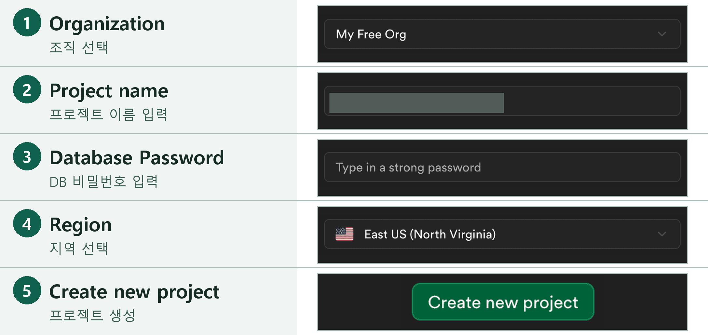
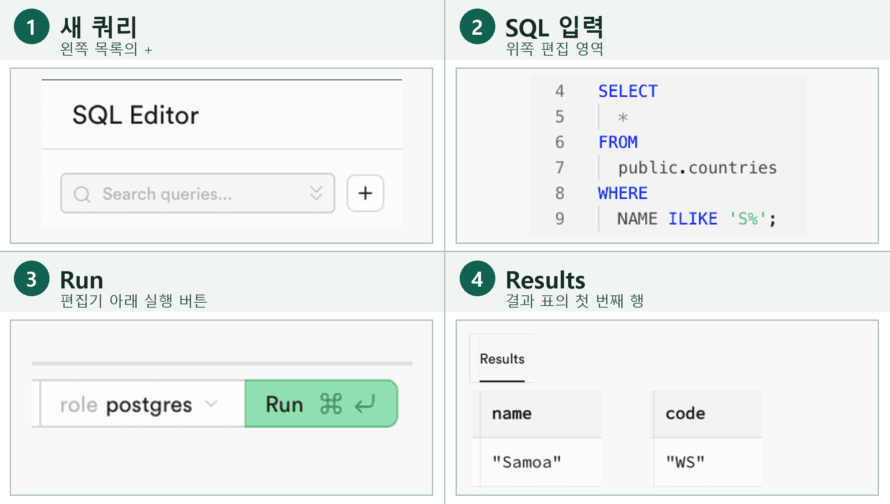
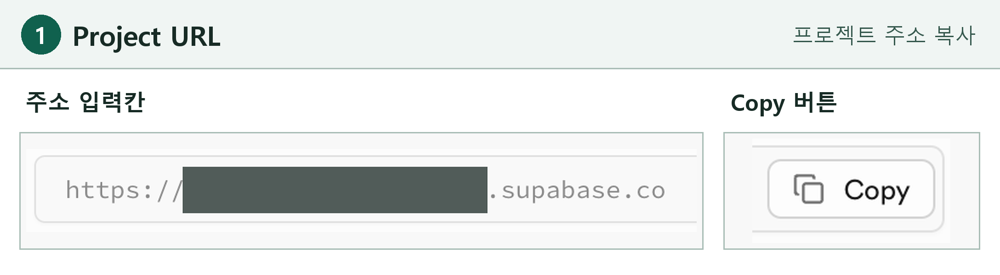
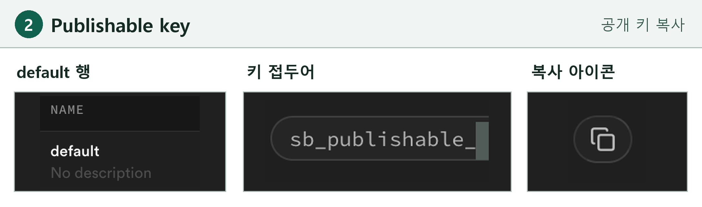

# 12장 Supabase에서 상품 목록 읽어 오기

데이터베이스 규칙을 확인했으니, 이제 본인 Supabase 프로젝트에 자체 예시 12개를 넣고 앱에서 읽는다. 목표는 상품 공급 경로가 서버로 바뀌어도 분류·장바구니·퀴즈·영수증이 그대로 작동하는 것이다. 계정을 만들지 않고 계속하고 싶다면 내장 예시 경로를 사용해도 19장의 앱 설치까지 진행할 수 있다. 이 장의 원격 조회 실습만 별도로 남는다.

```bash
cd ~/market-book/kit
node start.mjs 12
cd work/ch12/apps/mobile
npm ci
```

`ch12`의 기준 코드는 11장과 같은 `479f6f5`다. 이전 장의 SQL 학습 파일과 개인 설정은 `ch11`에 보존된다. 새 사본에 계정 연결값은 들어 있지 않다. VS Code에서 `work/ch12`를 열고 다음을 진행한다.

## 12.1 Supabase 프로젝트와 SQL Editor 준비하기

브라우저에서 [Supabase 대시보드](https://supabase.com/dashboard)에 로그인한다. 프로젝트 목록에서 **New project**를 누른다. 처음 로그인해 조직을 만들라는 안내가 나오면 실습용 조직 이름을 지정하고, 그 조직에서 새 프로젝트를 연다. 아래 그림은 Supabase가 공개한 실제 프로젝트 생성 화면이다. 자신의 브라우저에서는 조직 이름·지역·추가 옵션이 다를 수 있다.



그림 12-1. 프로젝트 생성 화면에서 조직·이름·비밀번호·지역 입력칸과 마지막 버튼을 차례로 발췌했다. 왼쪽은 책에서 붙인 입력 안내다. 예시 프로젝트 이름은 가렸다. [원본 화면](https://github.com/supabase/supabase/blob/4ead4b092ee7e5ad4def2cd295b14492db12720b/apps/www/public/images/blog/2024-12-01-orioledb-release/orioledb-project-create.png)

1. **① Organization**에서 내 실습용 조직을 선택한다. 조직은 프로젝트를 담는 공간이다. 계정에 조직이 한 개라면 미리 선택되어 있을 수 있다.
2. **② Project name**에 **market-book**을 입력한다. 나중에 SQL을 실행할 때 상단에서 확인할 이름이다.
3. **③ Database password**에 새 DB 비밀번호를 정해 보관한다. 자동 생성 옵션을 쓴 경우 생성된 값을 먼저 보관한다. 이 비밀번호를 입력하는 곳은 이 생성 화면이다. 뒤에서 앱에 넣을 값은 별도의 공개 키다.
4. **④ Region**에서 실습할 곳과 가까운 지원 지역을 선택한다. **Security options**에 **Enable Data API** 항목이 보이면 활성화되어 있는지 확인한다. 앱은 이 API로 상품 목록을 불러온다.
5. 선택한 조직·요금제와 화면에 표시된 예상 비용을 읽는다. 무료 조직과 무료로 허용되는 프로젝트를 이용하는 독자는 무료 범위임을 확인한 후 **⑤ Create new project**를 한 번 누른다. 프로젝트 이름이 **market-book**인 대시보드가 열리고 DB가 준비될 때까지 기다린다. [공식 Expo 빠른 시작](https://supabase.com/docs/guides/getting-started/quickstarts/expo-react-native)

### SQL을 입력하고 결과를 읽는 네 곳

대시보드 상단에 표시된 프로젝트 이름을 확인한다. 왼쪽 세로 메뉴의 **SQL Editor**를 누른다. 메뉴가 아이콘만 보이는 폭이라면 마우스를 올려 이름을 읽는다. SQL은 지금 연 **브라우저의 쿼리 편집 영역**에 입력한다. Git Bash에서 입력할 명령은 12.4절에 다시 나온다.



그림 12-2. 실제 SQL Editor에서 새 쿼리, 입력 줄, Run, Results를 각각 확대했다. ④의 첫 행은 국가 조회 예시로 name은 Samoa, code는 WS다. 상품 조회 결과는 12.2절에서 대조한다. [원본 화면](https://github.com/supabase/supabase/blob/4ead4b092ee7e5ad4def2cd295b14492db12720b/apps/www/public/images/index/dashboard/supabase-sql-editor-light.png)

1. **① 새 쿼리**를 연다. 사진의 더하기 기호 또는 현재 화면의 **New query / New snippet**으로 새 편집 탭을 연다. 빈 편집기가 이미 열려 있다면 거기서 시작한다. 목록에서 기존 쿼리를 골랐다면 먼저 새 탭을 연다.
2. **② 위쪽 편집 영역**의 첫 줄을 한 번 누른다. 다음 SQL 상자 안의 SELECT부터 맨 끝 세미콜론까지 복사한 뒤 브라우저에서 **Ctrl+V**를 누른다. 줄 번호가 있는 곳에 글자가 보이는지 확인한다.
3. 한 줄만 선택되어 있다면 쿼리 안을 한 번 눌러 선택을 푼다. **③ Run**을 눌러 현재 쿼리를 실행한다. 아래 표가 갱신될 때까지 기다린다.
4. **④ Results**에서 열 이름과 **첫 번째 행**을 읽는다. 그림의 국가 이름은 Studio 기능을 보여 주는 예다. 지금 실행할 쿼리에서는 첫 행의 두 칸에 무엇이 나오는지 확인한다. [공식 SQL Editor 열기](https://supabase.com/dashboard/project/_/sql/new)

첫 쿼리는 데이터를 바꾸지 않는 조회다.

```sql
SELECT
  to_regnamespace('catalog_private') AS private_schema,
  to_regclass('public.play_catalog') AS public_catalog;
```

새 실습 프로젝트라면 `private_schema`와 `public_catalog` 두 열이 보이고 첫 줄의 두 값이 모두 `NULL`이다. 이는 아직 12장의 구조를 만든 적이 없다는 뜻이다. 이미 이름이 나온다면 앞에서 만든 실습 프로젝트인지 확인한다. 자료가 있는 프로젝트를 비우거나 기존 테이블을 지우지 않는다.

이 책의 화면 안내는 **선택할 항목과 읽을 결과**를 기준으로 한다. 본인 계정 화면의 프로젝트 ID·키·메일 주소를 예제나 공개 기록에 옮기지 않는다.

## 12.2 예시 데이터와 공개 읽기 구조 적용하기

이제 Windows에서 **VS Code 창과 대시보드를 연 브라우저 창**을 모두 띄워 둔다. SQL 파일은 VS Code에서 열고, 실제 DB에 적용하는 동작은 브라우저에서 한다. **Alt+Tab**으로 두 창을 오갈 수 있다.

**첫 번째 파일로 한 번 따라 하기.** VS Code 왼쪽에서 **supabase → migrations → 20261112090000_catalog.sql**을 누른다. 코드 한 줄을 클릭하고 **Ctrl+A → Ctrl+C**를 누른다. 브라우저로 돌아와 그림 12-2의 **①**에서 새 쿼리를 연다. **②**를 누르고 **Ctrl+V**로 붙여 넣는다. 편집기 안에서 **Ctrl+End**를 눌러 마지막 **COMMIT;**까지 들어왔는지 확인한 뒤 **③ Run**을 누른다. 명령이 끝나면 **④ Results**에서 완료 또는 오류 문구를 읽는다. 구조를 만드는 SQL은 성공해도 상품 행이 표시되지 않을 수 있다.

아래 순서대로 각각 새 쿼리를 열어 파일 한 개씩 실행한다. 실행에 실패하면 Results의 오류 문구와 실행 중이던 파일명을 기록하고, 그 파일에서 복사가 빠진 부분을 먼저 확인한다. 성공한 파일을 처음부터 모두 재실행하면 이미 생성된 객체에 대한 다른 오류가 생길 수 있다. 끝난 파일의 창을 남겨 두면 읽던 파일을 찾기 쉽다.

1. `20261112090000_catalog.sql`
2. `20261112102641_manual_price_observations.sql`
3. `20261115133406_catalog_categories.sql`
4. `supabase/seed.sql`

세 마이그레이션은 `supabase/migrations/` 안에 있다. 마지막 seed는 한 단계 위 `supabase/`에 있다. 각 파일의 `BEGIN`부터 `COMMIT`까지 포함한다. 주석이나 마지막 줄을 잘라 붙이지 않는다.

이 순서는 이미 6개를 쓰던 프로젝트를 12개로 확장한 개발 이력도 재현한다. 새 프로젝트의 최종 결과는 처음부터 12개이며, 독자는 앱을 6개 상태로 되돌리지 않는다. 분류 마이그레이션은 새 예시도 넣으므로 그 뒤 seed를 적용해도 상품 수가 24개로 늘지 않아야 한다.

네 파일이 끝나면 **새 쿼리**를 열어 아래 SELECT 한 개를 붙여 넣고 Run을 누른다. 이제는 구조를 만드는 명령과 달리 Results에 실제 데이터 행이 보여야 한다.

```sql
SELECT category_id, count(*) AS product_count
FROM public.play_catalog
GROUP BY category_id
ORDER BY category_id;
```

| category_id | product_count |
| --- | ---: |
| bakery-snacks | 2 |
| dairy-eggs | 4 |
| produce | 6 |

공개 대상이 12개인지도 확인한다.

```sql
SELECT count(*) AS all_products,
       count(*) FILTER (WHERE NOT is_sample) AS real_products
FROM public.play_catalog;
```

Results에 나올 표를 아래와 대조한다. 앞 쿼리에서는 세 행이었고, 이번 쿼리에서는 두 열을 가진 **한 행**이 나온다. 숫자 **12**는 자체 예시 상품 수, **0**은 실제 외부 가격 자료 수다. 위의 분류별 결과와 이 표는 동봉 기준 소스를 로컬 PGlite에서 실행해 대조했다.

| all_products | real_products |
| ---: | ---: |
| 12 | 0 |

## 12.3 공개 키와 서버용 비밀 키 구분하기

다음으로 가져올 값은 두 개다. **프로젝트 URL**은 어느 서버에 연결할지 정하고 **publishable key**는 앱이 사용할 공개 키다. 대시보드 상단에서 프로젝트 이름이 **market-book**인지 확인하고 **Connect**를 누른다. 앱·모바일 프레임워크를 고르는 화면이 열리면 **Expo React Native**를 선택한다. 프로젝트 URL과 공개 키가 함께 표시되거나 EXPO_PUBLIC_로 시작하는 두 설정 줄에 들어 있다. [Expo용 공식 Connect 패널](https://supabase.com/dashboard/project/_?showConnect=true&connectTab=mobiles&framework=exporeactnative)



그림 12-3. 프로젝트 홈의 Project URL 행에서 주소와 오른쪽 Copy 버튼을 각각 확대했다. 회색으로 가린 부분은 프로젝트 식별값이다. Connect 패널에서도 프로젝트 주소를 찾을 수 있다. [원본 화면](https://github.com/supabase/supabase/blob/4ead4b092ee7e5ad4def2cd295b14492db12720b/apps/docs/public/img/guides/auth-workos/supabase-project-settings-url.png)

**① 주소 복사.** Project URL 행의 **Copy**를 누른다. 값은 https://로 시작하는 프로젝트 주소다. Connect 창에 데이터베이스 접속 문자열이 보인다면 모바일 앱 연결 화면을 다시 선택한다. 이 프로젝트에서 필요한 값에는 DB 비밀번호 자리나 postgresql://가 들어 있지 않다. 복사한 값을 먼저 12.4절의 첫 번째 줄에 붙여 넣고 다음 값을 복사한다. Windows 클립보드는 마지막으로 복사한 값부터 붙여 넣는다.



그림 12-4. API Keys 화면의 Publishable key 구역. 왼쪽부터 같은 행의 default 이름, 키 접두어, 복사 아이콘이다. 키의 식별 부분은 가렸다. [원본 화면](https://github.com/supabase/supabase/blob/4ead4b092ee7e5ad4def2cd295b14492db12720b/apps/www/public/images/blog/2026/security-retro/api-keys.png)

**② 공개 키 복사.** Connect의 공개 키를 사용하거나, 왼쪽 **Project Settings → API Keys**를 열어 **Publishable key**를 찾는다. 새 프로젝트의 기본 키라면 **default** 행에 있다. 그림의 겹친 사각형을 누르고 값이 sb_publishable_로 시작하는지 확인한다. 12.4절의 두 번째 줄에 붙여 넣는다. 같은 설정 화면의 Secret keys 항목, service_role 키, DB 비밀번호는 서버 관리자용이다. [공식 API 키 안내](https://supabase.com/docs/guides/getting-started/api-keys)

공개 키는 앱 배포 파일에서 읽힐 수 있다. 따라서 공개 키를 숨기는 것으로 데이터베이스를 보호하지 않는다. 11장의 객체 권한과 RLS가 읽기 범위를 제한한다. 서버용 키는 그와 다른 권한을 가지며 앱 코드에 넣지 않는다. [Supabase API 키](https://supabase.com/docs/guides/getting-started/api-keys)

이 앱의 `readCatalogConfig`는 URL과 키의 모양을 먼저 검사한다. URL에는 프로젝트 주소만 들어가야 한다. `/rest/v1/play_catalog`는 코드가 붙인다.

| 입력 | 앱에서 판단하는 상태 |
| --- | --- |
| URL과 키 모두 없음 | 아직 설정하지 않은 상태 |
| 둘 중 하나만 있음 | 연결 설정 오류 |
| URL에 불필요한 경로가 있음 | URL 오류 |
| 서버용 비밀 키 또는 이전 JWT 형식 | 허용한 공개 키 형식이 아님 |

검사를 통과했다고 권한까지 맞다는 뜻은 아니다. 실제 읽기 성공은 요청 결과로 확인한다.

## 12.4 환경 변수 파일 만들기

**1. Git Bash에서 파일을 준비한다.** VS Code의 아래쪽 터미널 탭에 Git Bash가 열려 있는지 확인한다. 다음 두 줄을 한 줄씩 입력하고 각각 Enter를 누른다. 두 번째 명령은 기존 예시 파일을 복사해 `.env.local`이라는 개인 설정 파일을 만든다.

```bash
cd ~/market-book/kit/work/ch12/apps/mobile
cp -n .env.example .env.local
```

`-n`은 같은 파일이 있을 때 덮어쓰지 않게 한다. 출력 없이 프롬프트가 돌아와도 정상이다.

**2. VS Code의 편집기에 붙여 넣는다.** 왼쪽 탐색기에서 **apps → mobile → .env.local**을 누른다. 안 보이면 **Ctrl+P**를 눌러 **.env.local**을 입력하고 경로가 **apps/mobile**인 항목을 고른다. 파일 이름 끝이 **.local**인지 탭 제목을 읽는다. 아래 두 변수에서 등호 왼쪽 이름은 유지하고, 오른쪽 값만 차례로 본인 프로젝트의 값으로 바꾼다. 각 값은 한 줄이다. 두 번째 줄도 채운 뒤 **Ctrl+S**로 저장한다.

```dotenv
EXPO_PUBLIC_SUPABASE_URL=https://본인프로젝트주소.supabase.co
EXPO_PUBLIC_SUPABASE_PUBLISHABLE_KEY=sb_publishable_본인공개키
```

**3. 두 화면을 대조한다.** 첫째 줄 오른쪽은 그림 12-3에서 복사한 주소, 둘째 줄 오른쪽은 그림 12-4에서 복사한 공개 키다. 브라우저의 Copy가 설정 블록 전체를 복사하면 프로젝트에 이미 있는 변수 이름과 등호가 두 번 들어가지 않았는지 살펴본다. 아래쪽 터미널로 돌아온 뒤에는 12.7절의 실행 명령을 사용한다. 서버가 이미 켜져 있다면 12.8절처럼 새 설정으로 다시 시작한다.

위 문자열은 입력 위치를 보여 주는 자리표시자다. 그대로 실행하면 연결되지 않는다. URL 앞뒤의 공백, 줄바꿈으로 잘린 키, 다른 프로젝트에서 복사한 키를 확인한다. 실제 값이 담긴 파일은 다른 장의 예제 원고나 공개 저장소에 붙이지 않는다.

Expo가 인식할 수 있도록 코드에서는 다음처럼 변수 이름을 직접 적는다. 객체의 동적 키로 우회해 읽지 않는다.

```typescript
const projectUrl = process.env.EXPO_PUBLIC_SUPABASE_URL;
const publishableKey = process.env.EXPO_PUBLIC_SUPABASE_PUBLISHABLE_KEY;
```

`EXPO_PUBLIC_`라는 이름은 공개 가능한 앱 설정이라는 뜻이다. 비밀 파일에 써 두었으니 앱 안에서도 비밀이라는 뜻은 아니다. [Expo 환경 변수](https://docs.expo.dev/guides/environment-variables/)

## 12.5 fetch로 목록을 받고 화면 값으로 바꾸기

VS Code에서 `src/features/catalog/catalog.ts`를 연다. 전체 파일에는 주소 검사, 응답 검사, 시간 제한, 취소, 오류 메시지 처리가 들어 있다. 가장 먼저 `loadCatalog` 안의 요청을 찾는다.

```typescript
const response = await (options.fetch ?? globalThis.fetch)(
  checked.url + '/rest/v1/play_catalog?select=' + selectedColumns
    + '&order=sort_order.asc,id.asc&limit=' + MAX_CATALOG_PRODUCTS,
  {
    method: 'GET',
    headers: {
      apikey: checked.publishableKey,
      Accept: 'application/json',
      Prefer: 'count=exact',
    },
    signal: controller.signal,
  },
);
```

이 발췌의 `checked`, `selectedColumns`, `controller`는 같은 파일에서 만든 값이다. 요청 주소만 복사해 App.tsx에 새로 붙이지 않는다. 전체 파일을 읽으며 각 값의 생성 위치를 찾는다.

`await`는 응답을 기다린다. 응답이 도착하면 `response.json()`으로 JSON을 읽는다. 읽었다는 이유만으로 올바른 상품이 되지는 않는다. 외부 입력을 먼저 `unknown`으로 받아 검사하는 이유다.

```typescript
const data: unknown = await response.json();
const products = parseCatalogRows(data);
```

DB와 화면의 이름을 연결한다.

| DB 응답 | 앱 값 | 검사할 내용 |
| --- | --- | --- |
| `id` | `id` | 중복 없는 상품 ID |
| `unit_label` | `unit` | 빈 규격이 아닌지 |
| `category_id` | `categoryId` | 세 분류 중 하나인지 |
| `play_price_krw` | `priceKrw` | 1~10,000의 원 단위 정수 |
| `is_sample` | `isSample` | 예시인지 명확히 구분 |
| `price_observation_id` | `priceObservationId` | 가격 관측 식별자 형식 |

원래 가격과 놀이 가격도 같아야 한다. 잘못된 행 하나를 조용히 버리고 나머지 목록을 사용하는 대신 응답 전체를 거절한다. 일부 상품이 빠진 것을 독자가 완전한 상품 목록으로 오해하지 않게 하기 위해서다.

서버의 행 제한 때문에 목록이 잘렸는지는 `Content-Range`와 실제 행 수를 대조한다. 이 프로젝트는 한 번에 최대 1,000개까지 읽고, 더 큰 목록은 일부만 보여 주지 않는다. 책의 12개 예시는 이 범위 안에 있다.

## 12.6 로딩·실패·빈 목록·다시 시도 화면 만들기

`src/components/catalog-loader.tsx`의 역할은 준비된 배열을 놀이 화면에 전달하는 것이다. 로딩과 실패 화면을 장바구니 함수에 섞지 않는다.

| 상태 | 보여 줄 안내 | 가능한 선택 |
| --- | --- | --- |
| loading | 가게 물건을 가져오고 있어요 | 예시로 바로 시작 |
| unconfigured | 가게를 준비하고 있어요 | 다시 불러오기, 예시 선택 |
| empty | 아직 준비된 물건이 없어요 | 다시 불러오기, 예시 선택 |
| error | 물건을 불러오지 못했어요 | 다시 불러오기, 예시 선택 |
| ready | 상품 목록 | 장보기 진행 |

조회 실패를 성공처럼 보여 주지 않는다. 대신 사용자가 내장 예시를 선택할 수 있게 한다. 실패 상태에서 상품을 표시하지 않는 것과 사용자가 예시를 선택해 놀이하는 것은 서로 다른 상태다.

`CatalogLoader`의 자식 함수는 데이터가 준비된 뒤에만 실행된다. 실제 참고 앱의 App.tsx에서 그 연결을 찾는다.

```tsx
<CatalogLoader>
  {(products, source, reload) => (
    <MarketScreen products={products} source={source} reload={reload} />
  )}
</CatalogLoader>
```

서버에서 얻은 목록은 한 번의 놀이가 끝날 때까지 유지한다. 영수증의 **다시 장보기**에서 새 목록을 읽고 새 놀이를 만든다. 자료를 읽는 중간에 기존 장바구니의 가격이 바뀌지 않는다.

## 12.7 SQL 결과와 앱의 한 상품 대조하기

SQL Editor에서 다음 조회를 실행한다.

```sql
SELECT id, name, unit_label, category_id,
       source_price_krw, play_price_krw, is_sample
FROM public.play_catalog
WHERE id = 'sample-apple';
```

이름 사과, 규격 1개, 분류 produce, 두 가격 1500, 예시 true를 확인한다. 이 값은 화면에서 “사과 / 1개 / 1,500원”으로 바뀐다. 천 단위 쉼표는 표시 형식이고 DB 값 자체는 정수 1500이다.

앱을 시작한다.

```bash
npm start
```

Android Expo Go에서 프로젝트를 열고 **가게에서 불러온 상품이에요.** 안내를 찾는다. “예시 가격” 안내도 함께 있어야 한다. 서버에서 받았다는 사실이 실제 판매 가격이라는 뜻은 아니다. 전체 12개, 과일·채소 6개, 유제품·달걀 4개, 빵·간식 2개를 대조한다.

사과 2개와 우유 1개의 합계 5,500원, 10,000원 결제 후 정답 4,500원을 다시 확인한다. 출처가 바뀌었는데 계산값이 달라졌다면 상품 가격과 수량부터 비교한다.

## 12.8 설정을 바꾼 뒤 개발 서버 다시 시작하기

환경 변수 변경은 일반 화면 새로고침만으로 판단하지 않는다. 현재 서버 터미널에서 Ctrl+C를 누르고 같은 폴더에서 다시 시작한다.

```bash
npm start -- --clear
```

휴대전화에서도 새로 실행된 프로젝트를 연다. 예전 QR이나 다른 장의 서버에 접속했다면 올바른 설정을 바꾸어도 화면이 달라지지 않는다. PC의 터미널 경로, 포트, 휴대전화가 연 프로젝트를 함께 확인한다.

다음 장에서 새 사본을 만들면 `.env.local`은 자동으로 따라가지 않는다. 같은 실습 프로젝트를 계속 쓸 때만 이전 장의 파일을 **본인 PC 안에서** 복사한다.

```bash
# ch13을 만든 뒤 kit/work/ch13/apps/mobile에서 실행하는 예
cp -n ../../../ch12/apps/mobile/.env.local .env.local
```

`cp`가 원본을 찾지 못하면 연결 실습을 하지 않았거나 경로가 다른 것이다. 내장 예시로 계속할 경우 복사할 필요가 없다.

## 12.9 URL 오류를 고치고 다시 확인하기

실제 키를 지우지 않도록 먼저 메모해 둔다. URL 끝에 임시로 `/wrong`을 붙이고 저장한다. 서버를 멈추고 다시 시작하면 앱은 잘못된 설정을 성공 목록으로 사용하지 않아야 한다. **예시 상품으로 바로 놀이하기**는 계속 사용할 수 있다.

URL에서 `/wrong`을 지우고 프로젝트 주소만 남긴다. 다시 서버를 시작한 뒤 공개 상품 안내와 12개를 확인한다. 같은 환경에서 통신만 일시 실패했다면 **다시 불러오기**로 재시도할 수 있지만, 빌드에 넣는 연결값 자체를 바꿨을 때는 서버 재시작부터 한다.

| 증상 | 해결 순서 |
| --- | --- |
| 계속 준비 안내 | 두 변수가 앱에 전달됐는지, 올바른 폴더의 서버인지 확인 |
| 권한 오류 | 같은 프로젝트의 URL·공개 키인지, SQL 권한 적용이 끝났는지 확인 |
| 빈 목록 | SQL Editor에서 공개 뷰 12행을 먼저 확인 |
| 6개 또는 분류 오류 | 세 번째 마이그레이션과 최종 seed 확인 |
| 키를 바꿔도 같음 | 모든 관련 Expo 서버를 구분하고 해당 서버만 재시작 |
| 관리자 조회만 성공 | 공개 역할·Data API 설정은 별개이므로 실제 앱 요청 확인 |

### 선택 실습 · 10장의 장보기 화면에 데이터 로더 붙이기

10장에서 작성한 장바구니·퀴즈·영수증은 상품을 어디서 읽어 왔는지 몰라도 작동한다. 같은 화면에 12장의 데이터 로더를 붙여 이 경계를 확인해 보자. 아래 방법은 자기 작업을 남겨 두고 동봉된 **10장 완성본의 새 복사본**에서 출발한다.

1. Windows 파일 탐색기에서 `market-lab.zip`을 이번에는 `~/market-book/bridge-kit`이라는 새 폴더에 모두 푼다. 이 폴더 바로 아래에 `start.mjs`가 있는지 확인한다.
2. 아래와 같이 10장과 12장을 각각 복원한다. `work/ch10`은 코드를 수정할 쪽이고 `work/ch12`는 데이터 로더를 가져올 쪽이다. 앞에서 쓴 `kit/work`와 별개인 폴더다.

~~~bash
cd ~/market-book/bridge-kit
node start.mjs 10
node start.mjs 12
cd work/ch10/apps/mobile
pwd
~~~

두 앱을 비교하면 10장에는 `src/screens/shopping-screen.tsx`가, 12장에는 `src/components/catalog-loader.tsx`가 있다. 아래 명령을 차례로 실행한다. 첫 줄은 Git Bash가 이번 터미널에서 기억할 상대 경로다. 이어지는 네 줄은 로더와 로더가 읽는 파일만 가져온다.

~~~bash
source_app=../../../ch12/apps/mobile
cp "$source_app/src/features/catalog/catalog.ts" src/features/catalog/
cp "$source_app/src/features/catalog/catalog-session.ts" src/features/catalog/
cp "$source_app/src/features/catalog/catalog-device-fixture.ts" src/features/catalog/
cp "$source_app/src/components/catalog-loader.tsx" src/components/
~~~

`catalog.ts`는 공개 행을 앱의 상품값으로 변환한다. `catalog-session.ts`는 로딩 중인지, 원격 또는 내장 예시로 준비되었는지를 결정한다. `catalog-device-fixture.ts`는 개발 중 연결 지연을 시험할 때 로더가 참조한다. 마지막 파일이 이 결과를 React 화면에 전달한다. `categories.ts`와 12개 상품 데이터는 10장의 것을 유지한다. 교육용 상품 타입은 선택 필드 `priceObservationId?: string`을 받아들일 수 있다.

App.tsx를 다음 연결로 바꾸면 기존 ShoppingScreen에 서버 데이터를 전달할 수 있다.

```tsx
import { SafeAreaProvider } from 'react-native-safe-area-context';
import { CatalogLoader } from './src/components/catalog-loader';
import { ShoppingScreen } from './src/screens/shopping-screen';

export default function App() {
  return (
    <SafeAreaProvider>
      <CatalogLoader>
        {(products, source, reload) => (
          <ShoppingScreen
            products={products}
            sourceLabel={source === 'supabase'
              ? '가게에서 불러온 예시 상품'
              : '앱에 들어 있는 예시 상품'}
            onNewRound={source === 'supabase' ? reload : undefined}
          />
        )}
      </CatalogLoader>
    </SafeAreaProvider>
  );
}
```

이제 터미널의 현재 폴더를 `bridge-kit/work/ch10/apps/mobile`에 둔 채 다음을 실행한다. 새로 푼 사본이므로 이 폴더에서 처음 한 번은 `npm ci`가 필요하다.

~~~bash
npm ci
npm run typecheck
npm run lint
npm test
npm start -- --web
~~~

처음에는 이 사본에 `.env.local`을 만들지 않는다. 연결 설정 안내에서 **예시 상품으로 바로 놀이하기**를 누르고 화면의 상품 출처를 읽는다. 사과 두 개와 우유 한 팩을 담으면 5,500원이다. 10,000원을 내고 4,500원을 입력한 뒤 영수증을 열어 본다. 익숙한 10장의 화면이면서, 첫 진입 때 어떤 데이터를 쓸지는 12장의 로더가 결정했다.


그림 12-5. 10장 앱에 12장 로더를 연결해 PC 웹에서 실행한 화면. 공개 연결값을 비운 상태에서 ‘다시 불러오기’와 ‘예시 상품으로 바로 놀이하기’가 나타난다.

두 버튼을 구별해 보자. **다시 불러오기**는 같은 설정으로 한 번 더 읽는다. 아직 연결값을 넣지 않았다면 다시 안내 화면으로 돌아온다. **예시 상품으로 바로 놀이하기**는 여기서 읽기를 마치고 앱에 들어 있는 목록을 선택한다. 선택 뒤 장보기 화면의 ‘앱에 들어 있는 예시 상품’ 문구가 선택의 결과다.

이제 본인 서버와 비교하려면 `Ctrl+C`로 서버를 종료한다. 기존 `kit/work/ch12/apps/mobile/.env.local`의 **본인 프로젝트 URL과 공개 키**를 지금 실습 중인 `bridge-kit/work/ch10/apps/mobile/.env.local`에도 넣는다. `npm start -- --web --clear`로 다시 열어 출처 문구가 바뀌는지 본다. 이때도 공개 자체 예시를 쓴다면 같은 장바구니의 합계와 거스름돈은 그대로여야 한다.

원격 새 놀이는 로더의 `round` 키가 바뀌며 화면을 다시 만든다. 내장 예시는 ShoppingScreen의 기존 초기화를 사용한다. 선택 실습은 기본 과정의 `ch12`를 대체하지 않는다.

이 장을 마쳤다면 서버 자체 예시 읽기와 내장 예시 선택을 구분할 수 있고, 연결 오류를 재현한 뒤 복구할 수 있어야 한다. 외부 상점 가격이 없어도 이 목표는 모두 달성할 수 있다.

그림 12-1~12-4는 Supabase 공개 저장소의 실제 예시 화면에서 필요한 영역을 잘라 확대했다. 녹색 번호와 화면 바깥의 안내는 책에서 덧붙였다. 예시 프로젝트 이름·주소·키의 식별 정보는 가렸다. [Supabase 원본 저장소와 Apache 2.0 라이선스](https://github.com/supabase/supabase/blob/4ead4b092ee7e5ad4def2cd295b14492db12720b/LICENSE)
