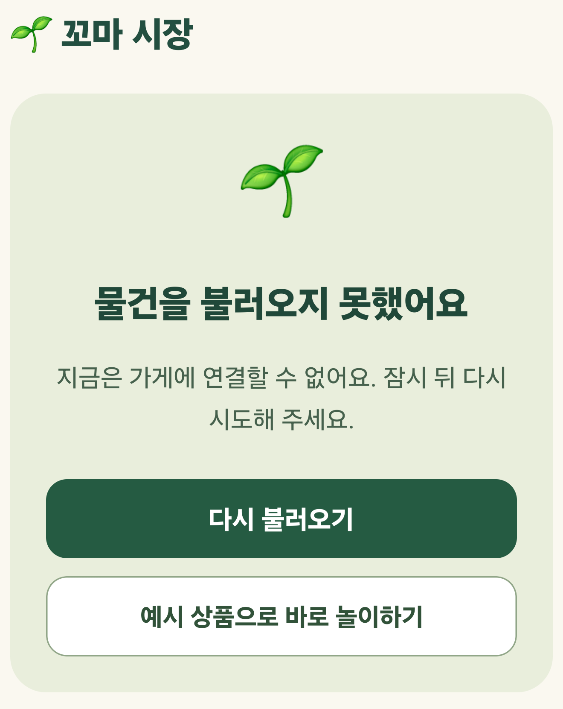

# 14장 인터넷이 없어도 놀이 시작하기

앱을 켰는데 인터넷이 느리면 상품 목록을 기다려야 할까? 이 앱은 기다리는 동안에도 **예시 상품으로 바로 놀이하기**를 제공한다. 사용자가 예시를 선택한 다음에는 뒤늦게 온 서버 응답이 그 선택을 취소하지 못하게 한다. 네트워크의 성공 여부와 아이가 이미 시작한 놀이의 상태를 분리하는 장이다.

11~14장은 같은 `479f6f5` 참고 앱의 서로 다른 부분을 읽는다. 이번에는 `catalog-session.ts`를 중심으로 동작을 추적한다. 10장에서 만든 장바구니·채점·영수증을 바꾸는 실습이 아니다.

```bash
cd ~/market-book/kit
node start.mjs 14
cd work/ch14
npm --prefix apps/mobile ci
```

## 14.1 서버를 기다리지 않고 예시 놀이 시작하기

인터넷 연결 실패를 만날 때마다 자동으로 예시 상품을 보여 주면 사용자는 지금 어떤 가격을 보고 있는지 알아차리기 어렵다. 이 앱은 로딩 중에도 선택 버튼을 보여 주고, 예시를 선택하면 출처를 화면에 표시한다.

VS Code에서 `apps/mobile/src/components/catalog-loader.tsx`를 연다. `catalog.status`가 `ready`가 아닐 때 표시하는 화면에 다음 버튼이 있다. 실습 코드의 일부를 발췌한 것이다.

```tsx
<Pressable
  testID="catalog-use-samples"
  accessibilityRole="button"
  accessibilityLabel="예시 상품으로 바로 놀이하기"
  onPress={session.useSamples}
>
  <Text>예시 상품으로 바로 놀이하기</Text>
</Pressable>
```

버튼을 누르면 `session.useSamples`가 로컬 배열을 선택한다. `sample-products.ts`는 앱 코드와 함께 들어가는 12개 자체 예시다. 인터넷으로 내려받아야 생기는 배열이 아니다.

먼저 연결값이 없는 새 참고 폴더에서 실행한다.

```bash
cd apps/mobile
npm start
```

Expo Go로 앱을 열고 “가게를 준비하고 있어요” 화면에서 예시 버튼을 누른다. 과일·채소 6개, 유제품·달걀 4개, 빵·간식 2개를 분류별로 확인한다. 이 단계는 **연결값 없음에서 로컬 예시로 진행**한 검사다. Expo 개발 서버 없이 앱이 시작된다는 검사와는 구분한다.

환경 파일을 이전 장에서 복사한 경우에는 개발 서버를 종료한 뒤, 아래처럼 이번 명령에만 빈 연결값을 전달할 수 있다.

```bash
EXPO_PUBLIC_SUPABASE_URL= \
EXPO_PUBLIC_SUPABASE_PUBLISHABLE_KEY= \
npm start -- --clear
```

일반적인 환경 파일은 그대로 보존된다. 종료 후 보통의 `npm start`를 실행하면 자신의 연결 설정을 다시 사용할 수 있다.

## 14.2 로딩 중 사용자의 선택을 우선하기

원격 요청과 사용자 입력은 서로 다른 시간에 도착한다. 버튼을 누르는 동안에도 요청은 진행 중일 수 있다. 필요한 상태를 말로 적으면 다음과 같다.

| 사건 | 상태와 화면 |
|---|---|
| 로더 연결 | 서버 조회를 시작하고 `loading` 표시 |
| 연결값 없음 | `unconfigured`, 예시 선택 가능 |
| 서버 빈 목록 | `empty`, 다시 불러오기 또는 예시 선택 |
| 서버 조회 실패 | `error`, 다시 불러오기 또는 예시 선택 |
| 유효한 원격 목록 수신 | `ready`, 출처는 `supabase` |
| 사용자가 예시 선택 | `ready`, 출처는 `sample` |
| 예시 선택 뒤 이전 요청 도착 | 지금 상태 유지 |

예시 선택은 “현재 요청이 끝나면 실행할 예약”이 아니다. 누른 즉시 로컬 목록을 선택한다. 그런 다음 진행 중인 요청을 취소한다. 취소 전에 사용자의 선택을 먼저 기록해야, 취소 처리 과정에서 실행되는 콜백도 바뀐 선택을 볼 수 있다.

`apps/mobile/src/features/catalog/catalog-session.ts`에서 `useSamples`를 찾는다. 현재 요청 무효화와 `ready` 상태 게시가 어떤 순서로 실행되는지 읽는다. 데이터 선택을 이 모듈에 모았으므로 화면 컴포넌트는 버튼을 누를 때 내부 요청 번호까지 조작하지 않는다.

**확인 질문.** 로딩 중에도 버튼을 제공하는 이유를 한 문장으로 적어 보자. 답의 핵심은 실패가 확정될 때까지 기다리지 않고 사용자가 놀이를 선택할 수 있다는 점이다.

## 14.3 늦게 도착한 서버 응답 무시하기

`AbortController`는 진행 중인 요청에 중단 신호를 보내는 도구다. 하지만 중단 신호만 믿어서는 부족하다. 이미 완료된 응답의 후속 처리나 취소를 무시하는 작업이 나중에 실행될 수 있기 때문이다.

참고 구현은 요청마다 번호를 부여한다. 다음 요청을 시작하거나 예시를 선택하면 이전 번호를 무효로 만든다. 응답을 화면에 반영하기 전에 다음 조건을 함께 확인한다.

```text
이 로더가 아직 연결되어 있는가?
사용자의 선택이 여전히 서버 상품인가?
이 응답의 번호가 현재 요청 번호와 같은가?
이 요청이 취소되지 않았는가?
```

위 조건은 구현을 설명하는 의사 코드다. 전체 실행 코드는 `catalog-session.ts`에 있다. 요청 번호를 생략하고 `setState`만 호출하는 코드로 바꾸면, 이전 요청이 새 놀이를 덮어쓰는 문제가 다시 생긴다.

동봉한 작은 실행기로 이 문제를 직접 재현한다. 개발 서버는 그대로 두어도 된다. 새 Git Bash 터미널에서 저장소 루트로 이동한다.

```bash
cd ~/market-book/kit/work/ch14
cp ../../steps/14/race-demo.mjs .
node --experimental-strip-types race-demo.mjs
```

실행기는 실제 서버 대신 끝나지 않은 Promise를 만든다. 예시 12개를 선택한 뒤, 취소 신호를 일부러 무시하고 상품 한 개짜리 응답을 늦게 전달한다. 핵심 부분은 다음과 같다.

```js
const session = createCatalogSession({
  samples: sampleProducts,
  read: signal => {
    signal.addEventListener('abort', () => {
      aborted = true;
    }, { once: true });

    // 취소 뒤에도 응답을 전달해 방어 조건을 확인한다.
    return new Promise(resolve => {
      resolveRemote = resolve;
    });
  },
});

session.useSamples();
resolveRemote(sampleProducts.slice(0, 1));
```

전체 파일은 로더 연결, 결과 관찰, 단언, 정리까지 포함한다. 출력의 핵심은 다음과 같다.

```text
loading
ready sample:12
늦은 서버 1개 응답 후에도 sample:12 유지
```

단순히 오류가 없다는 것보다 “한 개짜리 늦은 응답 뒤에도 12개가 남았다”는 결과가 중요하다. Node 버전에 따라 모듈 형식 관련 경고가 붙을 수 있다. 마지막 확인 문장과 종료 상태를 함께 읽는다.

**직접 바꾸기.** `slice(0, 1)`을 `slice(0, 3)`으로 바꾸어 다시 실행한다. 늦은 응답의 크기는 달라져도 현재 상품은 12개여야 한다. 이 실습은 응답의 내용보다 사용자가 선택한 출처를 지키는 규칙을 확인한다.

## 14.4 새 놀이 때 상품 목록과 장바구니 초기화하기

10장에서 새 놀이는 장바구니, 낸 돈, 답, 영수증을 초기화했다. 원격 상품을 붙인 앱에서는 새 놀이의 상품 출처를 다시 고르는 일도 필요하다. 상품 ID나 가격이 달라진 새 목록에 이전 장바구니를 그대로 적용하면 이전 가격으로 계산한 결과가 남을 수 있다.

`CatalogLoader`는 놀이 회차를 뜻하는 `round`를 보관한다. 새 놀이에서는 회차를 늘리고 세션을 다시 조회한다.

```tsx
const reload = () => {
  // 응답이 빨라도 이전 장바구니와 영수증을 남기지 않는다.
  setRound((value) => value + 1);
  session.reload();
};

const screen = catalog.status === 'ready' ? (
  <Fragment key={round}>
    {children(catalog.products, catalog.source, reload)}
  </Fragment>
) : (
  /* 로딩·오류·예시 선택 화면 */
);
```

화면 부분은 설명을 위해 줄였다. 복사해서 전체 파일을 덮어쓰지 않는다. 동봉 참고 코드의 같은 위치를 비교한다.

React에서 같은 위치의 컴포넌트라도 `key`가 바뀌면 새 컴포넌트로 만든다. 따라서 자식의 장바구니와 퀴즈 상태가 함께 새로 시작된다. 아주 빠른 응답으로 로딩 화면을 눈으로 보지 못해도 회차가 바뀌므로 초기화는 적용된다.

실제 화면에서 사과 두 개와 우유 한 개를 담고, 10,000원을 내고, 4,500원을 맞혀 영수증을 연다. 새 놀이를 시작하고 예시를 다시 선택한다. 다음을 확인한다.

- 전체 상품은 12개이고 분류가 유지된다.
- 담은 수량과 합계는 0이다.
- 이전에 고른 낸 돈과 입력한 답이 남아 있지 않다.
- 이전 영수증이 다시 나타나지 않는다.

목록을 가져오는 일과 놀이를 초기화하는 일을 한 화면의 여러 버튼에서 따로 처리하지 않는다. `reload`를 한 경로로 모으면 일부 상태만 초기화하는 실수를 줄일 수 있다.

## 14.5 앱에 포함된 예시와 원격 캐시 구분하기

현재 앱에는 원격 목록을 기기에 영구 저장하는 캐시가 없다. 앱을 껐다 켠 뒤에도 마지막 서버 가격을 복원하는 기능을 만들었다고 설명하면 실제 구현과 다르다.

| 구분 | 자체 예시 | 원격 캐시 |
|---|---|---|
| 자료가 생기는 곳 | 앱 코드에 포함한 배열 | 과거 서버 응답 |
| 인터넷이 처음부터 없어도 존재 | 예 | 이전 저장이 있어야 함 |
| 현재 구현 | 있음, 12개 | 없음 |
| 가격의 의미 | 학습용 고정 예시 | 마지막 동기화 시점의 원격 자료 |
| 추가로 필요한 정책 | 예시라는 표시 | 만료·갱신·삭제·저장 실패 처리 |

참고 코드의 상품 출처가 `sample`과 `supabase`로 나뉘는 이유가 여기 있다. 예시를 서버의 최신 목록처럼 표시하지 않는다. 서버 오류 화면에서 예시로 넘어갈 때도 사용자가 직접 선택한다.

**독자 연습.** “어제 보았던 서버 가격을 오늘 비행기 모드에서 보여 준다”는 요구가 생겼다고 가정하자. 현재 배열만으로 충족할 수 있는지 판단하고, 필요한 저장 시각과 만료 정책을 종이에 적는다. 이 책에서는 캐시 코드를 추가하지 않고 지금 동작을 정확히 구분하는 데 집중한다.

## 14.6 설치형 앱에서 인터넷 없이 첫 실행 계획 세우기

Expo Go로 여는 개발 앱은 처음 코드를 받을 때 PC 개발 서버에 연결한다. 앱 내부에 예시가 있다는 사실과 설치된 APK가 PC 없이 시작된다는 사실은 별도로 검사해야 한다.

다음 그림은 이 장의 참고 코드 `479f6f5`로 만든 별도 APK를 실제 인터넷 차단 상태에서 처음 실행했던 기록이다. 상품 조회가 실패해도 예시로 넘어가는 버튼이 남아 있다.



그림 14-1. 2026-11-15 23:52 KST, SM-S948N·Android 17의 설치형 검사 앱 첫 실행. 앱 영역만 발췌했다. 오프라인 조건과 이후 12개 예시·5,500원 계산·영수증 성공은 같은 실행의 검사 보고서에서 확인했다. 출처는 `125d852`에 보존된 `docs/book/verification/latest-android.md`, 실행 ID `20261115T142809826Z-10d3cf5c`다. 그림 자체의 상태 표시 유무만으로 오프라인을 판정하지 않는다.

19장에서 APK를 설치한 뒤 20장에서 다음 절차를 수행한다. 지금은 `work/ch14` 루트에 `offline-check.md`를 만들고 자신의 검사표를 준비한다.

```markdown
# 인터넷 없는 첫 실행 검사

- APK 파일과 앱 버전:
- 기기/Android 버전:
- 검사 날짜:
- PC 개발 서버 종료 확인:
- Wi-Fi/모바일 데이터 끔 확인:
- 앱 완전 종료 후 다시 시작:
- 예시 상품 선택과 12개 확인:
- 사과 2 + 우유 1 = 5,500원:
- 낸 돈 10,000원, 답 4,500원:
- 영수증 및 새 놀이:
- 원래 네트워크 설정 복원:
- 결과와 문제:
```

처음에는 결과 칸을 비워 둔다. 설치형 앱을 실제로 검사한 뒤에만 성공을 적는다. 앱에 공개 서버 설정이 들어 있다면 오프라인에서는 로딩 또는 오류 화면이 나올 수 있으며, 그 상태에서도 예시 버튼으로 진행할 수 있어야 한다.

검사 뒤 휴대전화의 네트워크 상태를 원래대로 돌려놓는 것까지 절차에 넣는다. 자동화 도구가 사용자 설정을 임의로 바꾸도록 맡기기 전에, 어떤 상태를 바꾸고 복원할지 이해해야 한다.

## 14.7 대기 중 예시를 선택하고 늦은 응답 뒤 상태 확인하기

순수 함수 실행에 이어 실제 개발 화면에서도 같은 흐름을 확인한다. 참고 앱에는 이 목적의 개발 전용 시나리오가 있다. 실제 통신을 망가뜨리거나 공개 DB를 수정할 필요가 없다.

기존 Expo 서버를 Ctrl+C로 종료한다. `apps/mobile`에서 다음 명령을 실행한다.

```bash
cd ~/market-book/kit/work/ch14/apps/mobile
EXPO_PUBLIC_DEVICE_RUN_ID=book-ch14 \
EXPO_PUBLIC_CATALOG_TEST_SCENARIO=pending-choice \
npm start -- --clear
```

이 두 변수는 이번 실행에만 전달된다. 개발 모드에서만 활성화되며 `catalog-device-fixture.ts`가 요청을 대기시킨다. Expo Go로 다시 열면 상품을 가져오는 화면이 계속 보이고, 아래쪽에 검사 요청 횟수가 표시된다.

1. **예시 상품으로 바로 놀이하기**를 누른다.
2. 12개 예시가 보이는지 확인한다.
3. 화면 아래의 **취소 뒤 늦은 응답 확인** 표시를 확인한다.
4. 사과 두 개와 우유 한 개를 담아 5,500원을 만든다.
5. 분류를 바꿨다가 돌아와도 수량이 유지되는지 확인한다.
6. 10,000원을 내고 4,500원을 맞혀 영수증까지 이동한다.

이 시나리오는 취소가 일어나면 즉시 늦은 응답을 보내므로, 사람이 상품을 담기 전에 표시가 나타날 수 있다. 따라서 화면 실습은 예시 선택이 유지되고 정상 놀이로 이어지는지를 확인한다. 응답 전달 시점을 정확히 제어한 검사는 14.3의 실행기와 자동 검사에서 담당한다.

터미널에서 다음 검사를 실행하면 세션의 연결·정리·지연 응답 처리도 코드로 확인할 수 있다.

```bash
node --experimental-strip-types --test \
src/features/catalog/catalog-session.test.ts \
src/features/catalog/catalog-device-fixture.test.ts
```

이 명령의 현재 위치는 `apps/mobile`다. 경로 오류가 나오면 터미널이 저장소 루트인지 앱 폴더인지 먼저 확인한다. 전체 앱 검사는 17장에서 같은 기준으로 정리한다.

실습이 끝나면 Ctrl+C로 종료하고 변수 없이 `npm start -- --clear`를 실행한다. 검사 문구가 사라졌는지 확인한다. 환경 파일에 두 변수를 직접 적었다면 지우고 다시 시작한다. 개발 검사 표시를 제품의 일반 화면으로 남겨 두지 않는다.

| 증상 | 해결 방향 |
|---|---|
| 대기 화면이 바로 사라짐 | 변수 이름·값과 서버 재시작 여부 확인 |
| 요청 횟수가 한 번보다 많음 | 개발 모드의 연결·정리 반복 가능, 최종 선택 유지 여부 확인 |
| 예시 선택 뒤 상품이 한 개가 됨 | 세션의 현재 요청 판정이 누락되었는지 비교 |
| 새 놀이에 이전 영수증이 남음 | 회차 `key`와 `reload` 연결 확인 |
| 일반 실행에도 검사 표시가 남음 | 터미널 변수·환경 파일·캐시 초기화 확인 |

이 장을 마치면 데이터가 늦게 도착해도 사용자가 시작한 놀이를 유지하는 구조를 설명할 수 있다. 다음 장은 같은 12개 상품과 계산 규칙을 유지하면서 작은 화면, 큰 글자, 키보드에 맞게 배치를 바꾼다.
