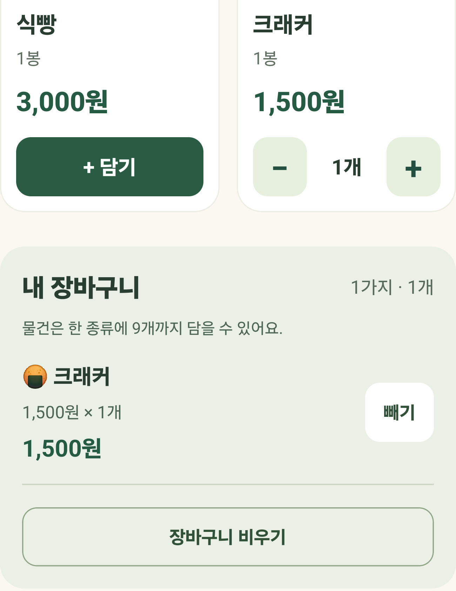
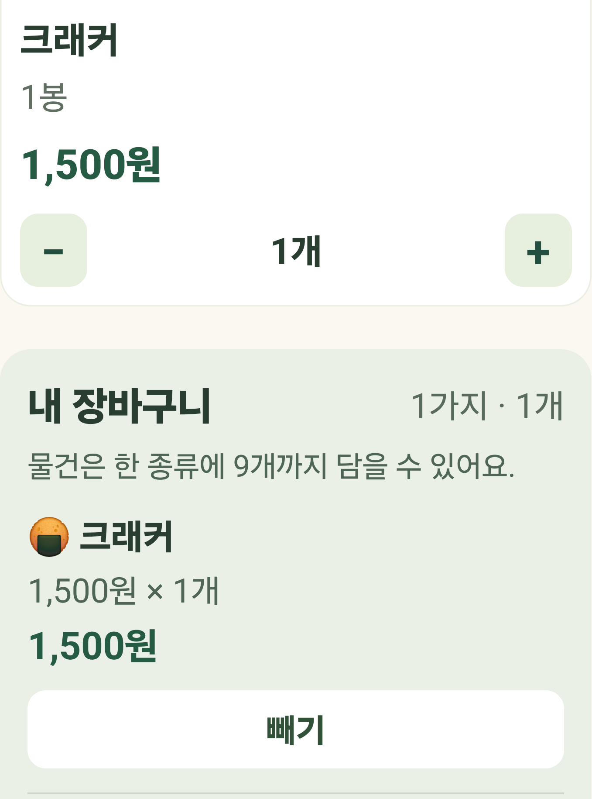
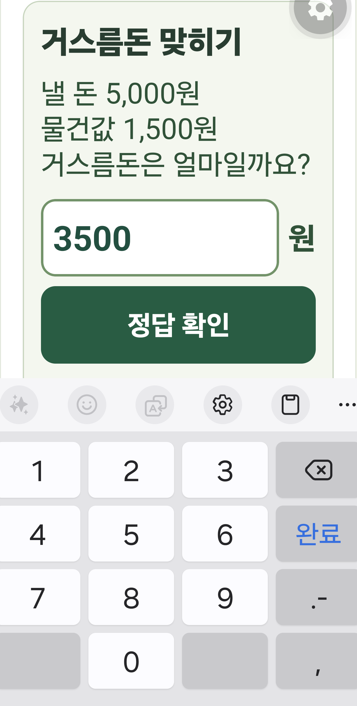

# 15장 작은 화면과 큰 글자에서도 편하게 만들기

기능이 맞아도 확인 버튼이 키보드 뒤에 숨으면 놀이를 끝낼 수 없다. 이 장에서는 화면 너비와 글자 크기에 맞춰 상품 열 수를 바꾸고, 큰 글자에서는 장바구니 요약을 스크롤 안으로 옮긴다. 거스름돈을 입력할 때는 입력칸과 정답 확인 버튼이 함께 보이게 한다.

15장의 참고 코드는 `e15dac6`이다. 이전 장의 12개 상품, 분류, 계산, 영수증, 예시 전환을 유지하면서 화면 배치를 개선한 전체 앱이다. 이전 폴더를 덮어쓰지 않고 별도 폴더에서 비교한다.

```bash
cd ~/market-book/kit
node start.mjs 15
cd work/ch15/apps/mobile
npm ci
npm start
```

원격 연결은 선택 사항이다. 연결값이 없으면 예시 상품을 선택한다. 처음에는 Android의 글자·화면 설정을 바꾸지 말고, 사과 두 개와 우유 한 개로 5,500원, 낸 돈 10,000원, 답 4,500원, 영수증까지 확인한다. 이 동등 확인을 마친 뒤 화면 조건을 바꾼다.

## 15.1 시스템 표시와 안전한 여백 확인하기

앱의 화면 전체가 버튼을 놓을 수 있는 영역은 아니다. 위쪽 상태 표시와 카메라 영역, 아래쪽 탐색 막대가 차지하는 공간이 있다. 화면 가장자리와 겹치지 않게 확보하는 영역을 안전 영역이라고 부른다.

참고 코드의 `App.tsx`에는 `SafeAreaProvider`와 `SafeAreaView`가 있다. 4장에서 첫 화면을 만들 때 쓴 원리가 전체 목록에도 적용된다. `SafeAreaProvider`가 안전 영역 정보를 제공하고 `SafeAreaView`가 필요한 여백을 반영한다.

```tsx
<SafeAreaProvider>
  <SafeAreaView style={styles.screen}>
    <StatusBar style="dark" />
    {/* 상품 목록과 계산 화면 */}
  </SafeAreaView>
</SafeAreaProvider>
```

이 코드는 구조를 보여 주기 위한 발췌다. 동봉한 `App.tsx` 전체에는 데이터 로더와 다른 구성 요소도 있다. 발췌만으로 전체 파일을 덮어쓰지 않는다.

기기에서 맨 위 제목까지, 그리고 목록 맨 아래까지 각각 스크롤한다. 상태 표시 영역과 제목이 겹치지 않는지, 마지막 버튼을 Android 탐색 막대 위에서 누를 수 있는지 확인한다. 화면을 캡처해 공유할 때는 개인 알림과 기기 식별 정보가 나오지 않게 앱 영역을 사용한다.

안전 영역 여백을 확보했다고 키보드 문제도 자동으로 해결되는 것은 아니다. 키보드는 앱 사용 중에 나타나는 별도의 영역이므로 15.4에서 추가로 처리한다.

## 15.2 작은 화면에서 목록과 버튼 배치하기

14장의 `App.tsx`와 15장의 파일을 VS Code에서 비교한다. 탐색기에서 한 파일을 오른쪽 클릭해 **비교 대상으로 선택**, 다른 파일을 오른쪽 클릭해 **선택 항목과 비교**를 사용할 수 있다. 개인적으로 고친 14장 파일을 15장으로 통째로 복사하면 새 배치를 잃으므로 먼저 차이를 읽는다.

화면 너비와 글자 확대율은 다음처럼 얻는다.

```tsx
const { width, fontScale } = useWindowDimensions();
const compactLayout = width < 380 || fontScale > 1.2;
const columns = width >= 380 && fontScale <= 1.2 ? 2 : 1;
```

`width`는 사진 파일의 픽셀 너비가 아니라 React Native가 배치에 사용하는 논리적 너비다. 1,440픽셀짜리 휴대전화 화면이라고 해서 `width`가 1440인 것은 아니다. 화면 설정에 따라 앱이 쓸 수 있는 논리적 너비가 달라진다.

조건을 표로 읽으면 이해하기 쉽다.

| 화면 조건 | 상품 열 수 | 합계 배치 |
|---|---:|---|
| 너비 380 이상, 확대율 1.2 이하 | 2열 | 키보드가 없을 때 아래 고정 |
| 너비 380 미만 | 1열 | 목록 안에 배치 |
| 글자 확대율 1.2 초과 | 1열 | 목록 안에 배치 |

다음 두 그림은 같은 스마트폰의 실제 개발 검사 화면에서 앱 영역만 발췌한 것이다. 크래커 한 개, 1,500원 상태이므로 앞서 사용한 5,500원 확인 예시와 구별해서 읽는다.



그림 15-1. 기본 글자에서 상품이 두 열로 보이고 장바구니의 가격과 빼기 버튼이 가로로 놓인다. 2026-11-16, SM-S948N·Android 17·Expo Go, 가독성 개선 검사 기록. `e15dac6`에 반영된 변경의 실제 화면 발췌다.



그림 15-2. 같은 검사에서 큰 글자를 적용한 화면. 상품은 한 열, 장바구니의 빼기 버튼은 아래쪽에 넓게 배치된다. 상태 표시와 탐색 영역을 제외했고 화면 내용을 다시 그리지 않았다.

열 수가 바뀌어도 상품의 ID와 수량은 그대로여야 한다. 따라서 장바구니 상태는 상품 카드나 각 행 안에 넣지 않고 상위 놀이 화면에 유지한다.

## 15.3 글자 확대에 반응하는 레이아웃 만들기

글자 크기를 고정해 화면을 맞추면 사용자가 선택한 큰 글자 설정을 무시하게 된다. 이 앱은 글자를 줄이는 대신 가로 배치를 세로로 바꾸고 스크롤 공간을 확보한다.

`FlatList`의 핵심 설정을 확인한다.

```tsx
<FlatList
  ref={listRef}
  key={columns}
  data={visibleProducts}
  extraData={shopping}
  numColumns={columns}
  keyExtractor={(item) => item.id}
  columnWrapperStyle={columns === 2 ? styles.row : undefined}
  /* 나머지 목록 속성은 전체 파일에서 확인 */
/>
```

`numColumns`는 상품을 한 줄에 몇 개 놓을지 정한다. 열 수가 바뀔 때 `key={columns}`로 목록을 다시 만들어 열 배치를 맞춘다. `keyExtractor`는 각 상품을 고유 ID로 구분한다. `extraData={shopping}`은 상품 배열이 같아도 장바구니 상태가 바뀌면 카드 표시를 갱신하는 데 사용한다.

목록이 다시 만들어지는 것과 놀이 전체를 새로 시작하는 것은 다르다. 14장의 `round`는 새 놀이를 위한 키이고, 여기의 `columns`는 배치를 위한 목록 키다. 수량·낸 돈·퀴즈 상태가 목록 바깥의 놀이 화면에 있으므로 열 전환만으로 장바구니를 지우지 않는다.

큰 글자에서는 아래 고정 합계가 너무 많은 높이를 차지할 수 있다. 참고 코드는 같은 `cartSummary` 요소를 두 위치 중 하나에 넣는다.

```tsx
// 목록의 내용 안: 좁은 화면 또는 큰 글자
{compactLayout && cartSummary}

// 목록 바깥: 여유 있는 화면, 키보드가 닫힌 상태
{!compactLayout && !keyboardVisible && cartSummary}
```

같은 요약을 재사용하므로 두 배치에서 금액이나 정답 숨김 규칙이 달라지지 않는다. 거스름돈을 맞히기 전에는 정답을 짐작하게 하는 잔액을 숨기는 규칙도 그대로 적용한다.

**직접 바꾸기.** `App.tsx`에서 두 곳의 기준 너비 `380`을 모두 `420`으로 바꿔 저장한다. 휴대전화의 논리적 너비가 380 이상 420 미만이라면 기본 글자에서도 한 열로 바뀐다. 너비가 범위 밖이면 변화가 없을 수 있다. 사과를 담은 상태에서 수량이 유지되는지 확인하고 두 값을 다시 `380`으로 돌린다. 두 조건 중 하나만 바꾸면 상품과 요약의 기준이 엇갈릴 수 있다는 점도 확인한다.

## 15.4 키보드가 뜬 입력칸과 확인 버튼을 가리지 않게 하기

숫자 키보드는 화면의 아래쪽을 차지한다. 입력칸만 간신히 보이고 확인 버튼이 가려지면 사용자는 키보드를 닫는 방법부터 찾아야 한다. 참고 구현은 세 가지 처리를 함께 사용한다.

첫째, `KeyboardAvoidingView`로 키보드가 차지한 공간에 대응한다. 이 책의 Android 경로에서는 `height` 동작을 사용한다. 참고 코드에 남은 다른 플랫폼 분기는 이 책의 출시 대상에 포함하지 않는다. 동작 의미는 React Native의 [KeyboardAvoidingView 문서](https://reactnative.dev/docs/keyboardavoidingview)에서도 확인할 수 있다.

둘째, 키보드가 열린 상태에서 누른 확인 버튼의 첫 탭이 처리되도록 목록을 설정한다.

```tsx
keyboardShouldPersistTaps="handled"
keyboardDismissMode="none"
```

셋째, 입력칸과 확인 버튼을 포함한 답 영역의 실제 위치를 읽는다. 화면에 보이는 목록 영역보다 아래로 넘치면 그만큼 스크롤한다. `App.tsx`의 `keepAnswerVisible`에서 다음 계산을 찾는다.

```tsx
const bottomOverflow =
  regionTop + regionHeight - (top + height - 12);
const topOverflow = regionTop - (top + 12);
const delta = bottomOverflow > 0
  ? bottomOverflow
  : topOverflow < 0 ? topOverflow : 0;

if (Math.abs(delta) > 1) {
  listRef.current?.scrollToOffset({
    offset: Math.max(0, scrollOffset.current + delta),
    animated: false,
  });
}
```

여기에서 `top`과 `height`는 보이는 목록 영역, `regionTop`과 `regionHeight`는 답 영역의 위치와 크기다. 숫자 12는 가장자리에 딱 붙지 않게 두는 여백이다. 화면 크기를 추측해서 일정한 값만큼 올리는 대신 실제 두 영역을 비교한다.

키보드가 보이면 고정 합계를 잠시 숨겨 입력 공간을 확보한다. 숨기는 것은 화면 배치뿐이다. 장바구니를 비우거나 낸 돈을 바꾸지 않는다. 키보드 이벤트 리스너는 화면이 정리될 때 제거하고, 예약한 프레임 작업도 취소한다.



그림 15-3. 2026-11-16의 좁은 화면·큰 글자 검사. 크래커 1,500원에 5,000원을 낸 뒤 답을 3,500원으로 고친 상태다. 키보드와 확인 버튼이 함께 보인다. 오른쪽 위 회색 도구 표시는 Expo Go의 개발 도구이며 제품 버튼이 아니다. 실제 화면의 앱·키보드 영역을 발췌했다.

이 그림은 버튼이 보이는 상태를 보여 준다. 첫 탭으로 채점되었는지는 그림 한 장으로 확정할 수 없으므로 다음 절차에서 직접 확인한다.

## 15.5 스마트폰과 태블릿 화면 비교하기

스마트폰에서만 보기 좋은 화면을 만들면 태블릿에서는 내용이 지나치게 넓게 펼쳐질 수 있다. 반대로 태블릿에서 여유 있게 보이던 버튼이 스마트폰에서 잘릴 수 있다. 두 종류의 기기를 모두 갖고 있지 않다면 보유한 기기로 확인한 범위만 기록한다.

다음 순서로 같은 데이터를 비교한다.

1. 새 놀이에서 자체 예시 12개를 선택한다.
2. 상품 이름·단위·가격·수량 버튼이 모두 읽히는지 확인한다.
3. 분류 버튼을 바꾸고 전체 상품으로 돌아온다.
4. 사과 두 개와 우유 한 개를 담는다.
5. 장바구니 수량과 합계 5,500원이 줄바꿈되어도 읽히는지 확인한다.
6. 낸 돈과 답 입력, 결과, 영수증까지 이동한다.

기기의 물리적 크기만 기록하지 말고 글자 설정, 화면 확대 설정, 방향, 키보드 종류도 함께 기록한다. “태블릿에서 성공”이라는 문장만으로는 작은 글자인지 큰 글자인지 알 수 없다.

PC 웹 미리보기에서 창을 좁히는 것은 빠른 배치 점검에 유용하다. 그러나 Android 숫자 키보드, 안전 영역, 시스템 글자 확대를 동일하게 재현하지 않으므로 실기기 확인과 구분한다. 웹 화면이 맞아도 Android 확인 버튼이 가려질 수 있다.

## 15.6 Android 설정에서 글자 크기 바꾸고 원래대로 복원하기

설정을 바꾸기 전에 현재 글자 크기와 화면 확대 단계를 메모한다. 제조사와 Android 버전에 따라 메뉴가 다르지만 대체로 **설정 → 디스플레이 → 글자 크기** 또는 접근성의 글자·표시 크기 항목에서 조정한다. 메뉴 이름을 찾기 어려우면 설정 검색에서 “글자 크기”를 찾는다.

처음에는 글자 크기만 한두 단계 올린다. 앱으로 돌아와 상품이 한 열로 바뀌는지, 가격과 버튼이 잘리지 않는지 확인한다. 이어서 자신의 기기에 화면 확대 설정이 있으면 원래 값을 기록한 뒤 한 단계 올려 본다. 두 설정을 함께 바꾸었다면 검사 기록에도 둘 다 적는다.

화면을 비교할 때는 같은 위치로 이동한다. 기본 글자의 상품 위쪽과 큰 글자의 영수증을 비교하면 개선 여부를 판단하기 어렵다. 예를 들어 크래커 한 개를 담은 상태로 상품 카드와 장바구니를 각각 캡처한다.

| 확인 항목 | 기본 설정 | 큰 글자 |
|---|---|---|
| 상품 이름·가격 전체 표시 | 직접 기록 | 직접 기록 |
| 담기·빼기 버튼 접근 | 직접 기록 | 직접 기록 |
| 장바구니 수량 유지 | 직접 기록 | 직접 기록 |
| 낸 돈 선택 가능 | 직접 기록 | 직접 기록 |
| 답 입력·확인 가능 | 직접 기록 | 직접 기록 |
| 영수증·새 놀이 가능 | 직접 기록 | 직접 기록 |

검사가 끝나면 원래 글자 크기와 화면 확대 값으로 복원한다. 앱을 다시 열어 기본 배치가 돌아왔는지 확인한다. 원래부터 큰 글자를 사용하던 독자는 그 설정이 자신의 기본값이다. 책의 그림에 맞추기 위해 편한 설정을 버릴 필요는 없다.

## 15.7 숫자 키보드를 연 채 확인 버튼까지 스크롤하기

마지막 검사는 눈으로 보이는지와 실제 눌리는지를 함께 확인한다. 큰 글자 상태에서 새 놀이를 시작하고 크래커 한 개, 1,500원을 담은 뒤 5,000원을 고른다.

답 입력칸을 눌러 숫자 키보드를 연다. 먼저 `3000`을 입력하고 키보드를 닫지 않은 채 **정답 확인**을 한 번 누른다. 오답 안내가 나타나야 한다. 첫 탭은 키보드만 닫고 두 번째 탭에 채점된다면 15.4의 목록 탭 처리 설정을 다시 본다.

이제 답을 `3500`으로 고친다. 키보드가 열린 상태에서 확인 버튼까지 스크롤할 수 있는지, 버튼이 완전히 보이는지 확인하고 한 번 누른다. 정답 안내와 3,500원이 나온 뒤 영수증으로 이동한다.

이 실습에서는 의도적으로 5,500원 예시 대신 1,500원 예시를 사용했다. 그림 15-3과 같은 짧은 계산으로 배치에 집중하기 위해서다. 끝나면 새 놀이의 12개 상품과 빈 장바구니를 확인한다.

| 문제 | 먼저 볼 부분 |
|---|---|
| 상품 이름이 잘림 | 고정 높이·줄 수 제한, 열 전환 조건 |
| 큰 글자에서 합계가 화면을 차지함 | `compactLayout`과 요약 배치 |
| 확인 버튼이 키보드 뒤에 있음 | 답 영역 ref·측정·스크롤 연결 |
| 첫 탭으로 채점되지 않음 | `keyboardShouldPersistTaps` |
| 열 전환 뒤 수량이 사라짐 | 장바구니 상태가 목록 밖에 있는지 |
| 키보드 닫은 뒤 화면이 반복 이동 | 이벤트 정리와 프레임 취소 |

코드를 수정했다면 앱 폴더에서 다음을 실행한다.

```bash
npm run typecheck
npm run lint
npm test
```

자동 검사는 계산 규칙과 코드 오류를 찾는 데 도움을 준다. 실제 글자 확대와 키보드 조작은 자신의 기기에서 확인한 결과를 별도로 남긴다. 다음 장에서는 이 배치를 유지하면서 TalkBack이 읽는 이름과 초점 이동을 개선한다.
