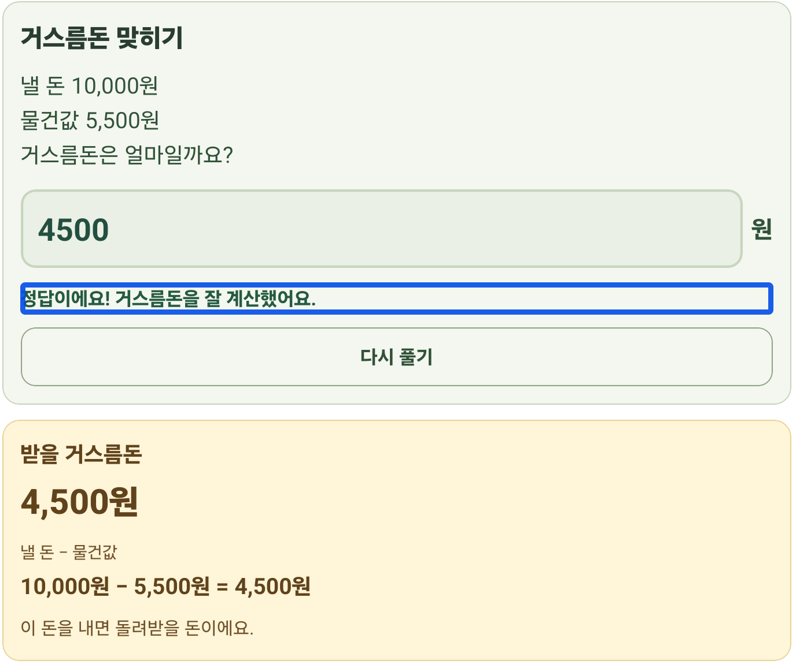
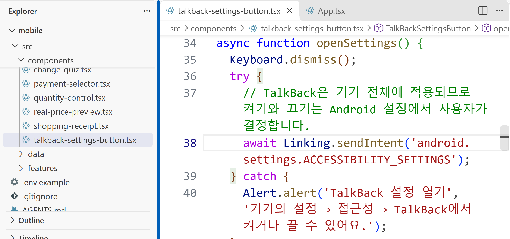
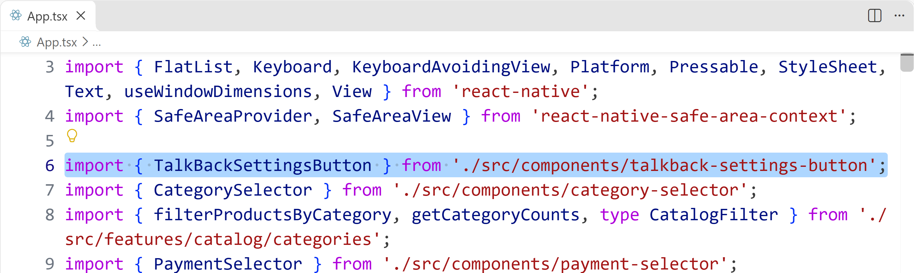
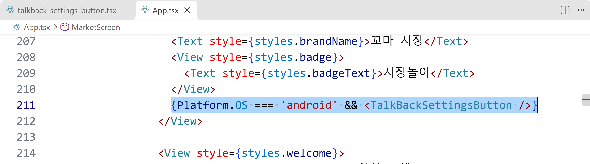
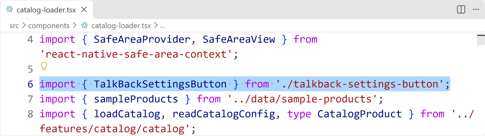
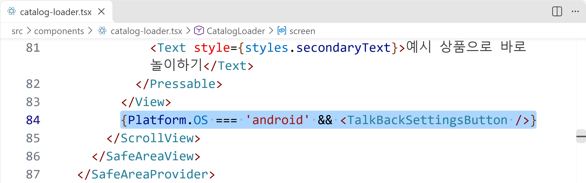
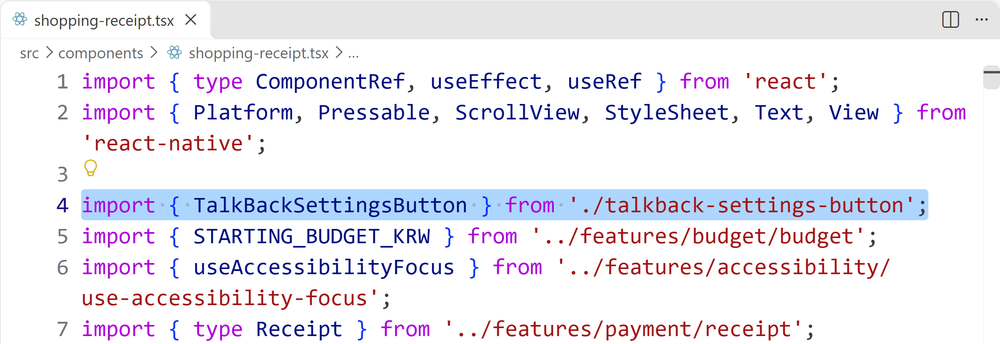
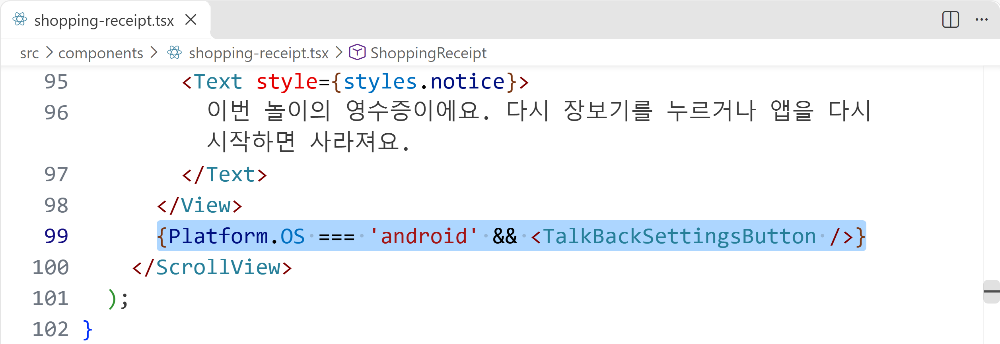
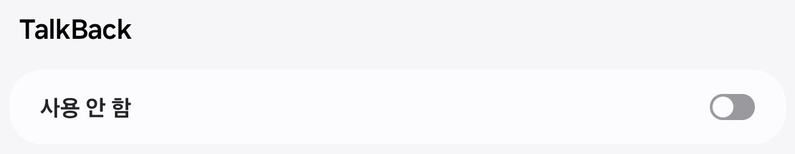
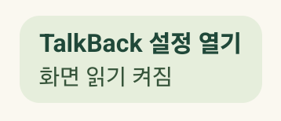

# 16장 TalkBack으로 사용할 수 있는 앱 만들기

TalkBack은 Android의 화면 읽기 기능이다. 화면의 글자를 소리 내는 것과 함께, 사용자가 어떤 요소를 선택했고 무엇을 실행할 수 있는지 알려 준다. 이 장에서는 상품 이름·가격·수량을 읽는 정보와 버튼의 이름·상태를 정리하고, 담기·채점·영수증 이동 뒤 읽기 초점이 자연스럽게 이어지도록 만든다.

상품과 읽기 초점의 기본 코드는 `c949154`를 따른다. 이번 판의 Android 예제에는 앱에서 기기 접근성 설정을 여는 버튼도 들어 있다. 15장의 가독성 개선, 자체 예시 12개, 분류, 계산, 영수증을 포함한다.

```bash
cd ~/market-book/kit
node start.mjs 16
cd work/ch16/apps/mobile
npm ci
npm start
```

연결값 없이 예시를 선택해도 모든 절을 진행할 수 있다. 먼저 평소 쓰던 화면 읽기 상태에서 사과 두 개와 우유 한 개, 합계 5,500원, 낸 돈 10,000원, 답 4,500원, 영수증 흐름을 확인한다. 화면 읽기를 켠 뒤에도 같은 일을 할 수 있는지가 이 장의 목표다.

## 16.1 화면 읽기 사용자와 앱 요소의 관계

화면 읽기를 켜면 한 번 탭하는 동작의 의미가 달라진다. 보통의 터치에서는 버튼을 즉시 실행하지만, TalkBack에서는 먼저 요소에 초점을 맞춰 이름과 역할을 읽는다. 그다음 두 번 탭해 실행한다.

앱은 사용자가 볼 수 있는 글자 외에도 다음 정보를 제공해야 한다.

| 정보 | 사용자가 알아야 하는 내용 | React Native 속성 |
|---|---|---|
| 이름 | 어떤 상품의 어떤 행동인가 | `accessibilityLabel` |
| 역할 | 버튼인가, 제목인가 | `accessibilityRole` |
| 상태 | 선택되었는가, 사용할 수 있는가 | `accessibilityState` |
| 값 | 현재 몇 개 담겼는가 | `accessibilityValue` |
| 묶음 | 함께 읽으면 이해되는 정보인가 | `accessible` |
| 변경 안내 | 현재 결과가 바뀌었는가 | `accessibilityLiveRegion` |

속성을 많이 붙이는 것보다 읽기 순서와 묶음을 맞추는 것이 중요하다. 상품 카드 전체를 하나의 읽기 요소로 묶으면서 그 안에 담기·빼기 버튼까지 넣으면 버튼을 개별 조작하기 어려워질 수 있다. 이 앱은 상품 설명 영역을 묶고 수량 버튼은 별도로 둔다.

React Native의 [접근성 문서](https://reactnative.dev/docs/accessibility)는 각 속성의 의미와 플랫폼 차이를 설명한다. 책의 참고 코드는 고정된 React Native 버전에 맞춰져 있으므로 최신 문서의 예제를 그대로 붙이기 전에 제공된 타입과 사용법을 확인한다.

## 16.2 버튼의 이름·역할·상태 설명하기

`src/components/quantity-control.tsx`를 연다. 화면에는 `+`만 보이는 버튼이라도 TalkBack에서는 “사과 한 개 더 담기”처럼 목적을 읽어야 한다.

```tsx
const atLimit = quantity >= MAX_QUANTITY;
const quantityValue =
  '현재 ' + quantity + '개 담김'
  + (atLimit ? '. 9개까지 담을 수 있어요.' : '');

<Pressable
  accessibilityRole="button"
  accessibilityLabel={
    productName
    + (quantity === 0 ? ' 담기' : ' 한 개 더 담기')
  }
  accessibilityValue={{ text: quantityValue }}
  accessibilityState={{ disabled: atLimit }}
  disabled={atLimit}
  onPress={onAdd}
>
  {/* 보이는 글자와 스타일은 전체 코드에서 확인 */}
</Pressable>
```

현재 수량이 9개면 화면에서도 비활성이고 접근성 상태도 비활성이다. `disabled`만 설정한 뒤 이름에 “계속 담기”라고 적거나, 접근성 상태만 바꾼 채 실제 버튼은 동작하게 두지 않는다. 같은 상태에서 화면과 읽기 정보가 함께 만들어져야 한다.

`testID`와 `accessibilityLabel`은 역할이 다르다. 예를 들어 사과 담기의 테스트 ID는 `product-sample-apple-add`다. 이는 자동 검사 도구가 찾는 안정적인 식별자다. 사람에게 읽어 줄 이름은 “사과 담기”다. ID 문자열을 사용자 안내로 읽게 하지 않는다.

낸 돈 선택에서는 `accessibilityState={{ disabled, selected }}`를 사용한다. 초록색 배경으로 선택을 표현하더라도 색을 보지 못하는 사용자가 현재 선택을 알 수 있어야 한다. `payment-selector.tsx`에서 화면의 “선택됨” 글자와 접근성의 `selected`가 같은 값에 연결되는지 확인한다.

**직접 바꾸기.** 별도 메모에 새 상품 “연필”의 담기, 한 개 더 담기, 한 개 빼기, 모두 빼기 이름을 적는다. 모두 “버튼”이라고만 읽거나 `+`, `−`만 읽었을 때와 비교한다. 실제 상품 목록을 늘리는 작업은 하지 않아도 이름 설계의 차이를 이해할 수 있다.

## 16.3 상품 가격과 수량을 이해하기 쉽게 읽기

상품 설명은 이름, 단위, 예시 여부, 가격 순서로 묶는다. `App.tsx`의 상품 렌더 부분을 찾는다.

```tsx
<View
  accessible
  accessibilityLabel={
    item.name + ', ' + item.unit
    + (item.isSample ? ', 연습용 가격 ' : ', 가격 ')
    + won.format(item.priceKrw) + '원'
  }
>
  {/* 그림·이름·단위·가격 */}
</View>
```

사과가 연습용 상품이면 “사과, 1개, 연습용 가격 1,500원”과 같은 정보를 들을 수 있다. 실제 발음, 쉼의 길이, 숫자 읽기는 기기의 언어·음성 설정에 따라 다를 수 있다. 검사에서는 정해진 한 문장과 소리가 완전히 같은지보다 필요한 정보가 빠지지 않는지 확인한다.

장바구니 합계는 총 수량과 금액을 한 문장으로 제공한다. 읽기 순서가 “3개, 5,500원”에서 끝나면 어떤 수량과 금액인지 모호하므로 “장바구니 총 3개, 합계 5,500원”처럼 맥락을 포함한다.

거스름돈 퀴즈에서는 화면에 숨긴 정답을 접근성 레이블로 미리 읽으면 안 된다. 참고 코드의 `hideBudgetAnswer`는 보이는 잔액뿐 아니라 합계의 읽기 정보에도 적용된다. 정답을 맞히기 전에는 정답 금액을 숨기고 안내 문구를 읽는다.

영수증은 계산 순간 복사한 값으로 읽는다. `shopping-receipt.tsx`에서는 각 항목을 상품 이름·단위·단가·수량·항목 합계로 묶고, 총합과 낸 돈·거스름돈을 별도로 묶는다. 화면을 읽기 좋게 만들면서도 계산 데이터의 근거는 10장의 영수증 스냅샷과 같게 유지한다.

**확인하기.** 정답을 입력하기 전 TalkBack으로 장바구니 요약과 결제 영역을 읽어 본다. 거스름돈 정답이 먼저 읽히지 않는지 확인한다. 이 검사는 텍스트가 눈에 안 보인다는 사실만으로 대신할 수 없다.

## 16.4 담기·빼기 뒤 예상한 위치에 초점 유지하기

초점은 지금 화면 읽기가 가리키는 위치다. 사용자가 사과 담기를 눌렀는데 갑자기 사과 빼기나 화면 맨 위로 초점이 이동하면 다음 행동을 다시 찾아야 한다.

이전 구현에서는 수량이 0일 때의 담기 버튼과 수량이 있을 때의 버튼 묶음이 서로 다른 구조였다. 버튼이 사라지고 새로 생기면서 읽기 초점이 달라질 수 있었다. 참고 코드는 같은 부모 안에 `key="add"`인 담기 버튼을 유지한다. 0개일 때와 1개 이상일 때 글자와 스타일은 달라도 같은 버튼으로 이어진다.

빼기 버튼은 수량이 0이 되면 없어져야 한다. 마지막 한 개를 빼는 순간에는 없어질 버튼에서 남아 있는 담기 버튼으로 초점을 옮긴다.

```tsx
const restoreAddFocus = useRef(false);
const focusAdd = useAccessibilityFocus(addRef);

useEffect(() => {
  if (quantity === 0 && restoreAddFocus.current) {
    restoreAddFocus.current = false;
    return focusAdd();
  }
}, [quantity, focusAdd]);

// 빼기 버튼의 처리
onPress={() => {
  // 마지막 한 개를 빼면 이 버튼이 사라진다.
  restoreAddFocus.current = quantity === 1;
  onDecrease();
}}
```

코드는 역할을 설명하는 발췌다. 전체 컴포넌트에는 `addRef` 선언과 담기 버튼의 `ref` 연결도 포함되어 있다. 플래그가 없으면 다른 이유로 수량이 0이 되었을 때도 원하지 않는 초점 이동이 발생할 수 있다.

다음 두 동작을 별도로 검사한다. 사과를 0개에서 1개 담았을 때는 담기 버튼 위치가 유지되어야 한다. 1개에서 마지막 한 개를 뺐을 때는 없어지는 빼기 버튼 대신 담기 버튼으로 돌아가야 한다. 2개에서 1개로 줄일 때마다 무조건 담기로 이동하는 것은 의도한 동작이 아니다.

## 16.5 정답 결과와 영수증으로 초점 이동하기

채점 뒤에는 새로 나타난 결과를 알려 주고, 영수증 화면을 열면 제목부터 읽게 한다. 그러나 아무 때나 초점을 옮기면 사용자의 현재 조작을 방해한다. Android 코드는 TalkBack 등 화면 읽기 기능이 켜져 있을 때 초점 이동을 요청하고, 요소가 배치된 뒤에 실행하며, 화면을 떠나면 예약을 취소한다.

앱 폴더에서 다음 네 파일을 열어 비교한다.

| 파일 | 책임 |
|---|---|
| `src/features/accessibility/focus-request.ts` | 비동기 확인·예약·취소 규칙 |
| `src/features/accessibility/use-accessibility-focus.ts` | Android에서 화면 읽기 상태를 확인하고 초점 이벤트 보내기 |
| `src/features/accessibility/use-accessibility-focus.web.ts` | PC 브라우저에서 새 화면의 제목·입력칸·결과 안내로 키보드 초점 옮기기 |
| `src/components/change-quiz.tsx` | 채점 결과와 키보드 처리 연결 |

Android에서 초점이 이동하는 순서는 다음과 같다.

```text
읽기 초점 요청
  → 이전 예약 취소
  → 화면 읽기 활성 여부 확인
  → 필요하면 키보드가 닫힐 때까지 기다림
  → 다음 화면 프레임 예약
  → 여전히 유효하면 실제 요소에 focus 이벤트
```

이 흐름도는 프로그램 화면 캡처가 아니라 호출 순서를 설명한 것이다. 키보드를 닫으면서 바로 정답에 초점을 보내면 키보드 종료 안내와 정답 안내가 서로 겹칠 수 있다. 그래서 정답 결과는 필요한 경우 `keyboardDidHide` 이후의 프레임까지 기다린다. 그 사이 사용자가 새 입력을 시작해 키보드가 다시 열리면 이전 초점 요청으로 입력을 방해하지 않는다.

영수증의 제목은 다음처럼 연결한다.

```tsx
const titleRef = useRef<ComponentRef<typeof Text>>(null);
const focusTitle = useAccessibilityFocus(titleRef);

// 새 영수증 화면에서 제목부터 한 번 읽는다.
useEffect(() => focusTitle(), [focusTitle]);

<Text
  ref={titleRef}
  testID="receipt-title"
  accessible
  accessibilityRole="header"
>
  계산을 마쳤어요!
</Text>
```

`focusTitle`이 돌려주는 취소 함수가 effect 정리 함수가 된다. 비동기 활성 여부 조회가 늦게 끝나더라도 이미 떠난 화면으로 초점을 돌려보내지 않는다. 제목의 초점 안내와 같은 제목의 live 알림을 겹쳐 보내지 않아 반복 안내를 줄인다.



그림 16-1. 2026-11-16, SM-X710·Android 14·Expo Go·TalkBack 검사에서 정답 안내 문장에 초점이 놓인 실제 화면. 낸 돈 10,000원, 물건값 5,500원, 답 4,500원이다. `c949154`에 반영된 접근성 개선 기록에서 앱 영역만 발췌했다. 파란 테두리는 초점 위치를 보여 주며 음성 내용을 증명하는 자료는 아니다.

### PC 브라우저에서는 어디에 초점이 갈까?

예시 상품을 골라 상품 12개가 떠도, 키보드가 새 화면의 제목으로 이동했는지는 따로 확인해야 한다. 이전 예제에서는 상품이 보인 뒤에도 초점이 웹 문서 전체를 뜻하는 `BODY`에 남았다. 브라우저에서 Android용 `sendAccessibilityEvent` 함수를 호출했기 때문이다.

VS Code 왼쪽에서 **work → ch16 → apps → mobile → src → features → accessibility** 순서로 펼친다. `use-accessibility-focus.ts` 옆에 있는 **use-accessibility-focus.web.ts** 파일을 연다. 앱을 브라우저로 실행하면 Expo가 `.web.ts` 파일을 고르고, Android에서는 앞에서 본 `.ts` 파일을 고른다. 이번 ZIP의 16~20장에 이 두 파일이 함께 들어 있다. 예전에 꺼낸 폴더에 웹 파일이 없으면 이번 ZIP을 새 폴더에 풀고 그곳에서 `node start.mjs 16`을 입력한다. 기존 실습은 이전 폴더에서 계속 열 수 있다.

다음은 웹 파일에서 실제로 초점을 옮기는 부분이다. `target.current`는 장보기 제목처럼 새 화면에서 가리킬 요소다.

```ts
const element = target.current;
if (!(element instanceof HTMLElement) || !element.isConnected) return;

// 제목과 결과 문구도 초점을 받을 수 있게 하되, 키보드의 Tab 이동 순서는 유지한다.
if (element.tabIndex < 0 && !element.hasAttribute('tabindex')) {
  element.tabIndex = -1;
}
element.focus();
```

`requestAnimationFrame`은 새 화면이 준비될 때까지 위 동작을 한 프레임 미룬다. `tabIndex = -1`인 제목은 코드로 초점을 받을 수 있고, Tab을 누르면 다음 조작 요소로 이어진다. 다른 요청이 들어오거나 화면을 떠나면 대기 중인 프레임을 취소한다.

**키보드로 확인하기**

1. 16장 앱 폴더(`work/ch16/apps/mobile`)에서 설치를 마쳤다면 VS Code의 PowerShell에 `npm.cmd run web`을 입력한다. 이미 같은 폴더에서 Expo가 실행 중이면 그 터미널을 클릭해 `w`를 눌러 웹을 연다.
2. Chrome에서 Tab을 눌러 **예시 상품으로 바로 놀이하기** 버튼으로 이동하고 Enter를 누른다. 상품 12개가 열리고 **오늘은 무엇을 사 볼까요?** 제목이 초점을 받는다. Tab을 한 번 더 누르면 제목 다음의 조작 요소로 이동한다.
3. 사과 두 개와 우유 한 개를 담고 10,000원권을 고른다. 거스름돈에 `1`을 넣어 정답을 확인한 뒤 **다시 풀기** 버튼을 누른다. 입력칸을 다시 클릭하지 않고 `4500`을 입력할 수 있으면 초점이 돌아온 것이다. 정답을 확인하고 **계산 완료** 버튼을 누르면 영수증의 **계산을 마쳤어요!** 제목으로, **다시 장보기** 버튼을 누르면 상품 화면 제목으로 초점이 이동한다.
4. 테두리가 눈에 잘 보이지 않으면 각 동작 직후 Chrome에서 `Ctrl+Shift+J`로 콘솔을 열고 아래 한 줄을 입력한다. 영수증을 연 직후에는 `receipt-title`, 다시 장보기를 누른 직후에는 `market-title`이 출력된다. 콘솔을 닫고 다음 동작을 확인한다.

```js
document.activeElement?.getAttribute('data-testid')
```

브라우저에서 확인한 것은 키보드의 초점 위치다. Android에서 읽어 주는 이름과 순서는 다음 절에서 TalkBack을 켜고 확인한다.

## 16.6 앱에서 TalkBack 설정 열고 켜기·끄기

이 절에서는 꼬마 시장의 **TalkBack 설정 열기** 버튼을 만든다. 버튼을 누르면 Android의 접근성 설정이 열리고, 거기서 사용자가 TalkBack 스위치를 바꾼다. 앱으로 돌아왔을 때 버튼의 둘째 줄이 **화면 읽기 꺼짐**에서 **화면 읽기 켜짐**으로 바뀌면 코드와 설정이 연결된 것이다.

### VS Code에서 버튼 파일 열기

16장 앱에서 사용할 파일은 다음 위치에 있다. `src/components`에는 버튼 자체를 만들고, `App.tsx`에는 그 버튼을 장보기 화면에 표시하는 줄을 넣는다.

```text
work/ch16/apps/mobile/
├─ App.tsx
└─ src/
   └─ components/
      └─ talkback-settings-button.tsx
```

1. 16장 실습 폴더가 이미 있으면 2단계로 간다. 처음이라면 개정판 `market-lab.zip`을 푼 뒤, VS Code의 **파일 → 폴더 열기**에서 `start.mjs`가 보이는 폴더를 연다. **터미널 → 새 터미널**을 눌러 아래쪽 입력 줄에 `node start.mjs 16`을 입력하고 Enter를 누른다. 왼쪽 탐색기에 `work/ch16`이 생긴다.
2. **파일 → 폴더 열기**를 다시 선택해 **work → ch16 → apps → mobile**을 연다. 탐색기 맨 위에 폴더 이름 **mobile**이 보이고 그 바로 아래에 `App.tsx`, `package.json`, `src`가 있으면 편집할 폴더에 도착했다.
3. 왼쪽 탐색기에서 **src → components**를 차례로 펼치고 **talkback-settings-button.tsx**를 클릭한다. 그림 16-2처럼 편집기 위쪽 탭에도 같은 파일명이 보이면 열렸다. 개정판에는 완성 파일이 들어 있다. 기존 코드를 사용할 때는 아래 전체 코드와 대조한 뒤 ‘버튼을 눌렀을 때와 돌아왔을 때의 코드 읽기’로 넘어간다. 직접 입력하려면 새로 꺼낸 연습용 파일의 편집 영역을 클릭하고 `Ctrl+A`를 누른다. 이미 수정한 작업을 보관하려면 ZIP을 새 폴더에 풀고 1~2단계로 연습용 파일을 준비한다. 직접 만든 앱에 파일이 없다면 `components`를 마우스 오른쪽 버튼으로 눌러 **새 파일**을 선택하고 `talkback-settings-button.tsx`를 만든다.
4. 가운데 편집 영역에 아래 코드를 첫 `import`부터 마지막 `});`까지 입력하고 `Ctrl+S`로 저장한다. 종이책의 줄 번호는 위치 표시용이다. 번호가 없는 다음 줄은 위 줄에 이어 쓴다. HTML판에서는 **파일 전체 코드 복사**를 누르고 편집기에 `Ctrl+V`로 붙여 넣을 수 있다.



그림 16-2. 왼쪽 탐색기(Explorer)에서 선택한 `talkback-settings-button.tsx`가 오른쪽 탭에 열렸다. 34행에서 `openSettings`가 시작되고, 38행에서 Android 접근성 설정을 연다.

<div class="file-listing" data-filename="talkback-settings-button.tsx">

```tsx
import { useEffect, useState } from 'react';
import { AccessibilityInfo, Alert, AppState, Keyboard, Linking, Pressable, StyleSheet, Text } from 'react-native';

export function TalkBackSettingsButton() {
  const [screenReader, setScreenReader] = useState<boolean | null>(null);

  useEffect(() => {
    // 설정을 다녀오거나 다른 화면 읽기 서비스를 써도, 기기의 실제 탐색 상태를 표시합니다.
    let revision = 0;
    function refresh() {
      const request = ++revision;
      void AccessibilityInfo.isScreenReaderEnabled().then((enabled) => {
        if (request === revision) setScreenReader(enabled);
      }).catch(() => {
        if (request === revision) setScreenReader(null);
      });
    }
    const reader = AccessibilityInfo.addEventListener('screenReaderChanged', (enabled) => {
      // 이전 상태 조회가 늦게 끝나도 새 이벤트로 받은 값을 덮지 않습니다.
      revision++;
      setScreenReader(enabled);
    });
    const appState = AppState.addEventListener('change', (state) => {
      if (state === 'active') refresh();
    });
    refresh();
    return () => {
      revision++;
      reader.remove();
      appState.remove();
    };
  }, []);

  async function openSettings() {
    Keyboard.dismiss();
    try {
      // TalkBack은 기기 전체에 적용되므로 켜기와 끄기는 Android 설정에서 사용자가 결정합니다.
      await Linking.sendIntent('android.settings.ACCESSIBILITY_SETTINGS');
    } catch {
      Alert.alert('TalkBack 설정 열기', '기기의 설정 → 접근성 → TalkBack에서 켜거나 끌 수 있어요.');
    }
  }

  const status = screenReader === null ? '기기 접근성 설정' : screenReader ? '화면 읽기 켜짐' : '화면 읽기 꺼짐';
  return (
    <Pressable testID="talkback-settings" accessibilityRole="button"
      accessibilityLabel="TalkBack 설정 열기" accessibilityValue={{ text: status }}
      accessibilityHint="기기의 접근성 설정에서 TalkBack을 켜거나 꺼요."
      onPress={openSettings} style={({ pressed }) => [styles.button, pressed && styles.pressed]}>
      <Text style={styles.label}>TalkBack 설정 열기</Text>
      <Text style={styles.status}>{status}</Text>
    </Pressable>
  );
}

const styles = StyleSheet.create({
  button: { alignSelf: 'flex-start', maxWidth: '100%', minHeight: 48, justifyContent: 'center', paddingHorizontal: 12, paddingVertical: 6, borderRadius: 12, backgroundColor: '#E6EEDC' },
  label: { color: '#204839', fontSize: 15, fontWeight: '700' },
  status: { color: '#36543A', fontSize: 14 },
  pressed: { backgroundColor: '#CBDCC5' },
});
```

</div>

### 버튼을 눌렀을 때와 돌아왔을 때의 코드 읽기

| 언제 실행되나 | 코드가 하는 일 |
|---|---|
| 버튼을 누를 때 (34~42, 49행) | `onPress={openSettings}`가 함수를 호출한다. `Linking.sendIntent`는 Android의 접근성 설정을 열고, 열 수 없으면 `Alert.alert`가 직접 찾아갈 경로를 보여 준다. |
| 앱으로 돌아올 때 (10~17, 23~25행) | `AppState`가 `active`가 되면 `refresh()`가 실행된다. `AccessibilityInfo.isScreenReaderEnabled()`로 기기의 상태를 조회하고 `setScreenReader`로 화면의 값을 바꾼다. |
| 상태가 바뀔 때 (18~22, 44, 51행) | `screenReaderChanged` 알림도 같은 값을 갱신한다. `status`는 참이면 ‘화면 읽기 켜짐’, 거짓이면 ‘화면 읽기 꺼짐’, 아직 값을 모르면 ‘기기 접근성 설정’을 둘째 줄에 표시한다. |

`revision`은 상태를 조회할 때와 새 알림이 올 때마다 올라간다. 늦게 도착한 이전 조회 결과가 방금 확인한 켜짐·꺼짐 표시를 되돌리는 일을 막는다.

### 장보기 화면에 버튼 연결하기

왼쪽 탐색기의 **mobile** 폴더 바로 아래에서 **App.tsx**를 연다. 개정판에는 아래 두 줄이 각각 들어 있다. `Ctrl+F`로 `TalkBackSettingsButton`을 찾으면 파일 위의 불러오기 줄과 화면 안의 표시 줄을 차례로 확인할 수 있다. 직접 만드는 중이라면 빠진 줄만 해당 위치에 넣는다.

<div class="print-together">

**버튼 불러오기 · 배포본 6행.** `App.tsx` 탭을 클릭하고 `Ctrl+G`를 누른 뒤 `6`을 입력하고 Enter를 누른다. 그림 16-3처럼 4행의 `SafeAreaProvider`, 빈 5행, 6행의 `TalkBackSettingsButton`, 7행의 `CategorySelector`가 차례로 보인다. 6행은 방금 살펴본 파일에서 버튼을 불러온다.

배포본에 이 줄이 있으면 그대로 두고 다음 단계로 간다. 직접 만든 앱에 빠져 있다면 `CategorySelector`를 불러오는 줄의 첫 글자 `i` 앞을 클릭한다. Enter로 빈 줄을 만든 뒤 ↑ 키로 그 줄에 올라가 아래 코드를 `import`부터 마지막 세미콜론(`;`)까지 한 줄로 입력하고 `Ctrl+S`로 저장한다.

```tsx
import { TalkBackSettingsButton } from './src/components/talkback-settings-button';
```



그림 16-3. `App.tsx`에서 선택된 6행 전체가 버튼을 불러오는 문장이다. 왼쪽 줄 번호와 바로 아래의 `CategorySelector`를 함께 보고 입력 위치를 찾는다.

</div>

**장보기 화면에 버튼 넣기 · 배포본 211행.** `Ctrl+G`를 누르고 `211`을 입력한 뒤 Enter를 누른다. 그림 16-4에서 209행의 ‘시장놀이’ 아래를 본다. 210행의 `</View>`가 배지를 닫고, 212행의 `</View>`가 제목 영역을 닫는다. 두 줄 사이에 아래의 `Platform.OS` 한 줄을 넣으면 Android에서 버튼이 보인다. 배포본에는 이미 들어 있다. 직접 수정해서 줄 번호가 달라졌다면 `Ctrl+F`로 `styles.badgeText`를 찾아 같은 위치에 입력하고 `Ctrl+S`로 저장한다.

```tsx
  <View style={styles.badge}>
    <Text style={styles.badgeText}>시장놀이</Text>
  </View>
  {Platform.OS === 'android' && <TalkBackSettingsButton />}
</View>
```



그림 16-4. `App.tsx`에서 파란색으로 선택한 줄이 211행이다. 배지를 닫는 210행과 제목 영역을 닫는 212행 사이에서 `TalkBackSettingsButton`을 표시한다.

<div class="print-together">

### 상품 준비 화면에 버튼 연결하기

왼쪽 탐색기에서 **mobile → src → components → catalog-loader.tsx**를 연다. 버튼 파일도 같은 `components` 폴더에 있으므로 여기서는 경로를 `./talkback-settings-button`으로 적는다. 아래 줄 번호는 독자용 16장 예제 기준이다. 배포본을 열었다면 선택된 줄을 대조하고, 직접 만든 앱에서는 빠진 줄만 입력한다.

**1. 버튼 불러오기 · 6행.** 편집기에서 `Ctrl+G`를 누르고 `6`을 입력한 뒤 Enter를 누른다. 4행은 `SafeAreaProvider`를 불러오고 5행은 비어 있다. 다음 코드를 7행의 `sampleProducts` 바로 위에 둔다. Android를 구분하는 `Platform`은 3행의 `react-native` 목록에 들어 있다. 직접 만든 파일이라면 같은 목록에 `Platform`이 있는지도 확인한다.

```tsx
import { TalkBackSettingsButton } from './talkback-settings-button';
```



그림 16-5. `catalog-loader.tsx`의 6행. 버튼 파일의 이름 앞에 붙은 `./`는 지금 연 파일과 같은 폴더를 가리킨다.

</div>

<div class="print-together">

**2. 상품 준비 카드 아래에 버튼 넣기 · 84행.** `Ctrl+G`로 `84`에 간다. 줄 번호가 달라졌다면 `Ctrl+F`로 `styles.secondaryText`를 찾아 **예시 상품으로 바로 놀이하기**가 적힌 줄을 확인한다. 그 아래 82행의 `</Pressable>`과 83행의 `</View>`를 차례로 지난 다음, 85행의 `</ScrollView>` 바로 위에 아래 한 줄을 넣고 `Ctrl+S`로 저장한다.

```tsx
{Platform.OS === 'android' && <TalkBackSettingsButton />}
```



그림 16-6. `catalog-loader.tsx`의 84행. 이렇게 배치하면 Android 상품 준비 화면에서 카드 아래로 설정 버튼이 이어지고, 카드와 버튼이 함께 스크롤된다.

</div>

<div class="print-together">

### 영수증 화면에 버튼 연결하기

같은 탐색기의 **src → components → shopping-receipt.tsx**를 연다. 위쪽 탭에서 파일명이 `shopping-receipt.tsx`인지 확인한다.

**1. 버튼 불러오기 · 4행.** `Ctrl+G`로 `4`에 간다. 2행에서는 `react-native`에서 `Platform` 등을 불러오고, 3행은 비어 있다. 아래 한 줄의 자리는 5행에서 시작 예산 `STARTING_BUDGET_KRW`를 불러오는 줄 바로 위다. 버튼 파일은 이 파일과도 같은 폴더에 있다.

```tsx
import { TalkBackSettingsButton } from './talkback-settings-button';
```



그림 16-7. `shopping-receipt.tsx`의 4행. 아래쪽에 `STARTING_BUDGET_KRW`가 보이면 영수증 파일의 입력 위치를 찾은 것이다.

</div>

<div class="print-together">

**2. 영수증 안내 아래에 버튼 넣기 · 99행.** `Ctrl+G`로 `99`에 간다. 줄 번호가 달라졌다면 `Ctrl+F`로 **이번 놀이의 영수증이에요**를 찾는다. 안내 문구를 닫는 97행의 `</Text>`와 그 아래 98행의 `</View>`를 확인한다. 100행의 `</ScrollView>` 바로 위에 아래 한 줄을 넣고 `Ctrl+S`로 저장한다.

```tsx
{Platform.OS === 'android' && <TalkBackSettingsButton />}
```



그림 16-8. `shopping-receipt.tsx`의 99행. 영수증 맨 아래에서 **다시 장보기**와 안내 문구를 지나면 **TalkBack 설정 열기** 버튼이 보인다.

</div>

### Android에서 실행하고 버튼 찾기

1. VS Code의 **터미널 → 새 터미널**을 누른다. 아래 입력 줄의 경로가 `work/ch16/apps/mobile`로 끝나는지 확인한다. Windows PowerShell이라면 이 폴더에서 처음 한 번 `npm.cmd ci`를 입력해 패키지를 설치한다.
2. 설치가 끝나면 같은 위치에서 `npm.cmd run typecheck`를 입력한다. 오류 없이 입력 줄이 돌아오면 `npm.cmd start`로 개발 서버를 연다. 이미 16장 앱의 QR 코드가 다른 터미널에 떠 있다면 그 서버를 계속 사용한다. Git Bash의 설치·검사·실행 명령은 각각 `npm ci`, `npm run typecheck`, `npm start`다.
3. PC와 Android 기기를 같은 Wi-Fi에 연결한다. 기기에서 **Expo Go → Scan QR**을 눌러 터미널의 QR 코드를 읽는다. 버튼은 Android에서 표시되므로 아래 확인은 그 기기에서 진행한다.
4. **상품 준비 화면에서 확인한다.** 상품 데이터 연결값을 넣지 않은 16장 예제는 이 화면에서 기다린다. **예시 상품으로 바로 놀이하기**를 누르기 전에 그 아래의 **TalkBack 설정 열기**를 확인한다. 상품을 곧바로 불러오면 장보기 화면으로 넘어간다. 장보기에서는 맨 위 **꼬마 시장** 제목 근처에 같은 버튼이 보인다.
5. **영수증에서 확인한다.** 상품을 담고 물건값 이상의 놀이돈을 고른다. 거스름돈을 입력해 **정답 확인**을 누르고, 답이 맞으면 **계산 완료**를 누른다. 영수증 제목에 **계산을 마쳤어요!** 문구가 보이면 맨 아래로 스크롤한다. **다시 장보기**를 누르기 전에 영수증 안내 아래에서 설정 버튼을 확인한다.

### 앱에서 설정을 열고 TalkBack 켜기

**1. 앱의 버튼을 찾는다.** **TalkBack 설정 열기** 아래의 작은 글씨로 현재 상태를 확인한다. **화면 읽기 꺼짐**이면 버튼을 한 번 누른다. 평소 TalkBack을 사용하는 독자는 켜 둔 채 아래의 터치 동작부터 연습한다.


그림 16-9. 장보기 화면 위쪽에서 누를 버튼. 두 번째 줄에 현재 상태가 표시된다.

**2. 기기 설정에서 TalkBack을 켠다.** 앱에서 열린 **접근성** 화면에서 **TalkBack**을 선택한다. 그림처럼 **사용 안 함**이 보이면 그 줄의 오른쪽 스위치를 누른다. 확인 창이 뜨면 내용을 읽고 **허용** 또는 기기에 표시된 확인 버튼을 누른다. 이 설정은 기기 전체에 적용된다.



그림 16-10. 갤럭시 탭의 Android 14 설정 화면. TalkBack을 켜려면 오른쪽의 회색 스위치를 누른다.

**3. 앱으로 돌아온다.** Android의 **뒤로 가기**로 꼬마 시장에 돌아온다. 아직 설정 화면이면 한 단계 더 돌아간다. 앱 버튼 아래가 **화면 읽기 켜짐**으로 바뀌었는지 확인한다.



그림 16-11. 같은 장보기 화면에서 확인한 켜짐 상태. 이제 버튼을 한 번 탭하면 이름을 읽고, 두 번 탭하면 실행한다.

TalkBack을 켠 동안에는 다음 동작으로 앱을 사용한다.

| 동작 | 일반적인 의미 |
|---|---|
| 요소를 한 번 탭 | 초점을 맞추고 읽기 |
| 두 번 탭 | 현재 초점 요소 실행 |
| 한 손가락으로 좌우 쓸기 | 이전·다음 읽기 요소 |
| 두 손가락으로 스크롤 | 목록 이동 |

기기의 설정과 TalkBack 버전에 따라 동작 안내가 다를 수 있다. 설정 화면에 표시되는 기본 사용 안내를 우선한다. 처음에는 앱에서 바로 결제 실습을 하기보다 설정 화면의 안내와 간단한 버튼으로 조작을 익힌다.

상품을 기다리는 화면에서는 **예시 상품으로 바로 놀이하기**에 초점을 맞춰 이름을 듣고 두 번 탭한다. 상품 이름과 가격 영역을 읽은 뒤 사과 담기로 이동한다. 화면을 보면서 손가락으로 찾아도 되고 좌우 쓸기로 순서대로 이동해도 된다.

### 같은 버튼으로 돌아가 켜짐에서 꺼짐 확인하기

평소 TalkBack을 쓰는 독자는 켠 상태를 유지한다. 실습할 때만 켰다면 같은 **TalkBack 설정 열기** 버튼을 한 번 탭해 이름을 듣고 화면을 빠르게 두 번 탭해 연다. 접근성 화면에서 **TalkBack** 항목, 켜진 **사용** 스위치, 확인 창의 **사용 중지** 또는 **끄기**를 차례로 선택한다. TalkBack이 켜져 있는 동안에는 항목마다 **한 번 탭해 선택하고 두 번 탭해 실행**한다. 앱으로 돌아와 **화면 읽기 꺼짐**을 확인한다.

다른 화면 읽기 서비스를 쓰는 기기에서도 버튼에 **화면 읽기 켜짐**이 표시될 수 있다. 상태를 읽지 못했을 때는 **기기 접근성 설정**이 표시된다. 버튼을 눌렀을 때 경로를 알려 주는 창이 뜨거나 이전 예제에 버튼이 보이지 않으면 기기의 **설정 → 접근성 → TalkBack**으로 직접 들어간다. 기종에 따라 스위치와 확인 버튼의 이름은 조금씩 다르다. 예전에 받은 ZIP으로 실습 중이라면 [부록 C.2](#appC-s2)에서 바로가기가 포함된 소스를 여는 방법을 확인한다.

소리가 들리지 않으면 TalkBack 활성 상태, 미디어·접근성 음량, 블루투스 출력 연결을 확인한다. 소리가 없다고 앱 레이블이 잘못되었다고 바로 판단하지 않는다. 반대로 파란 테두리가 보인다고 필요한 문장이 모두 잘 읽힌다고 판단하지 않는다. 눈으로 본 초점과 귀로 들은 내용을 함께 확인한다.

## 16.7 상품 선택부터 영수증까지 읽는 순서 확인하고 복원하기

한 번에 전체 흐름을 해 본다. 사용자는 상품 선택, 수량 변경, 낸 돈 선택, 거스름돈 입력, 결과 확인, 영수증, 새 놀이로 이어져야 한다.

1. 예시 상품 목록에서 사과 설명을 읽는다.
2. 사과를 한 개 담고 초점이 담기 위치에 유지되는지 확인한다.
3. 한 개를 빼서 0개로 만들고 담기로 초점이 돌아오는지 확인한다.
4. 다시 사과 두 개와 우유 한 개를 담는다.
5. 장바구니 총 3개와 합계 5,500원을 읽는다.
6. 10,000원을 선택하고 선택 상태가 전달되는지 듣는다.
7. 답 `4500`을 입력하고 정답 확인을 실행한다.
8. 키보드가 닫힌 뒤 정답 안내를 읽는지 확인한다.
9. 계산 완료를 실행하고 영수증 제목과 내역을 읽는다.
10. 다시 장보기를 실행해 제목과 빈 장바구니로 돌아온다.

이 과정에서 가격과 수량의 단위가 빠지지 않는지, 정답 전 잔액이 읽히지 않는지, 새 화면의 안내가 반복되어 조작을 방해하지 않는지 기록한다. 접근성 검사 기록에 개인 음성이나 계정 화면을 넣을 필요는 없다. “기기·Android·TalkBack 조건, 실행한 동작, 기대한 정보, 들은 정보, 초점 위치”면 문제를 다시 찾는 데 도움이 된다.

코드 수준의 예약·취소 규칙은 다음 명령으로 검사한다. 현재 위치는 `work/ch16/apps/mobile`이다.

```bash
node --experimental-strip-types --test \
src/features/accessibility/focus-request.test.ts
npm run typecheck
npm run lint
```

단위 검사가 통과해도 실제 음성 안내의 순서와 기기별 키보드 동작은 직접 확인해야 한다.

| 문제 | 확인할 부분 |
|---|---|
| “플러스”만 읽음 | 상품 이름을 포함한 `accessibilityLabel` |
| 버튼을 개별 선택할 수 없음 | 상위 `accessible` 묶음 범위 |
| 9개 제한을 알 수 없음 | 값·비활성 상태와 실제 `disabled` |
| 마지막 한 개를 뺀 뒤 초점 사라짐 | 담기 ref와 마지막 수량 플래그 |
| 정답 안내보다 키보드 안내가 덮음 | 키보드 종료 후 초점 예약 |
| 화면을 떠난 뒤 초점이 갑자기 이동 | effect 정리와 예약 취소 |
| 영수증 제목이 여러 번 반복됨 | 초점 안내와 live 알림 중복 |

실습 전에 TalkBack이 꺼져 있었다면 [16.6절](#ch16-s6)의 끄기 순서로 원래 상태를 복원한다. 평소 TalkBack을 사용하는 독자는 켠 상태를 유지한다. 글자 크기·화면 확대·음량을 바꿨다면 그것도 자신의 시작 값으로 돌린다.

17장의 참고 코드 `97b00ff`는 이 장의 `c949154`와 `App.tsx` 및 `src` 내용이 같다. 다음 장에서는 지금의 상품·접근성 개선을 유지한 채 반복 검사를 위한 도구를 보강한다. 테스트 ID도 `product-sample-apple-add`, `cart-summary`처럼 지금 읽은 실제 참고 앱의 이름을 이어서 사용한다.
