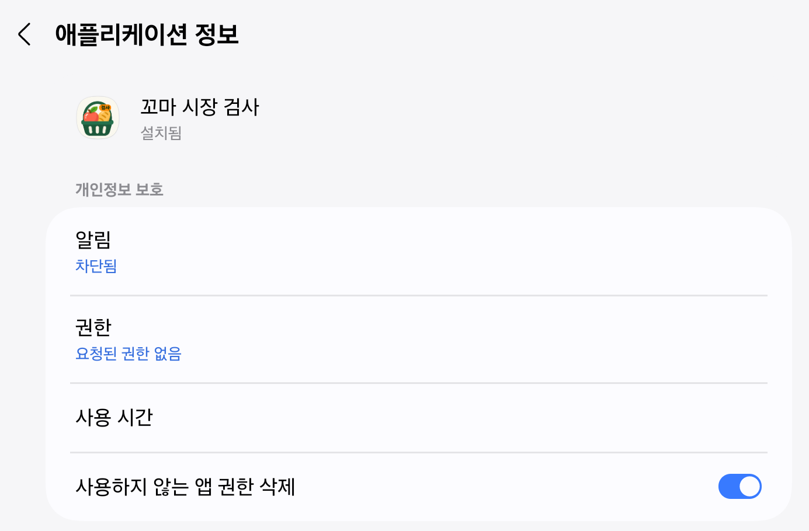

# 18장 앱 이름과 아이콘, 시작 화면 만들기

앱 목록에 ‘꼬마 시장’이 여럿 보이면 어떤 것을 눌러야 할까. 검사 중인 앱에는 이름과 아이콘에 표시를 남겨 구분한다. 이번 장에서는 같은 장바구니 그림으로 일반 아이콘, Android 적응형 아이콘, 단색 아이콘을 구성하고 시작 화면까지 연결한다.

17장의 앱 기능은 유지한다. 새 참고 폴더는 브랜드 이미지와 검사 앱 설정을 검증한 `807d295`를 기준으로 한다.

```bash
cd ~/market-book/kit
node start.mjs 18
cd work/ch18
npm --prefix apps/mobile ci
```

VS Code에서 `work/ch18`을 연다. 17장의 폴더는 그대로 남겨 둔다. 새 폴더에서는 `expo-splash-screen`이 포함된 `package.json`과 `package-lock.json`이 함께 제공된다. `npm ci`로 이 조합을 설치한다.

자신의 17장 수정본을 계속 사용하는 독자는 참고본의 다음 파일을 VS Code로 비교한 뒤 필요한 변경을 적용한다. 잠금 파일은 `package.json`과 짝으로 가져오며, `App.tsx`나 `src`를 통째로 덮어쓰지 않는다.

| 도입할 파일 | 역할 |
| --- | --- |
| `apps/mobile/package.json`·`package-lock.json` | 시작 화면 라이브러리와 호환 버전 |
| `apps/mobile/app.json` | 기본 앱 이름·버전·이미지 경로 |
| `apps/mobile/app.config.js` | 실행 목적에 따른 최종 설정 |
| `apps/mobile/eas.json` | 다음 장의 검사 APK 빌드 프로필 |
| `apps/mobile/assets/brand` | 여섯 PNG |
| 루트 `.easignore` | 다음 장에서 검사할 업로드 파일 규칙 |

기존 Git 이력으로 참고 파일을 확인하려면 별도 복사본의 `807d295`를 사용한다. 이 장에서는 클라우드에 로그인하거나 APK를 요청하지 않는다. 계정과 패키지의 개인화는 19장에서 진행한다.

## 18.1 앱 이름과 아이콘을 설정하는 파일을 VS Code에서 찾기

VS Code 탐색기에서 `apps/mobile/app.json`을 연다. 여기의 `expo.name`은 기본 앱 이름이며 `expo.icon`은 기본 아이콘 경로다. 앱 화면에 쓰여 있는 ‘꼬마 시장’ 문구는 `App.tsx`의 화면 요소이므로 서로 다른 위치에서 관리된다.

| 바꾸려는 것 | 찾을 위치 | 확인하는 곳 |
| --- | --- | --- |
| 앱 목록의 이름 | 최종 Expo 설정의 `name` | 설치 후 앱 목록·앱 정보 |
| 화면 상단의 이름 | `App.tsx`의 `market-title` | 놀이 화면 |
| 기본 아이콘 | `icon` | 앱 아이콘을 쓰는 환경 |
| Android 적응형 아이콘 | `android.adaptiveIcon` | Android 런처 |
| 시작 화면 | `expo-splash-screen` 플러그인 | 설치 앱의 새 프로세스 실행 |

`app.json`만 확인하고 끝내지 않는다. 같은 폴더에 `app.config.js`가 있으면 그 함수가 정적 설정을 받아 최종 값을 바꿀 수 있다. 참고 앱은 기본 이름이 ‘꼬마 시장’이어도 검사 용도로 읽으면 ‘꼬마 시장 검사’를 반환한다.

앱 폴더의 Git Bash에서 다음을 실행한다.

```bash
cd apps/mobile
STORE_PRICE_APP_VARIANT=inspection STORE_PRICE_STANDALONE_BUILD=0 npx expo config --type public
```

출력에서 `name`, `icon`, `android.adaptiveIcon`, `plugins`를 찾는다. 이 장의 예상 최종 이름은 **꼬마 시장 검사**다. 이 명령은 설정을 읽어 보여 주며 설치된 기기의 아이콘을 즉시 바꾸지는 않는다.

### VS Code에서 두 설정을 나란히 읽기

1. `app.json` 탭을 연다.
2. `app.config.js`도 연다.
3. 탭을 오른쪽으로 끌거나 **편집기 오른쪽 분할**을 선택한다.
4. 왼쪽에서 `icon`의 기본 경로를 찾는다.
5. 오른쪽에서 `return` 안의 `icon`과 `name`을 찾는다.
6. 터미널의 최종 출력이 어느 값과 일치하는지 표시한다.

문자열 하나를 찾을 때는 Ctrl+F를, 여러 파일에서 같은 설정을 찾을 때는 Ctrl+Shift+F를 쓴다. 다른 파일의 같은 단어를 일괄 바꾸기 전에 대상이 앱 화면 문구인지 설치 설정인지 확인한다.

**연습:** `app.config.js`의 검사 앱 이름만 ‘내 꼬마 시장 검사’로 바꾸고 위 명령을 다시 실행한다. 출력이 바뀌면 저장이 반영된 것이다. 이 책의 이후 화면과 맞추려면 이름을 ‘꼬마 시장 검사’로 돌린다. 이미 설치된 APK 이름이 바뀌는 것은 새 APK로 업데이트한 뒤다.

## 18.2 장바구니·사과·빵 이미지의 일반·적응형·단색 버전 살펴보기

`apps/mobile/assets/brand`를 연다. 여섯 파일의 이름이 서로 닮았지만 쓰임이 다르다.

| 파일 | 배경과 그림 | 사용하는 곳 |
| --- | --- | --- |
| `market-icon.png` | 크림색 바탕 위 초록 장바구니 | 일반 앱 기본 아이콘 |
| `market-foreground.png` | 투명 바탕 위 장바구니·사과·빵 | 일반 앱 적응형 전경·시작 화면 |
| `market-monochrome.png` | 투명 바탕의 검정 모양 | 일반 앱 단색 테마 아이콘 |
| `inspection-icon.png` | 크림색 바탕·‘검사’ 배지 | 검사 앱 기본 아이콘 |
| `inspection-foreground.png` | 투명 바탕·‘검사’ 배지 | 검사 앱 적응형 전경·시작 화면 |
| `inspection-monochrome.png` | 검정 모양·투명한 글자 구멍 | 검사 앱 단색 테마 아이콘 |


**그림 18-1.** 일반 아이콘. 장바구니·사과·빵을 중심에 두고 바깥에 여백을 남겼다.


**그림 18-2.** 같은 그림에 ‘검사’ 배지를 붙인 검사 앱 아이콘. 설치할 앱을 구분하는 표시다.

### 파일을 눈으로 확인한다

VS Code에서 PNG를 한 번 누르면 미리보기가 열린다. `foreground`와 `monochrome`에서 바깥이 투명한지 확인한다. 뷰어가 투명을 흰색으로 보일 수 있으므로 배경색이 다르게 표시되는 뷰어에서도 살펴본다. 파일 탐색기 속성의 **자세히**에서 가로·세로도 확인한다.

제공된 원본 여섯 개는 모두 **1254×1254 픽셀**이다. 제작 요청에서는 1024×1024를 목표로 했지만 실제 받은 파일은 1254×1254였기 때문에 실제 파일 값을 기록했다. ‘요청한 크기’와 ‘반환된 파일의 크기’는 같은 사실이 아니다.

이미지를 줄여 보았을 때도 장바구니가 구분되는지 살펴본다. 아주 얇은 글자나 가장자리의 작은 장식은 런처 모양에 따라 읽기 어렵거나 잘릴 수 있다. 전경 이미지의 투명 여백은 이 문제를 줄이기 위해 남겨 둔 공간이다.

일반 `icon`은 크림색 바탕을 포함한다. 적응형 아이콘은 배경색과 전경 이미지를 별도로 지정한다. 같은 불투명 정사각형을 두 곳에 그대로 넣으면 예상치 못한 테두리나 배경이 생길 수 있으므로 용도를 구분한다.

### 여섯 파일의 출처

이 프로젝트의 그림은 내장 이미지 생성 도구로 새로 만들고 배경·검사 배지·단색 변형을 구성한 것이다. 외부 유통업체의 로고나 상품 사진을 사용하지 않았다. 생성 문장과 실제 파일 지문은 `docs/06-brand-assets.md`에 있다.

새 그림으로 바꾸는 독자는 출처와 원본을 함께 보관한다. 다른 회사의 아이콘을 다운로드해 이름만 바꾸는 방식은 쓰지 않는다. 이번 실습에서는 제공된 여섯 파일을 사용하면 별도의 이미지 생성 계정 없이 같은 설정을 따라 할 수 있다.

## 18.3 시작 화면의 이미지와 배경색 설정하기

시작 화면은 앱이 준비되는 동안 잠시 보이는 Android의 화면이다. 앱의 첫 번째 상품 화면과는 다르다. 이 프로젝트는 `expo-splash-screen` 플러그인으로 시작 이미지와 배경색을 설정한다.

앱 폴더에서 설치된 라이브러리를 확인한다.

```bash
npm ls expo expo-splash-screen
```

이 참고본은 Expo SDK 58과 `expo-splash-screen ~58.0.14`를 사용한다. 이전 폴더에 기능을 직접 추가한다면 다음 명령으로 현재 Expo SDK에 맞는 패키지를 설치한다.

```bash
npx expo install expo-splash-screen
```

새 패키지가 이미 들어 있는 참고본에서 위 설치 명령을 반복할 필요는 없다. SDK 58의 플러그인 옵션과 실제 설치 앱에서 확인해야 하는 이유는 [Expo SplashScreen 문서](https://docs.expo.dev/versions/v58.0.0/sdk/splash-screen/)를 따른다.

### 동적 설정에서 이미지 묶음 선택하기

`app.config.js`에서 `const extra` 처리 다음에 있는 아래 블록을 읽는다. 17장 소스를 직접 확장하는 경우에는 이 블록과 다음 반환 속성을 함께 가져온다. 변수를 만들기만 하고 `return`에 연결하지 않으면 설정에 반영되지 않는다.

```javascript
// 앱 용도에 맞는 그림을 한 번에 선택해 아이콘과 시작 화면이 서로 다르지 않게 합니다.
const brand = variant === 'production' ? 'market' : 'inspection';
const backgroundColor = '#FAF8EF';
const foregroundImage = './assets/brand/' + brand + '-foreground.png';

// 이전에 선언한 같은 플러그인을 제거하고 선택한 용도의 설정을 한 번만 적용합니다.
const plugins = (config.plugins ?? []).filter((plugin) =>
  (Array.isArray(plugin) ? plugin[0] : plugin) !== 'expo-splash-screen');

plugins.push(['expo-splash-screen', {
  backgroundColor,
  image: foregroundImage,
  imageWidth: 200,
  resizeMode: 'contain',
}]);
```

이 블록의 `variant`는 파일 위쪽에서 `STORE_PRICE_APP_VARIANT` 환경 변수를 읽은 값이다. 참고본에는 검사 용도와 다른 용도의 혼입을 막는 검증도 있다. 이 블록만 빈 파일에 붙이지 말고 제공된 전체 `app.config.js`의 위치를 확인한다.

`return`에서 다음 속성이 반환되는지 확인한다.

```javascript
icon: './assets/brand/' + brand + '-icon.png',
plugins,
```

그리고 `android` 객체 안에 있는 적응형 아이콘은 다음과 같다.

```javascript
adaptiveIcon: {
  backgroundColor,
  foregroundImage,
  monochromeImage: './assets/brand/' + brand + '-monochrome.png',
},
```

이렇게 하면 `inspection`을 선택했을 때 기본 아이콘·전경·단색·시작 화면이 모두 검사 배지가 있는 그림을 사용한다. 이전 템플릿의 `backgroundImage`를 함께 남기지 않는 이유는 지정한 크림색 배경 위에 다른 배경 그림이 겹치지 않게 하기 위해서다.

`resizeMode: 'contain'`은 그림 비율을 유지하며 지정 영역 안에 맞춘다. 그림을 크게 보이게 하려고 원본의 투명 여백을 무조건 없애면 런처에서 주요 부분이 잘릴 수 있다.

### 코드로 설정을 확인하고 화면으로 확인하기

앱 폴더에서 실행한다.

```bash
STORE_PRICE_APP_VARIANT=inspection STORE_PRICE_STANDALONE_BUILD=0 npx expo config --type public
npm run typecheck
npm run lint
npm run export:check
```

설정에서 `inspection-foreground.png`, `inspection-monochrome.png`, 배경색 `#FAF8EF`를 찾는다. 없는 이미지 경로나 중복 플러그인이 보이면 파일을 확인한다.

Expo Go에서는 설치 앱의 시작 화면과 같은 모습이 전부 재현되지 않을 수 있다. 따라서 지금은 파일과 설정을 확인하고, 19장에서 만든 APK의 아이콘을 눌러 실제 시작 화면을 확인한다. 시작 화면을 오래 보여 주려고 임의의 대기 시간을 추가하지 않는다. 준비가 끝나면 사용자가 바로 놀이를 시작할 수 있어야 한다.

**연습:** 배경색을 잠시 다른 연한 색으로 바꾸고 최종 설정 출력의 `backgroundColor`가 바뀌는지 확인한다. 이어 원래 `#FAF8EF`로 돌리고 저장한다. 이 연습은 파일과 출력의 연결을 확인하는 것이며 새 APK 화면 검사는 아니다.

## 18.4 내 기기에서 찾기 쉽게 검사 앱의 이름과 배지 확인하기

앱 이름, 그림, 패키지 식별자는 서로 다른 값이다. 이름은 사람이 읽고, 식별자는 Android가 앱을 구분하는 데 쓴다. 이름만 바꿔도 기존 앱과 별개로 설치되는 것은 아니다.

참고 설정은 다음 구분을 갖고 있다.

| 항목 | 일반 앱 그림 | 이 책에서 설치할 검사 앱 |
| --- | --- | --- |
| 이름 | 꼬마 시장 | 꼬마 시장 검사 |
| 이미지 접두사 | `market` | `inspection` |
| 아이콘의 글자 | 없음 | 검사 |
| 이번 책의 빌드 | 직접 요청하지 않음 | 19장의 `inspection` APK |
| 독자 패키지 | 19장에서 정할 기본값 | 기본값 뒤에 `.inspection` |

17장까지의 Expo Go에서는 ‘어느 프로젝트를 열었는가’를 확인했다. 19장부터는 ‘어느 설치 앱을 눌렀는가’를 확인해야 한다. 홈 화면에 아이콘이 여러 개라면 이름·검사 배지·앱 정보의 버전을 함께 본다.



**그림 18-3.** 실제 태블릿에 설치된 검사 APK의 앱 정보. 설정 파일의 이름과 배지가 설치 결과에 반영된 사례다. 이 그림은 2026년 11월 18일 검사 앱 기록이며 독자의 새 설치 결과가 아니다.

### 앱 설정과 기기 결과가 다를 때

| 현상 | 먼저 확인할 것 |
| --- | --- |
| Expo Go에서는 옛 그림이 보임 | Expo Go의 표시와 설치 APK의 시작 화면을 구분 |
| 새 APK에도 예전 아이콘이 보임 | 설치한 APK의 빌드 ID·버전, 실제 누른 패키지 |
| 일부 모양에서 그림이 잘림 | 전경의 투명 여백·주요 그림의 위치 |
| 시작 화면만 다른 그림 | 플러그인의 `image`와 선택된 `brand` |
| 배경이 예상과 다름 | 남아 있는 `backgroundImage`, 플러그인 배경색 |
| 클라우드에서 이미지 파일 없음 | 실제 파일명·대소문자·`.easignore` |

기존 검사에서 모든 제조사의 런처 모양과 테마 설정을 확인한 것은 아니다. 자신이 사용하는 기기에서 큰 아이콘·작은 아이콘, 사용할 테마를 확인하고 결과를 적는다.

**완료 확인:** 여섯 PNG의 역할을 설명하고, 검사 용도의 최종 이름·기본 아이콘·적응형 전경·단색·시작 이미지 경로를 찾을 수 있는가. 이름과 배지가 일치하는가. 다음 장에서 본인 계정·패키지로 APK를 만들 준비가 되었다면 새 빌드와 설치로 이어 간다.
