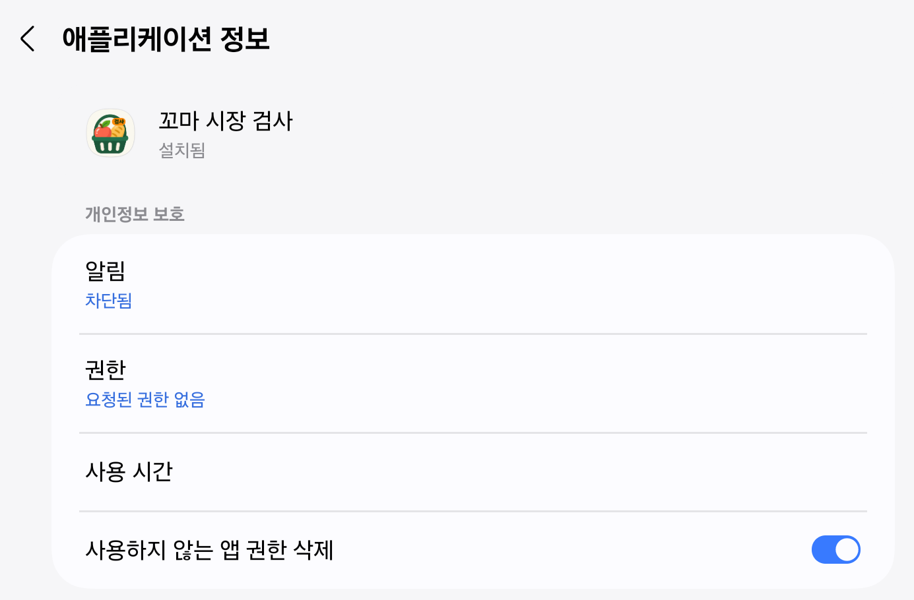
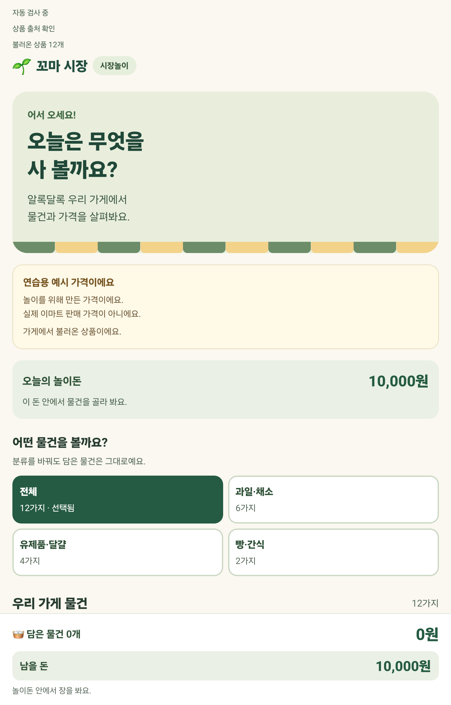

# 19장 EAS로 APK를 만들어 내 Android 기기에 설치하기

Expo Go에서 열던 꼬마 시장을 기기의 앱 목록에 설치해 보자. 이 장을 마치면 PC의 개발 서버를 종료한 뒤에도 **꼬마 시장 검사** 아이콘을 눌러 앱을 실행할 수 있다. 첫 APK를 설치한 다음에는 버전 코드를 올려 같은 앱을 업데이트한다.

준비할 것은 18장까지 완성한 소스, Windows의 Git Bash, 본인 Expo 계정, USB 디버깅을 허용한 Android 기기 한 대다. 13장과 17장에서 사용한 ADB가 필요하다. 여기서는 기존 프로젝트의 `apps/mobile`에서 작업한다. 명령 앞에 표시되는 `$` 같은 터미널 프롬프트는 입력하지 않는다.

이 장의 출력 예시는 독자가 확인할 모양을 설명한다. 계정 이름·기기 번호·빌드 ID·파일 지문은 실행할 때마다 달라진다. 개발 당시 실제 결과는 각 절의 ‘개발에서 확인한 사례’와 장 끝의 기록에 구분해 두었다.


**이 장부터 시작한다면 — 배포 꾸러미에서 완성 소스를 준비한다**

18장 폴더에서 본인의 변경을 이어 가는 독자는 그 폴더를 계속 사용해도 된다. 이 장부터 시작하거나 같은 기준과 비교할 독자는 배포 ZIP을 풀어 둔 `kit`에서 다음처럼 새 실습 폴더를 만든다.

```bash
cd ~/market-book/kit
node start.mjs 19
cd work/ch19
npm --prefix apps/mobile ci
```

출력된 실제 경로가 다르면 도구가 알려 준 경로를 사용한다. VS Code의 **파일 → 폴더 열기**에서 `work/ch19`를 연다. 이미 같은 폴더에 자기 작업이 있다면 지우거나 덮어쓰지 않는다.

이 참고본은 `35b12e4`의 설치 실습에 16장에서 익힌 **TalkBack 설정 열기** 버튼을 더했다. 이 소스로 만든 Android 앱에서 장보기와 영수증을 오가며 화면 읽기 설정을 바꿀 수 있다. 다음 파일들이 보이는지 확인한다.

```text
apps/mobile/
  App.tsx
  app.json
  app.config.js
  eas.json
  package.json
  package-lock.json
  src/
  assets/brand/
```

꾸러미가 만든 폴더에는 Git 이력이 없다. 19.2절에서 저자의 공개 프로젝트 설정을 본인 것으로 바꾸고 Git 이력의 첫 커밋을 만든 뒤 EAS를 사용한다. 본인 계정·비밀번호·서명 키를 제공하는 꾸러미가 아니므로 계정 연결은 직접 해야 한다. **4장에서 첫 앱을 살펴보는 `adcfaab`는 이 장의 시작점과 다르다.**

**선택 — 기존 Git 저장소에서 설정 버튼이 있는 앱 복제하기**

프로젝트의 원래 Git 이력을 갖고 있는 독자는 ZIP 대신 별도 복사본을 만들 수도 있다. 원본 저장소 **루트**의 Git Bash에서 먼저 확인한다.

```bash
git cat-file -t 3487654
```

`commit`이 출력되면 아직 없는 새 폴더로 복제한다.

```bash
git clone --no-local . ../market-book-ch19
cd ../market-book-ch19
git switch --detach 3487654
git switch -c codex/book-ch19
git show --no-patch --oneline HEAD
```

원본의 미커밋 수정, `.env.local`, 설치한 패키지와 개인 빌드 자료는 가져오지 않는다. 같은 이름의 폴더가 있다면 `market-book-ch19-2`처럼 다른 새 이름을 사용한다. 마지막 출력은 `3487654 feat: 놀이 중 TalkBack 설정 열기`로 시작한다. 이 커밋으로 빌드하는 앱에는 개인정보처리방침 버튼도 있다. 이번 실습에서 만드는 파일은 `inspection` APK다.

커밋이 없으면 임의의 다른 커밋으로 대신하지 않고 위의 배포 꾸러미를 사용한다. ZIP과 Git 복제 중 하나만 선택하면 된다. 어느 경로든 이후 수정은 분리한 실습 폴더에서 하고, 남아 있는 저자 프로젝트 연결 정보는 다음 절에서 본인 것으로 바꾼다.

## 19.1 Expo Go에서 열었던 프로젝트가 Android 설치 파일이 되는 과정 이해하기

지금까지는 `npm start`로 개발 서버를 켜고 Expo Go로 프로젝트를 열었다. 이번에는 소스와 이미지, 설정을 클라우드의 빌드 컴퓨터에 전달한다. 빌드 컴퓨터가 Android 앱을 만들고 서명하면, 우리가 내려받을 수 있는 APK 파일이 생긴다.

| 단계 | 작업하는 곳 | 다음 단계로 넘기는 것 |
| --- | --- | --- |
| 코드와 설정 준비 | PC의 VS Code | TypeScript·TSX 코드, 이미지, 잠금 파일, 앱 설정 |
| 빌드 요청 | PC의 Git Bash | 사용할 EAS 프로젝트와 `inspection` 프로필 |
| APK 생성 | Expo의 빌드 서버 | 실행 코드와 이미지를 포함한 서명된 APK |
| 설치 | USB로 연결한 Android | 기기 앱 목록에 표시되는 꼬마 시장 검사 |
| 실행 확인 | Android | 개발 서버 없이 열리는 놀이 화면 |

이 장에서는 개발 서버 연결을 기다리는 개발용 클라이언트가 아니라, 실행 코드를 포함하는 검사 APK를 만든다. `eas.json`에서 `developmentClient: false`와 `android.buildType: "apk"`를 확인하는 이유다. APK를 만드는 설정과 기기에 설치하는 과정은 [Expo의 APK 빌드 안내](https://docs.expo.dev/build-reference/apk/)에서 확인할 수 있다.

공식 문서에는 서비스 이름이 ‘Expo Build’로 표시되기도 한다. 이 책은 프로젝트 기록과 연결하기 위해 EAS 빌드라는 표현을 사용한다. 명령 이름 `eas`와 설정 파일 이름 `eas.json`은 그대로다. [Expo 서비스 이름 안내](https://docs.expo.dev/eas-to-expo/)

**따라 하기 — 현재 폴더부터 확인한다**

1. VS Code에서 앞 장까지 작업한 실습 저장소를 연다.
2. **터미널 → 새 터미널**을 선택하고 Git Bash인지 확인한다.
3. 저장소 루트에서 다음 명령을 실행한다.

```bash
cd apps/mobile
pwd
ls
```

마지막 경로가 `/apps/mobile`로 끝나고, 목록에 `package.json`, `app.json`, `app.config.js`, `eas.json`이 보여야 한다. 이미 `apps/mobile`에 있다면 `cd apps/mobile`을 다시 입력하지 않는다.

다음 명령은 이 장에서 사용하는 버전을 확인하고 기존 앱의 코드 검사를 실행한다.

```bash
node -v
npm -v
npm test
npm run typecheck
npm run lint
```

검사가 실패하면 해당 파일을 고친 뒤 진행한다. 패키지를 아직 설치하지 않은 새 복사본이라면 먼저 `npm ci`를 실행한다. `package-lock.json`을 지우거나 React Native 버전만 따로 올려 문제를 해결하려 하지 않는다.

## 19.2 내 Expo 계정으로 로그인하고 실습용 EAS 프로젝트 연결하기

EAS 프로젝트는 빌드 기록과 서명 설정을 관리하는 공간이다. 예제 소스에 남아 있는 저자의 연결 정보는 독자의 빌드 공간이 아니다. **로그인한 계정, 앱 설정의 소유자, 연결된 프로젝트를 모두 본인 것으로 맞춘다.**

### 계정에 로그인한다

[Expo 계정 만들기](https://expo.dev/signup)에서 본인 계정을 준비한다. 비밀번호나 인증 코드는 브라우저 또는 로그인 명령의 입력창에 직접 입력한다. 실습 노트나 소스 파일에는 적지 않는다.

`apps/mobile`의 Git Bash에서 실행한다.

```bash
npx eas-cli@latest --version
npx eas-cli@latest login
npx eas-cli@latest whoami
```

첫 실행 때 npm이 EAS CLI 패키지 설치를 물으면 패키지 이름이 `eas-cli`인지 확인하고 진행한다. 로그인은 CLI가 안내하는 브라우저 또는 터미널 절차를 따른다. `whoami`에는 본인의 Expo 사용자명이 나와야 한다. 다른 계정이면 `npx eas-cli@latest logout` 후 다시 로그인한다. 회사에서 설정한 `EXPO_TOKEN`이 있는 터미널이라면 토큰을 출력하지 말고 개인 실습용 새 터미널에서 계정을 확인한다.

이 책은 전역 설치와 명령을 섞지 않도록 `npx eas-cli@latest`를 사용한다. 사용한 실제 CLI 버전은 기록한다. 공식 명령 형태는 [EAS CLI 참조](https://docs.expo.dev/eas/cli/)를 따른다.

### 저자의 프로젝트 연결을 본인의 설정으로 바꾼다

VS Code 탐색기에서 `apps/mobile/app.json`을 연다. 아래 다섯 값을 확인한다.

| 설정 | 뜻 | 독자가 넣을 값 |
| --- | --- | --- |
| `expo.owner` | Expo 프로젝트 소유 계정 | `whoami`에서 확인한 본인 사용자명 |
| `expo.slug` | Expo 프로젝트의 짧은 이름 | 예: `market-book-mina2026` |
| `expo.android.package` | Android 앱 식별자의 기본값 | 예: `com.mina2026.marketbook` |
| `expo.version` | 사람에게 보여 주는 버전 | 첫 실습에서는 `1.0.0` |
| `expo.android.versionCode` | 설치 파일의 빌드 번호 | 처음 만든 본인 패키지에서는 `1` |

`mina2026`은 설명용 이름이다. 본인이 구별할 수 있는 영문 소문자·숫자 조합으로 바꾼다. 패키지의 각 구간은 문자로 시작하게 하고 공백과 하이픈을 넣지 않는다. **기본 패키지에는 아직 `.inspection`을 붙이지 않는다.** 다음 절에서 동적 설정이 검사 앱에 그 접미사를 붙인다.

예제 저장소를 그대로 복제했다면 `extra.eas.projectId`도 확인한다. **저자의 projectId 항목을 제거**하고 `extra`의 다른 설정이 있으면 보존한다. 현재 예제에서 `extra`에 EAS 연결만 있다면 다음처럼 빈 객체로 남겨도 된다.

```json
"extra": {}
```

이 코드는 `app.json` 전체가 아니라 `expo` 안의 한 항목이다. 바로 앞 항목과의 쉼표를 확인한다. `projectId`에 임의의 UUID를 만들거나 책의 예시 값을 붙여 넣지 않는다.

이 프로젝트에는 `app.config.js`도 있다. Expo는 `app.json`을 읽은 뒤 동적 설정을 적용하므로, `app.json`만 바꿔도 최종 결과가 같아지는 것은 아니다. [Expo 앱 설정 안내](https://docs.expo.dev/workflow/configuration/)

`apps/mobile/app.config.js`의 `return` 안에서 `slug:` 줄을 찾아 다음으로 바꾼다.

```javascript
    // 실습자가 app.json에 정한 프로젝트 이름을 그대로 사용합니다.
    slug: config.slug,
```

같은 `return` 안의 `android` 객체에서 `package:`로 시작하는 조건식 전체를 다음 블록으로 바꾼다. 주변의 `adaptiveIcon`, `allowBackup`, `versionCode`는 유지한다.

```javascript
      // 본인 앱 식별자에서 검사 앱을 파생해 다른 설치 앱과 구분합니다.
      package: standalone ? androidPackage : variant === 'production'
        ? config.android.package
        : config.android.package + '.inspection',
```

예시 기본값이 `com.mina2026.marketbook`이면 검사 APK의 최종 식별자는 `com.mina2026.marketbook.inspection`이다. 이 장에서는 `standalone`을 끈 `inspection` 프로필만 사용한다. 예전 첫 실행 전용 `preview` 프로필과 저자용 `scripts/build/inspection.mjs`를 대신 실행하지 않는다. 그 도구에는 저자의 패키지·소스 지문을 대조하는 규칙이 있다.

### 최종 설정을 읽고 EAS 프로젝트를 연결한다

아래 명령은 현재 터미널에 남아 있을 수 있는 이전 검사 전용 값을 해제한다.

```bash
unset STORE_PRICE_ANDROID_PACKAGE STORE_PRICE_BUILD_NONCE
unset EXPO_PUBLIC_DEVICE_RUN_ID
export STORE_PRICE_APP_VARIANT=inspection
export STORE_PRICE_STANDALONE_BUILD=0
export EXPO_NO_DOTENV=1
export EXPO_PUBLIC_PRIVATE_PRICE_PREVIEW=disabled
export EXPO_PUBLIC_PRIVATE_PRICE_PREVIEW_TOKEN=disabled
export EXPO_PUBLIC_CATALOG_TEST_SCENARIO=disabled
npx expo config --type public
```

출력에서 `owner`·`slug`·`android.package`·`version`·`android.versionCode`를 찾는다. 최종 앱 이름은 **꼬마 시장 검사**, 패키지는 본인 기본값 뒤에 `.inspection`이 붙은 값이어야 한다. 저자의 이름이나 식별자가 나오면 빌드하지 말고 동적 설정의 해당 줄을 다시 찾는다.

### ZIP 참고본의 Git 이력 시작하기

EAS가 소스 위치를 판단할 수 있도록 참고본의 저장소 루트를 준비한다. `node start.mjs 19`로 만든 새 폴더처럼 `.git`이 없는 경우에만 다음을 실행한다. Git 복제 경로를 선택한 독자는 이미 이력이 있으므로 이 블록을 건너뛴다.

먼저 저장소 루트의 `.gitignore`에 `.env`, `node_modules`, `.artifacts` 제외 규칙이 있는지 확인한다. 본인의 계정·slug·기본 패키지를 입력하고 저자의 projectId를 지운 상태에서 다음 순서를 따른다.

```bash
cd ../..
git init -b codex/book-ch19
git status --short
git add .gitignore .easignore AGENTS.md README.md apps scripts supabase docs
git diff --cached --name-only
```

추가 목록은 공개할 수 있는 소스와 문서여야 한다. `.env.local`, 비밀번호, 서명 키, APK나 개인 캡처가 보이면 커밋하지 않는다. 잘못 추가한 경로는 `git rm --cached -- "해당 파일"`로 staging에서만 빼고 제외 규칙을 확인한다. 이는 디스크의 파일을 지우는 명령이 아니다.

2장에서 설정한 본인 Git 이름·이메일로 첫 커밋을 만든 뒤 앱 폴더로 돌아온다.

```bash
git commit -m "chore: 내 Android APK 실습 시작점"
cd apps/mobile
```

커밋은 로컬 이력을 만들며 GitHub 업로드는 하지 않는다. 다음 EAS 연결에서 새 projectId가 저장되면 그 차이도 본인의 실습 기록으로 남긴다.

다음 명령으로 본인 계정에 실습 프로젝트를 만들거나 이미 만든 본인 프로젝트에 연결한다.

```bash
npx eas-cli@latest init
```

질문에 표시되는 `@소유자/프로젝트이름`을 읽는다. 앞에서 정한 본인 `owner`와 `slug`가 맞을 때 진행한다. 새 프로젝트가 만들어지면 EAS가 projectId를 알려 준다. 동적 설정 때문에 자동으로 저장할 수 없다는 안내가 나오면, **그 명령이 실제로 반환한 ID**를 `app.json`의 `expo.extra.eas.projectId`에 넣는다.

다음은 구조만 보여 주는 예시다. `명령이 반환한 본인 projectId`라는 문장을 그대로 저장하지 않는다.

```json
"extra": {
  "eas": {
    "projectId": "명령이 반환한 본인 projectId"
  }
}
```

`app.config.js`의 기존 `const extra = { ...config.extra };`와 반환값의 `extra,`는 이 정보를 보존한다. 저장한 뒤 확인한다.

```bash
npx eas-cli@latest project:info
```

**확인할 결과:** 본인 소유자·프로젝트명·projectId가 앞선 결과와 일치한다. 이때까지는 프로젝트 연결을 마친 것이며 APK는 아직 만들지 않았다.

## 19.3 eas.json에서 검사 APK용 inspection 프로필과 패키지 이름 확인하기

`apps/mobile/eas.json`을 연다. 최상위 `cli.appVersionSource`가 `local`인지, `build.inspection`이 아래 설정인지 확인한다. 기존 다른 프로필은 지우지 않아도 된다. 아래 코드는 검사 APK만 만드는 최소 파일의 전체 모양이다.

```json
{
  "cli": {
    "appVersionSource": "local"
  },
  "build": {
    "inspection": {
      "environment": "preview",
      "developmentClient": false,
      "distribution": "internal",
      "autoIncrement": false,
      "env": {
        "EXPO_NO_DOTENV": "1",
        "EXPO_PUBLIC_PRIVATE_PRICE_PREVIEW": "disabled",
        "EXPO_PUBLIC_PRIVATE_PRICE_PREVIEW_TOKEN": "disabled",
        "EXPO_PUBLIC_CATALOG_TEST_SCENARIO": "disabled",
        "STORE_PRICE_APP_VARIANT": "inspection",
        "STORE_PRICE_STANDALONE_BUILD": "0"
      },
      "android": {
        "buildType": "apk"
      }
    }
  }
}
```

| 항목 | 이번 실습에서의 의미 |
| --- | --- |
| `inspection` | 빌드 명령에서 지정할 프로필 이름 |
| `environment: "preview"` | 이 프로필에서 읽을 EAS 환경 변수 묶음 |
| `developmentClient: false` | 개발 서버를 기다리는 개발용 클라이언트가 아닌 앱 |
| `distribution: "internal"` | 기기에 직접 설치해 검사할 빌드 |
| `buildType: "apk"` | 내려받을 Android 파일 형식 |
| `appVersionSource: "local"` | 저장소의 앱 설정으로 버전 관리 |
| `autoIncrement: false` | 다음 실습에서 우리가 직접 버전 코드를 올림 |

프로필 이름 `inspection`과 환경 이름 `preview`는 역할이 다르다. **`--profile preview`로 바꿔 입력하지 않는다.** 기존 예제의 `preview` 프로필은 별도 검사 식별자를 요구한다.

`EXPO_NO_DOTENV=1`은 로컬 `.env.local`을 자동으로 읽지 않게 한다. 따라서 12장에서 PC에 넣은 공개 상품 연결값은 클라우드 빌드에 자동으로 따라가지 않는다. 설치 APK도 본인의 공개 예시 목록을 읽게 하려면 본인 EAS 프로젝트의 `preview` 환경에 다음 두 값을 준비한다.

```bash
npx eas-cli@latest env:set preview --name EXPO_PUBLIC_SUPABASE_URL --type string --visibility plaintext
npx eas-cli@latest env:set preview --name EXPO_PUBLIC_SUPABASE_PUBLISHABLE_KEY --type string --visibility plaintext
```

명령이 값을 물으면 12장에서 만든 **본인 프로젝트의 URL과 publishable 키**를 입력한다. 명령을 실행하는 폴더의 `project:info`가 본인 프로젝트인지 먼저 확인한다. 동일 이름이 있으면 값을 무심코 덮어쓰지 말고 본인의 앞 장 설정과 대조한다. UI를 사용한다면 Expo 프로젝트의 환경 변수 설정에서 이름·값·대상 환경 `preview`를 같은 기준으로 입력한다. 프로필의 환경 선택은 [EAS 환경 변수 사용법](https://docs.expo.dev/eas/environment-variables/usage/)을 따른다.

공개 키는 앱 코드에 포함되는 값이다. `sb_secret_` 키, 과거 `service_role` 키, 데이터베이스 비밀번호를 여기에 넣으면 안 된다. 서버의 접근 권한은 12장에서 만든 공개 조회와 RLS로 제한한다. [Supabase API 키 안내](https://supabase.com/docs/guides/getting-started/api-keys)

외부 DB 연결 없이 내장 예시만 사용할 독자는 두 변수를 등록하지 않아도 된다. 그 경우 설치 앱에서 연결 설정 안내가 나온 뒤 **예시 상품으로 바로 놀이하기**를 눌러야 한다. 이는 다음 장에서도 사용할 정상적인 별도 경로다.

### 이미지가 업로드 대상에 들어 있는지 확인한다

VS Code에서 저장소 루트의 `.easignore`를 연다. `apps/mobile` 안의 파일이 아니다. 이 저장소는 필요한 파일만 허용하는 방식이므로, 다음 두 줄을 `!apps/mobile/assets/*.png` 아래에 추가한다. 이미 있다면 중복해서 넣지 않는다.

```gitignore
!apps/mobile/assets/brand/
!apps/mobile/assets/brand/*.png
```

첫 줄은 폴더에 들어갈 수 있게 하고, 둘째 줄은 그 안의 PNG를 허용한다. 18장의 이미지가 로컬에서 보이는데 클라우드에서 없다고 나오는 문제를 막는 설정이다. 기존 `**/.env*`, 서명 키, `.artifacts`, `data` 등의 제외 규칙은 유지한다. `.easignore`가 있으면 Git의 제외 규칙을 대신 사용하므로 내용을 통째로 비우지 않는다. [EAS 업로드 파일 제외 안내](https://docs.expo.dev/build-reference/easignore/)

`apps/mobile`에서 업로드할 파일 목록을 로컬 폴더에 펼쳐 본다.

```bash
npx eas-cli@latest build:inspect --platform android --profile inspection --stage archive --output ../../.artifacts/book-build/archive-v1
```

이 명령은 업로드 대상을 확인하는 단계이며 APK 빌드 요청이 아니다. 출력 폴더가 이미 있다는 오류가 나면 기존 자료를 지우는 옵션을 넣지 말고 `archive-v1-check2`처럼 새 출력 이름을 사용한다.

파일 탐색기로 출력 폴더를 열어 다음을 확인한다.

- 앱의 `App.tsx`, `src`, `package.json`, `package-lock.json`이 있다.
- `assets/brand` 아래의 아이콘 PNG와 시작 화면에 사용할 PNG가 있다.
- `app.json`과 `app.config.js`가 본인 설정이다.
- `.env.local`, 개인 가격 원자료, 서명 키 파일, 기기 캡처는 없다.

## 19.4 터미널에서 빌드를 요청하고 EAS 빌드 화면에서 진행 상태 읽기

파일을 모두 저장한다. 계정과 프로젝트를 마지막으로 확인하고 빌드를 요청한다.

```bash
npx eas-cli@latest whoami
npx eas-cli@latest project:info
npx eas-cli@latest build --platform android --profile inspection --message "book-inspection-v1"
```

이 명령부터는 준비한 소스를 Expo의 빌드 서버로 보내고 계정의 빌드 사용량을 사용한다. 처음 실행하는 독자는 대화형 질문을 읽을 수 있도록 `--non-interactive`를 붙이지 않는다.

첫 Android 빌드에서는 서명 키를 새로 만들지 묻는 질문이 나올 수 있다. **이번 본인 패키지의 첫 빌드**라면 EAS가 키를 생성·보관하도록 선택할 수 있다. 이미 본인이 배포해 사용 중인 동일 패키지가 있다면 기존 키를 사용해야 한다. 확인하지 않은 키로 바꾸지 않는다. 이번에 사용할 계정·프로젝트·패키지와 키를 이후 업데이트에서도 유지한다.

터미널에는 빌드 ID와 상세 페이지 주소가 나온다. 주소를 Ctrl+클릭해 브라우저에서 연다. 상단의 프로젝트, Android, `inspection` 프로필, 앱 버전과 빌드 번호를 확인한다.

| 화면에서 읽을 상태 | 의미 | 독자가 할 일 |
| --- | --- | --- |
| 대기 중, `in-queue` | 빌드 작업 순서를 기다림 | 같은 요청을 반복하지 않고 기다린다 |
| 진행 중, `in-progress` | 패키지 설치·코드 묶기·Android 빌드 진행 | 각 단계의 로그를 읽는다 |
| 완료, `finished` | APK 생성이 끝남 | 결과 파일을 내려받는다 |
| 실패, `errored` | 특정 단계가 실패함 | 19.5절에서 첫 실패 지점을 찾는다 |

화면 문구는 서비스 버전에 따라 달라질 수 있다. 대기 시간이 길다는 이유만으로 새 빌드를 여러 번 만들지 않는다. 터미널을 닫았다면 `apps/mobile`에서 다음 명령으로 최근 기록을 다시 찾을 수 있다.

```bash
npx eas-cli@latest build:list --platform android --build-profile inspection --limit 3
```

목록에서 방금 기록한 빌드 ID와 메시지 `book-inspection-v1`를 대조한다. 가장 위의 파일이라는 이유만으로 다른 빌드를 선택하지 않는다.

**개발에서 확인한 사례:** 2026-11-17의 고정 검사 APK는 EAS에서 `FINISHED`가 되었고 약 67.8MB의 파일을 받았다. 당시 파일 크기와 빌드 소요 시간은 독자 APK의 합격 기준이 아니다. 포함한 소스·SDK·이미지가 다르면 크기와 시간이 달라진다. 당시 과정은 [고정 검사 APK 개발 기록](../chapters/07a-inspection-apk.md)에 남아 있다.

## 19.5 실패한 단계의 로그 찾기, 설정 수정하기, 다시 빌드하기

실패 화면에서는 맨 마지막의 ‘빌드 실패’ 문장보다 **처음 실패한 단계와 그 앞의 오류**가 중요하다. EAS 빌드 상세에서 실패한 단계를 펼쳐 오류 문구와 파일 경로를 찾는다. 다음 표에서 가까운 증상을 골라 순서대로 확인한다.

| 증상 | 먼저 확인할 곳 | 고친 뒤 확인할 것 |
| --- | --- | --- |
| 프로젝트 접근 권한 오류 | `whoami`, `owner`, `extra.eas.projectId` | 모두 본인 프로젝트인지 `project:info`로 확인 |
| slug가 프로젝트와 다르다는 오류 | `app.json`과 `app.config.js`의 `slug` | 동적 설정이 `config.slug`를 반환하는지 확인 |
| 독립 APK 식별자가 잘못됐다는 오류 | 명령의 `--profile`, `STORE_PRICE_STANDALONE_BUILD` | `inspection`과 `0`인지 확인 |
| 아이콘이나 이미지 파일을 찾지 못함 | 파일명 대소문자, `.easignore`, archive 폴더 | `assets/brand`의 실제 PNG가 포함됐는지 확인 |
| `npm ci` 또는 의존성 설치 실패 | `package.json`과 `package-lock.json` | 앞 장의 맞는 잠금 파일로 로컬 `npm ci`가 되는지 확인 |
| TypeScript·구문·모듈 경로 오류 | 로그에 나온 소스 파일 | 같은 줄을 고친 후 코드 검사 실행 |
| 빌드는 성공했으나 상품 연결 설정이 없다고 표시 | EAS `preview`의 공개 연결값 | 로컬 `.env.local`만 수정한 것은 아닌지 확인 |
| APK 대신 AAB를 받음 | 빌드 상세의 프로필과 `buildType` | `inspection`·`apk`로 새 빌드 요청 |

Windows에서는 대소문자가 다른 파일 경로도 우연히 열릴 수 있지만, 빌드 서버에서는 실패할 수 있다. 예를 들어 실제 파일이 `inspection-icon.png`인데 설정에 `Inspection-Icon.png`로 적었다면 실제 이름과 일치시킨다.

수정한 뒤 `apps/mobile`에서 검사를 다시 실행한다.

```bash
npm test
npm run typecheck
npm run lint
npx expo config --type public
```

파일 포함 규칙을 수정했다면 새 이름으로 archive 검사도 반복한다. 원인이 해결된 뒤 새 빌드를 요청한다.

```bash
npx eas-cli@latest build --platform android --profile inspection --message "book-inspection-v1-fix1"
```

앞서 실패한 빌드와 새 빌드의 ID를 따로 적는다. 같은 소스로 다시 요청하는 경우에도 서버 장애인지 설정 오류인지 먼저 구분한다. 이유 없이 캐시를 지우거나 여러 라이브러리를 한꺼번에 업그레이드하면 원인을 찾기 어렵다.

**개발에서 확인한 사례:** 초기 EAS 준비 과정에서는 프로필 환경 변수에 빈 문자열을 넣어 설정 검증이 실패했다. 프로젝트에서는 사용하지 않는 검사 기능을 `disabled`로 명시하고, 앱도 그 값을 비활성으로 해석하도록 맞췄다. 이 장의 프로필이 같은 값을 쓰는 이유다. 빈 문자열 오류를 피하려고 기능을 켜는 값을 넣어서는 안 된다. [설치형 앱 준비 기록](../chapters/05a-standalone-offline.md)

## 19.6 완성된 APK를 내려받아 USB로 연결한 기기에 설치하기

### 정확한 빌드의 APK를 보관한다

EAS 상세 페이지에서 본인 계정·프로젝트·빌드 ID·`inspection`·완료 상태를 확인한다. 결과 파일의 다운로드 링크를 눌러 PC에 저장한다. 확장자는 `.apk`여야 한다. 브라우저의 **다운로드 목록 → 폴더에서 보기**로 실제 파일을 찾는다.

첫 파일은 예를 들어 `market-inspection-v1.apk`로 이름을 정한다. 이름을 바꾸어도 앱 내부 버전이나 패키지는 달라지지 않는다. 두 번째 빌드를 받을 때 첫 파일을 덮어쓰지 않도록 버전을 파일명에 넣는다.

`apps/mobile`의 Git Bash에서 파일 위치를 변수에 넣는다. 아래는 다운로드 폴더에 저장한 경우의 예다.

```bash
BOOK_APK="$HOME/Downloads/market-inspection-v1.apk"
ls -l "$BOOK_APK"
sha256sum "$BOOK_APK"
```

`No such file or directory`라면 설치 명령을 실행하지 말고 실제 저장 경로를 확인한다. Windows에서 다운로드 폴더를 다른 드라이브로 옮겼다면 Git Bash 경로도 그 위치에 맞춘다. 경로에 공백이 있을 수 있으므로 큰따옴표를 유지한다.

`sha256sum`의 64자리 값은 이번 파일의 지문이다. 빌드 ID·파일명·버전과 함께 로컬 실습 기록에 적는다. 저자 파일의 지문과 같아야 하는 것은 아니다.

### USB 연결과 설치 대상을 확인한다

13장의 설치 위치를 사용했다면 같은 Git Bash에서 먼저 검색 경로를 준비한다.

```bash
export PATH="$HOME/market-book/tools/platform-tools:$PATH"
```

이 장부터 시작하는 독자는 [Android SDK Platform-Tools](https://developer.android.com/tools/releases/platform-tools)의 Windows ZIP을 받아 `$HOME/market-book/tools/platform-tools/adb.exe`가 되도록 압축을 푼다. 다른 위치라면 위 경로만 실제 폴더로 바꾼다. 새 터미널에서는 이 설정을 다시 하며 기존 `$PATH`는 유지한다.

1. 기기 잠금을 해제한다.
2. 데이터 전송이 가능한 USB 케이블로 PC에 연결한다.
3. 기기에 USB 디버깅 허용 창이 나오면 지금 연결한 본인 PC인지 확인하고 허용한다.
4. 다음 명령을 실행한다.

```bash
adb version
adb devices -l
```

정상 연결은 기기 행에 `device`가 표시된다. 아래는 형식을 설명하는 예시이며, `내_기기번호`를 명령에 입력하는 단계는 아니다.

```text
List of devices attached
내_기기번호    device product:... model:... device:...
```

`unauthorized`라면 기기의 승인 창을 확인한다. `offline`이면 잠금과 케이블을 확인하고 다시 연결한다. 목록이 비어 있으면 충전 전용 케이블, USB 포트, 드라이버를 점검한다. `adb: command not found`는 연결 문제가 아니라 PC의 ADB 실행 경로 문제이므로 13장의 설치 위치부터 확인한다.

아래 명령의 `-d`는 USB 기기를 선택한다. 이번 실습에서는 USB Android 기기를 한 대만 연결한다. 여러 기기를 사용해야 한다면 `adb devices -l`에서 확인한 대상 번호로 `-d` 대신 `-s "실제_기기번호"`를 지정한다.

이어서 패키지 이름과 현재 Android 사용자를 확인한다.

```bash
BOOK_PACKAGE="com.mina2026.marketbook.inspection"
BOOK_ANDROID_USER="$(adb -d shell am get-current-user | tr -d '\r')"
printf '%s\n' "$BOOK_ANDROID_USER"
adb -d shell pm list packages --user "$BOOK_ANDROID_USER" "$BOOK_PACKAGE"
```

`BOOK_PACKAGE`는 반드시 19.2절에서 확인한 **본인 최종 패키지**로 바꾼다. 사용자 번호는 보통 숫자 하나로 출력되며, 관리 프로필이 있는 기기에서 무조건 `0`이라고 가정하지 않는다. 값이 비어 있거나 오류 문장이 나오면 설치를 멈추고 연결을 해결한다.

마지막 명령에 정확히 같은 `package:본인패키지` 행이 나오면 이미 설치된 앱이 있다. 그것을 삭제하지 말고 19.7절에서 버전을 확인한다. 이번 파일이 새 버전이면 19.8절의 업데이트 절차를 따른다. 첫 설치라면 같은 패키지 행이 없어야 한다.

설치 대상이 맞고 같은 앱이 없을 때 실행한다.

```bash
adb -d install --user "$BOOK_ANDROID_USER" "$BOOK_APK"
```

설치가 완료되었을 때의 대표 출력은 다음과 같다.

```text
Performing Streamed Install
Success
```

`Success`는 설치 명령의 성공이다. 앱 실행과 놀이 검사는 다음 단계에서 확인한다. ADB의 설치와 기기 지정 방법은 [Android ADB 안내](https://developer.android.com/tools/adb)를 참고한다.

### 설치가 멈춘 것처럼 보일 때

| 메시지 또는 상태 | 확인과 다음 행동 |
| --- | --- |
| `more than one device/emulator` | 기기를 한 대로 줄이거나 정확한 `-s` 대상으로 다시 실행 |
| `INSTALL_FAILED_USER_RESTRICTED` | 잠금 화면, 기기 설치 확인, 업무용 프로필의 설치 정책을 확인 |
| Play Protect 확인 창 | 내용을 읽고 본인이 만든 APK에 대한 선택을 직접 완료 |
| 서명 불일치 | 기존 앱을 보존하고 19.8절에서 빌드 계정·키 확인 |
| 설치 도중 시간 초과 | 기기에 앱이 실제로 생겼는지 다시 조회한 뒤 상태에 맞게 진행 |

기기 정책을 우회하거나 Play Protect를 꺼서 넘어가지 않는다. 본인 앱 설치임을 확인한 뒤 기기에 표시된 선택을 직접 한다. 설치 도구가 기다리다 끝났어도 기기 선택을 늦게 완료하면 설치가 뒤늦게 끝날 수 있다. 같은 패키지를 다시 조회하면 중복 설치 요청과 잘못된 삭제를 피할 수 있다.

**개발에서 확인한 사례:** 2026-11-17에는 Play Protect 선택을 기다리다 자동 검사 설치 단계가 제한 시간을 넘었다. 이 실행은 실패로 기록했고 앱을 자동 삭제하지 않았다. 사용자가 기기에서 선택한 뒤 설치 상태를 다시 확인하고 전체 검사를 다시 진행했다.

## 19.7 기기의 앱 목록에서 아이콘을 눌러 실행하고 앱 정보에서 버전 확인하기

먼저 PC에서 `npm start`가 실행 중인 터미널을 찾는다. 그 터미널에서 **Ctrl+C**를 눌러 개발 서버를 종료한다. 브라우저의 미리보기 창만 닫는 것으로는 서버가 꺼지지 않는다.

기기의 앱 목록을 열고 **검사 배지가 있는 꼬마 시장 검사**를 찾는다. Expo Go가 아니라 이 아이콘을 누른다. 시작 화면을 지나 상품을 불러오는 화면 또는 예시 선택 안내가 나타나야 한다. 공개 연결값을 준비했다면 공개 예시 목록을 읽고, 준비하지 않았다면 **예시 상품으로 바로 놀이하기**를 누른다.

이 단계에서는 인터넷 연결을 유지해도 된다. 확인하려는 것은 **PC 개발 서버 없이 실행되는가**이다. 인터넷까지 끈 상태의 검사는 20장에서 별도로 진행한다.



**그림 19-1.** 2026년 11월 18일 태블릿의 앱 정보에서 확인한 꼬마 시장 검사 아이콘과 설치 상태. 버전 1.0.0·코드 2는 같은 캡처의 메타데이터로 확인한 값이며 이 그림에 숫자가 보이는 것은 아니다.



**그림 19-2.** 설치형 검사 APK를 종료 후 다시 실행해 공개 예시 상품 12개를 불러온 화면. 놀이돈 10,000원과 빈 장바구니를 확인한다. 이 그림은 인터넷 없는 첫 실행의 증거가 아니다.

두 그림은 당시 기기 화면의 앱 관련 영역만 잘라 사용했으며, 상단 알림과 개인 앱 작업표시줄은 제외했다. 원본과 공개용 그림의 관계는 [그림 출처 기록](figures/fig19-sources.json)에 남겼다.

### 앱 정보와 설치 버전을 대조한다

1. 기기의 앱 목록에서 **꼬마 시장 검사** 아이콘을 길게 누른다.
2. **앱 정보** 또는 원 안의 **i**를 선택한다.
3. 화면 아래로 내려가 버전 항목을 찾는다. 제조사에 따라 메뉴와 위치가 다르다.
4. 본인이 빌드한 표시 버전 `1.0.0`과 비교한다.

앱 정보 화면에 빌드 번호가 보이지 않을 수 있다. 다음 명령으로 Android가 보관한 설치 버전을 읽는다.

```bash
adb -d shell dumpsys package "$BOOK_PACKAGE" | sed -n '/versionCode=/p; /versionName=/p'
```

첫 실습에서 기대하는 핵심 값은 다음과 같다. `versionCode` 줄 뒤의 다른 정보와 들여쓰기는 기기마다 다르다.

```text
versionCode=1
versionName=1.0.0
```

앱 이름이 같다는 이유만으로 같은 앱이라고 판단하지 않는다. 설치 때 사용한 `BOOK_PACKAGE`, EAS 빌드 상세의 버전, 기기의 설치 버전을 함께 비교한다.

**지금 확인할 것:** 개발 서버가 꺼져 있고, 기기의 검사 아이콘을 눌러 앱이 열리며, 설치 버전이 본인의 첫 빌드와 일치한다. 장보기 전체 기능은 20장에서 차례로 확인한다.

## 19.8 같은 검사 앱의 버전 코드를 올리고 업데이트 설치 결과 확인하기

앱을 고친 뒤 같은 이름의 APK를 다시 만드는 것만으로는 어떤 설치 파일을 쓰는지 알아보기 어렵다. 이번에는 표시 버전과 빌드 번호를 함께 바꿔 업데이트를 구분한다. 첫 APK와 빌드 기록은 그대로 보관한다.

`apps/mobile/app.json`에서 다음 두 값을 바꾼다.

| 항목 | 첫 설치 | 이번 업데이트 |
| --- | --- | --- |
| `expo.version` | `1.0.0` | `1.0.1` |
| `expo.android.versionCode` | `1` | `2` |

이미 본인 패키지로 더 높은 번호를 사용했다면 표의 `2`를 그대로 쓰지 말고 기존보다 높은 번호를 정한다. `owner`·`slug`·`extra.eas.projectId`·기본 패키지는 바꾸지 않는다. `eas.json`의 `appVersionSource: "local"`과 `autoIncrement: false`도 유지한다. 두 버전 값의 역할은 [Expo 버전 관리 안내](https://docs.expo.dev/build-reference/app-versions/)에 설명되어 있다.

저장 후 `apps/mobile`에서 실행한다.

```bash
npm test
npm run typecheck
npm run lint
npx expo config --type public
npx eas-cli@latest build --platform android --profile inspection --message "book-inspection-v2"
```

이번에도 같은 계정·프로젝트·패키지의 기존 서명 키를 사용한다. 이미 키를 만든 같은 패키지인데 새 키 생성이나 다른 자격 증명이 표시되면 진행을 멈추고 프로젝트·패키지를 다시 확인한다. 서명 키를 새로 만들면 기존 앱의 업데이트로 설치되지 않을 수 있다.

완료된 새 APK는 `market-inspection-v2.apk`로 내려받는다. EAS 상세의 메시지·버전 `1.0.1`·코드 `2`를 대조한다. 현재 폴더와 변수를 유지한 Git Bash에서 확인한다.

```bash
BOOK_APK_V2="$HOME/Downloads/market-inspection-v2.apk"
ls -l "$BOOK_APK_V2"
sha256sum "$BOOK_APK_V2"
adb -d shell pm list packages --user "$BOOK_ANDROID_USER" "$BOOK_PACKAGE"
adb -d shell dumpsys package "$BOOK_PACKAGE" | sed -n '/versionCode=/p; /versionName=/p'
```

이 명령에서 설치 전 버전은 여전히 첫 APK의 값이어야 한다. 터미널을 새로 열었다면 19.6절의 `BOOK_PACKAGE`와 현재 사용자 확인 명령을 다시 실행한다. 비어 있는 변수를 사용하지 않는다.

기존 앱을 삭제하지 않고 업데이트한다.

```bash
adb -d install -r --user "$BOOK_ANDROID_USER" "$BOOK_APK_V2"
```

`-r`은 기존 앱을 다시 설치하면서 앱 데이터를 유지하는 옵션이다. 설치가 `Success`로 끝나면 버전을 다시 읽는다.

```bash
adb -d shell dumpsys package "$BOOK_PACKAGE" | sed -n '/versionCode=/p; /versionName=/p'
```

기대하는 값은 `versionCode=2`, `versionName=1.0.1`이다. 아이콘을 눌러 다시 실행하고 첫 화면이 열리는지 확인한다.

### 자료를 보존한다는 뜻

업데이트를 위해 앱을 제거하거나 **저장공간 → 데이터 삭제**를 누르지 않는다. 첫 APK·두 번째 APK·각 빌드 ID·파일 지문도 남겨 두면 문제의 대상을 구분할 수 있다.

현재 꼬마 시장의 장바구니와 영수증은 메모리에 있다. 업데이트 과정에서 앱 프로세스가 종료되면 놀이 상태는 처음으로 돌아갈 수 있다. `-r`이 앱 데이터 영역을 보존한다고 해서 **메모리 속 장바구니나 영수증까지 유지한다는 뜻은 아니다.** 이 앱의 정상 재시작 결과와 저장 데이터 손실을 구분한다.

`INSTALL_FAILED_UPDATE_INCOMPATIBLE`처럼 서명이 맞지 않는 오류가 나오면 기존 앱을 지우지 않는다. 첫 빌드와 두 번째 빌드가 같은 EAS 프로젝트·패키지·서명 키인지 확인한다. `INSTALL_FAILED_VERSION_DOWNGRADE`라면 설치된 버전 코드를 다시 읽고 더 높은 코드로 새로 빌드한다. 낮은 버전을 강제로 덮어쓰는 옵션은 이번 실습에 필요하지 않다.

**개발에서 확인한 사례:** 프로젝트에서는 기존 고정 검사 APK의 코드 `1`을 코드 `2`로 업데이트했다. 기존 PASS 기록·APK 파일 지문·버전·서명을 확인하고 설치했으며, 아이콘·시작 화면의 시각 확인과 전체 놀이 검사를 따로 수행했다. 그 결과는 `807d295` 커밋과 [아이콘·시작 화면 개발 기록](../chapters/07b-branding-apk.md)에 보존한다. 당시 표시 버전은 계속 `1.0.0`이었다. 이 장의 독자 실습에서는 차이를 눈으로 찾기 쉽게 표시 버전도 `1.0.1`로 바꾼다.

### 실습 결과를 기록한다

아래 항목을 본인의 로컬 실습 노트에 채운다. 예시 출력이나 저자의 성공 기록을 본인의 결과로 옮겨 적지 않는다.

| 기록할 항목 | 본인이 확인한 값 |
| --- | --- |
| 실행 날짜와 사용한 EAS CLI 버전 | 직접 기록 |
| 본인 프로젝트와 최종 패키지 | 직접 기록 |
| 첫 APK 빌드 ID·버전·코드·SHA-256 | 직접 기록 |
| 업데이트 APK 빌드 ID·버전·코드·SHA-256 | 직접 기록 |
| 기기 모델·Android 버전 | 직접 기록 |
| 첫 설치 / 업데이트 명령 결과 | 성공 또는 오류 문구 |
| 개발 서버를 끈 뒤 아이콘 실행 | 확인 / 미확인 |
| 설치 후 실제 버전 대조 | 일치 / 불일치 |
| 발생한 문제와 해결 | 직접 기록 |

이 장을 마친 기기에는 본인 계정으로 빌드한 검사 앱이 설치되어 있어야 한다. 다음 장에서는 그 앱에서 사과 두 개와 우유 한 팩을 담고, 거스름돈과 영수증까지 직접 확인한다.

### 참고한 개발 기록

이 장은 코드 기준 `35b12e4`, 기존 검사 APK 검증 `bf1663e`, 아이콘을 포함한 업데이트 검증 `807d295`를 바탕으로 독자 실습 순서를 구성했다. 본인 계정 연결, 개인 패키지 설정, 직접 EAS 요청과 ADB 설치 명령은 2026-11-21에 공식 문서 및 저장소 설정과 대조했다. 원고 작성 중 독자 계정 로그인·새 클라우드 빌드·기기 설치를 실행한 것은 아니다. 자신의 계정과 기기에서 얻은 결과는 위 기록지에 별도로 남긴다.
