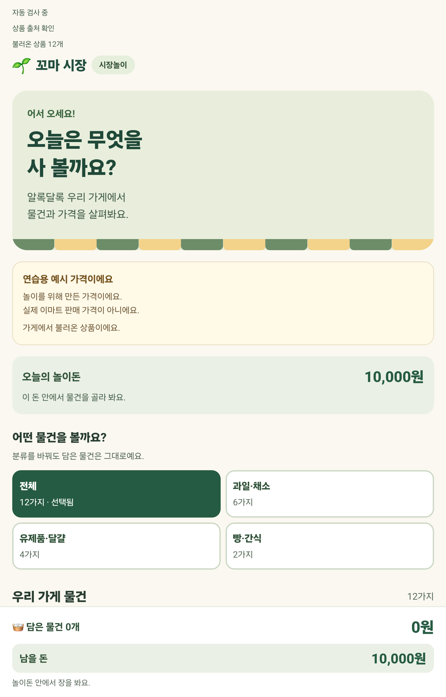
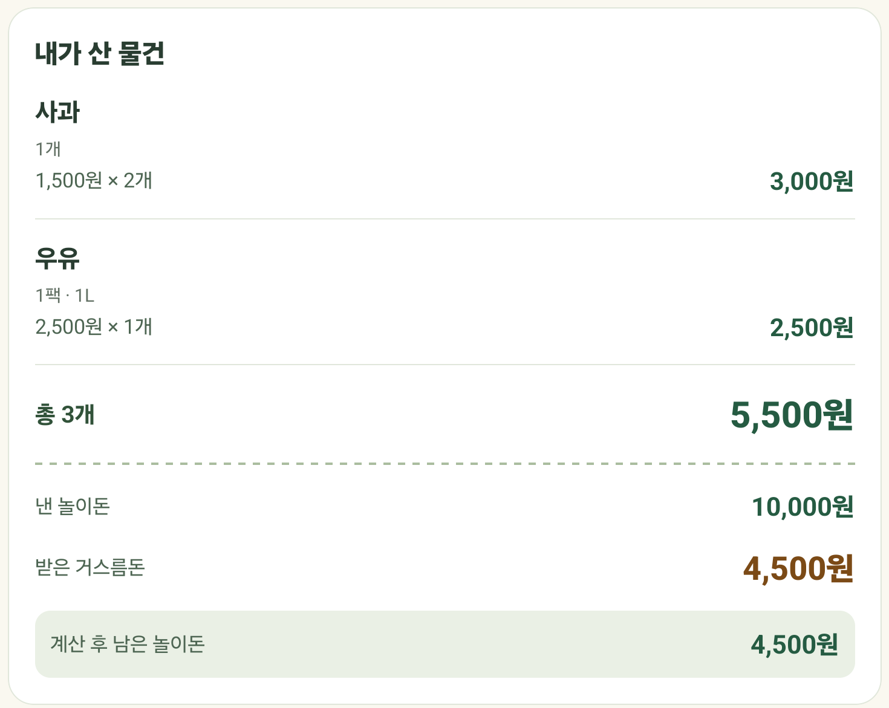
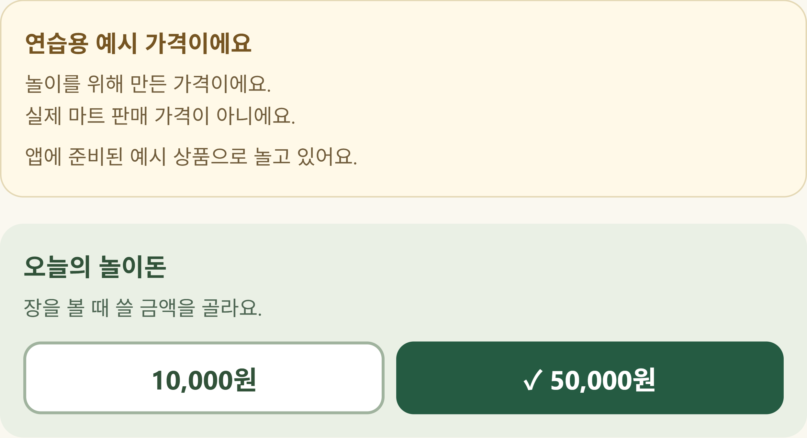
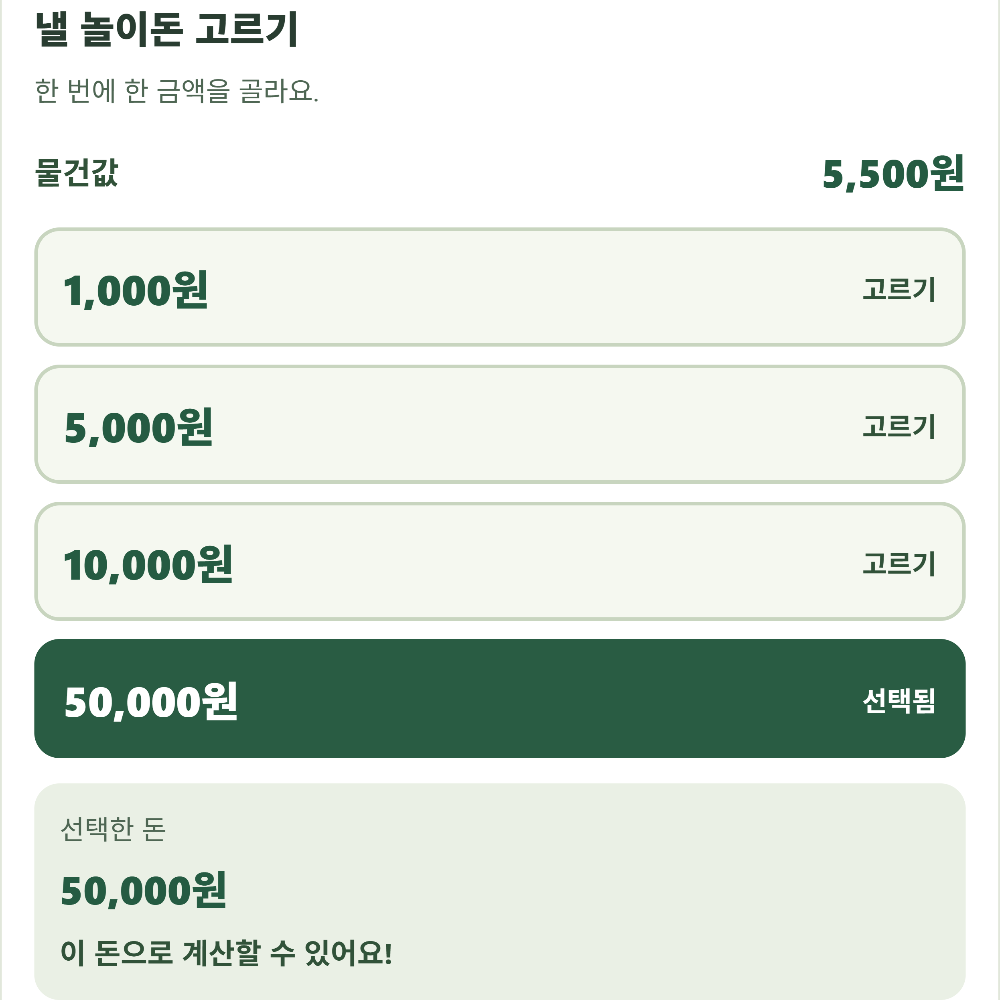
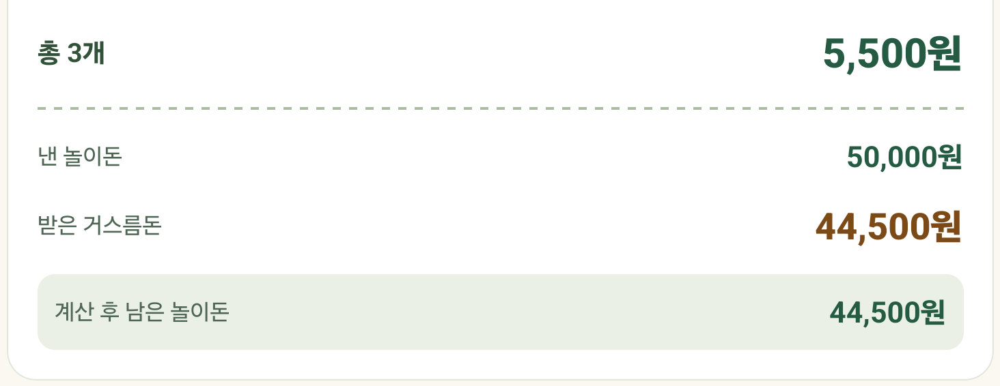
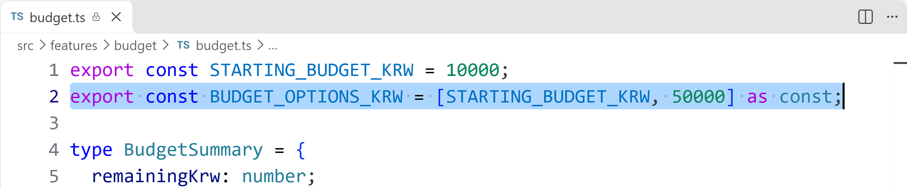
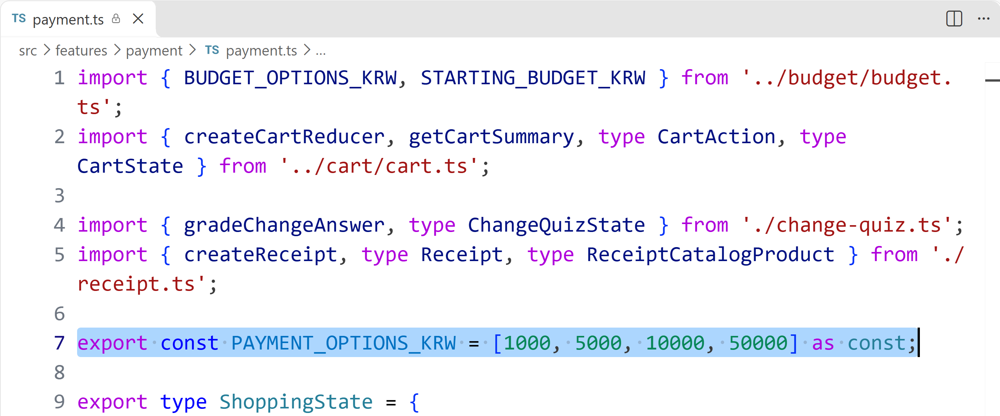

# 20장 내 기기에서 장보고 영수증까지 확인하기

이제 PC가 아니라 기기의 아이콘에서 앱을 연다. 사과 두 개와 우유 한 팩을 담아 5,500원을 만들고, 놀이돈 10,000원을 낸 뒤 거스름돈 4,500원을 맞힌다. 이어 인터넷을 끈 상태에서도 앱에 들어 있는 예시 상품으로 같은 놀이를 끝내 본다.

20.1~20.6절에서는 19장에서 **본인 계정으로 만든 검사 APK**를 연다. 20.7절에서는 이 판의 20장 소스로 실행해 50,000원 예산과 지폐를 고른다. 앱 이름·패키지·설치 버전은 19장의 기록으로 확인한다. PC에서 코드부터 보고 싶다면 ZIP을 푼 예제 폴더의 터미널에서 `ls`로 `start.mjs`를 찾고 `node start.mjs 20`을 실행한다. `work/ch20/apps/mobile`에 이 책의 20장 완성 참고본이 생긴다. `App.tsx`는 앱의 시작 파일이고 `src`에는 상품·장바구니·영수증 코드가 있다.

**PC에서 완성된 앱을 먼저 보려면** VS Code 탐색기의 `work/ch20/apps/mobile`에서 **mobile을 오른쪽 클릭 → 통합 터미널에서 열기**를 누른다. PowerShell에 `npm.cmd ci`를 입력해 처음 한 번 설치하고, 설치가 끝나면 `npm.cmd run web`을 입력한다. 브라우저에서 **예시 상품으로 바로 놀이하기**를 누른다. Git Bash에서는 `npm ci`와 `npm run web`을 쓴다. 첫 실행 화면은 2.6절의 그림 2-23~2-28에, 처음 푼 ZIP에서 바로 실행하는 명령은 [부록 C.1](#appC-s1)에 있다.

PC에서는 Tab으로 **예시 상품으로 바로 놀이하기** 버튼을 찾아 Enter를 눌러 보자. 이 판의 20장에서는 상품 12개가 열리면서 키보드 초점이 **오늘은 무엇을 사 볼까요?** 제목으로 이동한다. 초점을 확인하는 방법은 [16.5절](#ch16-s5)에 있다. Android에서 **TalkBack 설정 열기** 버튼을 사용하고 소리로 확인하는 방법은 [16.6절](#ch16-s6)에서 연습한다.

개발 당시의 정식 패키지 화면과 독자의 검사 앱은 아이콘의 검사 배지가 다를 수 있지만 이 장에서 확인하는 예시 상품의 가격과 놀이 규칙은 같다. 그림은 실제 개발 검증에서 얻은 화면이며, 각 그림의 캡션에 당시 범위를 적었다.

## 20.1 설치한 앱에서 예시 상품 12개를 확인하고 빈 장바구니에서 시작하기

### PC 개발 서버를 끈다

19장에서 `npm start`를 켜 두었다면 그 터미널에서 Ctrl+C로 종료한다. 웹 미리보기 창만 닫지 말고 서버가 있던 터미널이 명령을 입력할 수 있는 상태인지 확인한다.

기기의 앱 목록에서 검사 배지가 붙은 **꼬마 시장 검사**를 누른다. Expo Go 아이콘이나 브라우저 주소를 누르는 단계가 아니다. 시작 화면을 지나 놀이 화면 또는 상품 연결 안내가 나타나야 한다.

| 첫 화면 | 사용할 경로 |
| --- | --- |
| 공개 예시 목록을 불러옴 | 출처를 읽고 바로 진행 |
| 목록을 불러오는 중 | 기다리거나 **예시 상품으로 바로 놀이하기** |
| 연결 설정 없음·조회 실패·빈 목록 | **예시 상품으로 바로 놀이하기** |
| QR 또는 개발 서버 연결 화면 | 잘못된 앱을 열었는지 19장 설치를 확인 |

인터넷이 연결되어 있다고 반드시 서버 상품을 쓰는 것은 아니다. 사용자에게 표시된 출처 문구를 읽는다.

- **가게에서 불러온 상품이에요.** — 공개 상품 목록을 읽은 경로.
- **앱에 준비된 예시 상품으로 놀고 있어요.** — APK에 들어 있는 예시를 선택한 경로.

두 경로의 예시 가격이 같더라도 출처는 따로 기록한다. 실제 매장 가격을 불러왔다고 표현하지 않는다.

### 시작 상태를 맞춘다

1. 영수증이 열려 있다면 **다시 장보기**를 누른다.
2. 장바구니가 남아 있다면 **장바구니 비우기**를 누른다.
3. 분류에서 **전체**를 선택한다.
4. 상품이 12가지인지 확인한다.
5. 놀이돈이 10,000원인지 확인한다.
6. 담은 물건 0개·합계 0원인지 확인한다.

분류별 개수는 과일·채소 6가지, 유제품·달걀 4가지, 빵·간식 2가지다. 분류는 보이는 목록을 바꾸는 기능이므로 다른 분류로 이동해도 장바구니가 사라져서는 안 된다.



**그림 20-1.** 공개 예시 상품 12개를 불러온 설치형 검사 APK. 놀이돈 10,000원과 빈 장바구니가 보인다. 상품 카드의 본문은 아래로 스크롤해 확인한다. 이 화면만으로 오프라인 동작을 판단하지 않는다.

## 20.2 사과 두 개와 우유 한 팩을 담아 세 개·5,500원 확인하기

전체 목록 또는 **과일·채소**에서 사과를 찾는다. 예시의 사과는 1개에 1,500원이다.

1. 사과의 **+ 담기**를 한 번 누른다.
2. 수량이 1개로 바뀌는지 확인한다.
3. 같은 카드의 **+ 버튼**을 한 번 더 누른다.
4. 사과가 2개인지 확인한다.
5. **유제품·달걀** 분류를 선택한다.
6. 우유 1팩·1L, 2,500원을 찾고 **+ 담기**를 한 번 누른다.
7. 장바구니 부분까지 아래로 스크롤한다.

| 상품 | 단가 | 수량 | 품목 금액 |
| --- | ---: | ---: | ---: |
| 사과 | 1,500원 | 2개 | 3,000원 |
| 우유 | 2,500원 | 1개 | 2,500원 |
| **합계** | | **3개** | **5,500원** |

앱에서 ‘2가지’와 ‘3개’가 함께 보일 수 있다. ‘2가지’는 서로 다른 품목 수이고 ‘3개’는 담은 총수량이다. 사과를 두 번 담았다고 품목이 세 종류가 되는 것은 아니다.

돈을 고르기 전의 예산 잔액은 다음과 같다.

```text
오늘의 놀이돈 10,000원
물건값       5,500원
남을 돈      4,500원
```

합계가 다르면 바로 답 입력으로 넘어가지 않는다. 장바구니의 사과 수량과 우유 수량부터 확인한다. 우유가 두 개라면 2,500원이 한 번 더 더해진다. 품목의 **빼기**는 해당 품목 전체를 빼는 버튼이고, 상품 카드의 **− 버튼**은 한 개를 줄이므로 목적에 맞게 누른다.

**장바구니를 담아 둔 채 TalkBack 설정을 다녀온다.** 장보기 화면 맨 위로 올라가 **TalkBack 설정 열기**를 누른다. 기기의 **접근성 → TalkBack**에서 사용 여부를 선택한다. TalkBack을 켠 상태에서는 버튼이나 스위치를 한 번 탭해 선택하고 두 번 탭해 실행한다. **뒤로 가기**로 앱이 보일 때까지 돌아온다. 버튼 아래의 **화면 읽기 켜짐** 또는 **화면 읽기 꺼짐**이 현재 상태와 맞는지, 장바구니의 **3개·5,500원**이 그대로인지 확인한다. 실습을 위해 바꿨다면 같은 경로에서 원래 상태로 돌린다.

**연습:** 사과를 한 개 줄여 합계가 4,000원이 되는지 확인한 뒤 다시 한 개 담아 5,500원으로 복구한다. 화면 숫자를 외우는 대신 품목 금액을 더해 확인한다.

## 20.3 놀이돈 10,000원을 선택하고 거스름돈 4,500원을 입력해 영수증 받기

장바구니 아래에서 낼 놀이돈을 고른다. 19장 APK에서는 1,000원·5,000원·10,000원 중 한 장을 선택한다. 20장 완성본에는 50,000원권도 보인다. 이 절에서는 기본 예산 10,000원으로 진행한다.

### 부족한 돈의 안내를 먼저 읽는다

5,000원을 한 번 선택해 본다. 물건값이 5,500원이므로 낼 돈이 500원 모자란다. 이 상태에서 계산을 완료할 수 없어야 한다.

이제 10,000원 버튼을 누른다. 선택 표시가 바뀌고 거스름돈 맞히기를 할 수 있어야 한다. 5,000원과 10,000원이 합쳐져 15,000원이 된 것으로 해석하지 않는다.

10,000원을 고르면 정답을 먼저 보지 않고 계산하도록 예산의 남을 돈도 가려질 수 있다. 값이 없어졌다는 오류가 아니라 퀴즈에서 답을 드러내지 않기 위한 동작이다.

### 정답 입력과 오답 수정

1. 거스름돈 입력칸을 누른다.
2. 숫자 키보드에서 먼저 `4000`을 입력한다.
3. 확인 버튼이 키보드에 가려졌다면 화면을 스크롤해 찾는다.
4. **정답 확인**을 누르고 오답 안내를 읽는다.
5. 입력값을 고치거나 **다시 풀기**를 눌러 `4500`을 입력한다.
6. **정답 확인**을 다시 누른다.

입력은 `4,500원`이라는 문장 대신 숫자 `4500`으로 한다. 정답은 다음 관계다.

```text
낸 놀이돈 10,000원 − 물건값 5,500원 = 거스름돈 4,500원
```

정답 안내 후에는 받을 거스름돈과 계산 관계를 확인한다. **계산 완료**를 눌러 영수증으로 이동한다.

### 영수증을 한 줄씩 확인한다



**그림 20-2.** 2026년 11월 18일 실제 Android 정식 앱 검증에서 얻은 영수증의 금액 영역. 사과 두 개와 우유 한 팩의 합계는 5,500원이며, 놀이돈 10,000원을 내고 받은 거스름돈은 4,500원이다. 상단 알림과 하단 개인 앱 영역을 제외한 원본 화면의 일부다.

품목별 단위와 담은 수량을 구분해 읽는다. 사과 아래의 ‘1개’는 상품의 판매 단위이고 `1,500원 × 2개`가 실제 담은 수량이다. 우유는 ‘1팩·1L’ 단위로 한 개를 담았다.

| 영수증의 확인 항목 | 기대값 |
| --- | --- |
| 사과 | 1,500원 × 2개 = 3,000원 |
| 우유 | 2,500원 × 1개 = 2,500원 |
| 총수량 | 3개 |
| 합계 | 5,500원 |
| 낸 놀이돈 | 10,000원 |
| 받은 거스름돈 | 4,500원 |
| 계산 후 남은 놀이돈 | 4,500원 |

이번 예에서는 예산도 10,000원이고 낸 돈도 10,000원이므로 거스름돈과 남은 놀이돈이 같다. 두 값이 항상 같은 개념은 아니다. 8장에서 살펴본 다른 물건값과 다른 낼 돈을 떠올려 보자.

**예상과 다른 경우:** 영수증의 수량이 다르면 완료 전에 장바구니가 바뀌지 않았는지 확인한다. 정답을 맞힌 뒤 상품이나 낼 돈을 바꾸면 예전 정답을 그대로 사용하지 않도록 퀴즈가 초기화된다. 계산 완료 시점의 장바구니를 다시 확인해야 한다.

## 20.4 다시 장보기로 장바구니와 놀이돈 초기화하기

영수증 아래의 **다시 장보기**를 누른다. 상품 선택 화면으로 돌아오면 다음 상태를 확인한다.

| 항목 | 새 놀이의 상태 |
| --- | --- |
| 장바구니 | 비어 있음 |
| 합계 | 0원 |
| 놀이돈 | 10,000원 |
| 선택한 돈 | 없음 |
| 입력한 답·채점 결과 | 없음 |
| 분류 | 전체 |
| 이전 영수증 | 표시되지 않음 |

출처에 따라 목록을 다시 가져오는 방식은 다를 수 있다. 서버 목록을 사용했다면 다시 조회하는 동안 로딩이 보일 수 있고, 내장 예시를 사용했다면 같은 예시로 새 놀이를 시작한다. 어느 경로든 이전 수량과 답이 다음 놀이에 남지 않아야 한다.

현재 영수증은 앱 메모리에 있다. 공유 파일이나 구매 내역으로 영구 저장하는 기능은 없다. 다시 장보기나 앱 프로세스 재시작 뒤 사라지는 것은 현재 구현의 규칙이다. 남기고 싶은 실습 결과는 본인이 화면을 캡처하고 기록지에 적는다.

한 번 더 점검하려면 사과 한 개만 담고 놀이돈 5,000원을 선택해 보자. 거스름돈은 3,500원이고 계산 후 전체 놀이돈 잔액은 8,500원이다. 이 비교를 통해 거스름돈과 예산 잔액을 구분할 수 있다. 확인 뒤 다시 장보기로 초기화한다.

## 20.5 앱을 닫고 네트워크를 끈 뒤 내장 예시로 한 번 더 장보기

이번에는 PC 개발 서버뿐 아니라 인터넷 연결도 끈다. 검사를 마친 뒤 원래 상태로 복구할 수 있도록 먼저 기기의 설정을 적는다.

| 설정 | 검사 전 내 상태 |
| --- | --- |
| Wi-Fi | 켜짐 / 꺼짐 |
| 모바일 데이터 | 켜짐 / 꺼짐 / SIM 없음 |
| 비행기 모드 | 켜짐 / 꺼짐 |
| VPN·테더링·유선 인터넷 등 별도 연결 | 있음 / 없음 |
| USB로 PC에 연결 중 | 예 / 아니요 |

### 이번 실행을 정확히 구분한다

19장에서 이미 설치하고 실행했으므로 이 절은 **설치 앱을 오프라인에서 다시 실행하는 검사**다. 새로 설치한 APK의 최초 실행을 증명하는 검사는 아니다. 이전 자료를 모두 지우거나 앱을 제거하지 않아도 이번 목표를 확인할 수 있다.

1. 장바구니나 영수증 기록이 필요하다면 먼저 화면을 남긴다.
2. 앱 아이콘을 길게 눌러 **앱 정보**를 연다.
3. **강제 종료**를 눌러 앱 프로세스를 끝낸다. **데이터 삭제**나 **제거**를 누르지 않는다.
4. USB 케이블을 분리한다. PC가 전달하는 개발 연결을 함께 배제하기 위해서다.
5. 기기 설정에서 Wi-Fi를 끈다.
6. SIM을 사용하는 기기라면 모바일 데이터도 끈다. SIM 없는 태블릿은 Wi-Fi만 해당할 수 있다.
7. VPN·테더링·유선 어댑터 등 다른 인터넷 경로가 있다면 이번 검사 동안 연결을 끊는다.
8. 기기의 아이콘으로 **꼬마 시장 검사**를 다시 연다.

비행기 모드를 켰다고 Wi-Fi까지 반드시 꺼졌다고 가정하지 않는다. 기기마다 비행기 모드에서 Wi-Fi를 다시 켤 수 있다. 실제 Wi-Fi·데이터 표시를 확인한다. 이 절은 통신 설정을 배우는 실습이므로 전용 기기의 업무 연결이나 다른 사람의 연결을 임의로 바꾸지 않는다.

### 예시를 직접 선택한다

앱이 목록을 불러오려 하면 기다리거나 **예시 상품으로 바로 놀이하기**를 누른다. 연결 실패 안내에서 같은 버튼을 찾을 수도 있다. 내장 예시를 선택한 뒤 출처가 **앱에 준비된 예시 상품으로 놀고 있어요.**로 표시되는지 확인한다.

인터넷 연결이 없는 상태에서 다음 순서를 반복한다.

1. 예시 상품이 12가지인지 확인한다.
2. 사과 두 개와 우유 한 팩을 담는다.
3. 3개·합계 5,500원을 확인한다.
4. 놀이돈 10,000원을 고른다.
5. `4500`을 입력하고 정답을 확인한다.
6. 계산을 완료하고 같은 금액의 영수증을 확인한다.
7. **다시 장보기**로 빈 장바구니를 확인한다.

네트워크가 없어도 앱에 포함된 예시와 계산 로직으로 놀이를 마칠 수 있어야 한다. 이 결과는 실제 가격을 오프라인에 저장했다는 의미가 아니다. 서버의 최신 가격을 다시 가져온 결과도 아니다.

### 오프라인 검사에서 자주 혼동하는 것

| 관찰 | 의미 또는 조치 |
| --- | --- |
| Expo Go가 프로젝트를 못 엶 | 설치 검사 APK를 열었는지 확인 |
| 로딩 중 예시 선택이 보임 | 기다리지 않고 선택해도 정상 |
| 내장 예시가 서버 목록과 같음 | 출처 문구로 경로를 구분 |
| 다시 장보기 후 서버 로딩 없음 | 내장 예시 경로에서는 정상 |
| 앱을 재시작하자 수량이 사라짐 | 현재 메모리 상태 초기화 규칙 |
| 오프라인인데 웹 페이지가 열림 | 다른 인터넷 경로가 남았는지 확인 |

개발에서는 새 패키지·미실행 상태·네트워크 감시·파일 지문까지 확인한 첫 실행 자동 검사를 별도로 수행했다. 그 기록과 독자의 수동 재실행 검사는 범위가 다르다. 본인이 수행한 범위만 결과로 적는다.

## 20.6 연결 설정을 복구하고 결과 화면을 개발 기록에 남기기

검사가 성공했어도 연결을 원래대로 돌리는 일까지 마쳐야 한다.

1. 검사 전 Wi-Fi가 켜져 있었다면 다시 켠다.
2. 검사 전 모바일 데이터가 켜져 있었다면 다시 켠다.
3. 원래 꺼져 있던 연결은 임의로 켜지 않는다.
4. 비행기 모드·VPN·별도 어댑터를 바꿨다면 원래 상태로 복구한다.
5. 기기에서 연결 상태를 다시 읽고 기록지와 대조한다.
6. 필요한 경우 USB를 다시 연결한다.

휴대전화와 SIM 없는 태블릿을 모두 갖고 있더라도 한 기기의 결과를 다른 기기의 결과로 대신하지 않는다. 모델과 Android 버전을 따로 적는다. 화면 크기·글자 확대·키보드·TalkBack은 각각 확인한 항목에만 표시한다.

### 독자 결과 기록지

| 항목 | 내 결과 |
| --- | --- |
| 검사 날짜·시각 | |
| 기기 모델·Android 버전 | |
| 앱 이름·본인 패키지 | |
| 표시 버전·versionCode | |
| APK 빌드 ID 또는 저장한 파일명 | |
| PC 개발 서버 종료 확인 | |
| 첫 놀이의 상품 출처 | |
| 사과 2개·우유 1개·합계 5,500원 | |
| 놀이돈 10,000원·거스름돈 4,500원 | |
| 영수증의 품목·수량·금액 | |
| 다시 장보기 초기화 | |
| USB 분리·Wi-Fi/데이터 차단 확인 | |
| 내장 예시로 오프라인 재실행·영수증 | |
| 통신 설정 복구 | |
| 문제와 해결한 방법 | |

결과 화면을 책이나 공개 저장소에 싣는 경우 상단 알림, 기기 번호, 계정명, 개인 앱 목록이 함께 들어가지 않았는지 확인한다. 앱 화면이 보이는 영역만 사용하고 원본은 개인 보관한다. 자신이 캡처하지 않은 그림을 자신의 기기 결과라고 적지 않는다.

### 마지막 확인

- [ ] PC 서버를 켜지 않고 기기의 앱 아이콘으로 실행했다.
- [ ] 예시 가격과 실제 판매 가격을 구분하는 안내를 읽었다.
- [ ] 사과 두 개와 우유 한 팩으로 3개·5,500원을 만들었다.
- [ ] 오답을 고쳐 4,500원을 맞히고 영수증을 확인했다.
- [ ] 새 놀이에서 수량·돈 선택·답·분류가 초기화되었다.
- [ ] 인터넷을 끄고 내장 예시로 같은 놀이를 끝냈다.
- [ ] 검사 전 연결 상태로 복구했다.
- [ ] 본인 기기·앱 버전·실제 결과를 기록했다.

## 20.7 50,000원 예산과 지폐를 골라 영수증까지 확인하기

**오늘의 놀이돈**은 이번 장보기에 쓸 수 있는 전체 예산이다. **낼 놀이돈 고르기**에서는 물건값을 치를 지폐 한 장을 선택한다. 이번에는 예산과 지폐를 각각 50,000원으로 골라 본다. 사과 두 개와 우유 한 팩을 사면 물건값은 5,500원이고, 50,000원권을 낸 손에 돌아오는 돈은 44,500원이다.

### 20장 완성본을 열고 실행하기

1. 이 판의 `market-lab.zip`을 새 폴더에 푼다. VS Code에서 **파일 → 폴더 열기**로 `start.mjs`가 보이는 폴더를 열고, **터미널 → 새 터미널**에서 `node start.mjs 20`을 입력한다. 이번 판에서 이미 20장을 꺼냈다면 다음 단계로 간다. 이전 ZIP이나 19장에서 설치한 APK를 쓰고 있다면 [부록 C.2](#appC-s2)의 ‘50,000원 선택이 보이지 않을 때’에서 같은 완성본을 받을 수 있다.
2. **파일 → 폴더 열기**에서 **work → ch20 → apps → mobile**을 열고 **터미널 → 새 터미널**을 누른다. 아래 PowerShell 입력 줄의 끝이 `work\ch20\apps\mobile>`인지 확인한다. 예제 최상위 폴더에 머물러 있다면 그 터미널에서 `cd .\work\ch20\apps\mobile`을 먼저 입력한다. 왼쪽에 `App.tsx`와 `package.json`이 보이는 이 위치에서 앱 명령을 실행한다.
3. 이 폴더에서 처음 한 번 `npm.cmd ci`를 입력한다. PC 브라우저로 실습하려면 이어서 `npm.cmd run web`을 입력한다. Android에서는 `npm.cmd start`를 입력하고 같은 Wi-Fi에 연결한 기기의 **Expo Go → Scan QR**로 20장의 QR을 읽는다. 16장 서버가 같은 포트를 사용하고 있으면 16장 터미널에서 `Ctrl+C`를 누른 뒤 20장 서버를 시작한다.
4. 상품 준비 화면에서 **예시 상품으로 바로 놀이하기**를 누른다. 장보기가 이미 열렸다면 바로 예산 버튼을 찾는다. 예시 상품으로 장을 열었을 때 **연습용 예시 가격이에요** 안의 둘째 줄에서 ‘실제 마트 판매 가격이 아니에요.’를 확인한다. 그 아래 **오늘의 놀이돈**에 10,000원과 50,000원 두 버튼이 보이면 이번 실습에 맞는 판이다.

### 오늘의 놀이돈을 50,000원으로 바꾸기

처음에는 10,000원에 선택 표시(✓)가 있다. **오늘의 놀이돈 → 50,000원**을 눌러 표시가 옮겨가는지 본다. 장바구니가 비어 있어도 예산은 고를 수 있다. 아래로 내려가 사과의 **+ 담기**를 누른다. 같은 자리에 나타난 `+` 버튼을 한 번 더 누르고, 우유의 **+ 담기**를 한 번 누른다. 장바구니에서 총 3개, 합계 5,500원을 확인한다.



그림 20-3. PC 웹 미리보기에서 오늘의 놀이돈으로 50,000원이 선택된 화면. 이 버튼은 장바구니 전체를 살 수 있는지 판단할 예산을 바꾼다.

### 낼 놀이돈에서 50,000원권 고르기

장바구니 아래 **낼 놀이돈 고르기**까지 내려간다. 물건값 5,500원을 확인하고 1,000원·5,000원·10,000원·50,000원 중 **50,000원**을 누른다. 해당 버튼의 **선택됨** 표시와 아래 **선택한 돈 50,000원**을 확인한다. 기본 예산 10,000원일 때의 50,000원권에는 ‘50,000원 예산에서 쓸 수 있어요.’라는 안내가 붙는다. 버튼을 누를 수 없으면 위쪽에서 예산을 50,000원으로 골랐는지, 물건을 한 개 이상 담았는지, 물건값이 예산 안인지 차례로 확인한다.



그림 20-4. PC 웹 미리보기의 낼 놀이돈에서 50,000원을 골랐다. 이 지폐 한 장을 기준으로 거스름돈 문제가 만들어진다.

**거스름돈 맞히기**에 쉼표 없이 `44500`을 입력하고 **정답 확인 → 계산 완료**를 누른다. 영수증에서 총 3개·합계 5,500원, 낸 놀이돈 50,000원, 받은 거스름돈 44,500원, 계산 후 남은 놀이돈 44,500원을 차례로 읽는다. **다시 장보기**를 누르면 장바구니가 비고 기본 예산 10,000원으로 새 놀이를 시작한다.



그림 20-5. 갤럭시 탭(Android 14)에서 확인한 정식 앱 영수증의 금액 영역. 사과 두 개와 우유 한 팩을 샀다. 예산과 낸 돈이 이번에는 같아서 두 결과가 모두 44,500원이다.

**PC에서 초점도 확인해 보자.** 같은 50,000원권 실습에서 먼저 `1`을 입력해 오답을 확인하고 **다시 풀기** 버튼을 누른다. 입력칸을 다시 클릭하지 않고 `44500`을 입력한 뒤 정답을 확인한다. 초점은 정답 안내로 이동한다. **계산 완료** 버튼을 누르면 영수증 제목으로, **다시 장보기** 버튼을 누르면 상품 화면 제목으로 이어진다. Chrome에서 실제 초점 위치를 확인하는 한 줄 명령은 [16.5절](#ch16-s5)에 있다.

### 같은 장바구니에서 낼 지폐만 바꿔 보기

두 번째 놀이에서도 예산 50,000원을 선택하고 같은 물건을 담는다. 이번에는 낼 돈으로 **10,000원**을 고른다. `4500`을 입력해 정답을 확인하고 영수증을 연다. 아래 두 거래에서 **받은 거스름돈**과 **계산 후 남은 놀이돈**을 각각 비교한다.

| 오늘의 놀이돈 | 물건값 | 낸 놀이돈 | 받은 거스름돈 | 계산 후 남은 놀이돈 |
|---:|---:|---:|---:|---:|
| 50,000원 | 5,500원 | 50,000원 | 44,500원 | 44,500원 |
| 50,000원 | 5,500원 | 10,000원 | 4,500원 | 44,500원 |

거스름돈은 **낸 놀이돈 − 물건값**, 예산 잔액은 **오늘의 놀이돈 − 물건값**이다. 또 한 번 장을 열어 지폐와 답을 입력한 뒤, 계산을 완료하기 전에 위쪽의 예산을 바꿔 보자. 담은 물건은 남고, 낼 지폐와 퀴즈 입력은 초기화된다. 금액을 잘못 골랐어도 물건을 처음부터 다시 담을 필요가 없다.

### VS Code에서 50,000원 버튼 두 개 직접 추가하기

이제 앞에서 눌렀던 두 버튼을 코드로 만들어 보자. 20장 완성본에는 금액 목록을 버튼으로 그리는 코드가 있다. 연습용 사본에서 50,000원을 잠시 빼고, 두 파일에 값을 하나씩 다시 입력하면 어느 파일이 어느 화면을 바꾸는지 볼 수 있다.

**준비. 연습의 시작 화면 만들기.** 앞에서 새로 푼 20장을 연습용으로 쓰면 된다. 작업 중인 파일을 보관하려면 개정 ZIP을 다른 빈 폴더에 풀고 이 절 첫머리의 절차로 20장을 연다. VS Code 왼쪽 탐색기 맨 위가 `mobile`이고 `App.tsx`와 `package.json`이 보이는지 확인한다. 그 폴더의 터미널에서 실행한 `npm.cmd run web`은 켜 둔다. 이제부터 두 줄의 TypeScript 코드는 가운데 파일 편집기에 입력한다.

1. `Ctrl+P`를 누르고 `src/features/budget/budget.ts`를 입력한 뒤 Enter를 누른다. **2행 전체**를 아래 한 줄로 바꾸고 `Ctrl+S`로 저장한다. 1행의 기본 예산은 그대로 둔다.

```ts
export const BUDGET_OPTIONS_KRW = [STARTING_BUDGET_KRW] as const;
```

2. 같은 방법으로 `src/features/payment/payment.ts`를 연다. **7행 전체**를 아래 한 줄로 바꾸고 `Ctrl+S`로 저장한다.

```ts
export const PAYMENT_OPTIONS_KRW = [1000, 5000, 10000] as const;
```

3. 앱을 띄운 **브라우저**에서 `Ctrl+R`로 새로 고친다. 상품 준비 화면이 뜨면 **예시 상품으로 바로 놀이하기**를 누른다. **오늘의 놀이돈**에는 10,000원 하나, 아래 **낼 놀이돈 고르기**에는 1,000원·5,000원·10,000원 세 개가 보이면 출발점이다.

**1. 오늘의 놀이돈에 50,000원 추가하기.** VS Code에서 `budget.ts` 탭을 누른다. 2행의 닫는 대괄호 `]` 바로 앞에 `, 50000`을 입력하고 `Ctrl+S`를 누른다. 쉼표는 두 선택지를 나누는 기호다. 금액은 다섯 자리 숫자 `50000`으로 쓴다. 저장 후의 1~2행을 대조한다.

```ts
export const STARTING_BUDGET_KRW = 10000;
export const BUDGET_OPTIONS_KRW = [STARTING_BUDGET_KRW, 50000] as const;
```



그림 20-6. `budget.ts`의 1~2행. 코드에는 쉼표 없이 `50000`을 적고, 화면에서는 `50,000원`으로 표시한다.

브라우저 위쪽 **오늘의 놀이돈**에서 새로 생긴 50,000원을 눌러 선택 표시가 옮겨가는지 본다. 아래쪽 **낼 놀이돈 고르기**에는 여전히 지폐가 세 종류다. 예산 버튼 하나를 먼저 완성했다.

`App.tsx`를 열고 `Ctrl+F`로 `BUDGET_OPTIONS_KRW.map`을 찾는다. 배열의 값마다 버튼을 하나 만든다. 같은 블록의 293행에서 누른 금액을 보낸다.

```tsx
onPress={() => dispatch({ type: 'select-budget', amountKrw })}
```

**2. 낼 놀이돈에도 50,000원권 추가하기.** VS Code에서 `payment.ts`로 돌아간다. 7행의 닫는 대괄호 `]` 바로 앞에 `, 50000`을 입력하고 `Ctrl+S`로 저장한다. 완성한 줄은 다음과 같다.

```ts
export const PAYMENT_OPTIONS_KRW = [1000, 5000, 10000, 50000] as const;
```



그림 20-7. `payment.ts`의 7행. 화면에서 고를 수 있는 지폐 한 장의 후보를 이 배열에 적는다.

브라우저를 새로 고쳐 예시 상품을 열고 사과 두 개와 우유 한 팩을 담는다. **낼 놀이돈 고르기**의 네 번째 칸에 50,000원이 보인다. 기본 예산 10,000원에서는 이 지폐를 누를 수 없다. 위쪽 **오늘의 놀이돈**에서 50,000원을 고른 뒤 아래쪽에서 50,000원권을 누른다. 그림 20-4의 ‘선택됨’ 표시를 확인한다.

같은 파일에서 `isAvailablePayment`를 찾는다. 42~46행은 선택한 금액이 배열에 있고 현재 예산 이하인지 검사한다.

```ts
function isAvailablePayment(amountKrw: number | null, budgetKrw: number): amountKrw is number {
  return amountKrw !== null
    && amountKrw <= budgetKrw
    && PAYMENT_OPTIONS_KRW.some((option) => option === amountKrw);
}
```

같은 파일에서 `select-budget`을 검색해 66행의 조건으로 간다. 72행의 `...state`는 방금 담은 장바구니를 보존한다. 다른 예산을 눌렀을 때 새 예산을 기록하고 이전 지폐와 답을 지우는 줄이다.

```ts
return { ...state, budgetKrw: action.amountKrw, selectedPaymentKrw: null, quiz: createUnansweredQuiz() };
```

이어 `src/components/payment-selector.tsx`의 62~66행을 본다. 화면에서도 같은 제한을 적용해 예산을 넘는 지폐에 안내를 붙인다.

```ts
const exceedsBudget = amountKrw > budgetKrw;
const disabled = !canChooseMoney || exceedsBudget;
```

**3. 영수증 확인하고 검사하기.** 브라우저에서 `44500`을 입력하고 **정답 확인 → 계산 완료**를 누른다. 그림 20-5처럼 물건값 5,500원과 거스름돈 44,500원이 보이는지 확인한다.

`src/features/payment/receipt.ts`에서 `changeAmountKrw: paidAmountKrw`와 `remainingBudgetKrw: startingBudgetKrw`를 찾으면 두 뺄셈을 볼 수 있다. VS Code에서 **터미널 → 새 터미널**을 열고 `mobile` 폴더에서 아래 명령을 한 줄씩 실행한다.

```powershell
npm.cmd run typecheck
npm.cmd test
```

첫 명령이 오류 없이 끝나면 두 번째 명령의 결과에서 `50000원 예산으로 5500원어치를 사면`으로 시작하는 검사가 통과했는지 확인한다.

처음의 상품 배열은 버튼과 상태, 계산 규칙, 데이터 읽기, 화면 배치와 접근성, 검사와 설치를 거쳐 내 기기에서 실행되는 앱이 되었다. 다음 기능을 더할 때도 작은 계산부터 확인하고, 사용자가 누르는 전체 흐름을 검사한 뒤 새 APK로 설치해 확인한다.
